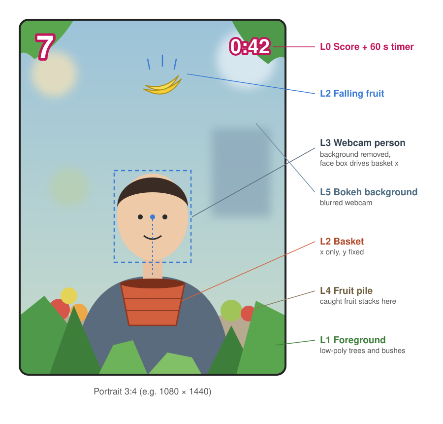
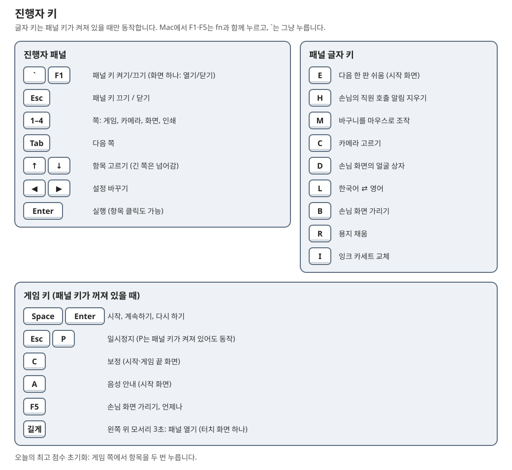
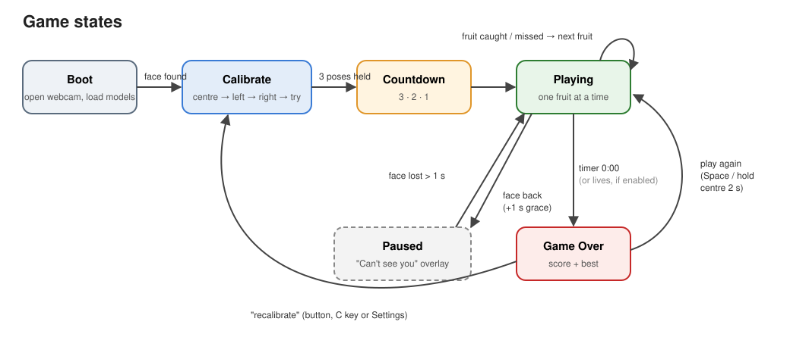
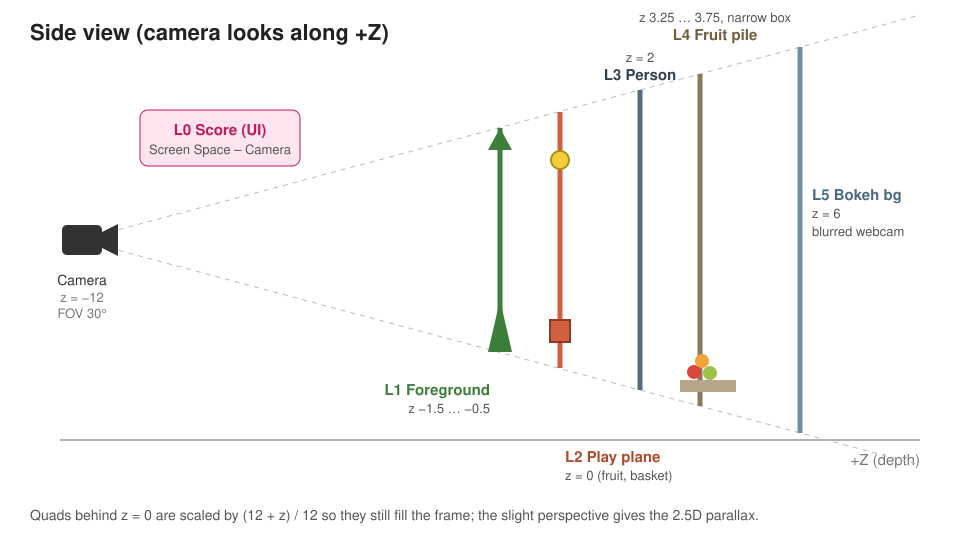
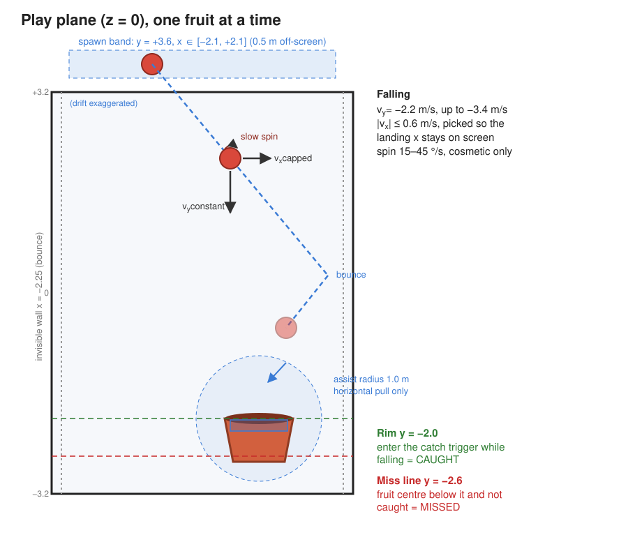
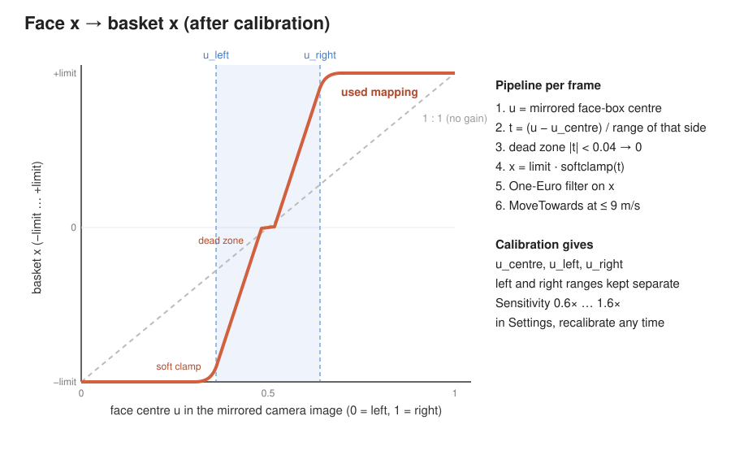
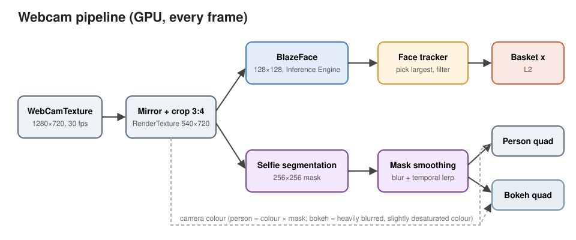
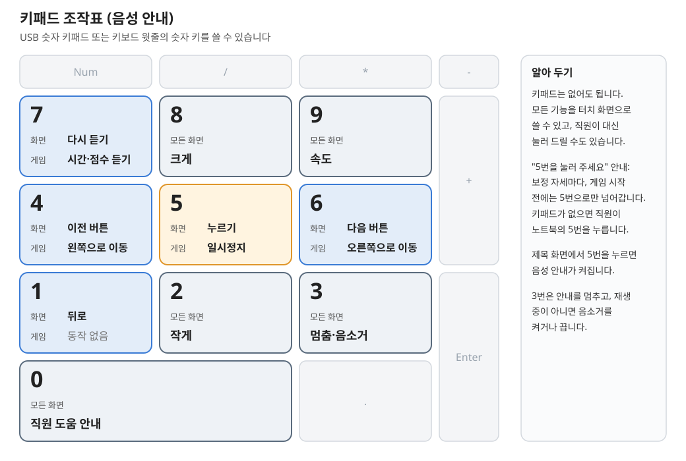

# 지스트의 과일 사진가게 (GIST Fruit Photo Shop) — 설계·구현 문서

> **이 문서는 영어 원문 [`DESIGN.md`](DESIGN.md)의 한국어 번역입니다.** 원문이 기준이며, 번역은 원문을 따라 갱신합니다. 두 문서의 내용이 다르면 원문을 따르십시오. (번역 기준일: 2026-11-10)

**접근성을 가장 먼저 생각해 만든 인터랙티브 포토부스**입니다. 움직일 수 있는 범위나 시력, 읽기 능력과 관계없이 부스 앞에 온 누구나 할 수 있습니다. 방문객은 카메라 앞에 서거나 앉아서 머리 움직임만으로 1분짜리 과일 받기 게임을 합니다. 바구니가 얼굴을 따라 좌우로 움직이고, 과일이 나무 꼭대기에서 떨어집니다. 보정이 각 플레이어의 편한 움직임 범위를 바구니가 움직이는 전체 폭에 맞추고, 더 순한 쉬움 모드와 시각장애인·저시력인을 위한 **소리 모드**(바이노럴 삐 소리와 한국어 내레이터)를 키 하나로 켤 수 있으며, 너그러운 보조가 모두를 돕습니다. 받은 과일은 플레이어 뒤에 쌓여 가고, 한 판이 끝나면 그 앞에서 포즈를 취해 액자에 담긴 네컷 사진을 인쇄하거나 휴대폰으로 받아 갑니다. 부스가 각 플레이어를 어떻게 돕는지는 §2에 있습니다.

전체가 **픽셀 아트와 복셀** 스타일입니다. 블록으로 만든 과일·나무·바구니, 살짝 픽셀화한 렌더링, 한글과 영문 픽셀 글꼴, 두툼한 3D UI를 씁니다.

이 문서는 MVP가 되어야 할 모습을 설명합니다. 현재 빌드가 아직 다른 부분은 그 차이를 메울 마일스톤을 적어 둡니다(§19). 각 선택이 어떻게 정해졌는지는 결정 기록(§20)에 있습니다. 숫자는 플레이 테스트에서 조정할 시작값입니다. **FruitGame**은 프로젝트의 짧은 이름으로, 코드, 에셋 폴더, 셰이더, 메뉴에서 씁니다.



*이 문서의 다이어그램은 이전 로우폴리 빌드를 위해 그린 것입니다. 배치, 깊이, 메커니즘은 그대로이고 그림 스타일만 바뀌었습니다.*

---

## 1. 한눈에 보기

| | |
|---|---|
| 제목 | **지스트의 과일 사진가게**, 그 아래 작은 영어 줄 "GIST Fruit Photo Shop" |
| 무엇인가 | 부스 체험: 보정 → 60초 한 판 → 포즈 → 액자 사진 받아 가기 |
| 엔진 | Unity 6000.6.7f1, URP 17.6, Input System 1.20 |
| ML 런타임 | Unity Inference Engine(`com.unity.ai.inference` 2.6.1), 모두 기기 안에서 실행 |
| 대상 | **macOS와 Windows** 단독 실행. 쓰는 기능(WebCamTexture, Inference Engine, URP, HttpListener)은 모두 크로스플랫폼이며, macOS 전용인 것은 Windows 대안을 두거나 표시합니다. |
| 화면 | **세로 9:16 또는 가로 16:9**, 창 모양으로 고름(기준 1080 × 1920 / 1920 × 1080). 어떤 창에서도 레터박스로 맞추며 큰 모니터 크기에 맞춤 |
| 부스 장비 | 큰 모니터. **Canon EOS R6**(1세대 미러리스, 이 문서에서는 DSLR이라 부름)을 깨끗한 HDMI 출력으로 **Elgato Game Capture 4K X**에 연결하며, 컴퓨터는 이를 웹캠으로 인식. **RP-108** 용지(4 × 6 in, 100 × 148 mm 엽서 크기)를 쓰는 **Canon SELPHY CP1500** 사진 프린터(§13, §14; M17). DSLR은 아직 연결 전이며 **micro HDMI → HDMI** 케이블이나 어댑터가 필요함 |
| 조작 | 웹캠으로 본 얼굴의 x 위치. 시험용으로 마우스·키보드 조작(진행자 패널의 M) |
| 사용 | **마우스만으로.** 모든 화면을 마우스로 쓸 수 있고, 키는 진행자용 단축키 |
| 스타일 | **픽셀·복셀**: 복셀 모델, 살짝 픽셀화한 렌더, Neo둥근모 Pro 픽셀 글꼴, 키캡 모양 3D UI |
| 언어 | **한국어 우선**(게임 안 말투: 해요체), 영어는 보조 |
| 세션 | **60초 시간제 한 판.** 목숨 수는 코드에 있지만 꺼져 있음 |
| 접근성 | **설계의 중심(§2):** 머리만으로 하는 조작과 플레이어별 보정(§9)으로 작은 범위로도 바구니 전체 폭을 움직임. 세 난이도(보통, 쉬움, 시각장애인·저시력인을 위한 **소리 모드**, §6, §11), 너그러운 보조(§10), 마우스만으로 되는 메뉴, 크고 대비가 높은 한국어 우선 UI |
| 결과물 | **4 × 6 in(100 × 148 mm) 세로 엽서**(300 dpi에서 1200 × 1800, M17)의 네컷 사진. SELPHY로 인쇄하거나 QR 코드로 같은 Wi-Fi에서 내려받음. M17 이전에는 1080 × 1440 이미지 |

---

## 2. 접근성을 중심으로 한 설계

이 부스는 **부스 앞에 온 누구나** 하도록 만들었습니다. 목·팔·상체 움직임이 제한된 분, 휠체어 사용자, 시각장애인과 저시력인, 어린이와 어르신, 한국어를 읽지 못하는 분까지입니다. 아래의 모든 기능이 그 때문에 있으며, 이 문서의 나머지는 각 기능이 어떻게 동작하는지 설명합니다.

### 누구를 위해, 어떻게
| 필요 | 부스가 하는 일 | 위치 |
|---|---|---|
| **제한되거나 한쪽으로 치우친 움직임** | 머리(얼굴) 위치만으로 조작하고, **보정**이 각 플레이어의 편한 범위를 양쪽 따로 재서 바구니 전체 폭에 맞춥니다. 아주 작은 범위도 받아들입니다. 멈춤 시간과 흔들림 허용치는 떨림이 있는 분을 위한 설정입니다. | §8, §9 |
| **앉아서 하는 분과 휠체어 사용자** | 카메라는 머리와 어깨를 담습니다. 서거나 손을 뻗거나 컨트롤러를 쥘 필요가 없습니다. 거리 안내("가까이", "뒤로")가 의자 위치를 잡도록 돕습니다. | §8, §9 |
| **시각장애인과 저시력인** | **소리 모드:** 주차 센서 같은 바이노럴 삐 소리가 귀로 과일 위치를 알려 주고, 한국어 내레이터가 보정, 게임, 점수, 사진까지 안내하며, 판 자체도 더 순합니다. | §11 |
| **더 순한 판이 필요한 분** | **쉬움**(진행자 키 E): 원래의 순한 판으로, 폭탄이 없고 한 번에 과일 하나씩 떨어집니다. | §6 |
| **기본적으로 모두에게** | **보조**가 과일을 그쪽으로 향하는 바구니 쪽으로 당깁니다. 과일은 벌을 주지 않으며(놓쳐도 시간만 잃고 목숨은 없음), 얼굴을 놓치면 게임이 **스스로 멈췄다가** 돌아오면 다시 시작합니다. | §5, §10 |
| **읽기와 언어** | 친근한 해요체의 **한국어 우선**, 진행자 패널(L)로 영어. 큰 픽셀 글꼴 하나, 크고 대비가 높은 글자와 키캡 버튼, 3D 블록 숫자. | §15 |
| **진행자와 동행인** | 모든 화면이 **마우스만으로** 되므로 동행인이 메뉴를 대신 다룰 수 있습니다. 키는 진행자용 단축키입니다. | §15 |
| **개인정보** | 모든 것이 부스 컴퓨터에서 실행됩니다. 업로드가 없고, 휴대폰 링크는 로컬 네트워크에서만 열리며 만료됩니다. | §14 |

### 원칙
- **움직임을 늘리지 않고 박자로만 어렵게.** 난이도는 속도, 타이밍, 다양성에서 나옵니다(§5). 바구니 크기와 필요한 움직임은 바뀌지 않으므로 보정한 범위를 끝까지 씁니다.
- **동작은 하나, 반응은 분명하게.** 할 일은 머리를 움직이는 것뿐이고, 받기·튕김·놓침마다 각자의 소리와 화면 반응이 있습니다.
- **기본은 너그럽게, 원하면 엄격하게.** 보통 판은 익숙한 플레이어에게도 도전이 되고, 쉬움과 소리 모드는 키 하나로 켜며 다음 방문객을 위해 초기화됩니다.
- **사진은 모두를 위한 것.** 소리 모드는 목소리로 포즈를 안내하고, 뷰티 필터와 네컷 인쇄는 모든 모드에서 같습니다.

### 진행자 조작
진행자는 키 하나만 기억합니다. **F1**(또는 숫자 1 왼쪽의 **`**. Mac의 F1은 fn을 누르지 않으면 화면 밝기 키이기 때문)이 **진행자 패널**(§15)을 엽니다. 에디터에서는 어느 Game 창에 포커스가 있든 키가 게임에 전달되므로, 진행자 화면 창에서도 키가 먹습니다. 모든 진행자 기능이 패널의 한 줄이고 옆에 글자가 적혀 있습니다. 글자는 패널 키가 켜져 있을 때만 동작하므로 게임 키와 겹치지 않습니다.



| 키 | 기능 |
|---|---|
| **`** / **F1** | 화면 하나: 진행자 패널 열기·닫기(터치 화면에서는 왼쪽 위 모서리를 3초 누르면 같음). 화면 둘: 패널 키 켜기·끄기 |
| **1–5** / **Tab** | 패널 쪽: 게임, 카메라, 화면, 인쇄, 뷰티 |
| **↑ ↓**, **◀ ▶**, **Enter** | 설정 고르기, 바꾸기, 실행(또는 클릭). 줄이 넘치는 쪽은 스크롤됨(마우스 휠, 또는 ↑ ↓가 고른 줄을 보이게 유지) |
| **E** | 다음 한 판을 쉬움으로(시작 화면) |
| *(두 번 클릭)* | 오늘의 최고 점수 초기화(게임 쪽) |
| **H** | 방문객의 직원 호출(키패드 0) 지우기 |
| **M** | 바구니가 얼굴 대신 마우스·키보드를 따름(시험용) |
| **C** | 카메라 바꾸기: 모든 카메라와 Auto, 실시간 미리보기. 클릭하거나 번호를 누름(기억됨). Esc로 닫기 |
| **D** | 손님 화면의 얼굴 상자(화면 하나일 때. 화면 둘이면 진행자 거울 화면에 항상 표시) |
| **L** | 한국어 ⇄ 영어(화면 쪽에도 있음) |
| **B** | 손님 화면 가리기(소리 모드 시험) |
| **R** / **I** | 용지 채움 / 새 잉크 카세트 |
| **Esc** | 패널 닫기(화면 하나) 또는 패널 키 끄기(화면 둘) |
| **F5** | 언제든 손님 화면 가리기 |

게임 자체의 키는 화면의 버튼과 맞춰 그대로입니다. **Space / Enter** 시작, **Esc / P** 일시정지, 시작 화면에서 **C** 보정, **A**(또는 **음성 안내** 키캡) 음성 안내. 패널 키가 켜져 있는 동안에는 **P**만 게임에 전달됩니다.

### 플레이어와 함께하는 테스트
움직임이 제한된 플레이어, 휠체어 사용자, 시각장애인·저시력인 플레이어와 하는 플레이 테스트는 일반 플레이 테스트와 함께 M6의 일부이며, 그 의견이 최종 조정에 반영됩니다.

---

## 3. 플레이 흐름



| 단계 | 일어나는 일 |
|---|---|
| **시작 화면** | 3D 복셀 타이틀 **지스트의 과일 사진가게**(블록이 과일처럼 떨어져 쌓임), 아이콘, 큰 **시작** 버튼 하나. 뒤에서 카메라 화면이 실시간으로 나와 지나가는 사람이 자신을 봅니다. |
| **움직이는 방법**(준비 1/3) | "어떻게 움직일까요?": 반복되는 픽셀 그림(`MoveDiagram`)이 있는 큰 카드 두 장. **머리를 옆으로**(몸을 살짝 기울여 머리를 옆으로 옮김, **추천해요** 표시)와 **고개를 돌려서**(고개를 돌림, 몸을 움직이기 어려운 분용). 옆으로 옮기기는 보통 속도에서 조작하기 쉽고, 돌리기는 상체 움직임이 제한된 분도 할 수 있게 합니다(§8). |
| **난이도**(준비 2/3) | "난이도를 골라요": **쉬움**(느림, 하나씩, 폭탄 없음), **보통**(점점 빨라지고 폭탄 있음), **어려움**(아주 빠르고 폭탄이 더 많음). 음성 안내가 켜져 있으면 이 단계를 건너뛰고 소리 판을 합니다(§11). |
| **보정**(준비 3/3) | 세 가지 자세(정면, 왼쪽, 오른쪽, 또는 왼쪽·오른쪽으로 돌리기)를 잠깐씩 유지해 이 플레이어의 편한 범위를 재고(자세마다 안내를 읽을 준비 시간을 먼저 줌), 짧은 **해 보기**를 합니다(§9). 모두 한 번씩 하므로 방문객마다 보정합니다. 뒤로는 난이도 단계로 돌아갑니다. |
| **카운트다운** | 똑딱 소리와 함께 3 · 2 · 1. 숫자 아래에 **규칙 줄**(`ScoreRules.Explain`, 설정 값으로 만듦): 두 줄로 "황금 과일은 3점! / 폭탄은 피해요 (-5점)", 폭탄이 없는 모드(쉬움, 소리로 하기)에서는 황금 과일 부분만. 음성 안내는 판 전에 `rules_golden`("가끔 황금 과일이 떨어져요. 받으면 3점이에요.")으로 말합니다. 이 3은 녹음된 음성이라 `goldenPoints`를 바꾸면 다시 만들어야 합니다. |
| **게임** | 과일은 한 번에 정확히 하나 떨어지고, 지금 과일을 받거나 놓친 뒤 0.6초 뒤에 다음 과일이 나옵니다(§5–§7). 받을 때마다 같은 과일이 플레이어 뒤 더미에 떨어집니다(§12). |
| **일시정지** | **II** 버튼으로, 또는 얼굴이 1초 동안 보이지 않으면 자동으로("안 보여요!"). 얼굴이 돌아오고 1초 뒤 다시 시작합니다. 일시정지 메뉴에는 **계속하기**와 **처음으로**가 있습니다. |
| **게임 끝** | 60초가 끝나면 공중에 있던 과일이 떨어지도록 기다린 뒤 "시간 끝!", 큰 점수, 오늘의 최고 점수, 받은 과일, 황금 과일, 놓친 과일, 폭탄, 그리고 **다시 하기**, **사진 찍기**, **처음으로**. |
| **포토부스** | 뷰티 필터가 켜진 채 이번 판의 과일 더미 앞에서 포즈 → 3·2·1 → 플래시 → 액자 미리보기 → **인쇄하기**, **휴대폰으로 받기**(QR), **저장**, **다시 찍기**, **완료**(§14). |
| **시작 화면으로** | **완료**나 **처음으로**를 누르면 시작 화면으로 돌아가고 다음 방문객을 위해 과일 더미를 비웁니다. |

---

## 4. 화면과 장면

### 장면 레이어 (앞에서 뒤로)

장면은 Z축을 따라 놓인 평행한 평면들이며, **시야각이 좁은 원근 카메라**로 보기 때문에 깊이가 은은한 2.5D 시차를 만듭니다.



| 레이어 | 무엇 | Z(월드) | 메모 |
|---|---|---|---|
| **L0** | HUD: 점수, 타이머, 일시정지 버튼 | UI | 3D UI 카메라에 복셀 점수·타이머 숫자. 평면 UI는 게임 화면에 맞춘 "Frame" 영역 안의 Screen Space – Overlay 캔버스(§15). 가로 화면에서는 HUD가 양옆으로 옮겨 갑니다. |
| **L1** | 전경 | −1.1 … −0.45 | 아래 양 모서리 쪽의 작은 복셀 나무 네 그루(소나무 둘, 사이프러스, 작은 참나무)와 아래 가장자리를 따라 복셀 덤불·풀·꽃. **한 가지 초록이 아니라 다양하게:** 식물마다 잎 색조(기본, 짙은, 연두, 청록, 올리브), 꽃마다 꽃잎 색(분홍, 흰색, 주황, 빨강, 연보라, 노랑)이 다릅니다. 앞쪽 빈 곳은 작은 꽃과 풀 포기로 채우며, 큰 덤불은 넣지 않아 바구니 위로 높이 올라오는 것이 없습니다. 플레이 레이어의 나머지와 같은 6.3 cm 블록입니다. |
| **L2** | 떨어지는 과일 + 바구니 | 0 | 게임 평면. 모든 게임 계산은 여기서 2D(x, y)로 합니다. |
| **L3** | 플레이어 | 2 | 배경을 지운 웹캠 영상(§13). 윤곽선 없이 **선명하게** 유지합니다(M11의 3 px 어두운 윤곽선은 인쇄에서 검은 테두리로 보여 없앴습니다, `playerOutline` 0). |
| **L4** | 뒤쪽 과일 더미 | ≈ 3.0 … 4.2 | 받은 과일이 플레이어 뒤에 물리로 쌓입니다(§12). |
| **L4b** | 먼 과수원 | 4.9 … 6.7 | 양쪽에 하나씩 풀이 덮인 **언덕**(`FarHills`). 가운데 열린 곳 옆 땅에서 솟아 화면 밖으로 이어지는 넓은 꼭대기까지 오르며, 밝은 풀 위에 깊이에 따라 점점 어두워지는 풀, 주변보다 아주 조금 어두운 옅은 띠, 꽃 몇 송이와 돌이 있습니다. 과수원은 그 위에 서 있습니다. 위쪽 모서리를 감싸는 큰 참나무 수관 둘과 소나무 둘, 언덕 비탈에 크기와 깊이가 다른 작은 나무 여섯 그루가 있고, 나무마다 잎 색조가 달라 한 가지 초록으로 보이지 않습니다. 각 수관의 카메라 쪽 면에는 과일 블록(나무마다 빨강, 주황, 노랑)이 몇 개 있고, 위쪽의 블록 구름 셋은 천천히 옆으로 흘러갑니다(`LivingScenery`). 저마다 0.07–0.16 m/s로 왼쪽이나 오른쪽으로 가다가, 화면 한쪽 끝을 완전히 벗어나면(카메라로 계산하므로 세로·가로 모두 맞음) 방향, 속도, 높이를 새로 골라 옆에서 다시 들어옵니다. 플레이 레이어보다 큰 블록을 쓰고 하늘색으로 디더링해 멀리 있는 것처럼 보입니다. **가운데는 열어 두어** 플레이어 뒤의 실제 방이 보입니다. 그림자는 없습니다. |
| **L5** | 배경 | 6 | 플레이어 뒤 방의 실시간 카메라 영상. 기본은 선명하며(보케 흐림 옵션이 있음), 대안으로 픽셀 아트 과수원 일러스트가 있습니다(§13). L4, L4b처럼 뒤쪽 픽셀 레이어로 그립니다. |

**카메라:** 위치 (0, 0, −12), +Z 방향을 봅니다. `ScreenLayout`이 어떤 창에서도 현재 레이아웃의 비율로 레터박스를 만들고(검은 띠는 두 번째 카메라가 그림), HUD 프레임을 그에 맞춰 늘리며, 시야각을 플레이 기둥(아래)에 맞춥니다. 세로에서 약 43.6°, 가로에서 30°입니다. 월드 1단위는 1미터입니다. 카메라 영상 전체를 보여 주는 사각형(플레이어 컷아웃과 배경)은 `ViewFill`이 화면 크기에 맞춥니다.

**두 가지 방향.** 게임은 **세로 9:16** 또는 **가로 16:9**를 쓰며, 창 모양으로 고릅니다(`GameConfig.orientation`: Auto, Portrait, Landscape. 그 중간 모양의 창은 더 가까운 쪽으로 레터박스되고, 레이아웃은 실시간으로 바뀝니다. 화면 크기에 맞춘 모든 것은 `ScreenLayout.Changed`를 듣습니다). **플레이 기둥**은 두 방향에서 크기가 같습니다. 과일 벽은 ±2.25 m에 나무 상자 더미와 함께 있고(`playColumnWidth` 전체 5.4 m), 높이는 `playHeight` 6.43 m입니다. 그래서 속도, 바구니, 보정, 보조, 과일 더미가 똑같이 동작하고 기둥 주변만 달라집니다.
- **세로 9:16:** 카메라가 기둥의 너비에 맞추므로 화면이 위아래로 길어집니다(z = 0에서 약 5.4 × 9.6 m). 잎 덩어리로 된 **수관 띠**가 위쪽에 플레이 평면보다 앞에 걸려 있어 과일이 잎 사이에서 떨어지고(과일은 그 뒤에서 생김), 풀 덮인 흙으로 된 **땅 둑**이 바구니 바로 아래를 채워 놓친 과일이 그 뒤로 사라집니다. 점수, 타이머, 일시정지 버튼은 수관 바로 아래, 플레이 영역 위에 한 줄로 놓입니다.
- **가로 16:9:** 카메라가 기둥의 높이(6.43 m, z = 0에서 너비 약 11.4 m)에 맞춥니다. 플레이 기둥은 가운데에 있고, 과일이 튕겨 나오는 **눈에 보이는 벽**으로 둘러싸입니다. 벽은 복셀 **나무 상자와 통** 더미입니다(`CrateWalls`, 로우폴리 상자 팩의 Box와 barrel 모델, §16). 각 벽 선에는 튕김 평면에 맞춰 상자 기둥이 땅 둑에서 수관까지 오르며 네 번째마다 통이 있고, 그 바깥에는 화면 가장자리로 낮아지는 상자 더미가 있어 각각 위에 뚜껑에 과일을 얹은 통이 놓이고, 발치에도 통이 하나 섭니다. 조각마다 크기(82–112 %), 회전, 나뭇결 색조가 조금씩 달라 자연스럽게 보입니다. 튕길 때마다 두드리는 소리, 맞은 조각의 작은 흔들림, 나무 조각 몇 개가 튑니다. 벽은 세로 화면에서도 화면 가장자리에 보입니다. 기둥을 일부러 화면 전체 폭으로 늘리지 않았습니다. 그러면 플레이어의 머리 범위가 아주 긴 바구니 이동에 대응되고, 과일이 가로지르는 데 너무 오래 걸립니다. 벽 바깥으로 과수원, 전경 식물, 실제 방이 이어지고, 양옆에 HUD(`SidePanels`)가 있습니다. 왼쪽에는 점수와 그 아래 **점수표**라는 크림색 패널(받은 과일 목록), 오른쪽에는 타이머와 그 아래 이번 판의 자동 사진 세 장을 담는 **필름 띠**(인쇄되는 컷처럼 3:4 세로, 사진이 찍힐 때마다 칸이 채워짐)가 있습니다. 상자 옆으로 작은 나무, 덤불, 꽃이 이어지고, 먼 **언덕** 둘(아래)이 양옆 나무가 설 자리를 줍니다.
- 과일이 생기는 높이, 놓침 선, 과일 더미는 기둥에 묶여 있습니다. 추가 배경은 각 방향에서 가장 넓은 화면을 덮으므로 켜고 끌 것이 없습니다. 수관 띠와 땅 둑(`SceneryBands`, 시작할 때 블록 격자로 만듦)은 가로 화면의 위아래 가장자리 밖에, 양옆 식물(**Build Orchard And Plant Variety**가 추가, §16)은 세로 화면의 양옆 밖에 있습니다.
- 픽셀 렌더는 레이아웃 기준 크기의 `renderScale` ½(540 × 960 또는 960 × 540)을 유지하므로, 1080 화면에서 게임 픽셀 하나는 여전히 2 × 2 화면 픽셀입니다. 가로 화면에서는 게임 픽셀 하나가 세로보다 조금 더 넓은 세계를 덮습니다.

### 렌더링 스타일

| 요소 | 사양 |
|---|---|
| **모델** | 모든 모델이 **복셀**입니다. 과일, 바구니, 나무, 덤불, 땅은 원본 로우폴리 모델에서 에디터 복셀 변환기(§16)로 만들므로 모양과 색이 이어집니다. 그룹별 블록 크기: **과일 4.4 cm**(과일 하나에 약 20블록이라 모양이 잘 보임), **플레이 레이어 세계 6.3 cm**(바구니, 전경 나무, 덤불, 땅), **먼 레이어 9 cm**. 과일은 깔끔한 단색(과일마다 5색, 공용 팔레트에서)을 쓰며 모든 메시는 이음매가 없습니다(§16). |
| **픽셀 렌더** | 메인 카메라의 `PixelRenderer`. 보조 카메라 둘이 게임 레이어를 `renderScale`(½: **540 × 720**)로 점 필터링 텍스처에 그립니다. **뒤쪽**(Back과 Pile 레이어: 배경, 먼 과수원, 과일 더미)과 **앞쪽**(나머지 전부: 바구니, 떨어지는 과일, 전경 식물, 투명 배경)입니다. 그다음 메인 카메라가 최종 해상도로 뒤쪽 레이어를 먼 사각형에, 선명한 플레이어(Person 레이어)를, 앞쪽 레이어를 가까운 사각형(PixelComposite 레이어)에 그리므로, 게임 픽셀 하나하나가 또렷한 2 × 2 블록이 되고 레이어 순서에 깊이 꼼수가 필요 없습니다. `PixelSnap`이 떨어지는 과일과 바구니를 게임 픽셀 단위로 움직입니다. 팔레트 제한과 모델 윤곽선은 없습니다. |
| **플레이어** | L3는 최종 해상도로 그려 뷰티 필터와 사진이 선명합니다. 윤곽선은 꺼져 있습니다(`playerOutline` 0). 켜면 매트 둘레에 그리되, 플레이 레이어의 무언가가 플레이어 앞에 있는 곳은 건너뛰어 바구니나 덤불을 따라 그리지 않습니다(앞쪽 레이어가 그 위에 그려짐). 테두리는 각 픽셀 둘레의 두 원 위에서 매트를 샘플해 찾고, 부드러운 매트 가장자리는 장면이 아니라 윤곽선 색으로 섞여 밝은 테두리가 생기지 않습니다. 사진에서도 플레이어는 늘 선명합니다("나도 픽셀로" 옵션 없음). |
| **깊이** | 거리는 색을 흐리는 대신 하늘색(#A9C6DD)으로의 **순서 디더링**(Bayer 4 × 4, 게임 픽셀 격자, 4단계)으로 보여 줍니다. 강도는 **과일 더미 0.5**, **먼 과수원 0.55**(구름은 그 약 3분의 1)입니다. 디더링 레이어의 텍스처는 원래 크기로만 샘플합니다. 색 아틀라스가 작은 색 견본이라 낮은 밉 레벨에서는 무지개 노이즈로 섞이기 때문입니다. 떨어지는 과일은 원래 색과 대비를 유지해 과일 더미와 섞이지 않습니다. |
| **조명** | 따뜻한 방향광 하나(약 50° 아래, 왼쪽 위에서)와 부드러운 그림자, 연한 파랑·연한 초록 그라디언트 환경광. 복셀 면은 평평하게 밝혀져 블록에 잘 어울립니다. 플레이어와 배경은 **조명을 받지 않아** 웹캠 영상의 원래 색이 유지됩니다. |
| **후처리** | 메인 카메라에만, 최종 합성 위에: 톤매핑, 색 보정, 부드러운 블룸, 비네트. **피사계 심도 없음**: 흐림은 픽셀과 디더링을 뭉갭니다. 보조 카메라는 후처리 없이 그립니다. 떨어지는 과일의 림 라이트는 남겨 두었고, 블록 면의 밝은 가장자리로 보입니다. |

---

## 5. 규칙과 점수

- **받기** = 그 과일 종류의 점수(모두 1점, 황금 과일 3점, 연속 보너스에서 ×2). 과일이 바구니에 쏙 들어간 뒤 같은 과일이 뒤쪽 더미에 떨어집니다.
- **놓치기** = 시간제 모드에서는 벌점이 없고 시간만 잃습니다. 놓친 수는 셉니다. 과일은 아래쪽 덤불 뒤 화면 밖으로 떨어집니다.
- **타이머:** 60초, 오른쪽 위. 게임이 멈추면 함께 멈춥니다. 마지막 10초는 맥박처럼 커졌다 작아집니다.
- **목숨(코드에 있음, 꺼짐):** `LivesCounter`와 목숨 HUD가 있고 테스트되었지만 `GameConfig.endCondition = Timer`라서 동작하지 않습니다. `Lives`(또는 `TimerOrLives`)로 바꾸면 다른 코드 수정 없이 세 번 놓치면 판이 끝납니다.
- **판은 박자와 다양성으로 어려워지며, 머리를 더 움직이게 하지는 않습니다**(M16.1). 보정은 여전히 각 플레이어의 범위를 바구니 전체 이동에 맞추고, 바구니 크기도 그대로입니다.
  - **모든 것이 고르게 올라갑니다**(판 동안 선형, 계단 없음): 낙하 속도 2.7 → 4.05 m/s(1.5배), 옆 이동 한계 0.7 → 1.8 m/s라 벽에 튕기는 일이 흔해집니다. 보조는 판 내내 최대 세기입니다.
  - **바구니에서 먼 곳에 떨어짐:** 과일은 판 시작에서 바구니 위치로부터 최소 0.5 m, 끝에는 1.3 m 떨어진 곳에서 생깁니다(`spawnAwayFromBasket`, 쉬움에는 없음). 그래서 플레이어가 움직여야 합니다.
  - **박자:** 과일이 떨어지는 박자는 직선으로 빨라집니다. 시작 박자(과일 하나의 낙하 + 0.6초 간격: 10초에 3.7개)에서 끝에는 **10초에 9개**(`endDropsPer10s`)까지, 10초마다 같은 만큼 늘어납니다. 끝까지 과일은 1.5배만 빨라지는데 박자는 10초에 9개까지 늘어나므로, 막바지에는 여러 과일이 함께 화면에 있습니다(최대 `maxFruitInAir` 3개). *이전 버전은 20초 남았을 때 두 개씩으로 바뀌고 제곱 곡선으로 빨라졌는데, 게임이 갑자기 두 배 빨라진 느낌이었습니다.*
  - **황금 과일**(한 판에 **3개**, `goldenPerRound`): 온통 금빛에 반짝이는 자취가 있고, 25 % 빠르며, **3점**입니다. 더미에도 금빛으로 들어갑니다.
  - **연속 보너스:** **5개째 연속**으로 받을 때부터 받을 때마다 **×2** 점수이고, 점수 아래에 "N연속! 점수 ×2"가 뜹니다. 과일을 놓치거나 폭탄을 받으면 연속이 끊깁니다.
  - **폭탄**(한 판에 **4개**, `bombsPerRound`, 15초부터): 심지 끝이 타며 불꽃을 튀기는 어두운 복셀 폭탄입니다. 보조가 당기지 않고, 그냥 떨어뜨리면 아무 일도 없습니다. 받으면 터지며(불과 연기 블록, 낮은 쿵 소리) **5점**이 깎이고(0점 아래로는 내려가지 않음) 빨간 "−5"가 뜹니다. 폭탄은 더미에 들어가지 않고, 게임 끝 화면에 나옵니다("폭탄 n개").
  - **정해진 개수:** 모든 판의 황금 과일과 폭탄 수가 같아 판끼리 비교할 수 있습니다. 각각은 판을 똑같이 나눈 자기 구간 안(그 가운데 60 %)의 무작위 시간에 정해지며, 황금 과일은 판 전체, 폭탄은 15초부터, 마지막 5초에는 없습니다(`specialsEndBefore`). 정해진 시간 뒤 처음 생기는 과일이 그것이 됩니다.
  - **쉬움**과 **소리 모드**는 필요한 플레이어를 위한 더 순한 판입니다(§6).
  - **목표:** 처음 하는 사람은 과일의 약 40–50 %, 익숙한 사람은 70–80 %를 받는 것. 판 통계로 읽으며 최종값은 M6에서 조정합니다. *바구니를 아무도 움직이지 않고 측정: 과일 29 %를 받았고 점수 약 5점(보조가 바구니 움직임을 따르기 전에는 68 %). 실제 플레이어로 확인할 것: 움직일 때의 받기 비율과 부드러워진 바구니의 느낌.*
- **최고 점수**는 PlayerPrefs에 날짜별로 저장합니다.

### 과일 종류와 점수 연결점
모든 과일은 지금은 점수가 같지만 각자의 종류이므로, 나중에 다양성에 따른 점수를 리팩터링 없이 넣을 수 있습니다.

- 과일마다 `FruitType` ScriptableObject가 id, 표시 이름, 모델, 점수(= 1), 생성 가중치, 크기 배율, 충돌체 모양, 아이콘을 가집니다. 선택 항목인 `atlas`/`atlasFar` 텍스처로 두 번째 팩의 모델이 자기 색 아틀라스를 쓸 수 있으며, 복셀 과일(M10)에는 필요 없습니다.
- **16종:** 사과, 바나나, 오렌지, 배, 레몬, 망고, 자몽, 포도, 체리, 아보카도, 용과, 코코넛, 망고스틴(흔하거나 꽤 흔함), 파인애플, 멜론, 수박(드묾). 모든 과일은 **통째**입니다. 용과는 모델이 반쪽뿐이라 대칭으로 붙여 통째로 만들었고(§16), 반쪽 수박은 쓰지 않습니다.
- 점수는 `ScoreRules.PointsFor(FruitType, context)` 함수 하나를 거칩니다. 지금은 `type.points`를 돌려주고, 나중에 연속, 스트릭, 희귀도를 적용할 수 있습니다.
- `RoundStats`가 **종류별** 받은 수와 놓친 수, 점수 기록(시간, 매번 받은 뒤의 점수)을 셉니다.

---

## 6. 난이도 모드

네 모드는 같은 게임을 쓰고 박자, 보조, 떨어지는 것만 다릅니다. **보통**이 기본이며, 진행자(소리 모드는 동행인도)가 시작 화면에서 다른 모드를 켜고, 다음 방문객을 위해 초기화됩니다(쉬움은 그 판이 끝날 때, 소리 모드는 방문이 끝날 때).

| | **보통** | **쉬움** | **어려움** | **소리 모드** |
|---|---|---|---|---|
| 누구를 위해 | 대부분의 플레이어 | 더 순한 판이 필요한 분 | 도전을 원하는 분 | 시각장애인과 저시력인(§11) |
| 켜는 방법 | (기본) | 준비 흐름, 진행자 패널의 **E**, 또는 진행자 기본 모드 | 준비 흐름, 또는 진행자 기본 모드 | **A** 또는 **음성 안내** 키캡. "음성 안내 켜짐" 표시와 음성 확인 |
| 낙하 속도 | 판 동안 2.7 → 4.05 m/s | 2.7 → 3.8 m/s | 2.7 → 5.2 m/s | 일정한 2.3 m/s |
| 박자 | 10초에 3.7 → 9개, 막바지에 겹침 | 하나씩, 앞 과일이 떨어지고 0.6초 뒤 | 10초에 3.7 → 13개, 공중에 최대 4개 | 하나씩, 앞 과일이 떨어지고 1초 뒤 |
| 떨어지는 곳 | 바구니에서 최소 0.5 → 1.3 m | 아무 곳 | 보통과 같음 | 아무 곳 |
| 보조(§10) | 2.6 m, 세기 7, 움직이는 바구니를 따름 | 1.8 m, 세기 4, 항상 켜짐 | 보통과 같음 | 2.2 m, 세기 5.5, 항상 켜짐 |
| 황금 과일, 연속 | 황금 3개, 연속 | 황금 3개, 연속 | 황금 3개, 연속 | 황금 3개(전용 삐 소리), 연속 |
| 폭탄 | 4개, 15초부터 | 없음 | 7개, 15초부터 | 없음 |
| 피드백 | 화면 + 소리 | 화면 + 소리 | 화면 + 소리 | 바이노럴 삐 소리, 차임, 내레이터 |
| 끝나는 때 | — | 판이 끝날 때 | 시작 화면으로 돌아갈 때 | 시작 화면으로 돌아갈 때 |

값은 `GameConfig`(§17)의 `easy*`, `hard*`, `auditory*` 항목에 있습니다. 어려움은 바구니를 줄이거나 더 많은 움직임을 요구하지 않습니다.

---

## 7. 떨어지는 과일



| 속성 | 사양 |
|---|---|
| 생성 위치 | ±2.1 m 안의 무작위 x, 바구니에서 최소 `spawnAwayFromBasket`(판 동안 0.5 → 1.3 m), y = +3.6(위쪽 가장자리 바로 위)이라 과일이 수관에서 떨어지는 것처럼 보입니다 |
| 세로 속도 | 과일마다 **일정**: 시작 2.7 m/s, 최대 3.8 m/s까지 |
| 옆 속도 | 무작위이지만 제한: 시작 \|vx\| ≤ 0.7 m/s, 최대 1.2 m/s. 벽에 튕기는 일이 흔하고 잘 보일 만큼 |
| 벽 | x = ±2.25의 벽이 vx를 반사해 과일이 옆으로 기둥을 벗어나지 않습니다. 튕김 피드백이 있는 복셀 상자 더미로 보이며(§4), 화면이 기둥보다 훨씬 넓은 가로 화면에서 중요합니다. |
| 회전 | 무작위 축으로 120–240 °/s, 과일 모양을 알아볼 만큼 빠르게. 정해진 낙하 중에는 겉모습일 뿐입니다. |
| 크기 | 모델 크기와 관계없이 과일의 가장 긴 변은 `fruitSize`(0.70 m) × 종류별 `sizeScale`입니다. 배율은 실제 크기 순서를 따르되 플레이할 수 있는 범위로 좁혔습니다: 체리 0.8, 망고스틴 0.9, 레몬 0.92, 사과·오렌지 1, 아보카도 1.05, 배 1.08, 망고 1.12, 용과·자몽·포도 1.15, 바나나 1.2, 코코넛 1.25, 멜론 1.35, 파인애플 1.45, 수박 1.55(0.56–1.09 m). 크기를 바꾸면 블록이 4.4 cm로 유지되도록 **Bake Fruit**를 다시 해야 합니다. |

### 실제 바구니 충돌이 있는 두 단계 움직임
과일은 각각 z = 0에 고정된 구 충돌체 Rigidbody입니다.

1. **정해진 낙하:** 물리 단계마다 속도를 `(vx, −vy)`로 고정해 아래로 내려가는 속도가 정확히 일정합니다. 보조(§10)가 vx를 살짝 바꾸고 벽이 반사합니다.
2. **부딪힘:** 바구니(테두리, 옆벽, 바닥 가장자리)에 닿는 순간 정해진 낙하가 멈추고 물리가 넘겨받습니다. 과일이 튕기며(탄성 0.45, 세게 부딪히면 덜 튕김: 충돌 속도 2 m/s부터 7 m/s에서 35 %까지 줄어듦) `knockedGravity`(9 m/s²)로 떨어집니다. 부딪힌 뒤의 속도는 제한되어(옆 2.2 m/s, 위 2.5 m/s) 바구니가 과일을 화면 건너편으로 날려 보내지 않습니다. 부딪힌 과일이 다시 통 안으로 들어오면 평소처럼 받은 것이고, 테두리나 입구에 0.35초 머물러도 받은 것으로 쳐서 그 자리에 남아 다음 과일을 막는 일이 없습니다. 4초 뒤에도 결론이 나지 않으면 바구니 위에 있으면 받기, 아니면 놓치기로 처리하고 아래로 떨어뜨립니다. 보조는 더 이상 작용하지 않으므로, 늦게 온 바구니는 과일을 삼키지 못하고 *쳐서 날려 보냅니다*. 바구니는 `MovePosition`으로 움직이는 키네마틱 Rigidbody이고 부드럽게 움직이므로(아래) 과일을 세게 치지 않고 밀어냅니다.

### 받기 / 놓치기 판정
- **받기:** 과일 중심이 통 안(테두리 아래, 좁아지는 안쪽 벽 사이)에 있으면 바구니 안의 트리거가 감지합니다. 깔끔하게 들어온 것과 테두리에 운 좋게 튕긴 것을 모두 포함합니다.
- **놓치기:** 과일 중심이 받히지 않은 채 놓침 선(y = −2.6) 아래로 내려가거나, 부딪힌 과일이 4초 뒤에도 결론이 나지 않을 때(테두리 위에 균형을 잡고 있는 경우).
- **부딪힘 피드백:** 바구니에 닿을 때마다 "띵" 소리와 바구니 흔들림(소리는 0.12초에 한 번까지).
- 벽이 단단하므로 중간 크기 과일(반지름 ≈ 0.35–0.4 m)은 바구니 중심에서 약 ±0.3 m 안에서만 깔끔하게 들어가고, 가장자리 쪽에서는 테두리에 걸려 물리가 결정합니다. 보조가 이를 보완합니다.

---

## 8. 바구니와 머리 조작

| 속성 | 사양 |
|---|---|
| 축 | 얼굴 추적의 x만 따릅니다. y는 고정이며 테두리가 −2.0(대략 가슴 높이)에 있습니다 |
| 크기 | 입구 너비 **1.3 m**, 높이 0.65 m, 바닥은 0.75배로 좁아짐. 모델은 상자 팩의 나무 **대야**를 복셀로 만든 것(§16)으로, 테두리가 받기 선에 맞고 입구가 보이도록 카메라 쪽으로 5° 기울였습니다. |
| 이동 범위 | x는 ±1.55 m로 제한되어 바구니가 상자 벽까지 가지만 넘지는 않습니다 |
| 움직임 | 보정(§9)으로 잰 플레이어 **자신의 편한 범위**가 바구니 **전체** 이동에 대응됩니다 |



### 매 프레임 대응 방법
**움직이는 방법**은 방문객마다 준비 흐름 첫 단계에서 고릅니다(`Steering.Mode`. 진행자 패널의 "Steering picked at the start", 즉 `GameConfig.steerBy`가 이 단계를 열 때 고른 카드이고, 방문이 끝나면 그 값으로 돌아갑니다). 이것이 신호 `u`(`HeadSignal`)를 정합니다. **옆으로 옮기기**(기본)는 아래처럼 얼굴 위치를, **돌리기**는 얼굴 메시에서 얻은 머리의 좌우 회전각을 씁니다: `u = 0.5 + yaw / turnDegreesPerWidth`(100°), yaw는 화면 오른쪽이 +. 그래서 1단계 이후는 같습니다. 방식마다 **보정이 따로 저장**되며, 돌리기가 켜져 있으면 보정의 왼쪽·오른쪽 안내가 "돌려요"(고개를 왼쪽으로 돌려요)로 바뀝니다. 보정 내레이션에는 왼쪽·오른쪽 대사의 돌리기 버전(`calib_left_turn`, `calib_right_turn`, `calib_more_left_turn`, `calib_more_right_turn`)이 있습니다. 게임 중 대사(소리 모드 안내와 포즈 안내)는 아직 "머리를 움직여요"이며, 돌리기 플레이어가 소리 모드를 쓰면 돌리기 버전이 필요합니다.
1. `u` = **좌우 반전한** 카메라 영상에서 추적한 얼굴 상자의 가로 중심. **3:4 플레이 영역**(카메라 영상 가운데의 3:4, 사진에 나오는 부분, 그 폭을 0…1로)을 기준으로 잽니다. 반전되어 있으므로 왼쪽으로 움직이면 거울처럼 바구니도 왼쪽으로 갑니다. `u`가 화면이 아니라 플레이 영역 기준이라 보정은 세로, 가로, 어떤 카메라 비율에서도 같은 뜻입니다.
2. `d = u − u_centre`, 잰 범위 `L = u_centre − u_left`, `R = u_right − u_centre`일 때 곡선 하나 `t = lin·d + quad·d²`(`lin = (L² + R²) / (L·R·(L+R))`, `quad = (L − R) / (L·R·(L+R))`)가 왼쪽 끝에서 −1, 오른쪽 끝에서 +1을 지납니다. 양쪽이 **각자** 잰 범위를 그대로 쓰므로 한쪽으로 더 많이 움직이는 플레이어도 양쪽 끝에 모두 닿지만, 가운데에서 두 배율 사이를 건너뛰지 않고 속도가 부드럽게 바뀝니다(예전의 두 직선 방식은 한쪽이 최대 두 배 빨랐고 가운데에서 바뀌었음). 양쪽이 같으면 직선입니다. 끝을 지나면 그 끝의 기울기로 곧게 이어지고, 한쪽이 다른 쪽의 2.2배를 넘으면 두 직선으로 돌아갑니다. 그 위에 **감도**(0.6×–1.6×)를 곱합니다.
3. 데드존: `|t| < deadZone → 0`. DSLR을 쓰면서 **0**(웹캠 떨림 때문에 0.02였고, 가운데 꺾임과 함께 가운데가 잠긴 느낌을 줬음).
4. `x = limit · softclamp(t)`: 가운데는 선형이고 0.8 무릎을 지나면 ±limit로 부드럽게 수렴해, 범위를 넘어가도 벽에 부딪히는 느낌이 없습니다.
5. x에 **One-Euro 필터**(최소 차단 3 Hz, β 1): 가만히 있으면 안정적이고, 작고 느린 움직임도 바로 따라옵니다(잡음 많은 웹캠 때문에 1 Hz, 0.5였고, 가운데 근처의 느린 움직임이 늦게 따라왔음).
6. 바구니는 그 x로 **부드럽게** 다가갑니다(`SmoothDamp`, 약 0.08초, 최대 10 m/s). 추적 오류를 흡수하고 과일을 세게 치지 않게 합니다.

> 바구니는 일부러 화면 속 얼굴보다 더 많이 움직이므로 플레이어의 턱 바로 아래에 있지 않습니다. 카메라 화면 전체를 머리로 가로지르는 것은 현실적이지 않으며, 목이나 상체 움직임이 제한된 플레이어에게는 더욱 그렇습니다.

### 얼굴 추적의 안정성
- 얼굴이 여럿이면 가장 큰 상자를 따르되, 이전 대상과 아직 겹치면(IoU ≥ 0.3) 그대로 따릅니다.
- 얼굴을 놓치면 바구니는 제자리에 있습니다. 1초 뒤 "안 보여요!"와 함께 게임이 멈추고, 얼굴이 돌아오고 1초 뒤 다시 시작합니다(직접 멈춘 경우는 계속하기를 기다림).
- 웹캠이 없거나 진행자 패널의 **M**이 켜져 있으면 키보드 ← → / A D와 마우스 x로 바구니를 움직입니다.

---

## 9. 보정

보정 덕분에 **머리를 얼마나 움직일 수 있든** 게임을 할 수 있습니다. **이** 플레이어가 머리를 편하게 얼마나 움직일 수 있는지 재서, 정확히 그 범위를 바구니 전체 이동에 대응시킵니다(§8). 몇 센티미터만 움직일 수 있는 플레이어도 화면을 가로질러 몸을 기울일 수 있는 플레이어와 똑같이 전체 폭을 씁니다.

### 단계
모든 방문객이 준비 흐름의 마지막 단계로 보정합니다(§3). 자세마다 안내를 읽을 **준비 시간**이 자세당 한 번 있습니다("그대로 있어요" 같은 이후 대사로 다시 시작하지 않음)("N초 뒤에 시작해요"). 정면 자세는 **5초**, 왼쪽과 오른쪽은 **3초**(`calibLeadInCentre`, `calibLeadIn`)이므로, 무슨 일인지 알기 전에 보정되는 사람은 없습니다. 소리 모드에서는 내레이터가 안내를 마친 뒤 준비 시간이 시작됩니다.
1. **"카메라를 똑바로 봐 주세요"**: 1초 동안 가만히 있으면 `u_centre`를 기록합니다.
2. **"편한 만큼 머리를 왼쪽으로 옮겨요"**: `u_left`, 즉 *멈춰서 유지한* 가장 먼 위치를 기록합니다(순간적인 최댓값이 아님).
3. **"편한 만큼 머리를 오른쪽으로 옮겨요"**: `u_right`를 기록합니다.
4. **해 보기**: 바구니가 새 대응을 따르고, 안내 줄에 규칙 줄(카운트다운 아래와 같음)이 나옵니다. **좋아요**는 저장, **다시 하기**는 반복, **뒤로**는 취소하고 이전 보정을 유지합니다.

### 접근성 세부 사항
- "가만히"는 얼굴이 1초 동안 ±0.02(u) 안에 머무는 것이며, 얼굴 둘레에 차오르는 고리로 보여 줍니다. 고리는 UI와 같은 픽셀 크기(캔버스 4단위, 정사각형, 포인트 필터링)의 픽셀 아트로, 얼굴 폭의 약 1.45배이고 픽셀 격자에 맞춰 놓입니다. 슬레이트색 테두리 안의 8픽셀 옅은 띠가 위에서부터 시계 방향으로 한 픽셀씩 분홍으로 차오르고, 바깥 가장자리는 더 밝습니다(`CalibrationController`가 만듦. 흐린 원판을 대신함). 허용치와 유지 시간은 떨림이 있는 플레이어를 위한 설정입니다. 살짝 평활화한 신호(0.12초)로 판단합니다. 얼굴 상자는 프레임을 128 px로 줄인 사본에서 나오므로 머리가 가만히 있어도 1초에 0.02–0.03쯤 흔들리기 때문입니다(DSLR로 잰 값, 2026-11-10). 원래 신호에 ±0.015로는 가만히 있어도 자주 인정되지 않았습니다. 각 자세는 마지막 값이 아니라 유지하는 동안의 평균으로 기록합니다.
- 왼쪽과 오른쪽 범위는 **따로** 저장하며, 대칭으로 만드는 `min()`이 없습니다.
- 아주 작은 범위도 받아들입니다. 계산을 안정적으로 하기 위해 한쪽에 0.03의 하한만 있습니다. 데드존과 필터가 범위에 맞춰 조정되므로 안정적입니다.
- 얼굴 상자가 플레이 영역 폭의 12 % 미만이거나 45 %를 넘으면 "가까이 와 주세요" 또는 "뒤로 가 주세요"를 안내합니다.
- 안내는 큰 글자와 화살표를 쓰며, 소리 모드에서는 내레이터가 모든 단계를 말합니다(§11). 소개, 자세마다의 안내, 가만히 있게 되면 "그대로 있어요"(진행 고리가 보이지 않으므로), 자세마다 "좋아요!", "조금 더 왼쪽/오른쪽으로", 가까이 또는 뒤로, "얼굴을 찾고 있어요", 확정하거나 다시 하는 방법, 마무리 대사입니다.
- PlayerPrefs에 저장합니다. 건너뛰면 기본값 0.5 / 0.35 / 0.65. **C**로 다시 보정합니다.

---

## 10. 보조

반경이 제한된 약한 끌어당김으로, 게임을 너그럽게 만듭니다.

- 지금 떨어지는 과일에만, **정해진 낙하** 중에만(부딪힌 뒤에는 절대 아님), **테두리 위에 있을 때만**, 바구니 입구에서 **R = 2.6 m** 안에서만 작용합니다. 판 동안 약해지지 않지만 **움직이는 바구니를 따릅니다**. 바구니가 1.2 m/s 이상으로 움직이는 동안 최대 세기이고, 멈춘 뒤 약 0.6초 남으며, 가만히 있는 바구니에는 15 %만 작용합니다. 과일을 향해 움직이는 플레이어는 넓고 강한 끌어당김을 받고, 가만히 서 있는 것은 득이 되지 않습니다.
- 바구니의 x 쪽으로 **가로** 가속도를 더합니다: `a = strength · (1 − d/R)`, 세기 7 m/s²(× 위의 움직임 배율). vx가 옆 이동 한계 + 1.6 m/s를 넘지 않도록 제한합니다.
- 세로 속도는 건드리지 않으므로 일정한 낙하 속도가 유지됩니다.
- 아슬아슬하게 놓칠 과일을 눈에 띄게 끌어오지만, 너무 늦은 바구니는 여전히 과일에 맞아 쳐 냅니다. 세기 0이면 꺼집니다(설정의 "Assist: Off / Low / Normal", M6).
- **모드별**(§6): 보통은 위 값을 쓰고 바구니 움직임을 따릅니다. **쉬움**은 원래의 순한 보조(1.8 m, 세기 4), **소리 모드**는 2.2 m에 세기 5.5이며, 둘 다 항상 켜져 있습니다. 이 플레이어들은 과일을 먼저 보거나 그쪽으로 움직이지 못할 수 있기 때문입니다.

---

## 11. 소리 모드 (청각 보조, M18)

시각장애인과 저시력인을 위한 모드입니다. 판을 귀로 하고, 한국어 내레이터가 플레이어를 안내합니다. Game Accessibility Guidelines의 조언(소리의 모든 성질을 쓰고, 공간 신호를 일관되게 하고, 플레이어에게 과부하를 주지 말고, 시각장애인 플레이어와 테스트할 것)을 바탕으로 만들었습니다.

### 켜기
- **켜는 방법:** 준비 흐름 난이도 단계의 **소리로 하기** 카드(동행인이나 플레이어가 고름. 내레이터가 모두에게 선택지를 읽어 줌), 또는 시작 화면이나 그 단계에서 **A**. 내레이터가 확인하고("소리 모드를 켰어요") "소리 모드" 표시가 뜹니다. 방문 내내(보정, 게임, 사진) 켜져 있다가 시작 화면으로 돌아오면 꺼집니다.
### 판
- **쉬움보다도 순한 판**(§6에서 비교): 과일이 일정하게 떨어지고(2.3 m/s, 가속 없음, 수관에서 바구니까지 약 2.4초), 하나씩, 사이에 1초 쉬고, 아무 곳에나 떨어집니다. 보조는 2.2 m에 세기 5.5(보통 보조의 약 80 %)이고 항상 켜져 있습니다(바구니 움직임과 무관). 폭탄은 없습니다. 황금 과일은 있으며 반짝이는 전용 삐 소리를 냅니다.
### 삐 소리
- **헤드폰용 주차 센서 삐 소리:** 떨어지는 과일이 바구니에서 듣는 **주차 센서**처럼 들립니다.
  - **방향은 바이노럴:** 과일이 바구니 옆으로 얼마나 떨어져 있는지에 따라 삐 소리를 왼쪽이나 오른쪽에 둡니다. 양 귀의 시간 차(최대 약 0.65 ms, Woodworth 공식), 크기 차, 먼 쪽 귀의 부드러운 감쇠를 써서 한쪽 귀에만 들리는 것이 아니라 정확한 각도에 놓입니다. 바구니 바로 위면 가운데입니다.
  - **삐 소리가 빨라짐:** 바구니가 과일 밑으로 정렬될수록 빨라지고(멀 때 초당 약 1.5번, 가까울 때 15번), 바로 밑에서는 **이어지는 소리**가 됩니다.
  - **음이 높아짐:** 과일이 바구니에 가까이 떨어질수록 높아져, 곧 떨어질 것을 들을 수 있습니다.
  - 받으면 밝게 올라가는 **차임**(황금 과일은 더 반짝임), 놓치면 부드럽게 내려가는 **음**. 내레이터가 말하는 동안 삐 소리는 작아집니다. 모든 크기, 지연, 머리 그림자 변화가 샘플 단위로 부드럽게 바뀌고, 소리는 끊지 않고 페이드하므로 바구니를 움직여도 딸깍 소리가 나지 않습니다.
### 내레이터
- **누가 듣나:** 음성 안내를 켠 방문객만(시작 화면의 음성 안내 버튼). 다른 사람은 시작 화면에서 짧고 조용한 초대(`title_invite`)를 듣습니다: 누군가 다가올 때, 방문이 끝나 시작 화면으로 돌아오고 1.5초 뒤(같은 방문객이 아직 있을 수 있고 음성 안내는 초기화됨), 그리고 음성 안내가 꺼진 채 누군가 시작 화면에 머무는 동안 30초마다.
- **내레이터**(한국어, 차분하고 쉬운 말, Google Cloud Text-to-Speech ko-KR-Neural2-B로 미리 만든 음성, 방문객이 고르는 1배부터 2배까지 다섯 속도): 카운트다운 전에 목표를 설명하고, 카운트다운을 세고, 45·30·15초에 남은 시간과 점수를 알려 주고("30초 남았어요, 지금 12점!"), 최종 점수를 말하고(과일별 목록은 말하지 않음), 사진을 찍을지 묻고(동행인이 **사진 찍기**를 누름), 얼굴 추적으로 포즈를 안내하고("조금 왼쪽으로", "조금 가까이", "좋아요, 그대로!") 촬영을 셉니다. 보정도 안내합니다: 소개, 자세마다(정면, 왼쪽, 오른쪽), 가만히 있게 되면 "그대로 있어요"(진행 고리가 보이지 않으므로), 자세마다 "좋아요!", "조금 더 왼쪽/오른쪽으로", 가까이 또는 뒤로, "얼굴을 찾고 있어요", 확정하거나 다시 하는 방법(동행인이 버튼을 누름), 마무리 대사. 모든 대사는 `Tools/render_narration.py`가 `Assets/FruitGame/Resources/NarrationLines.txt`에서 한 번 만든 클립이며(0–99 숫자는 각각 클립), 속도마다 `Resources/Narration/s<속도>/`에 만들어 오프라인과 Windows에서도 동작합니다.
- **음성 만들기:** `GOOGLE_TTS_API_KEY`를 설정하고(또는 `gcloud`로 로그인) `python3 Tools/render_narration.py --engine google --speeds 1,1.25,1.5,1.75,2`. 없는 클립만 만들며(`--force`는 다시 만들고, `--only <키>`는 대사를 고름), 6개씩 진행 막대와 함께 만듭니다. `--voice`와 `--pitch`로 목소리를 고릅니다(ko-KR-Neural2-B, 피치 0). `--engine say`는 테스트용으로 macOS 음성 미리보기를 빠르게 만듭니다.
### 테스트
- **가리고 하기(진행자):** **F5**를 누르면 게임을 계속하면서 화면(HUD 포함)이 검게 가려져, 볼 수 있는 테스터가 귀로만 할 수 있는지 확인할 수 있습니다.
- **남은 일:** 시각장애인·저시력인 플레이어와의 플레이 테스트. 그때까지 삐 소리 대응과 내레이션은 Game Accessibility Guidelines와 눈을 가린 자체 테스트에 근거합니다.

---

## 12. 뒤쪽 과일 더미

과일을 받으면 떨어지던 과일은 바구니가 가져갑니다. 그다음 같은 종류의 **더미용 사본**이 플레이어 뒤 위쪽에서 과일 하나 두께의 **아주 좁은 보이지 않는 통** 안으로 떨어지므로, 2D 더미처럼 쌓이지만 3D로 보입니다. 판 동안 플레이어 뒤에 **어지럽게 쌓인 나무 상자와 통** 위로 알록달록한 더미가 생겨, 상체 뒤로 사라지지 않고 어깨 위로 보입니다. 바구니 안에는 아무것도 쌓이지 않습니다.

### 상자 더미
- 양옆 벽처럼 상자 팩의 상자와 통(`Box_Vox`, `barrel_Vox`, 약 3분의 1이 통)이 뒤섞여 있습니다. 더미의 6 m 폭에 걸친 기둥들이고, 조각마다 크기(0.8–1.15배), 기울기(최대 12°), 회전, 나무 색(밝기 62–85 %, 약간 따뜻하거나 차가운 쪽으로)이 다릅니다. **더미 과일처럼 흐리게:** 게임 중에는 더미의 디더 재질 사본(`Fruit_Pile_Dither`, 같은 `pileDither` 0.5로 하늘색 #A9C6DD 쪽)을 소품 팔레트로 써서 배경으로 보이고, 사진에서는 과일과 함께 원래 색으로 바뀝니다(`SetPhotoMode`: 포토부스와 각 자동 사진). 땅(y = −3.6)에서 약 `heapHeight` 2.1 m(약 y = −1.5)까지 쌓아, 보통 구도에서 어깨(더미 깊이에서 약 y = −1.7) 바로 위에 옵니다. 기둥이 겹치고 맨 위 조각이 삐져나올 수 있어 윗면이 고르지 않습니다. `FruitPile`(`crate`, `barrel`, `heapHeight`, `heapSize`, `heapTilt`)이 만들고 Back 레이어(플레이어 뒤)에 그리며 그림자는 없습니다.
- 조각마다 더미 레이어의 상자 충돌체가 있어 과일이 고르지 않은 윗면에 자리 잡고, 윗면 0.35 m 아래의 예비 바닥이 틈으로 과일이 빠지지 않게 합니다.
- 첫 시험 인쇄 뒤(2026-11-05), 양옆 더미나 가운데 피라미드 대신 이것을 골랐습니다. 보통 구도에서는 상체가 땅 높이의 더미를 모두 가렸기 때문입니다.

### 통
- 보이지 않는 상자 충돌체: 상자 더미의 조각들과 그 윗면 바로 아래의 예비 바닥(더미가 없으면 y = −3.6), x = ±3.0의 왼쪽·오른쪽 벽, 그리고 가장 큰 과일 지름의 `pileDepthFactor`(1.15)배 간격의 앞·뒤 벽. 그래서 과일 두 개가 깊이 방향으로 나란히 놓이지 않습니다.
- `FruitPile`이 실행 중에 `GameConfig`로 만듭니다. 받은 과일은 `GameStateMachine`이 넣고, 새 판이 시작될 때와 시작 화면으로 돌아갈 때 더미를 비웁니다.
- 길쭉한 과일(바나나, 배, 파인애플, 포도, 용과, 아보카도)은 가장 긴 축을 따라 캡슐, 나머지는 구 충돌체를 씁니다.
- 과일은 완전한 3D 회전을 유지하며 벽 사이에서 굴러, 더미가 3D로 보입니다.
- 떨어지는 지점: 통 폭에서 비어 있는 무작위 x, y = +3.6에서.

### 배경다운 모습
- 더미 과일이 떨어지는 과일로 오해되어서는 안 됩니다. 하늘색으로 디더링하고(§4) 그림자를 만들거나 받지 않습니다. 더미는 `Fruit_Pile_Dither`(`FruitGame/Dither Fade`를 거친 공용 과일 팔레트)를 쓰며, 세기는 시작할 때 `GameConfig.pileDither`로 정합니다.
- **사진**에서는 받은 과일을 자랑하도록 더미와 상자 더미가 원래 색으로 바뀝니다(§14).

### 오류 방지 대책
| 대책 | 이유 |
|---|---|
| 단순한 충돌체: 구와 캡슐, 메시 충돌체는 쓰지 않음 | 안정적으로 쌓이고 계산이 가벼움 |
| Z축 고정 대신 좁은 앞·뒤 벽 | 회전은 자유로우면서 2D 더미를 유지. 카메라 쪽으로 굴러오지 않음 |
| Interpolate, 충돌 모드 Continuous Dynamic | 렌더 속도에서 뚫고 지나가거나 떨리지 않음 |
| `maxDepenetrationVelocity = 1.5` | 겹침이 과일이 "튀어 나가지" 않고 부드럽게 풀림 |
| 빈 곳에만 생성. 아니면 다른 x를 시도하고, 그래도 안 되면 더 높이 | 다른 과일 안에 생기지 않음 |
| 물리 재질: 마찰 0.8, 탄성 0.05 | 빨리 자리 잡음 |
| **자리 잡으면 고정**: 1.5초 동안 속도 < 0.05 m/s → 키네마틱 | 큰 더미도 비용이 없고 조금씩 움직이지 않음 |
| 판 중에는 아무것도 없애지 않음: 떨어뜨리는 높이에 빈자리가 없을 때까지(과일 약 130개, 화면 높이의 92 %까지) 쌓이고 그다음엔 더하지 않음. `pileMax`(400)는 안전 상한일 뿐. 자리 잡은 과일은 고정되어 가득 찬 더미도 부담이 적음(에디터에서 92 fps) | 더미가 그 판에서 받은 과일을 모두 보여 줌. 비용이 제한되고 공중에 뜬 과일이 없음 |
| 다른 모든 레이어를 무시하는 자체 물리 레이어 `Pile`(8) | 게임 중 과일이나 바구니와 닿지 않음 |
| 더미 물체의 솔버 반복 10 / 속도 반복 4, 고정 시간 간격 1/60 | 더 안정적으로 쌓임 |

*부하 테스트: 과일 50개를 몰아서 떨어뜨림. 40개에서 제한되었고, 대부분 자리 잡은 뒤 고정되었으며, 빠져나간 것은 없었고, 더미는 y ≈ −0.9까지 쌓였습니다.*

---

## 13. 웹캠 처리 과정



| 단계 | 사양 |
|---|---|
| **입력** | `WebcamSource`가 `WebCamTexture`를 **1920 × 1080, 60 fps**로 엽니다(Requested Size와 Requested Fps. 카메라가 가장 가까운 모드를 고름). 카메라 선택: 장치 이름에 `GameConfig.preferredCameraName`이 들어 있으면 그것, 아니면 내장이 아닌 첫 카메라(예: 연속성 카메라의 iPhone, 캡처 보드, USB 웹캠), 아니면 아무 카메라. 모든 장치 이름을 로그에 남깁니다. **카메라 메뉴(진행자 패널의 C):** 모든 카메라와 *Auto*(위 규칙)를 나열하고 지금 쓰는 카메라의 실시간 미리보기를 보여 줍니다. 줄을 클릭하거나 번호를 누르면 바로 카메라를 바꾸며(`WebcamSource.Use`, 새 카메라의 첫 프레임까지 이전 프레임 유지), 고른 것은 재시작해도 기억합니다(`preferredCameraName`보다 우선). 다른 디버그 화면처럼 영어이고, 불투명한 자체 최상위 캔버스입니다. **부스 카메라(M17):** **깨끗한 HDMI** 출력이 되는 DSLR이나 미러리스 카메라를 **Elgato Game Capture 4K X**에 연결합니다. macOS와 Windows에서 드라이버가 필요 없는 UVC 장치라 웹캠처럼 고릅니다. **1920 × 1080, 60 fps**로 요청합니다(60 fps는 지연을 줄이고, 컴퓨터가 감당하면 더 선명한 사진을 위해 4K로 설정할 수 있음). 2026-11-10에 처음 연결했을 때 4K X를 거친 R6 영상이 1920 × 1080으로 들어왔고, R6를 59.94p로 찍으면 매 프레임이 새 그림입니다(23.98p에서는 24p를 60으로 채워 보냈음). 3840 × 2160을 요청하면 Unity가 4K 전체를 받지만 macOS에서 **30 fps**뿐이고 R6를 4K로 두면 화면이 어둡게 들어왔으며, 1080p는 에디터에서 약 54–60 fps이므로 플레이에는 1080p60을 씁니다. `cameraRotation`(0 / 90 / 270°, 아직 만들지 않음)은 세로 화면을 위해 옆으로 눕힌 카메라를 지원해, 가로 영상에서 608 px를 잘라 내는 대신 플레이어 폭에 1080 px 전체를 씁니다. **사진 해상도(M17):** `WebcamSource`는 추적과 매팅을 위해 모든 프레임을 긴 변 960 px로 줄이므로, 16:9 1080p 입력이면 사진에 플레이어 부분 405 × 540이 들어갑니다. 인쇄와 비교해 보면 병목이 아닙니다. 컷 하나가 470 px 폭으로 인쇄되고, 960 px 프레임이 16:9 웹캠에서 사진 폭 약 405 px, 옆으로 눕힌 R6에서 540 px를 줍니다. 그래서 사진에도 960 px 프레임을 씁니다(추가 GPU 비용 없음). 원본 해상도 사본은 사진을 더 크게 인쇄할 때만 의미가 있습니다. |
| **준비** | 블릿 한 번으로 카메라 프레임 **전체**를 좌우 반전해(세로 뒤집힘 처리 포함) 카메라 자체 비율, 긴 변 960의 RenderTexture에 넣습니다(16:9 웹캠은 960 × 540, 3:4 세로 카메라는 720 × 960). 잘라 내는 것이 없어 매팅과 디버그 화면이 전체 프레임을 봅니다. `CameraFrame`이 화면에 놓이는 위치를 설명합니다. 화면 높이에 맞춰 가운데에 놓으므로, 화면보다 넓은 프레임은 양옆이 잘리고, 더 좁은 프레임(가로 화면의 3:4 카메라)은 가운데만 채우며 좌우 가장자리 10 %가 하늘색으로 사라집니다(플레이어 컷아웃도 함께). 얼굴 위치는 이 전체 프레임 uv로 보고하고, 조작을 위해 3:4 플레이 영역으로 바꿉니다(§8). 옆으로 눕힌 카메라를 위한 `cameraRotation`은 M17에서 넣습니다. |
| **얼굴 검출** | `FaceTracker`가 **BlazeFace short-range**(128×128, 키포인트 6개, Apache-2.0)를 GPU에서 돌리며, 점수 필터와 NMS를 그래프에 포함하고 비동기 읽기로 렌더링이 멈추지 않게 합니다. 얼굴 상자, 중심, 점수, 키포인트, 마지막으로 본 시간을 냅니다. 초당 약 50–130번 검출합니다. |
| **사람 매팅** | `PersonSegmenter`가 **Robust Video Matting MobileNetV3**(fp32, 15 MB, **GPL-3.0**)를 전체 프레임(16:9 웹캠은 1024 × 640으로 올림)에 다운샘플 0.25를 포함해 돌리고, 네 개의 순환 상태를 프레임 사이에 이어 시간적으로 안정적이고 머리카락 한 올까지 보이는 가장자리를 만듭니다. `ScheduleIterable`로 **시간 분할**합니다. 프레임마다 레이어 일부만 실행하며 목표 프레임률(60)을 지키도록 조절하므로 게임이 제 속도로 돕니다. 기본형 M5 MacBook Pro에서 매트는 초당 약 54번 갱신됩니다. 비교용으로 진행자 패널(카메라 쪽, Background removal)에서 다른 모델 둘을 고를 수 있습니다. **RVM ResNet-50**(fp32, 107 MB, 다운샘플 0.5: 머리카락이 더 섬세하지만 M5에서 초당 6–10번이라 끊겨 보였음)과 MediaPipe Selfie Segmentation(256×256, Apache-2.0, 대체용이기도 함)입니다. 두 RVM 모델은 저장소에서 제외합니다. **FruitGame > ML > Benchmark Models**(`ModelBench`)가 실행하는 컴퓨터에서 모든 모델의 시간을 잽니다. 입력은 준비 단계의 비율을 따릅니다(올림 후 576 × 960 또는 960 × 576). 시간 분할이 더 큰 입력을 흡수하지만, 부스 컴퓨터에서 실제 카메라로 매트 갱신률을 다시 확인해야 합니다. |
| **매트 정리** | `Mask Smooth`가 새 매트를 살짝 흐리고 이전 매트와 85 % 섞습니다. 컷아웃은 smoothstep(0.05, 0.75)를 써서 가장자리가 부드럽고 깜박이지 않습니다. |
| **플레이어(L3)** | `PersonCutout`이 카메라 색 × 매트를 `FruitGame/Person Cutout`으로 Geometry+500 순서에 그리며, 사람이 있는 곳에만 깊이를 씁니다. 같은 셰이더가 포토부스의 뷰티 필터(§14)와 M11부터의 픽셀 윤곽선을 적용합니다. |
| **얼굴 메시** | `FaceMesh`가 BlazeFace 상자 주변을 자른 영상에 **MediaPipe Face Mesh v2**(478점, Apache-2.0)를 **포토부스가 열려 있을 때만** 돌려 화장과 눈 모양 보정을 정확히 놓습니다. |
| **배경(L5)** | `BokehBackdrop`은 기본으로 카메라 프레임을 선명하고 보정 없이 보여 줍니다. **Bokeh** 스위치는 흐린 버전을 되살립니다. 플레이어를 가리고, ¼ 해상도에서 Kawase 흐림, 채도를 살짝 낮추고 밝게 하고 색을 입혀 방이 부드러운 보케가 됩니다. **Use Illustration**은 대신 픽셀 아트 과수원 일러스트(`Art/Backdrops/OrchardIllustration.png`, Photo Booth 2에서 가져옴)를 3:4로 가운데를 잘라 보여 주며, 기본은 꺼짐입니다. |
| **대체 동작** | 매팅 모델이 없으면 사람 레이어에 프레임 전체를 보여 줍니다. 카메라가 아예 없으면 단색 배경, 사람 레이어 숨김, 마우스·키보드로 바구니를 움직입니다. |

**부스 카메라 점검 목록 (M17)**
- 카메라에서 4K X의 HDMI 입력까지 **micro HDMI → HDMI** 케이블(또는 일반 HDMI 케이블에 어댑터). *아직 없음(2026-11-05).*
- 깨끗한 HDMI 출력(초점 표시, 메뉴, 녹화 표시 없음), 카메라 자동 전원 끄기 해제, 더미 배터리로 상시 전원.
- 얼굴 인식 연속 자동 초점. 부스 조명 아래 수동 노출과 화이트밸런스로, 사람이 움직여도 화면 밝기가 출렁이지 않게.
- 가슴 높이에서 약 24–35 mm 환산 렌즈로, 허리 위를 바구니 이동 여유와 함께 담기.
- **지연:** DSLR 경로와 웹캠에서 얼굴 움직임부터 바구니 움직임까지를 잽니다. HDMI 캡처의 지연이 편한 조작에 너무 크면, 얼굴은 따로 웹캠으로 추적하고 DSLR은 사진에만 씁니다(`WebcamSource` 두 개, 얼굴 상자를 둘 사이에 대응).
- Elgato 4K X는 4K를 제 속도로 받으려면 USB 10 Gbps 포트가 필요합니다(Mac에서 10 Gbps 모드는 4K Capture Utility의 숨은 설정). 1080p60은 5 Gbps에서도 됩니다.
- **R6가 보내는 것:** HDMI 영상은 항상 **16:9**이며 센서의 3:2는 나오지 않으므로 3:4 사진은 잘라 낸 것입니다. R6의 *HDMI 해상도* 메뉴는 **자동** 또는 **1080p**이고, Canon은 지연을 피하려면 1080p를 권합니다. 4K는 아마 동영상 모드에서 4K 화질과 HDMI 자동일 때만 보내며(사진 모드는 1080p를 보내는 편), 케이블이 오면 가장 먼저 확인할 일입니다. 1세대 R6는 4K에서 과열로 알려져 있으니 긴 시간 시험합니다.
- **계획: 1080p60, 카메라를 옆으로.** 그러면 3:4 부분이 1080 × 1440(똑바로 세우면 810 × 1080, 4K 세로는 1620 × 2160)으로, 470 × 627 인쇄 컷에 필요한 것의 이미 두 배이며 지연이 가장 적습니다. 사진이 더 필요하면 4K로 설정할 수 있습니다.

**플랫폼 간 메모**
- WebCamTexture, Inference Engine(macOS는 Metal, Windows는 DX12/Vulkan), URP는 두 플랫폼에서 모두 돕니다. GPU 백엔드, 대체는 CPU.
- macOS는 카메라 권한이 필요합니다. **Player Settings → Camera Usage Description**을 설정하고, 시스템 설정 → 개인정보 보호 → 카메라에서 앱을 허용합니다.
- Windows는 설정 → 개인정보 → 카메라에서 카메라를 막을 수 있으므로, 프레임이 오지 않으면 분명한 메시지를 보여 줍니다.
- 셰이더는 HLSL만 쓰며 플랫폼별 경로가 없습니다.

---

## 14. 포토부스

한 판이 끝나고 받는 기념사진입니다. 방금 받은 과일 더미 앞의 플레이어를 한국식 뷰티 필터로 부드럽게 다듬어, 타이틀, 연구실과 학교 로고, 점수가 있는 액자에 담습니다.

### 네컷 사진
인쇄물은 **네컷**입니다. 판 동안 자동으로 찍힌 **자동 사진** 세 장과, 끝난 뒤 부스에서 포즈를 취한 **마지막 사진**입니다.

- **자동 사진**(`ActionShots`): 판 동안 고르게 나눠 찍습니다(60초 판이면 15, 30, 45초). 매번 일시정지 버튼 아래에 작은 **3 · 2 · 1**이 나오고 숫자마다 화면이 살짝(30 %) 번쩍인 뒤, **셔터** 소리와 함께 게임 중인 장면을 그대로 찍습니다(바구니와 떨어지는 과일 포함, 더미는 원래 색, HUD 없음).
- 화면 레이아웃과 관계없이 **모든 사진은 3:4 세로**입니다. 화면 가운데를 가로 화면에서는 잘라 내고(1215 × 1620), 세로 화면에서는 조금 더 가까이 봅니다(1080 × 1440). 둘 다 게임 픽셀당 사진 픽셀이 정수이고 구도가 같습니다(가장자리에 상자 벽). 모두 판 타이머를 따르므로 게임과 함께 멈춥니다. 새 판이 시작되면 이전 판의 사진을 버립니다.
- **마지막 사진**(`PhotoBooth`): 이번 판의 더미 앞에서 포즈를 취해 찍습니다.

### 부스 흐름 (다른 화면처럼 마우스로)
1. **게임 끝 → 사진 찍기.**
2. **포즈 화면:** 실시간 장면에 이번 판의 더미가 **원래 색**으로 남고, 바구니와 과일 생성기는 숨깁니다. 뷰티 필터가 이미 켜져 있어 어떻게 나올지 보입니다. "포즈를 취해요!"와 큰 **사진 찍기** 버튼.
3. **3 · 2 · 1**(카운트다운 똑딱 소리), 흰 플래시와 셔터 소리.
4. 네컷 인쇄물의 **미리보기**와 **인쇄하기**, **휴대폰으로 받기**, **저장**, **다시 찍기**(마지막 사진만 바꿈), **완료**.
5. **완료**는 시작 화면으로 돌아가며 더미를 비웁니다.

### 인쇄물 구성
| 요소 | 사양 |
|---|---|
| 캔버스 | 세로 **1080 × 1440**, 창 크기와 관계없이 `PhotoFrame`이 화면 밖에서 원본 해상도로 크림색 #FFF8EC 카드에 합성합니다. **M17부터:** **세로 4 × 6 in(2:3) 엽서, 300 dpi: 1200 × 1800**, 여백 없음, 테두리 없는 인쇄의 잘림에 대비해 모든 가장자리에 약 3 mm를 비웁니다. 부스 용지는 **RP-108**(4 × 6 in)이라 지금은 엽서가 유일한 용지 설정이며, 다른 SELPHY 크기(L, 카드, 정사각)는 나중에 각자의 배치를 가진 설정으로 추가할 수 있습니다. |
| 타이틀 | 위쪽에 평면 픽셀 타이틀(`Art/Title/Export/Title.png`). 없으면 `GameConfig.photoCaption`("GIST Fruit Photo Shop")을 글자로 보여 줍니다. |
| 컷 | **주황 픽셀 액자**(주황 키캡 스프라이트, 9분할, 테두리와 간격 20 px, 액자 1000 × 1314에 옆으로 약 8 mm) 안의 **잘리지 않은 3:4 사진 470 × 627 px(40 × 53 mm)** **2 × 2 격자**: 자동 사진은 읽는 순서대로, **마지막 사진은 오른쪽 아래에 더 짙은 주황 #B85C10 테두리**로. 자동 사진이 없으면 그 칸은 비웁니다. 위에서 아래로: **70 px(6 mm) 여백**, **타이틀(150 px)**, 격자, **아래 띠(180 px)**, 70 px 여백, 사이사이 8 px. 6 mm는 모든 것이 RP-108 용지의 절취선 안에 들어오게 합니다(4 mm였던 첫 시험 인쇄는 간신히 들어왔음). 모든 사진이 3:4라 세로와 가로 판의 배치가 같습니다. 전체 폭 컷(45 × 60 mm)은 격자가 잘림선에 닿고 타이틀이 9 mm로 줄어 쓰지 않았습니다. |
| 아래 띠 | 셋으로 나눠, 로고마다 363 × 160 칸에 자기 비율로: **행사 로고**(왼쪽, 축제의 **열린감각** 마크, `Art/Logos/OpenSenses_Logo.png`: 노란 블록 위의 검은 열린감각 뒤로 자홍, 청록, 검정 층이 계단처럼 놓인 것. 축제 포스터에서 2150 × 717로 다시 그렸으며, 사각형은 정확히 그리고 글자는 JPEG에서 따서 확대하고 다듬음. 주변은 투명. 인쇄 크기에서 흐려지지 않도록 밉맵 없음. 칸 폭의 **0.75** 크기로, 칸 가운데에 두어 GIST 워드마크와 카드 중심에서 같은 거리(양쪽 373.5 px)에 중심이 옴) · 이번 판의 **점수**를 스티커 숫자로, 바로 뒤에 슬레이트색 **"점"**(64 px, 둘을 함께 가운데 정렬) · **GIST 워드마크**(오른쪽, `Art/Logos/GIST_Wordmark.png`, 높이 약 6 mm). **최고 점수는 넣지 않음:** 기념품이 방문객끼리 순위를 매겨서는 안 됩니다. |

### 한국식 뷰티 필터("뽀샤시" 느낌)
**GPUPixel**의 뷰티 필터(Apache-2.0)를 옮겨 `FruitGame/Person Cutout`에 넣었으므로, 플레이어에게만 적용되고 사진뿐 아니라 포즈 화면에서도 실시간으로 보입니다. 전체 세기는 `GameConfig.beautyStrength`(1, 0이면 꺼짐)입니다. 부스에서만이 아니라 **항상 켜져 있어**, 판 중간의 자동 사진이 인쇄물의 마지막 사진과 어울립니다(첫 시험 인쇄에서 필터가 있는 것과 없는 것이 나란히 보였음). 필터 설정이나 라이브러리는 나중에 바뀔 수 있습니다.

| 단계 | 사양(현재 값) |
|---|---|
| 피부 매끈하게 | 가이드 필터 방식: `BeautyPrep`이 절반 해상도의 평균과 고주파 분산을 만들고, 분산이 낮은 곳의 픽셀을 평균 쪽으로 당겨 가장자리와 이목구비는 또렷하게 유지합니다(DSLR 이후(2026-11-10) 더 강하게: 강도 **1.4**(`GameConfig.skinSmoothing`, 셰이더의 `_BlurAlpha`. 0.45였고 이제 4까지), 평균을 구하는 9탭 흐림의 간격 **3** 텍셀(`GameConfig.skinSmoothWidth`, 4까지. GPUPixel은 2)이며 가로도 세로만큼 넓게(가로 단계는 전체 프레임을, 세로 단계는 절반 크기 사본을 읽어서 옆으로는 절반만 닿았음). 필터는 언제나 960 px 프레임에서 돌아서 카메라 해상도와는 상관없고, 웹캠은 영상이 더 흐려 덜 필요했을 뿐) |
| 선명하게 | 3×3 고주파 샤픈(`_Sharpen` 0.15) |
| 밝게 | GPUPixel의 LUT 체인을 `beauty_skin_lut.png` + `beauty_light_lut.png`로 미리 구워 씀(`_Whiten` 0.3). 거의 검은 픽셀에서는 약하게 해 머리카락이 자연스럽게 |
| 화장 | 볼 터치 **아주 옅게**(`GameConfig.blushStrength` 0.04, 차가운 분홍 #FFA3C2, 색조는 `blushCoolness`. 웹캠의 얼굴 추적이 볼에 붙여 두기에는 느려서 꺼 두었다가, DSLR과 함께 보이는 가장 낮은 정도로 되살림), 차가운 분홍 입술(#F073BD, `GameConfig.lipStrength` 0.22, 색조는 `lipCoolness`. 이전 장밋빛은 입술에서 주홍으로 보였음). Face Mesh 점(없으면 BlazeFace 키포인트)으로 위치를 잡고 시간에 따라 부드럽게 옮겨 튀지 않게 |
| 추적 | 화장과 얼굴 모양 위치는 얼굴 메시에서 옵니다(M5에서 DSLR로 초당 약 33번). 갱신마다 평활화하고(`FaceMesh.smoothing` 0.3, 0.5였음) 화면에서는 그쪽으로 다가갑니다(`PersonCutout.makeupFollow` 초당 30, 약 33 ms. 10, 약 100 ms였을 때는 움직이는 얼굴을 볼 터치와 입술이 뒤따라감). **사진에는 정확히:** 사진마다(게임 중 사진과 마지막 사진) 그 순간의 카메라 영상과 마스크를 복사해 두고, 그 복사본에 얼굴 메시를 한 번 돌린 뒤(`FaceMesh.MeasureAsync`, 한두 프레임. 실시간 메시는 차례를 기다림) 배경 제거도 그 복사본에 돌립니다(`PersonSegmenter.MatteAsync`: 나눠서 돌던 실시간 계산이 끝나기를 기다렸다가 복사본에 모델을 한 번에 돌림. GPU 작업으로 약 한 프레임, RVM의 현재 순환 상태 사용. 매트는 실시간처럼 부드럽게 하되 이전 프레임과 섞지 않음). 사진은 그 매트로 오려 낸 복사본에, 측정값으로 바로 놓은 화장과 얼굴 모양, 같은 프레임을 보여 주는 배경(`BokehBackdrop.ShowPhotoFrame`. 붙잡아 둔 사람 뒤로 실시간 영상이 보이면 움직이는 플레이어가 두 번 나왔음)으로 그립니다. 그래서 사진에서는 무엇도 영상보다 늦지 않습니다. 얼굴이나 매트가 없으면 화면에 보이는 것을 씁니다. 그동안 손님 화면은 계속 움직입니다 |
| 모양 보정 | 눈 키우기 `GameConfig.bigEye` 0.2, V라인 `faceSlim` 0.025로 거의 티 나지 않게(0.4에서는 부자연스러웠음) |

알려진 작은 문제: 밝은 안경 반사에 약간 푸른 기가 돌고, 눈 키우기가 안경테를 살짝 휘게 합니다.

### 사진 가져가기
- **인쇄:** `Printer`(M17)가 PNG를 저장해 **USB-C**로 **Canon SELPHY CP1500**에 보냅니다(macOS는 IPP-over-USB 프린터로 인식, Wi-Fi AirPrint가 예비): `lp -o media=Postcard.Fullbleed -o print-scaling=fill -n <매수>`, `GameConfig.printerName` 또는 시스템 기본 프린터로. 카드는 용지 자체 크기에 여백 없이 인쇄하며 페이지에 맞춰 줄이지 않습니다. SELPHY 엽서는 100 × 148 mm로 4 × 6 in보다 조금 짧아 `fill`이 위아래를 약 1 % 자르고, 3 mm 여백이 이를 흡수합니다. Windows는 셸의 "print" 동작을 씁니다(대기열 정보 없음). **사진당 한 번:** 인쇄 버튼은 지금 카드를 한 번 인쇄합니다(다시 찍기는 새 카드를 만들어 다시 인쇄할 수 있음). 엽서 한 장에 약 40초 걸리므로(세 색과 코팅) 인쇄는 **대기열**에 들어갑니다. 미리보기에 "인쇄하고 있어요… 약 40초 뒤에 나와요" 또는 앞에 몇 장이 있고 모두 얼마나 기다리는지 나오고, 그동안 다음 플레이어가 시작할 수 있습니다. 백그라운드 스레드가 2초마다 대기열과 프린터 상태·경고(`lpstat`)를 읽습니다. **개수 세기:** 용지함에 남은 용지(`trayCapacity` 18)와 잉크 카세트로 남은 인쇄 수(`inkCapacity` 36, RP-108 세트의 카세트 셋), 그리고 누적 합계를 재시작해도 유지합니다. **진행자:** 프린터 상자(상태, 대기열, 용지와 잉크)는 진행자 패널의 인쇄 쪽에 있고, **R**은 용지함을 채웠을 때, **I**는 새 잉크 카세트일 때. 어느 쪽이든 `printWarnAt`(3) 이하이거나 프린터가 경고(용지 없음, 잉크 없음, 걸림)를 보내면 **경고 줄**이 오른쪽 아래에 저절로 나타납니다. M6에서 설정 패널로 옮깁니다. **매수:** `printCopies` 1, 두 장씩이면 2. 실패하면 "인쇄하지 못했어요 (프린터가 연결되어 있나요?)".
- **휴대폰으로 받기:** `PhotoShare`가 작은 `HttpListener` 서버(포트 8765)를 돌려 사진마다 추측할 수 없는 링크 `http://<LAN IP>:8765/p/<id>`를 만듭니다. 게임의 픽셀 스타일로 된 모바일 페이지입니다(크림색 배경, 픽셀 타이틀, `StreamingAssets/PhonePage/`에서 웹 글꼴로 보내는 Neo둥근모, 어두운 픽셀 테두리 안의 사진, 누르면 눌리는 분홍 키캡 "사진 저장" 버튼). QR 코드(`QrCode.cs`, 프로젝트 안의 인코더: 바이트 모드, ECC M, 버전 1–10)와 링크 글자를 카드에 보여 줍니다. 링크는 15분 뒤 만료됩니다.
- **저장**은 `~/Pictures/FruitGame/FruitGame_<날짜>_<시간>_<점수>.png`에 씁니다(Windows: `Pictures\FruitGame\`).
- **부스 메모:** 휴대폰이 부스 컴퓨터와 같은 Wi-Fi에 있어야 합니다. 기기 간 통신을 막는 행사장 Wi-Fi에서는 내려받기가 안 됩니다. macOS가 처음에 들어오는 연결을 허용할지 물을 수 있습니다. 이메일 전송은 MVP에 포함하지 않습니다.

### 개인정보
- 사진은 인쇄, 공유, 저장할 때만 부스 컴퓨터에만 저장되며 어디에도 올리지 않고, 휴대폰 링크는 로컬 네트워크에서만 열리고 만료됩니다.
- 미리보기 화면에 "사진은 이 컴퓨터에 저장돼요"라는 짧은 안내가 있습니다.
- `photoAutoDeleteDays`(14, 0이면 보관)가 시작할 때 이 게임이 저장한 카드를 정리합니다.

---

## 15. UI, 글자, 피드백

### 글꼴
- **모든 곳에 글꼴 하나: Neo둥근모 Pro**(SIL OFL 1.1). 한글 11,172자 전부(16 × 16 격자)와 라틴 문자(8 × 16)를 담고 있습니다.
- TextMeshPro에 `NeoDunggeunmo Pixel`로 가져왔습니다. 글꼴 원래 크기 16 px에서 샘플한 **정적 래스터** 아틀라스(힌팅, 안티앨리어싱 없음)이고, 점 필터링, 5텍셀 여백입니다. 아틀라스는 **FruitGame > Fonts > Bake Pixel Font**(`PixelFontBaker`)가 한 번 굽습니다. ASCII, 몇몇 기호, 한글 자모, `Art/Fonts/PixelFontCharacters.txt`의 자주 쓰는 한글 2,350자(KS X 1001), 그리고 `Strings.txt`, Game 장면의 글자, 사진 캡션의 모든 문자로 약 2,500자를 2048² 텍스처 **하나**에 담습니다(두 번째 아틀라스의 글자는 별도 서브메시로 그려져 스티커 글자에서 엉뚱한 글자 하나로 보였음). `Strings.txt`나 목록이 바뀌면 스스로 다시 굽되, 글자 집합이 실제로 바뀐 경우에만 굽습니다. 다시 구워도 같은 아틀라스가 나오므로 git에서는 글자가 바뀔 때만 에셋이 바뀝니다. 모든 글자 크기는 1080 × 1440 캔버스에서 **16 px의 배수**라 글자 픽셀 하나가 캔버스 픽셀 정수 개입니다. 글 안의 크기는 절댓값(`<size=64>`)만 쓰고 퍼센트는 쓰지 않습니다. 자동 크기 조절은 쓰지 않으며 긴 글은 줄을 바꿉니다.
- 굵기는 하나뿐입니다. 강조는 크기, 색, 효과로 하고 가짜 굵게는 쓰지 않습니다. `FruitGame/Pixel Text` 셰이더가 글자 픽셀 단위로 효과를 만듭니다. 외곽선은 글자를 글자 픽셀 1개만큼 넓히고, 그림자는 외곽선 모양을 글자 픽셀 1개만큼 오른쪽 아래로 옮긴 것입니다. 재질 세 가지: **Pixel**(평범, 버튼과 패널 글자), **Sticker**(흰 면, 분홍 #C2185B 외곽선, 어두운 #590A2E 그림자: 제목, 점수, 타이머, 64 px 넘는 크기), **Shadow**(그림자만, 64 px 이하의 스티커풍 글자. 외곽선이 한글을 어지럽게 하는 크기).
- **한국어가 기본 언어**이고 게임 안 모든 글은 **해요체**이며, **영어**가 대안입니다. 플레이어가 보는 모든 문구(약 70개: 이름표, HUD와 보정 메시지, 포토부스 메시지, 휴대폰 페이지, 과일 이름 16개)는 탭으로 구분한 표 하나 `Resources/Strings.txt`(키 · 한국어 · 영어, 줄바꿈은 `\n`, 값은 `{0}`)에 있어 코드 없이 문구를 고칠 수 있습니다. `Strings.Get(key)`가 현재 언어로 돌려주고, 고정된 이름표는 키를 가진 `LocalizedText`를 붙입니다. `LanguageSwitch`가 `GameConfig.language`(한국어)로 시작 언어를 정하고, 진행자 패널의 **L**(또는 언어 설정)이 한국어 ⇄ 영어를 바꾸며 열린 화면이 새로 고쳐집니다. 진행자 패널과 디버그 화면은 영어 그대로입니다. 모든 문구가 두 언어에서 글 상자에 맞는지 쟀습니다.
- **한국어는 띄어쓰기에서 줄을 바꿉니다:** TextMeshPro의 현대식 한글 줄바꿈(TMP Settings)을 켜서 낱말 사이에서만 줄이 바뀌고 낱말 안에서는 바뀌지 않습니다.
- 글꼴에 화살표 글자(← →)가 없으므로 ◀ ▶를 씁니다. 새 화면 글자는 쓰기 전에 글꼴에 있는지 확인합니다.

### 시작 화면과 로고
- `VoxelTitle`("Title" 오브젝트, 플레이 영역 2 m 앞이라 앞쪽 픽셀 레이어로 그려짐)이 실행 중에 `Art/Title/`의 1비트 글자 비트맵(Neo둥근모 원래 16 px, 1픽셀 = 1블록. 그 폴더의 `README.txt`에 다시 만드는 명령이 있음)으로 타이틀을 만듭니다. 첫 줄은 **픽셀화한 GIST 지스트 로고**(`GIST_Logo_Pixel.png`: `Art/Logos/GIST_Logo.png`의 지스트 마크를 20블록 높이로, 빨강 #DF1B14와 짙은 초록 #3F584F에 맞추고 크림색 외곽선으로 고유한 색 유지)와 **의**, 둘째 줄은 **과일 사진가게**, 그 아래 반 크기의 영어 줄 **GIST Fruit Photo Shop**입니다.
- 3D 스티커 스타일: **4블록 깊이**의 크림색 글자(획 단면 정도: 글자 1블록과 양쪽 외곽선 고리), 한 블록 뒤로 물러난 분홍 #C2185B 외곽선이라 면이 도드라지고, 뒤에 오른쪽 아래로 비켜 놓은 어두운 #590A2E 그림자 블록. 로고도 같은 방식으로 돌출합니다. 장면처럼 조명을 받는 정점 색 블록(`FruitGame/Voxel Title`)이고, 4초마다 비스듬한 빛 띠가 지나갑니다. 타이틀 가운데를 중심으로 늘 살짝 기울어 흔들리고(±4° / ±9°) 크기가 맥박치며(±2.5 %), 자리 잡은 뒤에는 부드럽게 오르내려 분명히 3D로 보입니다.
- **아이콘:** 렌즈가 오렌지 단면인 복셀 카메라(분홍 몸통, 어두운 앞판, 흰 플래시와 셔터). 첫 줄 옆에 놓입니다.
- **등장:** 시작 화면이 나올 때마다 타이틀을 8열 띠 × 4행 조각으로 나눠 왼쪽에서 오른쪽, 아래에서 위로 떨어뜨리고, 조각마다 살짝 튕기며 내려앉아 받은 과일처럼 글자가 쌓입니다(약 2.5초). 타이틀은 시작 화면에만 나옵니다.
- **평면 내보내기**(FruitGame > Title > Export PNGs, `TitleExporter`): `Art/Title/Export/Title.png`(1272 × 600, 투명), `Icon.png`(투명), `AppIcon.png`(하늘색 위 1024 × 1024). 블록당 4 px로 그려 날카로운 픽셀로 키우며, 타이틀과 아이콘은 README용으로 `Docs/images/`에도 복사합니다.

### 버튼, 패널, HUD
- **부스 크기:** 부스는 약 1.5–2 m 거리에서 보는 큰 모니터를 쓰므로 UI 전체를 3:4 빌드의 4분의 3 크기로 그립니다. UI 그림과 글자는 캔버스 단위로 크기를 유지하고(그림 픽셀당 4단위, 크기는 16 px 격자) 대신 캔버스를 키웁니다. `uiPixelScale` 3이면 짧은 변이 1440단위가 되어 1080 픽셀 화면에서 그림 픽셀 하나가 화면 픽셀 3개로, 여전히 정수입니다. 화면마다 요소별로 **세로와 가로 배치**가 있습니다(`AspectLayout`: 앵커, 피벗, 위치, 크기, 또는 3D 오브젝트의 위치와 크기를 실시간으로 바꿈). 가로 화면에서는 타이틀이 왼쪽, 안내 문구와 버튼이 오른쪽에 한 줄로 서고, HUD는 양옆으로 옮겨 갑니다(§4).
- **픽셀 UI 그림**(`Art/UI/`, 1픽셀 = 캔버스 4단위. 분할 이미지는 Pixels Per Unit Multiplier 0.25): 분홍 #C2185B, 슬레이트 #5A6B7D, 주황 #F28C26의 키캡 면과 테두리 스프라이트(어두운 #1E2233 외곽선, 밝은 왼쪽 위 가장자리), 그리고 아래 가장자리가 두껍고 어두운 크림색 패널.
- **버튼은 복셀 키캡**입니다(`KeycapButton`, `VoxelButtons`, `VoxelButtonKit`, M6 1.3). 버튼마다 블록으로 만들며, 이름표 글자 픽셀 하나가 블록 하나입니다(이름표 글자 크기 ÷ 16 캔버스 단위, 보통의 64단위 이름표면 UI 그림 픽셀 하나). 평평한 **황갈색 테두리**(#B98A5E, 밝은 배경보다 어두워 버튼이 눈에 띔, 폭 3블록, 높이 2블록, 둥근 모서리)는 움직이지 않고, 그 안에 버튼 색(분홍 #C2185B, 슬레이트 #5A6B7D, 주황 #B8500A)의 **키캡**이 **6블록** 솟아 있으며, 가장자리에서 두 블록 안쪽에 더 짙은 색의 2블록 높이 **턱**이 있고, 크림색 블록 **이름표**가 2블록 어두운 #1E2233 가장자리 위로 **4블록** 더 솟아 있습니다. 위층 아래의 블록은 더 어두워 옆면이 보입니다. **마우스를 올리면** 키캡이 2블록 올라오고, **누르면** 테두리 높이까지 내려가며, 쓸 수 없는 버튼은 회색입니다. 이름표는 픽셀 글꼴 아틀라스에서 바로 가져오므로 어떤 한국어나 영어 이름표도 되고, 키캡보다 넓은 이름표는 두 줄이 들어가면 띄어쓰기에서 줄을 바꿉니다. 모두 **화면 가운데에서 상자 안쪽을 보듯 원근으로** 그립니다. 가운데 버튼은 정면을 보고, 바깥에 있을수록 바깥쪽 가장자리가 보는 사람 쪽으로 돌아 커지고 안쪽 가장자리는 작아집니다(약한 효과, 각 방향 최대 16°). 시작 화면의 시작, 음성 안내, 고대비는 폭 560으로 한 줄로 섭니다. **세로 화면**은 자체 배치(`AspectLayout`)가 있습니다. 시작 화면 버튼은 플레이어 아래 풀밭에 낮게 놓이고 안내 문구가 시작 바로 위에 오며, 게임 끝 패널은 왼쪽의 음성 안내 버튼 줄을 피하도록 1100으로 좁아지고, 사진 버튼들은 간격을 둡니다. 캔버스는 레터박스가 채우는 쪽 변에 맞춰 크기를 정하므로, 가로 창 안의 세로 프레임(또는 그 반대)도 비율이 유지됩니다. 진행자 화면은 가로 그대로입니다.
- **그리는 방법:** 버튼마다 UI 속 자기 자리의 작은 이미지에 그리므로(게임에서 멀리 떨어진 화면 밖 카메라 하나, HUD3D 레이어) 패널, 페이드, 전환이 다른 이미지처럼 다룹니다. 상태, 이름표, 크기, 위치가 바뀔 때만 다시 그립니다. 원근 카메라가 각 버튼을 긴 변의 `closeness`(5)배 거리에서 보고, 화면 가운데에서 떨어진 정도만큼 돌립니다(`turnDistance` 1.5 × 프레임 짧은 변에서 45°, `maxTurn` 16°로 제한). 그래서 바깥쪽 가장자리가 앞으로 나와 3D로 보입니다. 플레이 중 Inspector에서 값을 바꾸면 모든 버튼을 다시 그립니다. 버튼 자체의 이미지는 클릭용으로(보이지 않게), 이름표 글자는 이름표의 원본으로(숨겨서) 남습니다. `enableVoxelButtons`를 끄면 평면 픽셀 키캡(어두운 테두리 위의 면)으로 돌아갑니다.
- **패널**(게임 끝, 휴대폰 카드)은 크림색 패널 스프라이트를 씁니다.
- **점수**(왼쪽 위)와 **타이머**(오른쪽 위)는 판이 진행 중일 때(카운트다운, 게임, 일시정지)만 보이고, 시작 화면, 보정, 게임 끝, 포토부스 화면에서는 보이지 않습니다. 이것은 **3D 블록 숫자**입니다(HUD 글자 오브젝트의 `VoxelText`). Neo둥근모 숫자 글자(`Art/UI/Digits.png`)를 타이틀의 스티커 스타일로 돌출하며, 글자 크기에서 글자 픽셀 1개 = 블록 1개입니다. 타이틀과 같은 4블록 돌출이고, 문자마다 자기 스티커 칸이 있어 숫자가 겹치지 않습니다. 글자 오브젝트의 값, 보임, 크기를 따라 하므로 점수의 튀어 오름과 타이머의 마지막 10초 맥박이 이어집니다. 숫자마다 부드럽게 흔들리고(±6° / ±12°) 맥박치며(±4 %), 점수가 오르면 숫자가 **카메라 쪽으로 곧장 튀어나오고**(거리의 18 %) 0.6초 동안 25 % 커져 제자리에서 자랍니다. **HUD 카메라**(`HudCamera`)가 그립니다. 메인 카메라에 쌓인 원근 오버레이 카메라(시야각 30°)로, HUD3D 레이어만 보고 메인 카메라의 3:4 화면에 맞추며, 숫자를 1단위 = 1픽셀인 거리에 두어 원근으로 옆면이 보입니다. 포토부스는 사진을 찍는 동안 쌓인 카메라를 꺼서 HUD가 사진에 나오지 않습니다.
- **목숨:** 점수 아래 작은 과일 아이콘 셋. 목숨이 꺼져 있는 동안은 숨깁니다.

### 화면

| 화면 | 내용 | 단축키 |
|---|---|---|
| **시작 화면** | 아이콘과 영어 줄이 있는 복셀 타이틀, 안내 문구, **시작**, **음성 안내**, **고대비** | Space / Enter = 시작, A = 음성 안내(§6) |
| **준비**(`SetupFlow`) | 단계 점(● ○ ○), 질문, 화면 가운데 절반의 크림색 카드(그림이 있으면 폭 520, 없으면 440, 키보드로 고른 카드는 분홍 테두리)와 그 둘레로 보이는 게임, **뒤로** | ◀ ▶ 고르기, Space / Enter 선택, Esc 뒤로 |
| **보정** | 화살표가 있는 자세 안내, 얼굴 둘레의 멈춤 고리, **좋아요** / **다시 하기**가 있는 **해 보기**, **뒤로** | Esc = 뒤로 |
| **게임** | 점수, 타이머, 위쪽 가운데 **II** 일시정지 버튼 | P / Esc = 일시정지 |
| **일시정지** | 어두워진 게임, **계속하기**, **처음으로**(판을 그만둠) | P / Esc / Space = 계속하기 |
| **게임 끝** | "시간 끝!", 큰 점수, 오늘의 최고 점수, 가운데 정렬한 과일 목록, 황금·놓친 과일·폭탄, **다시 하기**, **사진 찍기**, **처음으로** | Space = 다시 하기 |
| **포토부스** | §14처럼 포즈 / 카운트다운 / 미리보기 | — |

**진행자 패널**(`StaffPanel`, 모든 진행자 화면처럼 영어, 키는 §2)은 화면이 둘이면 진행자 화면의 한 열이고, 하나면 손님 화면 오른쪽 위에 겹치며, **F1** 또는 왼쪽 위 모서리 3초 누르기로 엽니다. 맨 위에는 **Status** 카드가 있습니다. 카메라, 얼굴(점수, 검출 속도, 플레이 영역 안의 위치), 매트와 얼굴 메시 줄(머리의 좌우·상하·기울기 각), 카메라 비율의 사람 마스크, 프린터 줄(프린터가 문제를 보고하면 빨간색). 그 아래 다섯 쪽에 설정(◀ ▶)과 동작(글자, Enter, 클릭)이 있습니다.
- **게임(Gameplay):** 방문마다 시작하는 모드(보통, 쉬움, 소리, 어려움. 쉬움과 소리는 판이나 방문이 끝나면 이 값으로 돌아감), 시작할 때 고른 움직임 방식(옆으로 또는 돌리기), 보조(꺼짐, 약하게, 보통: `assistScale`), 머리 감도, 보정의 멈춤 정도와 유지 시간, 한 판 길이(다음 판부터), 다음 판 쉬움(E), 다시 보정, 직원 호출 지우기(H), 오늘의 최고 점수(두 번 눌러 초기화), 바구니가 마우스를 따름(M).
- **카메라(Camera):** 카메라 바꾸기(C, 카메라 메뉴), 카메라 좌우 반전, 배경 분리 모델, 회전(DSLR과 함께, M17), 손님 화면의 얼굴 상자(D).
- **화면(Display):** 방향, 언어(L), 화면 하나 또는 둘(재시작 후), 손님 화면 가리기(B).
- **인쇄(Printing):** 인쇄 매수, 프린터(시스템 기본 또는 Mac이 아는 아무 프린터), 용지 채움(R), 새 잉크 카세트(I), 프린터 상자(상태, 경고, 대기열, 용지와 잉크, 누적 인쇄 수).
- **뷰티(Beauty):** 피부 매끈하게(0–4)와 그 폭(1–4 텍셀)은 둘 다 0.2 단위, 볼 터치(끔–0.3)와 입술(끔–0.8)은 둘 다 0.01 단위, 그리고 각각의 색조. 색조 0.5는 머티리얼 자체의 차가운 분홍이고, 낮추면 따뜻하게(복숭아, 장미), 높이면 차갑게(라일락, 베리) 색상을 최대 25°까지 돌립니다. 바로 적용됩니다(`GameConfig.skinSmoothing`, `skinSmoothWidth`, `blushStrength`, `blushCoolness`, `lipStrength`, `lipCoolness`).

설정은 **이 컴퓨터에 저장되며**(PlayerPrefs) 다음 실행 때 화면을 구성하기 전에 되살아납니다. **Reset settings to defaults**(두 번 클릭)는 GameConfig로 되돌립니다. 에디터에서는 플레이 모드가 끝나면 GameConfig 에셋을 원래대로 돌려놓습니다. 화면이 하나면 **D**가 켜져 있는 동안 손님 화면에 얼굴 상자가 보이고, 둘이면 진행자 거울 화면에 항상 보입니다.

### 손맛과 소리
- 받으면 바구니가 0.12초 찌그러지며 블록 입자가 조금 튀고, 놓치면 부드러운 쿵 소리, 과일이 생길 때마다 수관에서 바스락 소리가 미리 알려 줍니다.
- 소리: 퐁(받기), 띵(테두리), 쿵(놓침), 바스락(생성), 더미에 떨어짐, 카운트다운 똑딱, 판 끝, 카메라 셔터(자동 사진과 마지막 사진). 모두 짧고, 믹서 하나, 큰 소리 없음. 은은한 배경음 반복은 마무리 항목입니다.

### 부스 운영과 마무리 (M6)
전체 목록과 순서는 §19의 **M6 계획**에 있으며, 부스 쪽 항목은 다음과 같습니다.
- **대기 화면(어트랙트 모드):** 카메라 앞에 30초 동안 아무도 없으면 타이틀과 버튼 대신 예시 판이 소리 없이 저절로 진행되고(`DemoPilot`이 사람 속도로 바구니를 움직이며 폭탄을 피하고 가끔 놓침), 점수만 보이며(양옆 패널 없음) 위쪽 띠에 초대 문구 세 줄이 나옵니다. 점수가 `demoScoreTarget`(200)에 닿을 때까지 계속하며(점수로 끝나므로 시계는 보이지 않음), 그러면 화면이 `demoFade`(0.6초) 동안 어두워지고 그 뒤에서 판을 0점으로 다시 시작한 다음 다시 밝아집니다(`ScreenFade`). 얼굴, 터치, 키 중 하나가 생기면 바로 타이틀로 돌아올 때까지 반복하며, 그동안의 결과는 저장하지 않습니다(`IdleWatch`). 부스 기본 모드가 음성 안내면 초대 문구만 보입니다.
- **화면 전환:** 이전 패널이 0.1초 동안 떨어지듯 사라지고 새 패널이 0.2초 동안 살짝 넘치며 올라옵니다(`UiTransition`). 번쩍이는 것은 없으며, 음성 안내가 켜져 있으면 패널이 바로 사라져 말로 읽는 버튼 목록이 실제 화면과 맞습니다.
- **떠난 손님 초기화:** 방문 중 어느 화면에서든(준비, 보정, 음성 안내의 확인 대기, 게임 끝, 포토부스) 얼굴과 터치가 20초 없으면 20초 경고가 뜬 뒤 시작 화면으로 돌아가 다음 방문객이 깨끗하게 시작합니다. 게임 중에는 얼굴을 놓치면 일시정지가 적용되고, 일시정지가 60초를 넘으면 같은 경고 뒤 판이 끝납니다.
- **화면 둘**(`StaffScreen`, `GameConfig.screens`): 손님은 외부 터치 디스플레이에서 하며, 이것을 macOS **주 디스플레이**로 설정하고(시스템 설정 › 디스플레이) 노트북에는 **진행자 화면**이 나옵니다. 왼쪽 3분의 2는 손님 화면의 실시간 **거울**(UI 포함 초당 `staffMirrorRate` 30번 복사)이고 그 위에 **얼굴 상자**를 그립니다. 오른쪽 열은 항상 보이는 **진행자 패널**(아래)이고, F1이 그 키를 켭니다. 진행자는 트랙패드와 키를 씁니다. 화면이 둘이면 **디버그 화면은 손님 화면에 절대 나오지 않습니다.** 큰 문제는 양쪽에 보입니다. 진행자에게는 자세히, 플레이어에게는 친근한 한 줄로. 프린터가 오프라인, 정지, 용지나 잉크 없음이면 미리보기에 "프린터가 잠시 쉬고 있어요. 휴대폰으로 받아 가세요!"가 나오고 인쇄는 작업을 보내지 않습니다.
- **화면 하나**(MacBook만 있거나 행사장에서 케이블이 빠졌을 때): 손님 화면이 디스플레이를 채우고, 진행자 패널은 **F1**(또는 모서리 3초 누르기)로 그 오른쪽에 열립니다. `screens` **Auto**는 빌드에서는 두 번째 디스플레이가 연결되어 있으면, 에디터에서는 Display 2로 설정된 Game 창이 있으면(플레이를 시작할 때 확인) 화면 둘을 고르고, **Two**는 둘을 강제합니다. 에디터에서는 `Screen`과 화면 캡처가 포커스가 있는 Game 창을 따르므로, `GuestDisplay`가 대신 Display 1 Game 창의 크기(`ScreenLayout`용)와 그림(거울용)을 씁니다. 빌드에서는 둘 다 어차피 주 디스플레이입니다.
- **전환과 피드백:** 모든 화면 변화를 움직임으로 보여 주고, 게임 끝에서 점수와 목록이 올라가며 세어집니다.
- **소리(나중에):** 버튼 클릭, 배경음 반복(새, 나뭇잎), 진행자용 음량 하나. 행사장에 스피커가 없을 수 있어 보류 중입니다.
- **키오스크 빌드:** 창 테두리 없는 전체 화면, 로그인하면 시작, 화면이 꺼지지 않게, 충돌하면 다시 시작. 마우스 조작을 위해 커서는 남기되 3초 움직이지 않으면 숨깁니다.
- **마무리 점검:** UI가 확정되면 플레이 모드에서 화면마다 **FruitGame > Fonts > Check All Text**를 실행합니다(점 필터 아틀라스 하나, 모든 글자 있음, 16의 배수 크기, 픽셀 셰이더). 모델을 불러오는 동안의 준비 화면, 두 방향과 두 언어의 모든 화면에서 일관된 간격, 부스 장비에서 실제 방문객과 하는 플레이 테스트.

---

## 16. 그림과 에셋

### 그림 방향
- **팔레트:** 잎 초록 #3D7F3A / #5AA64F / #82C068, 바구니 테라코타 #D2603E / #8E3B23, 강조 분홍 #C2185B, 하늘 #A9C6DD / #9CC3D9. 과일은 자기 색을 유지합니다.
- **3D는 모두 복셀**, 2D는 모두 픽셀 아트, 픽셀 글꼴 하나. UI 그림에는 부드러운 그라디언트나 흐린 그림자를 쓰지 않습니다.

### 출처
| 에셋 | 출처 | 쓰임 |
|---|---|---|
| 과일 | **Low Poly Food**(과일 9종, 각 두 변형)와 **PolyOne Free Fruits**(7종 추가, 자매 프로젝트 Photo Booth 2에서) | 떨어지는 과일과 더미 과일로 복셀화(M10) |
| 나무 | **Low Poly Trees (Lite)**: 참나무, 소나무, 사이프러스 | 전경과 먼 레이어로 복셀화. 라이선스가 재배포를 금지하므로 공개 저장소에 넣지 않음 |
| 덤불, 풀, 꽃, 바위 | **Kenney Nature Kit**(CC0), 나무 초록에 맞춰 다시 칠함 | 아래 가장자리용으로 복셀화 |
| 바구니 | 로우폴리 상자 팩의 **대야**(프로젝트 담당자 제공, 라이선스 확인 필요, 저장소에서 제외) | Bake Props가 지름 1.6 m로 복셀화하고 밧줄 손잡이 색을 바꿈. 이전에 만든 통(`FruitGame Extras/Basket/make_basket.py`)은 장면에 꺼 둔 채 남겨 둠 |
| 폭탄 | **Low Poly Bomb**(프로젝트 담당자 제공, 라이선스 확인 필요, 저장소에서 제외) | Bake Props가 0.88 m로 복셀화하고 회색 몸통을 검게, 타는 심지용 "Fuse Tip" 표시 |
| 상자 벽 | 같은 상자 팩의 **Box**와 **barrel** | Bake Props로 복셀화(상자 0.7 m에 판자 홈, 통 0.6 m에 오목한 뚜껑을 채움) |
| 과수원 일러스트 | Photo Booth 2의 픽셀 아트 과수원 | 시작 화면 배경, 선택 가능한 게임 배경 |
| 픽셀 버튼 | Photo Booth 2의 픽셀 버튼 | 키캡 버튼 스타일 참고 |
| 로고 | GIST 워드마크와 열린감각 행사 로고(`Art/Logos/`, 행사 로고는 축제 포스터에서 다시 그림) | 사진 액자 |
| 글꼴 | **Neo둥근모 Pro** v1.020(`Art/Fonts/`, `NeoDunggeunmo-OFL.txt` 포함), OFL | 모든 글자 |
| 소리 | Kenney 오디오 팩(CC0), themightyglider의 카메라 셔터 "Camera"(OpenGameArt, CC0) | 모든 소리 |

새로 받는 것은 먼저 `~/Documents/3D Assets/`에 넣고, 가져오기 전에 예/아니오를 묻습니다.

### 복셀 처리 과정 (M10)
**FruitGame > Voxels**와 **FruitGame > Scene** 아래의 에디터 도구(`Scripts/Editor/Voxels/`)이며 모두 다시 실행할 수 있습니다. 블록 크기는 `GameConfig`(§17)에서 옵니다.
- **`VoxelMesher`**가 삼각형을 블록으로 바꿉니다. 삼각형이 지나는 격자 칸마다 블록이 되고, 둘러싸인 안쪽을 채우며, 바깥 공기에 닿는 면만 만듭니다. 정점은 정수 격자에서 합쳐지므로(모서리, 면 방향, 색마다) 면이 정확히 만나 T자 이음이나 틈이 없습니다. 단색 모델은 블록마다 가장 가까운 삼각형의 재질을 유지합니다(그래서 바구니의 번갈아 짠 무늬와 모든 식물의 색이 이어짐).
- **Make Whole Fruit From Halves**(`FruitMirror`): 모델이 반으로 잘린 과일(용과)의 잘린 면(가장 큰 평면)을 찾아 그 면을 기준으로 거울상을 붙여, 원본 모델 옆에 통째 과일 프리팹을 저장하고(원본과 함께 저장소에서 제외) 그 종류의 원본 모델로 씁니다. Bake Fruit 전에 실행합니다.
- **Bake Fruit**: 각 `FruitType`의 원본 모델(`sourceModels`)을 `Art/Voxels/Fruit/`의 복셀 프리팹으로 만듭니다. 폭은 약 20블록(과일 크기에 따라 17–26)입니다. 색을 정리합니다. 블록마다 그 아래 텍스처를 평균하고, k-means로 과일마다 `fruitColors`(5)색으로 줄입니다. 모든 과일이 16 × 16 점 필터 `FruitPalette.png` 하나(와 더미용으로 65 % 흐린 `FruitPalette_Far.png`)를 공유하며, 이것을 각 종류의 `atlas`/`atlasFar`로 정하므로 게임 중, 더미, 사진 재질이 그대로 동작합니다. 모델 26개를 약 2초에 굽고, 각각 면 500–2,500개입니다.
- **Mark Scene Meshes / Bake Scene**: L1, L2, L4b 아래의 모든 메시에 매끈한 원본을 기억하는 `VoxelSource`를 붙이고, 굽기는 오브젝트 자체 크기로(세계 6.3 cm, 먼 곳 9 cm) `Art/Voxels/World/`에 다시 만듭니다. 장면 메시 41개 → 블록 메시 39개, 면 약 8만 2천 개. 내장 큐브(과일 블록, 구름)는 건너뜁니다.
- **Bake Props**: 상자 팩의 상자, 통, 대야를 `Art/Voxels/Props/`의 정해진 크기 복셀 프리팹으로 만들고(4.4 cm 블록, 대야는 6.3 cm), 공용 `PropPalette.png`로 칠합니다. 모델별 블록 편집이 상자에 한 블록 판자 홈을 파고(안쪽은 어두운 나무로 채워 깊이가 보임), 통의 오목한 뚜껑을 덮고, 대야의 거의 검은 밧줄 손잡이를 밧줄 색으로 바꿉니다. 어두운 블록은 구멍처럼 보이기 때문입니다.
- **Build Orchard And Plant Variety**(`OrchardBuilder`)가 §4의 L1/L4b 다양성을 팔레트 재질 색조(`<material>__<variant>`)로 `Generated` 컨테이너에 만들며, 실행할 때마다 다시 만듭니다. 표시하고 굽기 전에 실행합니다.
- OBJ 색은 조심해야 합니다. Unity는 OBJ의 `Kd`를 선형으로 읽으므로, `ArtLibrary`가 OBJ 재질을 의도한 sRGB 색의 팔레트 재질로 다시 만듭니다.

**재생 전 시작 화면 미리보기**(`Scripts/Editor/TitlePreview.cs`, **FruitGame > Title Preview**, 기본으로 켜짐, *Refresh*로 다시 만듦): 에디터가 재생 중이 아닐 때도 게임 화면에 게임이 그리는 그대로의 시작 화면이 보입니다. 실행 중에만 만들어지는 부분(복셀 버튼, 3D 제목, 상자 벽, 언덕, 풍경 띠, 상자 받침, 살아 있는 풍경의 색·관목·나비·구름, 픽셀 렌더)은 각각 `IEditPreview`를 구현해 자기 코드로 편집 모드에서 정지된 모습을 만듭니다. 미리보기가 만든 것은 모두 숨겨지고 저장되지 않으며, 저장 전, 재생 전, 스크립트 다시 불러오기 전에 모두 치우고 저장되는 객체에 바꾼 것도 되돌린 뒤 다시 만듭니다(세로·가로 전환 뒤에도). 장면 자체에도 시작 화면 배치(시작 아래로 쌓인 음성 안내·고대비 버튼, 현재 문구, 숨긴 게임 HUD)를 저장해 두어, 에디터와 게임이 같은 화면에서 시작합니다. 움직임(블록이 떨어지는 등장, 바람, 흘러가는 구름)은 재생 중에만 있습니다.

---

## 17. 조정값 (`GameConfig` ScriptableObject)

| 키 | 기본값 | 메모 |
|---|---|---|
| `endCondition` | `Timer` | `Timer` / `Lives` / `TimerOrLives` |
| `roundDuration` / `countdownSeconds` | 60초 / 3 | |
| `lives` | 3 | 끝나는 조건에 목숨이 포함될 때만 |
| `fallSpeedStart` / `fallSpeedMax` | 2.7 / 4.05 m/s | 판 동안(`difficultyCurve` 1 = 선형) |
| `driftCapStart` / `driftCapMax` | 0.7 / 1.8 m/s | |
| `nextFruitDelay` → `nextFruitDelayEnd` | 0.6 → 0.3초 | 과일이 떨어진 뒤의 간격(보통은 아래의 박자가 먼저 옴) |
| `endDropsPer10s` | 9 | 판 끝의 박자. 10초에 약 3.7개에서 선형으로 오름 |
| `assistEndLevel` | 1 | 판 끝의 보조 세기(1 = 약해지지 않음) |
| `maxFruitInAir` / `spawnAwayFromBasket` | 3 / 0.5 → 1.3 m | |
| `assistFullAtSpeed` / `assistLinger` / `assistIdleLevel` | 1.2 m/s / 0.6초 / 0.15 | 보조가 움직이는 바구니를 따름(보통 판만) |
| `easyAssistRadius` / `easyAssistStrength` / `easyAssistExtraSpeedCap` | 1.8 m / 4 m/s² / 1.0 m/s | 쉬움: 원래 보조, 항상 켜짐 |
| `auditoryAssistRadius` / `auditoryAssistStrength` / `auditoryAssistExtraSpeedCap` | 2.2 m / 5.5 m/s² / 1.3 m/s | 소리 모드, 항상 켜짐 |
| `goldenPerRound` / `goldenSpeedFactor` / `goldenPoints` | 3 / 1.25 / 3 | |
| `bombsPerRound` / `bombAfterSeconds` / `bombPenalty` | 4 / 15초 / 5 | |
| `specialsEndBefore` | 5초 | 판 마지막 몇 초에는 황금 과일과 폭탄을 정하지 않음 |
| `comboFrom` / `comboMultiplier` | 5 / ×2 | |
| `easyFallSpeedMax` / `easyDriftCapMax` | 3.8 / 1.2 m/s | 쉬움의 가속 |
| `hardFallSpeedMax` / `hardDriftCapMax` / `hardNextFruitDelayEnd` / `hardEndDropsPer10s` / `hardMaxFruitInAir` / `hardBombsPerRound` | 5.2 m/s / 2.1 m/s / 0.2초 / 13 / 4 / 7 | 어려움(M6 2.6) |
| `spinDegPerSec` | 120–240 | |
| `spawnXRange` / `spawnY` | ±2.1 m / 3.6 | |
| `fruitSize` | 0.70 m | × 종류별 `sizeScale` |
| `wallX` / `rimY` / `missY` / `despawnY` | 2.25 / −2.0 / −2.6 / −4.2 | |
| `basketMouthWidth` / `basketHeight` / `basketTaper` / `basketWallThickness` | 1.3 m / 0.65 m / 0.75 / 0.08 | 충돌체를 이 값으로 만들고 모델 크기를 맞춤 |
| `basketXLimit` / `basketMaxSpeed` / `basketSmoothTime` | 1.55 m / 10 m/s / 0.08초 | |
| `knockedGravity` / `fruitBounciness` / `fruitFriction` / `knockedTimeout` | 9 m/s² / 0.45 / 0.3 / 4초 | 바구니에 부딪힌 뒤의 물리 |
| `knockedMaxSideSpeed` / `knockedMaxUpSpeed` / `hardHitRange` / `hardHitBounceScale` / `restCatchTime` | 2.2 / 2.5 m/s / 2–7 m/s / 0.35 / 0.35초 | |
| `pileZ` / `pileDepthFactor` | 3.6 / 가장 큰 과일의 1.15배 | |
| `pileFloorY` / `pileHalfWidth` / `pileSpawnY` | −3.6 / 3.0 / 3.6 | |
| `pileMax` / `pileFreezeSpeed` / `pileFreezeTime` | 400 / 0.05 m/s / 1.5초 | 안전 상한. 보통은 가득 차면 멈춤 |
| `assistRadius` / `assistStrength` / `assistExtraSpeedCap` | 2.6 m / 7 m/s² / 1.6 m/s | 세기 0 = 꺼짐 |
| `assistScale` / `defaultMode` | 1 / Normal | 진행자 패널: 보조 정도(0 꺼짐, 0.5 약하게, 1 보통)와 방문마다 시작하는 모드 |
| `sensitivity` | 1.0 | 0.6–1.6 |
| `deadZone` / `softClampKnee` | 0 / 0.8 | t 단위 |
| `calibMinRangePerSide` | 0.03 | |
| `oneEuroMinCutoff` / `oneEuroBeta` | 3 / 1 | 바구니 x(미터). 웹캠 때는 1 / 0.5 |
| `steadyTolerance` / `steadyHoldTime` | 0.02 / 1.0초 | 떨림이 있으면 올림. 0.015였음 |
| `calibLeadInCentre` / `calibLeadIn` | 5초 / 3초 | 자세를 세기 전에 보정 안내를 읽을 시간 |
| `steerBy` / `turnDegreesPerWidth` | Slide / 100° | 준비 흐름이 열릴 때 고른 카드, 카메라 폭 전체로 치는 회전 각도 |
| `faceLostPauseDelay` / `faceReturnGrace` | 1.0초 / 1.0초 | |
| `photoCaption` | "GIST Fruit Photo Shop" | 나중에 날짜가 필요하면 `{date}`를 쓸 수 있음 |
| `beautyStrength` / `bigEye` / `faceSlim` | 1 / 0.2 / 0.025 | 단계별 뷰티 값은 `Person_Cutout` 재질에 있음(§14) |
| `fruitBlockSize` / `worldBlockSize` / `farBlockSize` | 0.044 / 0.063 / 0.09 m | 바꾸면 다시 굽기(FruitGame > Voxels) |
| `fruitColors` | 5 | 정리 후 과일당 색 수 |
| `language` | Korean | 시작 언어. 진행자 패널의 L로 영어 |
| `mirrorCamera` | 켜짐 | 카메라를 좌우 반전해 보여 줌(진행자 패널, 카메라 쪽) |
| `screens` / `staffMirrorRate` | Auto / 초당 30 | 화면 하나 또는 둘, 진행자 거울의 갱신 빈도 |
| `preferredCameraName` | "Symplectomorphism" | 장치 이름의 일부. 비우면 내장이 아닌 첫 카메라 |
| `keyboardBasketSpeed` | 7 m/s | 대체 입력 |
| `renderScale` | 0.5 | 레이아웃 기준 크기에 대한 픽셀 렌더 크기 비율 |
| `pileDither` / `farDither` | 0.5 / 0.55 | 먼 곳 디더는 재질에 구워짐: 바꾸면 Build Orchard를 다시 실행 |
| `playerOutline` / `playerOutlineColor` | 0(꺼짐) / #1E2233 | 폭 1080 기준. 첫 시험 인쇄 전까지 3 px |
| `orientation` | Auto | Auto / Portrait / Landscape |
| `playColumnWidth` / `playHeight` | 5.4 / 6.43 m | z = 0의 플레이 기둥, 상자 벽 포함. 세로에서는 폭에, 가로에서는 높이에 맞춤 |
| `uiPixelScale` | 3 | 1080 화면에서 UI 그림 픽셀당 화면 픽셀(3:4 빌드는 4) |
| `cameraRotation`; `WebcamSource` Requested Size / Fps | 0°; 1920 × 1080 / 60 | M17. 옆으로 눕힌 카메라는 90° 또는 270°(회전은 아직 만들지 않음) |
| `printerName` / `printMedia` | (기본 프린터) / Postcard.Fullbleed | M17 |
| `printCopies` / `printSeconds` | 1 / 40초 | M17. 인쇄 뒤 보여 주는 대기 시간 |
| `trayCapacity` / `inkCapacity` / `printWarnAt` | 18 / 36 / 3 | M17 인쇄 개수 세기 |
| `attractAfter` / `walkAwayAfter` / `timeoutWarning` / `pauseLimit` | 30초 / 20초 / 20초 / 60초 | M6 |
| `photoAutoDeleteDays` | 14 | 이보다 오래된 저장 카드를 시작할 때 지움(0이면 보관) |

---

## 18. 프로젝트 구성과 스크립트

```
Assets/FruitGame/
  Art/        Beauty/ (GPUPixel LUT + 라이선스)  Fonts/ (Neo둥근모 Pro + Pixel/Sticker/Shadow 재질)  Logos/  Title/ (글자 비트맵, Export/)  UI/ (키캡과 패널 스프라이트, Digits)  Backdrops/  Materials/ (Palette/, 색조 변형 포함)  Voxels/ (Fruit/, World/, FruitPalette)  Models/ (Fruits/, FruitsPolyOne/, Trees/, Nature/, Basket/)  Rendering/
  Audio/      클립 7개
  Config/     GameConfig.asset  FruitTypes/ (16종)
  ML/         blaze_face_short_range.onnx + anchors  rvm_resnet50_fp32.onnx  rvm_mobilenetv3_fp32.onnx  selfie_segmentation.onnx  face_mesh.onnx  CREDITS.txt
  Prefabs/    Art/ (과일, 나무, 자연물, 바구니)
  Scenes/     Boot.unity (빌드는 여기서 시작)  Game.unity
  Shaders/    PersonCutout  BeautyPrep  MaskSmooth  BokehBlur  BokehBackdrop  FruitRim  PixelText  DitherFade  PixelComposite  VoxelTitle
  Scripts/
    Core/      GameConfig, GameStateMachine, IdleWatch, BootLoader, SaveData, RoundTimer, LivesCounter, ScreenLayout, GuestDisplay, ViewFill, Difficulty, IEditPreview
    Art/       VoxelSource, PixelRenderer, PixelSnap, BlockMesh, VoxelTitle, SceneryBands, FarHills, LivingScenery, BlockFx, BombFuse, GoldenSparkle
    Control/   BasketInputSource, FallbackInput, BasketInputRouter, DemoPilot, FaceToBasketMapper, OneEuroFilter, CalibrationData, CalibrationController
    Gameplay/  FruitType, ScoreRules, RoundStats, FruitSpawner, FallingFruit, BasketController, BasketAssist, FruitPile, PileFruit, CrateWalls
    Webcam/    WebcamSource, CameraFrame, FaceTracker, PersonSegmenter, PersonCutout, FaceMesh, BokehBackdrop
    Photo/     PhotoBooth, PhotoFrame, PhotoShare, QrCode, ActionShots
    UI/        GameHUD, UiTransition, SetupFlow, FaceDebugOverlay, StaffScreen, StaffPanel, StaffAlert, ScreenFade, CameraMenu, KeycapButton, VoxelButtons, VoxelButtonKit, VoxelText, HudCamera, HighContrast, Strings, LocalizedText, LanguageSwitch, AspectLayout, SidePanels
    Feedback/  AudioFeedback, AuditoryCues, Narrator, VoiceAssist
    Editor/    ArtLibrary, TitleExporter, PixelFontBaker, TitlePreview, Voxels/ (VoxelMesher, VoxelBaker, OrchardBuilder)
  Resources/  Strings.txt (한국어/영어 문구 표), NarrationLines.txt, Narration/s100…s200/ (속도별 음성)
```

`Art/FarHills`가 시작할 때 먼 언덕을 만들고, OrchardBuilder가 양옆 나무를 `FarHills.SurfaceY` 위에 세웁니다.

**조각들이 연결되는 방식**
- `BasketInputSource`가 조작의 이음매입니다. `FaceToBasketMapper`와 `FallbackInput`이 구현하고, `BasketInputRouter`가 하나를 고르며, `BasketController`는 어느 것인지 신경 쓰지 않습니다.
- `GameStateMachine`이 흐름을 맡고(상태: Boot, Setup, Calibrate, Gate, Countdown, Playing, RoundEnding, Paused, GameOver, Photo) 버튼이 부르는 공개 메서드(`Confirm`, `StartRound`, `TogglePause`, `ReturnToMenu`, `StartCalibration`, `StartPhoto`)를 냅니다.
- **장면은 손으로 관리합니다:** `Game.unity`가 기준이며 에디터에서 고칩니다(Claude가 실행 중에 고친 뒤 저장하기도 함). 원래의 코드 장면 빌더는 참고용으로 `Docs/archive/`에 보관했습니다.

장면 계층: `Main Camera`, `Directional Light`, `L1_Foreground`(수관·땅 띠 포함), `L2_Play`(바구니, 생성기, 벽, 상자 벽), `L3_Person`, `L4_Pile`, `L5_Bokeh`, `UI`(Frame이 있는 캔버스, 양옆 패널 포함), `Photo Frame`(화면 밖 y = 1000), `Systems`(상태 기계, 웹캠, 추적기, 포토부스).

---

## 19. 마일스톤과 로드맵

게임 플레이, 얼굴 조작, 웹캠 처리 과정, 포토부스, 픽셀·복셀 모습, 타이틀, 한국어화가 끝났습니다(M1–M15). 남은 것은 부스를 행사 장비에 맞추고 마무리하는 일입니다. **M16**은 부스 크기에서 세로 9:16과 가로 16:9에 맞추고, **M16.1**은 판을 더 어렵게 만들며, **M17**은 DSLR 입력과 SELPHY 프린터를 연결하고, **M6**은 최종 배치를 다듬도록 마지막에 옵니다.

| # | 목표 | 상태 / 끝나는 조건 |
|---|---|---|
| **M1** | 그레이박스 반복 | ✅ 한 번에 과일 하나, 받기/놓치기, 종류별 점수와 통계, 60초 타이머, 게임 끝과 다시 시작. 목숨은 코드에 있지만 꺼짐. |
| **M1.1** | 플레이 테스트 1 수정 | ✅ 실제 바구니 충돌, 더 큰 보조, 더 빠른 조정, 마우스만으로 되는 메뉴, 두 열 목록. |
| **M2** | 첫 그림 작업 | ✅ 로우폴리 과일, 나무, 덤불, 바구니, 조명, 점수 카운터, 3:4 프레임(M8–M13에서 다시 스타일링). |
| **M3** | 얼굴 조작 | ✅ 웹캠 입력, BlazeFace, One-Euro 필터가 있는 얼굴→바구니 대응, 보정, 얼굴을 놓쳤을 때의 일시정지. |
| **M4** | 플레이어와 배경 | ✅ 게임이 제 프레임률을 유지하도록 시간 분할한 RVM 매팅, 사람 컷아웃, 배경(선명, 보케 선택). |
| **M5** | 과일 더미 | ✅ 모든 오류 방지 대책을 갖춘 좁은 통 더미, 과일 50개로 부하 테스트. |
| **M7** | 포토부스 | ✅ 촬영, 로고와 점수가 있는 액자, Face Mesh 모양 보정을 포함한 GPUPixel 뷰티 필터, 인쇄와 QR 공유. |
| **M7.1** | Photo Booth 2에서 가져오기 | ✅ 액자의 GIST 워드마크, PolyOne 과일 7종, 시간별 점수 그래프, 한국어 대체 글꼴. |
| **M8** | 스타일 테스트 | ✅ 현재 모델, 원본 해상도 복셀, ½·⅓ 해상도 복셀(그리고 더 작은 블록, 디더 대 안개, 반짝임 테스트, 키캡 버튼 시안)을 버릴 렌더로 비교(복셀 변환기 시제품, 디더 셰이더, 촬영 장치는 M11이 대신한 뒤 제거, `Game.unity`는 건드리지 않음). **결정:** ½ 해상도 복셀, 블록 과일 4.4 / 세계 6.3 / 먼 곳 9 cm, 디더 0.5 / 0.55, 피사계 심도 없음, 3 px 플레이어 윤곽선, 팔레트 제한과 모델 윤곽선 없음, 더 풍성한 먼 과수원. *실루엣 대역으로 렌더함. M11에서 실제 플레이어로 윤곽선 다시 확인.* |
| **M9** | 픽셀 글꼴 | ✅ Neo둥근모 Pro를 또렷한 래스터 TMP 글꼴(`NeoDunggeunmo Pixel`)로, `FruitGame/Pixel Text` 셰이더와 Pixel / Sticker / Shadow 재질. 글자 46개를 모두 바꾸고, 크기를 16 px 격자에, 자동 크기 끔, 퍼센트 크기 태그 교체, ← →를 ◀ ▶로, 점수와 타이머를 프레임 안으로, Fredoka와 Jua 제거(휴지통으로). 모든 화면을 1080 × 1440에서 영어로, 시작과 게임 끝 화면을 한국어로 확인했고, 모든 한국어 이름표가 맞는지 쟀습니다. 사진 미리보기가 공유 버튼 뒤에 깔리던 문제도 고쳤습니다. |
| **M10** | 복셀 모델 | ✅ `VoxelMesher`(정점 합침, 이음매 없음), **Bake Fruit**(모델 26개, 공용 팔레트에서 각 5색), **Bake Scene**(`VoxelSource`로 메시 41개를 6.3 / 9 cm로), **Build Orchard And Plant Variety**(먼 나무 6그루 추가, 잎 색조, 과일 블록 55개, 구름 3개, 꽃과 풀 포기 12개 추가, 식물과 꽃잎 색조). 모두 FruitGame 메뉴에서 다시 실행 가능. 크기, 충돌체, 바구니 벽, 더미 통은 그대로. *플레이에서 확인: 이음매 없음, 받기와 놓치기 정상, 에디터에서 200–350 fps.* |
| **M11** | 픽셀 렌더와 세계 | ✅ `PixelRenderer`(선명한 플레이어 앞뒤의 ½ 해상도 레이어, 새 레이어 Person, Back, PixelComposite), 떨어지는 과일과 바구니의 `PixelSnap`, `FruitGame/Person Cutout`의 플레이어 윤곽선, 더미와 먼 과수원 전체에 `FruitGame/Dither Fade`(Build Orchard로 다시 만듦), 피사계 심도 끔, 일러스트 배경 옵션. 포토부스는 촬영 전에 두 레이어를 모두 그려, 사진에 바구니 없이 더미가 원래 색으로 나옵니다. HUD 캔버스는 UI 레이어로 옮김. *실루엣 대역으로 확인: 레이어 순서, 윤곽선(테두리 번짐 없음, 바구니를 따라 그리지 않음), 디더, 사진, 에디터에서 100–350 fps. 실제 플레이어를 카메라로 확인하는 일은 남음.* |
| **M12** | 타이틀과 로고 | ✅ `VoxelTitle`(픽셀 GIST 지스트 로고 + 의 / 과일 사진가게 + 영어 줄, Neo둥근모 비트맵으로 만든 스티커풍 블록, 빛 지나감, 오르내림), 오렌지 단면 렌즈의 복셀 카메라 아이콘, 시작 화면의 떨어지는 등장, FruitGame > Title > Export PNGs로 평면 PNG 내보내기(타이틀, 아이콘, 1024 앱 아이콘). 이전 TMP 타이틀은 숨기고 안내 문구를 타이틀 아래로. |
| **M13** | 3D UI | ✅ 버튼 19개를 모두 픽셀 키캡으로(`KeycapButton`: 올리면 1 px 올라오고 누르면 내려감), 게임 끝 패널과 휴대폰 카드에 크림색 픽셀 패널, 점수와 타이머는 쌓인 직교 HUD 카메라(HUD3D 레이어)의 3D 블록 숫자(`VoxelText`)로, 기존 튀어 오름과 맥박 유지. 검토 후 고침: 모든 블록 글자(타이틀, 로고, 숫자)를 4블록 돌출, 어디서나 흔들림과 맥박, 원근 HUD 카메라, 숫자는 스티커 칸 전체 간격, 받을 때마다 회전 대신 카메라 쪽으로 튀어나옴. `BlockMesh.Sticker`를 타이틀과 숫자가 공유. *확인: 시작, 게임, 게임 끝, 올림/누름 상태, HUD 없는 사진.* |
| **M14** | 사진 액자 다시 꾸미기 + 네컷 | ✅ 인쇄물이 **네컷**입니다. `ActionShots`가 판 동안 세 장을 찍고(15/30/45초, 작은 3·2·1, 가벼운 번쩍임, 셔터) 부스의 마지막 사진이 2 × 2 격자를 완성하며, 더 짙은 주황 테두리로 강조합니다. 인쇄물은 픽셀 타이틀, 주황 픽셀 액자, 픽셀 패널 자리 표시가 있는 크림색 카드. 휴대폰 페이지도 맞춰 다시 꾸미고(픽셀 글꼴, 키캡 버튼), 모든 촬영에 카메라 셔터 소리(CC0)를 씁니다. *확인: 자동 사진 세 장과 마지막 사진이 인쇄물로 합쳐지는 한 판 전체, 휴대폰 페이지의 모든 경로, 휴대폰 크기의 페이지.* |
| **M15** | 한국어화 | ✅ `Resources/Strings.txt`의 문구 약 70개(한국어 해요체 + 영어), `Strings` / `LocalizedText` / `LanguageSwitch`(기본 한국어, F3으로 전환), 장면 이름표 26개와 코드가 정하는 모든 메시지(HUD, 보정, 포토부스, 휴대폰 페이지, 과일 이름)를 표로. 두 언어에서 모든 문구가 맞는지 잼(얼굴 놓침 제목 배치를 키우고, 로고 자리 표시가 줄을 바꾸게 하고, 인쇄 실패 메시지를 두 줄로 한 뒤 104/104). *확인: 한국어 시작과 게임 끝 화면, 영어 전환(게임 끝 줄 포함), 한국어 휴대폰 페이지.* |
| **M15.1** | 팀원 설치 안내 | ✅ 저장소 밖 `~/Documents/3D Assets/FruitGame Private Share/`에 보관. 2026-11-10에 다시 만듦: 저장소에서 제외한 모든 파일을 프로젝트 경로대로 담은 압축 파일 하나(`FruitGame-Assets.zip`, 라이선스 안내 포함), 프로젝트 폴더를 고르고 풀어 넣고 확인하며 Unity가 지운 `.meta`를 git에서 되살리는 더블클릭 설치 도구(macOS `.command`, Windows `.bat` + `.ps1`), 한국어·영어 안내, 그리고 담당자용 `maintainer/make-share.sh`(압축 파일과 보낼 공유 zip을 다시 만듦). *확인: 새로 받은 저장소에서 `.meta` 하나를 지우고 macOS 설치 도구를 실행하면 93개 파일이 모두 들어가고 `.meta`가 되살아남. Windows 설치 도구는 아직 Windows에서 시험하지 않음.* |
| **M16** | 부스 크기의 두 방향 | ✅ `ScreenLayout`(`PortraitLetterbox` 대신: 창으로 9:16 또는 16:9, 레터박스, 고정된 플레이 기둥에 맞춘 시야각, 실시간 전환), 레이아웃을 따르는 픽셀 레이어, 웹캠 준비, 컷아웃, 보정 고리, 사진 크기, 전체 프레임 사각형의 `ViewFill`. `CrateWalls`(복셀화한 상자 팩의 상자와 통, 크기와 색조 다양, 바깥 통 위의 과일, 튕김 흔들림, 조각과 두드림), 복셀화한 대야 바구니, 양옆 나무 아래 `FarHills`, `SceneryBands`(수관 띠와 땅 둑), Build Orchard의 양옆 식물. 부스 크기 캔버스(`uiPixelScale` 3), HUD, 시작 화면, 게임 끝, 3D 타이틀의 `AspectLayout` 배치, 가로 `SidePanels`(실시간 그래프와 목록의 점수표, 세 칸 3:4 필름 띠), 모든 사진 3:4 세로, 카메라 프레임 전체를 유지해 화면 높이에 맞춤(화면보다 좁으면 가장자리 페이드), 3:4 플레이 영역에서 잰 얼굴 조작과 보정, 맨 위의 디버그 오버레이, 가로 타이틀과 버튼의 세로 가운데 정렬과 타이머 아래 가운데의 필름 띠, 더 큰 세로 사진 미리보기. *카메라를 끄고 두 방향에서 확인: 시작, 자동 사진이 필름 띠를 채우는 한 판, 게임 끝, 사진 미리보기, 실시간 전환, 에디터에서 340–355 fps. 남은 일: 실제 카메라로 매트 다시 확인(프레임을 보내는 카메라가 없었음). 미리보기 화면의 가로 배치는 엽서 인쇄와 함께 M17로.* |
| **M16.1** | 더 어려운 판 | ✅ 고른 가속(선형 낙하 속도, 옆 이동, 보조. 직선으로 오르며 막바지에 겹치는 박자: `GameConfig.DropIntervalAt`), 황금 과일(`FruitType.Golden`, `GoldenSparkle`), 5연속부터 ×2(`ScoreRules`), 사용자의 로우폴리 폭탄으로 만든 폭탄(Bake Props로 복셀화, 어둡게, 심지 끝의 `BombFuse` 불꽃과 `BlockFx` 폭발), 점수 팝업, 게임 끝의 폭탄 줄, E로 쉬움(`Difficulty`). *카메라를 끄고 플레이에서 확인: 폭탄과 황금 과일이 설계대로 떨어지고 점수가 남, 연속 팝업, 게임 끝 줄. 박자는 10초에 3.7 → 9개로 고르게(한 판에 약 38개), 가만히 있는 바구니가 35–40 %를 받음.* |
| **M18** | 청각 보조 모드 | ✅ §11의 모드: 켜기(키캡 + A), 더 순한 청각 판, 코드로 합성한 바이노럴 주차 센서 삐 소리(ITD, ILD, 머리 그림자, 빠르기, 이어지는 소리, 음 높이, 황금 음색, 받기 차임과 놓침 음), 내레이터(대본, Google TTS 렌더 스크립트, 덕킹이 있는 클립 재생, 45/30/15초 알림, 최종 점수, 사진 질문과 포즈 안내, 보정 안내), F5 가리고 하기. *끝나는 조건:* 화면을 가린 볼 수 있는 테스터가 귀로 과일 대부분을 받고, 내레이션이 방문 전체를 이어 감. 그다음 시각장애인 플레이어와 플레이 테스트. *카메라를 끄고 플레이에서 확인: 키캡과 A 전환과 음성 확인, 카운트다운을 붙잡는 소개, 점수와 함께 45/30/15초 알림, 최종 점수와 사진 질문, 포즈 안내와 셔터 대사, 방문 뒤 모드 꺼짐, F5 가리기. 바이노럴 렌더 측정(90°에서 왼쪽/오른쪽 크기 0.22/0.08, 지연 0.73 ms, 0°에서 가운데). Google Cloud TTS(ko-KR-Neural2-B)로 내레이션 렌더. 시각장애인 플레이어와의 플레이 테스트는 남음.* |
| **M17** | 부스 장비 | 두 부분, 프린터 먼저. **프린터(지금):** 용지 크기 인쇄(RP-108 엽서, 1200 × 1800 세로, 잘리지 않은 3:4 컷 2 × 2 격자와 타이틀, 로고·점수 띠), USB-C로 SELPHY에 여백 없이 정확한 크기로, 상태가 있는 인쇄 대기열, 용지·잉크 개수 세기와 매수. 지금 웹캠으로 시험함. **카메라(micro HDMI → HDMI 케이블이나 어댑터를 기다림):** DSLR → Elgato 4K X 입력(장치 고르기, 해상도, 프레임률, 회전), 웹캠과 비교한 지연 측정(대안으로 별도 추적 웹캠), 카메라 점검 목록. *끝나는 조건:* DSLR로 한 실제 판이 CP1500에서 제대로 인쇄되고 휴대폰 받기도 여전히 됨. |
| **M6** | 마무리와 빌드 | 아래 번호 목록(**M6 계획**): 새 모습(자연스러운 초록, 살아 있는 풍경, 복셀 버튼, 과일 크기, 열린감각 로고, 전환, 더 작은 UI, 게임 끝 다시 디자인과 나머지 UI 수정), 게임 플레이(정해진 황금 과일·폭탄 수, MediaPipe 분할과 얼굴 추적, 메뉴의 네 난이도), 진행자 화면과 손님 터치 디스플레이가 있는 화면 둘 키오스크, 일관된 진행자 키와 설정 패널, 대기 화면과 떠난 손님 초기화, 뷰티 필터 조정, 키오스크 빌드와 플레이 테스트. *끝나는 조건:* 모든 항목을 끝냈거나 일부러 뺐고, 부스 장비에서 실제 방문객과 플레이 테스트를 함. *P1 구현(2026-11-07), 검토 대기. 음성과 키오스크 접근성 기준(항목 6)을 2026-11-10에 나머지 항목보다 먼저 추가.* |

**의존 관계:** M8이 M10과 M11의 전제였고, M12–M15는 M9가 필요했습니다. **M18**이 다음이며 M17보다 먼저입니다(요청, 2026-11-05). **M16**은 M17의 프린터 부분(인쇄 배치가 사진 비율을 따름)과 **M6**(최종 배치를 다듬음)보다 먼저입니다. **M16.1**은 M16 바로 뒤로, 난이도를 최종 배치에서 조정하며 마지막 조정은 M6에서 합니다. M17의 프린터 부분은 만들었고 카메라 부분은 micro HDMI → HDMI 케이블이나 어댑터를 기다리므로, 그동안 **M6**을 계획의 우선순위대로 시작합니다(2026-11-07).

### M6 계획

2026-11-07에 합의했으며, M17의 카메라 부분이 케이블을 기다리는 동안 진행합니다. 항목은 영역별 번호이고, **(P1–P5)**는 우선순위이며, 작업 순서는 맨 끝의 우선순위 목록입니다. 모습 항목(P3)은 만들기 전에 배치와 느낌에 대한 질문부터 사용자에게 합니다. 항목을 만들면 바뀐 장을 그 자리에서 고치고 여기서 표시합니다.

**1. 시각 스타일**

| # | 항목 | 메모 | 우선 |
|---|---|---|---|
| 1.1 | **자연스러운 초록** *(구현, 검토 대기)* | 모든 잎, 덤불, 풀 색을 더 짙고 자연스러운 초록으로. 배경 초록을 더 빽빽하게, 덤불 더 많이. | P3 |
| 1.2 | **살아 있는 풍경** *(구현, 검토 대기)* | 나무와 덤불 잎에 바람, 꽃은 따로 움직임. 나비 몇 마리, 전체적으로 작은 움직임 더하기. | P3 |
| 1.3 | **3D 복셀 버튼** *(구현, 검토 대기)* | 버튼마다 둥근 사각형 복셀 모델. 가장 바깥 고리는 움직이지 않는 평평한 크림색 테두리이고, 그 안의 키캡이 누르면 내려가며 가장자리에서 약 두 복셀 안쪽에 솟은 턱이 외곽선이 됨. 이름표는 키캡 위의 돌출 글자. 평면 키캡 스프라이트(§15)를 대신하고 고르지 않던 버튼 크기를 고침. **구현(2026-11-08)** 고른 대로: UI 그림 픽셀(작은 버튼은 이름표 픽셀)당 블록 하나, 화면 가운데에서 보이는 원근, 어두운 가장자리 위의 크림색 솟은 이름표, 올리면 들림. | P3 |
| 1.4 | **과일 크기** *(구현, 검토 대기)* | 서로 대략 실제 크기처럼(작은 과일은 작게, 큰 과일은 크게) 하되 플레이할 수 있게. 먼저 게임 크기로 한 줄로 그려 사용자가 고치게 함. 사용자는 제안한 배율을 승인하고 잘린 과일을 통째로 해 달라고 함(용과는 반쪽에서 대칭, 반쪽 수박은 뺌). | P1 |
| 1.5 | **열린감각 로고** *(구현, 검토 대기)* | 카드의 Festival NADA 로고를 대신: 여러 색 사각형이 있는 한국어 글자 열린감각을 배경을 지워 원본(`open_senses.jpg`)이 허락하는 최고 품질의 PNG로. | P1 |
| 1.6 | **화면 전환** *(구현, 검토 대기)* | 모든 UI 화면 변화를 움직임으로(픽셀 블록 녹아내림 전환만 하려던 계획을 대신). | P3 |
| 1.7 | **더 작은 UI** *(`uiPixelScale` 3 유지, 현장 디스플레이에서 검토)* | **32인치** 손님 디스플레이에 맞게 UI 전체를 조금 작게. 필수 글자는 최소 7.25 mm 높이(6.9). 화면 둘 구성(3.1)으로 손님이 보는 디스플레이가 정해지면 최종 배율을 정함. | P3 |
| 1.8 | **게임 끝 패널 다시 디자인** *(구현, 검토 대기)* | 큰 점수, 오늘의 최고 점수 작은 줄, 가운데 정렬한 과일 목록, 아래 버튼으로 완성한 배치. 2.4(가로 패널을 넘치는 과일 목록), 2.5(점수 그래프 뺌), 4.3(최고 점수를 남길지)을 포함. | P3 |
| 1.9 | **판 중에만 HUD** *(구현, 검토 대기)* | 시작, 보정, 포즈, 미리보기 화면에는 점수와 타이머 없음. | P1 |
| 1.10 | **기타 UI 수정** *(구현, 검토 대기)* | a. 한국어 줄은 띄어쓰기에서만 바꿈(보정 제목이 "봐 주 / 세요"로 끊겼음), b. 시작 화면 안내 문구가 따로 떠 있지 않고 버튼과 함께, c. 점수표 목록이 게임과 일시정지 사이에 같은 글자 크기, d. 게임 화면 점수 아래의 흐릿한 유령 글자와 필름 띠의 "2" 자리 표시 없앰, e. 포즈와 미리보기 화면의 버튼이 플레이어를 가리지 않고, 미리보기 카드가 더 크며, 인쇄가 약 40초 걸린다고 알리고, 프린터 문제를 플레이어에게 보여 줌(휴대폰 받기는 계속 제공). 1.10a는 P1 *(구현, 검토 대기)*. 시작 화면에서는 상자 더미를 비워 둠(결정). | P4 |

**2. 게임 플레이와 메커니즘**

| # | 항목 | 메모 | 우선 |
|---|---|---|---|
| 2.1 | **정해진 황금 과일·폭탄 수** *(구현, 검토 대기)* | 떨어질 때마다 무작위 확률이 아니라 판마다 같은 수의 황금 과일과 폭탄을 무작위 시간에. | P1 |
| 2.2 | **더 가벼운 배경 분리** *(구현, 검토 대기)* | 기본형 M5 MacBook Pro에서 RVM이 너무 끊김. **M5에서 측정(2026-11-08)**, GPU에서 한 번 전체 실행: RVM ResNet-50 35.7 ms(실시간 초당 매트 6–10개), RVM MobileNetV3 다운샘플 0.5에서 17.1 ms, 0.25에서 6.7 ms(실시간 초당 54개, 게임 90 fps), MediaPipe 셀피 분할 1.8 ms(실시간 초당 136개). 같은 프레임에서 MobileNetV3의 마스크는 깨끗하고 머리카락이 ResNet-50보다 조금 부드러우며, MediaPipe는 가장자리가 각지고 배경 일부를 사람으로 착각함. **결정: RVM MobileNetV3, 0.25**(결정 67). 그 컴퓨터에서 MediaPipe 셀피 분할기(Sentis 또는 MediaPipe Unity 플러그인)를 RVM과 비교. 다른 선택은 배경 분리를 빼고 카메라 프레임을 다르게 보여 주는 것. 2.3과 함께 평가. | P2 |
| 2.3 | **머리 회전까지 보는 더 섬세한 얼굴 추적** *(구현: 방문객마다 고름, 검토 대기)* | 128 × 128 BlazeFace는 상자와 점 여섯 개만 줌. **측정:** BlazeFace 2.4 ms, Face Mesh v2(점 478개, 뷰티 필터용으로 이미 프로젝트에 있음) 4.8 ms. 실시간으로 메시는 30 fps 카메라에 묶여 초당 약 25–27번 갱신. `FaceMesh`가 이제 3D 점(가로는 눈꼬리, 세로는 이마에서 턱)으로 머리의 좌우·상하·기울기 각을 계산해 F1 화면에 보여 주어, 회전 조작이 될지 판단. MediaPipe Face Landmarker(점 478개와 머리 자세 행렬: 좌우, 상하, 기울기)를 시도하면 머리를 옮기는 대신 돌려서 조작할 수도 있음. 2.2와 2.3은 MediaPipe 처리 과정 하나를 공유할 수 있음. 둘 다 시도한 뒤(2026-11-08): 돌리기는 상체 움직임이 제한된 플레이어도 할 수 있게 하지만 보통 속도에서는 조작이 어렵고 어지러워, 이제 방문객마다 준비 흐름에서 고르고 옆으로 옮기기를 추천함. | P2 |
| 2.4 | **과일 목록 넘침** *(구현, 검토 대기)* | 가로 화면에서 과일 목록이 왼쪽 패널을 넘침. 1.8에서 고침. | P3 |
| 2.5 | **점수 그래프 없음** *(구현, 검토 대기)* | 시간별 점수 그래프를 게임 끝과 가로 양옆 패널에서 뺌. 1.8에서 함. | P3 |
| 2.6 | **네 난이도** *(구현, 검토 대기. 최종 느낌 확인은 직접)* | 음성 안내는 시작 화면의 자체 버튼. 쉬움, 보통, 새 **어려움**은 준비 흐름 난이도 단계의 카드 세 장(시작 화면은 단순하게). 나중에 인쇄물에도 난이도를 넣을 수 있음. 네 모드의 최종 조정(낙하 속도, 보조, 황금 과일과 폭탄 수, 연속, 판 길이)을 포함. 단순한 받기 시뮬레이션(여러 머리 속도의 이상적인 플레이어)과 비교했으며, 이것은 모드의 순서만 보여 줌. 사람에게는 더 어려울 것. | P3 |

**3. 키오스크 배치**

| # | 항목 | 메모 | 우선 |
|---|---|---|---|
| 3.1 | **화면 둘** *(구현, 검토 대기. 터치 시험은 디스플레이를 기다림)* | 게임은 진행자 노트북에서 돌고, 손님용 외부 **터치 디스플레이**가 있음. 노트북 화면은 **진행자 화면**: 손님 화면 거울과 디버그 화면, 프린터 상태, 카메라 메뉴, 설정. 손님 디스플레이는 게임만. 손님 버튼은 터치로(탭이 클릭). 큰 문제(프린터 오프라인, 카메라 없음)는 **양쪽 화면**에: 진행자 화면에 자세히, 플레이어에게 짧고 친근한 한 줄로. 디스플레이가 하나만 연결되면(MacBook만으로 작업하거나 행사장에서 케이블이 빠짐) 손님 화면으로 돌아가고 진행자 패널은 키로. **첫 단계:** macOS에서 실제 터치 디스플레이 시험. macOS는 제대로 된 터치 지원이 없어 대부분의 터치 모니터가 손가락 하나짜리 마우스로 동작하고, 화면이 둘이면 터치가 엉뚱한 화면에 갈 수 있음(해결: UPDD 같은 터치 드라이버, 또는 Windows 노트북). **MacBook만으로 시험:** 에디터에서 Display 1과 2로 설정한 Game 창 둘, 화면 하나 대체 동작, 실제 빌드는 가상 두 번째 디스플레이(BetterDisplay)나 Sidecar iPad. **구현(2026-11-08)**, 사용자가 고른 배치: 왼쪽 거울, 오른쪽 진행자 열, 디버그는 진행자만, 트랙패드와 키, 화면 하나는 그대로. 에디터에서 Display 2의 두 번째 Game 창으로 확인: 거울과 얼굴 상자가 맞고 손님 화면에 디버그 없음. 실제 장비에서 확인할 것: 빌드에서 진행자 화면 클릭(Unity의 두 디스플레이 입력), 손님 디스플레이의 터치. | P2 |
| 3.2 | **일관된 진행자 키** *(구현, 검토 대기)* | F 키와 글자 키를 기억하기 쉬운 배치로, 3.1과 함께. 진행자 화면의 **설정** 패널(카메라, 인쇄 개수, 보조, 방향, 언어, 기본 난이도)을 포함하며 따로 있던 F4 카메라 메뉴와 F6 프린터 상자를 대신. **구현(2026-11-08)** 사용자가 고른 대로: F1이 모든 동작의 글자가 적힌 진행자 패널 하나를 열고(키가 켜져 있을 때만 글자), 네 설정 묶음 모두, 초기화와 함께 저장, 터치만 있는 부스를 위한 모서리 3초 누르기. 에디터에서 두 모드 모두 확인: 패널이 열리고 닫히며, 설정이 바뀌고 저장되고, Reset이 지우고, 글자 동작이 됨. | P2 |
| 3.3 | **대기 화면과 떠난 손님 초기화** *(구현, 검토 대기)* | 카메라 앞에 30초 동안 아무도 없으면 저절로 진행되는 예시 판. 게임 끝이나 포토부스 화면에서 얼굴이 20초 없으면 20초 경고 뒤 시작 화면으로. 60초 넘는 일시정지는 판을 끝냄. 모든 시간 제한은 6.7을 따름(20초 앞서 경고하고 늘릴 방법: 터치, 키, 얼굴이 돌아옴). 떠난 손님 초기화는 준비, 보정, 음성 안내 확인 대기도 포함해 버려진 방문이 다음 사람을 막지 않음. | P4 |
| 3.4 | **부스 기본** *(구현, 검토 대기)* | 모델을 불러오는 동안의 준비 화면(빌드가 시작하는 `Boot` 장면), 시작할 때 `photoAutoDeleteDays`(14일)가 지난 저장 카드 삭제. 휴대폰 링크는 이미 15분 뒤 만료. | P4 |
| 3.5 | **키오스크 빌드** | 먼저 Unity 6000.6.8f1, 그다음 macOS와 Windows 빌드: 전체 화면, 로그인하면 시작, 화면이 꺼지지 않게, 충돌하면 다시 시작, 카메라 권한 묻기, 쓰지 않을 때 커서 숨김. | P5 |

**4. 포토부스**

| # | 항목 | 메모 | 우선 |
|---|---|---|---|
| 4.1 | **뷰티 필터 조정** *(구현, 검토 대기)* | 입술 색을 지금의 주홍에 가까운 색 대신 더 차가운 분홍으로, 얼굴 모양 보정을 아주 약하게 다시 켬. DSLR을 연결한 뒤(5.3) 더 본격적으로 다듬음. | P1 |
| 4.2 | **인쇄와 휴대폰 후속 작업** | 상자 더미가 들어간 새 시험 인쇄(프린터를 기다림), 세로 카드에 맞춘 휴대폰 받기 페이지 *(구현)*. | P4 |
| 4.3 | **게임 끝의 최고 점수** *(구현, 검토 대기)* | 순위를 매기지 않는 카드(결정 63)에 맞춰 이것도 뺄지 정함. 1.8에서 결정: 작은 줄로 남기고, 오늘의 최고 점수로. | P3 |

**5. 나중에**

| # | 항목 | 메모 | 우선 |
|---|---|---|---|
| 5.1 | **소리** | 배경음 반복과 진행자 음량. 보류. 버튼 클릭과 스피커 문제는 6.10과 6.6으로 옮김. | P5 |
| 5.2 | **플레이 테스트** | 접근성 플레이 테스트(움직임이 제한된 분, 휠체어 사용자, 시각장애인·저시력인)와 부스 장비에서 방문객과 하는 플레이 테스트. 첫 접근성 테스트는 6.13으로 앞당김. | P5 |
| 5.3 | **M17의 카메라 부분, 그다음 본격적인 뷰티 작업** | micro HDMI → HDMI 케이블을 기다림. | P5 |

**6. 음성 안내와 키오스크 접근성 기준** *(2026-11-10 추가, 다른 모든 것보다 먼저)*

이 부스의 목표 기준은 권위 순서대로: 한국의 검증 기준(과학기술정보통신부 고시 별표 5, 아래 "**K**"와 항목 번호)과 키오스크 UI 플랫폼의 음성 안내 지침("**UI**"). 그다음 이것들이 다루지 않는 부분은 Section 508("**508**"), ADA Standards §707("**ADA**"), EN 301 549("**EN**"), WCAG2ICT, Game Accessibility Guidelines입니다. 부스는 이 기준을 맞추는 것을 목표로 하지만 인증을 받지는 않았고, 임시 행사 부스에 법적 의무가 있는지는 주최 측이 판단할 문제입니다. 실시간 게임은 판 자체만 시간 제한 규칙에서 예외입니다.

**행사 범위(2026-11-10):** 행사는 2026-11-13이고 부스에는 **직원이 있으므로**, 무인 키오스크 규칙은 방문객에게 도움이 되는 곳에서 목표로 삼고 나머지는 직원이 맡습니다. 표 아래 3일 계획을 보십시오.

| # | 항목 | 무엇이 바뀌고 왜 | 우선 |
|---|---|---|---|
| 6.1 | **모든 화면에 음성** | 지금은 준비, 보정, 판 중 알림, 포즈만 말함. 시작 화면(무엇인지와 음성을 켜는 법), 일시정지 화면, 게임 끝 전체(점수, 목록, 놓친 수, 폭탄, 선택지), 미리보기, 모든 인쇄·휴대폰 상태를 더함. 화면마다 방문객이 어디에 있는지(N단계 중 몇 번째), 무엇이 있는지, 무엇을 할지, **각 조작이 어디 있는지** 말함(K 3.a, UI "화면과 같은 수준의 정보", 위치 세부, ADA 707.5, EN 5.1.3.1). | P0 |
| 6.2 | **음성 조절** | 멈춤, 마지막 줄(또는 지금에 맞는 줄) 다시 듣기, 음량, 속도, 음성 켜기/끄기를 모든 화면에서 보지 않고도. 지금은 방문객용이 하나도 없음(K 3.a, 3.c, UI, 508 402.2.4, EN 5.1.3.4, ADA 707.5.1). | P0 |
| 6.3 | **끊기 규칙** | 키를 누르거나 화면이 바뀌면 지금 줄을 끊고 새 줄을 시작. 화면을 넘어 줄이 쌓이지 않음. 지금 `Say`는 쌓이고 일부 경로만 `SayNow`를 씀. 소리 모드 소개가 카운트다운을 붙잡고 건너뛸 수 없으니 건너뛸 수 있게. 음성 위로 다른 긴 소리가 나오면 안 됨(UI, EN 5.1.3.5, 5.1.3.10). | P0 |
| 6.4 | **동행인 없이 키패드로 조작** | 터치로 고를 수 있는 모든 것을 물리 키패드로도, 논리적인 초점 순서, 보이는 초점, 말하는 초점, 초점 갇힘 없음, 촉각 표시, 키의 점자나 돌출 표시, 음성 시작 안내와 함께(K 3.d–f, 3.k, ADA 707.6, 707.8, 508 402.2.5, 407.3). 지금 키는 준비 카드와 확인만 다루고, 대본이 동행인에게 사진 찍기와 좋아요를 누르게 함. 조작에도 머리 움직임의 키패드 대안(WCAG 2.5.4, 508 302.7). **결정:** 현장이 허락하면 돌출 스티커를 붙인 USB 숫자 키패드(3일 남아 맞춤 버튼 상자는 불가), 없어도 같은 초점이 동작하고 직원이 방문객 대신 터치를 누름. | P0 |
| 6.5 | **대본을 다시 쓰고 다시 렌더** | 짧고, 쉽고, 차분하고 친근하게(UI는 차분한 말투를 요구. 지금 목소리는 1.5배와 +5반음의 "빠르고 발랄한" 목소리라 더 차분한 기본값을 고름). 화면 이름표와 맞는 일관된 이름, 예/아니오는 확인 / 취소, 고를 때마다 확인, 선택지 위치(`walk_difficulty`에는 없음), 판 중 대사의 돌리기 버전(§8). 속도는 약 세 속도의 클립이 필요함. Unity에서 재생 속도를 바꾸면 음 높이도 바뀌기 때문. 영어를 보여 줄 수 있는 동안은 영어 대사도(EN 5.1.3.14). | P0 |
| 6.6 | **소리 출력과 크기** | **결정:** 스피커는 있을 수도 없을 수도 있으므로(현장 디스플레이, MacBook) 음성은 어떤 출력에서도 동작하고, 헤드폰이 믿을 수 있는 출력이며, 크기는 스피커를 쓸 때만 잼. 쓸 때: 스피커 65 dBA, 범위 최소 18 dB, 단계 12 dB 미만, 방문이 끝나면 65 dBA 이하로 돌아감(UI, K 5.c, 508 402.3.2, EN 5.1.3.12–13), **부스에서 소음계로 측정**. 자체 음량이 있는 헤드폰 단자, 연결되면 스피커 끔(K 3.b, 최고 등급은 연결 방식 두 가지). 음성이 단자 위치를 말함. 음성과 삐 소리의 음량 분리(Game Accessibility Guidelines). | P0 |
| 6.7 | **말로 하는 오류, 경고, 시간 제한** | 얼굴 놓침, 카메라 없음, 프린터 고장, 인쇄나 휴대폰 실패를 다음에 할 일과 함께 말함(UI, EN 5.1.3.15, ADA 707.5). 자동 시간 제한(3.3의 20초와 60초 초기화) 전에는 최소 20초 앞서 화면과 음성으로 경고하고 간단히 늘릴 방법을 줌(K 2.b, 508 407.5, WCAG 2.2.1). 대기 화면 반복은 멈출 수 있음(K 2.a). | P0 |
| 6.8 | **결과를 말로** | 사진과 인쇄물을 말로 설명: 네 장, 점수, 인쇄물이 언제 **어디서** 나오는지, 다 나왔는지(EN 5.1.3.6, 5.1.3.16, ADA 707.5.2, UI 장치 위치). 휴대폰 사본을 보지 않고 받는 방법(더 나은 방법이 생길 때까지 직원 도움, QR만으로는 안 됨). 개인 정보는 스피커로 말하지 않음(K 10.b, EN 5.1.3.9). 지금 흐름에는 없음. | P0 |
| 6.9 | **저시력** | 필수 글자 대비 최소 4.5:1(K 3.i): **주황 버튼** 위 크림색 이름표가 **약 2.3:1**로 미달, 분홍(5.6:1)과 슬레이트(5.2:1)는 통과. 방문객이 켤 수 있는 7:1 고대비 모드를 따로 둠(K 3.j). 실제 디스플레이에서 필수 글자 높이 최소 7.25 mm, 이것이 1.7을 제한(K 3.g). 아무것도 잃지 않고 200 %까지 확대(K 3.h): **이번 행사에서는 하지 않음**(결정 73). 32인치 디스플레이에서 글자가 이미 7.25 mm를 넘고, 큰 글자 모드는 모든 화면에 배치 버그 위험이 있음. 행사 뒤로 남겨 둠. 색에만 의존하지 않음(K 4.a). 초당 3번 이상 번쩍이지 않음(K 8.a): 사진 플래시 확인. | P0 |
| 6.10 | **청각장애인과 난청인** | 말로 하는 모든 것을 화면에도, 내레이터 자막 포함. 버튼을 누르면 화면 반응과 함께 소리나 촉각 반응을 주며, 그래서 클릭 소리를 5.1에서 앞당김(K 5.a, 7.b, EN 5.1.5). 플레이에 필요한 소리 모드 정보는 화면에도 대응하는 것이 있음. | P0 |
| 6.11 | **뒤로 가기와 도움 받기** | 판이 끝난 뒤를 포함해 어느 단계에서든 취소하거나 뒤로(K 7.a, 7.d). 직원 호출 조작, 키패드에도(K 7.e). 기호에는 글자를 함께(K 7.f). | P0 |
| 6.12 | **부스 자체** | 모든 조작부는 바닥에서 400–1,220 mm, 필수 화면 정보는 1,400 mm 이하(K 9.a–b, 508 407.8)로, 32인치 디스플레이 설치와 세로 배치를 제한. 터치 대상은 최소 12 × 12 mm, 간격 2.5 mm(K 1.b–c). 인쇄물 받는 곳은 K 1.i대로. 키오스크 위치를 알리는 음성 장치, 또는 호출벨이 있는 직원(한국 시행령의 대안). | P0 |
| 6.13 | **대상이 되는 분들과 테스트** | 5.2의 일반 플레이 테스트보다 먼저, 최소한 시각장애인과 저시력인 테스터가 음성 흐름을 시험. 기준의 평가단은 12명: 비장애인 3, 전맹 2, 저시력 2, 휠체어 사용자 2, 청각·언어장애인 1, 65세 이상 2(K 2부, UI). | P0 |

**행사를 위해 구현함(2026-11-10), 검토 대기.** 모두 소프트웨어이며 숫자 키패드 없이도 됩니다. 시작 화면의 자체 버튼인 음성 안내(`VoiceAssist`, 키패드의 5도)는 소리 판을 하고 난이도 단계를 건너뜀. 누군가 시작 화면에 다가올 때와 방문이 끝난 뒤, 그리고 머무는 동안 30초마다 짧고 조용한 초대. 새 화면이나 키가 줄을 끊는 하나의 음성 경로(`Narrator`)와 다시 듣기, 멈춤 또는 음소거, 6 dB씩 네 단계 음량, 속도 선택. 모두 방문이 끝나면 초기화. 음성 안내가 켜져 있는 동안 음성 조절 터치 버튼 줄과 자막 띠. 다시 쓴 대본(`Resources/NarrationLines.txt`)으로 오류를 포함한 모든 화면을 말함. 화면마다 끝에 4와 6으로 넘기는 순서대로 버튼 이름을 말하며, 화면에서 만들어 어긋날 수 없음(위치 설명은 뺌). 짧게만 답하는 키(버튼 이름, 음량, 속도)는 끊은 안내를 다시 읽음. 보정 자세마다(정면, 왼쪽, 오른쪽)와 판 시작 전에 음성 안내는 방향이나 안내를 이해했을 때 누르는 5를 기다리며, 5만이 넘어가는 방법이고 키패드가 없으면 직원이 노트북에서 누름. 버튼 클릭 소리. 시작 화면의 고대비 전환. 4.5:1을 넘도록 주황 버튼을 어둡게. **선택 숫자 키패드**(또는 키보드 윗줄 숫자): 7 다시 듣기, 8과 2 음량, 9 속도, 3 멈춤 또는 음소거, 4와 6 버튼 고르기(이름을 말함, 판 중에는 조작), 5 누르기, 1 뒤로, 0 직원 부르기(직원이 지울 때까지 진행자 화면에 소리 없는 빨간 막대. 부스의 소리 출력은 하나뿐이고 방문객 것이어야 하므로. 소개에서 이 키를 알려 줌). 판 중 7은 남은 시간과 점수. 음성은 속도별 MP3로 렌더하며(`Tools/render_narration.py --speeds`, `Resources/Narration/s<속도>/`로), 렌더한 속도만 제공합니다.



*직원이 맡고 만들지 않음:* 위치 안내와 호출벨, 시각장애인을 위한 휴대폰 사본, 높이와 설치, 키패드 스티커 이외의 점자, 인증과 12명 평가단. *하지 않음:* 큰 글자, 영어 음성(음성 안내는 한국어만), 과일별 목록 읽기(합계만), 스피커가 생길 때까지 크기 측정.

출처: [키오스크 UI 음성 안내 지침](https://kioskui.or.kr/index.do?menu_id=00001048)과 그 [음성 예시](https://kioskui.or.kr/index.do?menu_id=00001089), 과학기술정보통신부 검증 기준 별표 5(law.go.kr), 시행령에 관한 [보건복지부](https://mohw.go.kr/board.es?act=view&bid=0027&list_no=1487865&mid=a10503000000) 자료, [Section 508](https://www.access-board.gov/ict/), [ADA Standards §707](https://www.access-board.gov/ada/#ada-707), [EN 301 549 V3.2.1](https://www.etsi.org/deliver/etsi_en/301500_301599/301549/03.02.01_60/en_301549v030201p.pdf), [WCAG2ICT](https://www.w3.org/TR/wcag2ict-22/), [Game Accessibility Guidelines](https://gameaccessibilityguidelines.com/full-list/). KS X 9211 자체는 유료 표준(2025-12-23 개정)이라 읽지 않았습니다. 준수를 말하기 전에 별표 5를 현재 고시와 대조하십시오.

**우선순위**

| 단계 | 순서 | 항목 |
|---|---|---|
| **P0** 음성과 키오스크 접근성 기준(남은 다른 모든 것보다 먼저) | 0 | 6.1–6.13 *(소프트웨어 구현, 검토 대기)*, 6.13은 음성 흐름이 돌아가면 |
| **P1** 빠른 성과 | 1–6 | 1.5 로고 · 1.9 판 중에만 HUD · 2.1 정해진 황금 과일·폭탄 수 · 4.1 뷰티 필터 조정 · 1.10a 한국어 줄바꿈 · 1.4 검토용 과일 줄 세우기 |
| **P2** 기반(뒤에 오는 것을 바꿈) | 7–9 | 2.2 + 2.3 M5에서 MediaPipe 시험 · 3.1 화면 둘(터치 시험 먼저) · 3.2 진행자 키와 설정 패널 |
| **P3** 새 모습 | 10–14 | 1.3 복셀 버튼 · 1.1 초록, 그다음 1.2 살아 있는 풍경 · 1.7 UI 크기와 1.6 전환 · 1.8 게임 끝 다시 디자인(2.4, 2.5, 4.3 포함) · 2.6 네 난이도와 조정 |
| **P4** 부스 흐름 | 15–18 | 1.10b–e 기타 UI 수정 · 3.3 대기 화면과 떠난 손님 · 3.4 준비 화면과 사진 정리 · 4.2 시험 인쇄와 휴대폰 페이지 |
| **P5** 출시와 나중 | 19–22 | 3.5 Unity 업그레이드와 키오스크 빌드 · 5.2 플레이 테스트 · 5.3 DSLR과 뷰티 작업 · 5.1 소리 |

항목 6(P0)이 먼저인 이유는 대본, 입력 방식, 화면을 바꾸기 때문이며, 그렇지 않으면 모습 작업(P3)을 그에 맞춰 다시 해야 합니다. 추적 모델(P2)이 모습(P3)보다 먼저인 이유는 더 느리거나 다른 모델이 게임 플레이와 사진을 바꿀 수 있기 때문이고, 화면 둘 구성이 진행자 정보가 어디 있을지와 UI 배율을 정합니다.

### 열린 질문
1. **행사 로고 품질:** 열린감각 로고는 포스터 JPEG(로고가 약 360 × 120)에서 다시 그렸습니다. 축제 측이 벡터나 PNG를 주면 바꿉니다.
2. **공개 저장소:** `.gitignore`가 처리합니다(결정 39). 아직 정할 것: GIST 로고와 열린감각 로고를 공개 저장소에 둘지. (이전 README PDF 두 개는 지웠습니다.)
3. **카메라 케이블:** 카메라(Canon EOS R6 1세대)는 micro HDMI(Type D) 포트라 Elgato 4K X까지 micro HDMI → HDMI 케이블이나 어댑터가 필요합니다. 그때까지 M17의 카메라 부분은 보류입니다.
4. **디스플레이:** 손님용으로 **32인치 터치 디스플레이**를 진행자 노트북에서 돌릴 가능성이 큽니다(M6 3.1). 아직 열린 것: 세로인지 가로인지, 보는 거리, 화면 둘에서 macOS 터치가 되는지(안 되면 터치 드라이버나 Windows 노트북).
5. **카메라:** DSLR 모델(깨끗한 HDMI 출력과 상시 전원 필요)과 렌즈, 부스 컴퓨터(4K 캡처에는 USB 10 Gbps).

---

## 20. 결정 기록

| # | 질문 | 결정 |
|---|---|---|
| 1 | 끝나는 조건 | **60초 타이머.** 목숨 수는 대안으로 코드에 있지만 쓰지 않음(`endCondition` 전환). |
| 2 | 뒤쪽 더미 | **사본**이 플레이어 뒤의 **아주 좁은 보이지 않는 통**에 떨어져, 과일이 2D처럼 쌓이지만 3D로 보임. 바구니 안에는 쌓이지 않음. |
| 3 | 바구니와 얼굴 | 바구니가 **턱 아래에서 벗어날 수 있음**. 머리로 화면 전체를 가로지르는 것은 현실적이지 않고, 게임의 목표는 **접근성**. 플레이어별 좌우 머리 범위 **보정**이 가장 섬세한 조작을 줌. |
| 4 | 과일 다양성 | 지금은 모두 같은 점수지만 **과일마다 자기 종류로 기록**해, 나중에 다양성에 따른 점수를 넣을 수 있게. |
| 5 | 외부 에셋 | 먼저 `~/Documents/3D Assets/`에 **받고**, 예/아니오를 위해 **바로 보여 줌**. |
| 6 | 플랫폼 | **macOS와 Windows.** 플랫폼 간으로 만들 수 없는 것이 있으면 macOS만도 괜찮음. |
| 7 | 과일과 바구니(플레이 테스트 1) | 과일이 바구니와 **실제 물리 충돌**: 테두리나 옆에 맞으면 튕겨 나감. 끌어당김이 느껴지도록 보조 반경과 세기를 올림. |
| 8 | 조정(플레이 테스트 1) | 더 빠른 첫 낙하(2.7 m/s), 벽 튕김이 보이도록 더 넓은 옆 범위(0.7–1.2 m/s), 바구니 최고 속도 두 배(18 m/s). |
| 9 | 부스 UI(플레이 테스트 1) | **모든 것을 마우스로.** 일시정지 메뉴에 **처음으로**. |
| 10 | 게임 끝 배치(플레이 테스트 1) | 점수 크기는 그대로, 긴 판이 넘치지 않도록 더 작은 **두 열** 과일 목록. |
| 11 | 순서(2026-10-27) | UI 조정은 나중에 더. 그림 작업 먼저. UI 코드를 다시 꾸미기 쉽게 유지. |
| 12 | 그림 조정(2026-10-27) | 과일 ×1.6(0.88 m), 바구니 1.6 m로, 회전 120–240 °/s, 바구니 기울기 5°, 작은 전경 나무 넷, 흐릿한 먼 나무. |
| 13 | 과일 더미 | 일찍 만듦(M3/M4 전에 M5). |
| 14 | 장면 빌더 | 은퇴. 장면을 직접 고치며 에디터에서 계속 보임. |
| 15 | 더미 가독성 | 더미 과일을 먼 나무처럼 흐리게, 그림자 없이 해서 배경으로 보이고 떨어지는 과일과 다투지 않게. (픽셀 스타일에서 디더링이 됨, 결정 25.) |
| 16 | 깊이 단서 | 게임 중 과일의 림 라이트와 먼 레이어의 약한 피사계 심도 흐림을 유지. 바닥 그림자는 시도 후 버림. 더 작은 더미와 낮은 상한은 기각. (M11에서 다시 평가.) |
| 17 | 포토부스(2026-10-27) | 마지막 판의 더미와 함께 찍는 사진, 한국식 뷰티 필터, 연구실과 학교 로고가 있는 액자, 점수. |
| 18 | 포토부스 세부 | 파일이 올 때까지 자리 표시 로고. 인쇄 먼저, QR 받기 다음, 이메일은 대안으로만(만들지 않음). 행사 캡션 넣음. 더미는 원래 색. |
| 19 | 분할 품질 | *모델 크기는 67로 대체됨.* 성능보다 품질: 시간적 안정성 때문에 MODNet(Apache-2.0) 대신 **RVM(GPL-3.0)**. 게임이 프레임률을 유지하도록 시간 분할. |
| 20 | 뷰티 필터 방향 | 더 강하게, SNOW/SODA 느낌(더우인만큼 강하지는 않게). 유료 SDK 예산이 없으므로 **GPUPixel**(Apache-2.0)을 옮김. |
| 21 | V라인 끔 | 얼굴 갸름하게가 부자연스러워 `faceSlim` = 0. 코드는 남김. |
| 22 | 더 부드러운 뷰티 | 조정한 값에서 모든 뷰티 설정을 절반으로: 매끈하게 0.45, 선명하게 0.15, 밝게 0.3, 볼 터치 0.07, 입술 0.225, 눈 키우기 0.2. |
| 23 | 보케 끔(일단) | 배경은 기본으로 평범하고 선명한 카메라 프레임. **Bokeh** 스위치로 흐린 방을 되살림. |
| 24 | Photo Booth 2의 에셋(2026-10-28) | 자매 프로젝트에서 가져옴: 학교 로고로 **GIST 워드마크**(칸을 330 px로 넓히고, 로고는 비율 유지를 위해 실제 크기로 가져옴), 한국어 대체 글꼴 **Jua**, **PolyOne 과일 7종**(포도, 체리, 용과, 코코넛, 아보카도, 망고스틴, 수박), 게임 끝 패널의 **시간별 점수 그래프**. |
| 25 | 픽셀·복셀로 다시 디자인(2026-10-28) | 모습을 **픽셀·복셀**로 바꾸고 게임 제목을 **지스트의 과일 사진가게**로. 두 언어 모두 **Neo둥근모 Pro**(OFL), Fredoka와 Jua를 대신. 기존 모델에서 복셀화, 복셀과 부드러운 저해상도 렌더의 혼합, 플레이어는 선명하게 픽셀 윤곽선과 함께, 디더링으로 깊이, 키캡 픽셀 버튼과 진짜 3D 복셀 타이틀·점수·타이머. 로드맵 M8–M15, M6은 끝으로. |
| 26 | 설계 문서 하나(2026-10-28) | MVP를 만드는 동안 바뀐 것은 새 장을 덧붙이지 않고 관련 장에 녹여 넣음. 이 기록이 역사를 남김. 고치기 전 문서는 `Docs/archive/DESIGN-2026-10-28-before-revision.md`로 보관. |
| 27 | 언어와 말투(2026-10-28) | 게임은 모두 한국어, 게임 안 글은 해요체. README는 한국어 합니다체. 이 설계 문서는 영어 유지. (2026-11-10: 한국어 README가 기본이고 영어 README와 한국어 번역 설계 문서를 더함, 결정 74.) |
| 28 | 스타일 테스트 결과(M8, 2026-10-28) | **½ 해상도 복셀**(C), 과일이 잘 보이도록 더 작은 과일 블록(4.4 cm), 플레이 레이어 세계 6.3 cm, **먼 레이어 9 cm**(12–16 cm는 너무 거칠고 6.3 cm는 너무 평평). 먼 나무가 단조로워 먼 레이어를 더 풍성한 과수원으로: 양옆에 나무 더, 나무별 잎 색조, 수관의 과일 블록과 블록 구름, 가운데는 열어 둠. 흐린 색 대신 디더링 깊이, 피사계 심도 뺌, 3 px 플레이어 윤곽선, 시안대로 키캡 버튼. |
| 29 | 식물 다양성(2026-10-28) | 전경 식물도 먼 과수원처럼: 식물별 잎 색조, 꽃별 꽃잎 색, 앞쪽 빈 곳에 작은 꽃과 풀 포기 더하기(꽃을 가리고 바구니를 덮던 큰 덤불은 없음). 블록 크기는 그대로(6.3 cm). |
| 30 | 픽셀 글자 세부(M9, 2026-10-28) | 외곽선이 픽셀 아트 모서리를 유지하도록 SDF 대신 원래 16 px의 래스터 아틀라스와 글자 픽셀 단위 외곽선·그림자. 작은 스티커 글자(≤ 64 px)는 외곽선을 빼고 그림자만, 그 크기에서는 외곽선이 한글을 어지럽게 하므로. |
| 31 | 복셀 굽기(M10, 2026-10-28) | 블록은 실행 중에 만들지 않고 에디터에서 에셋으로 구워 게임이 완성된 메시를 불러옴. 면은 더 큰 사각형으로 합치지 않고 격자 모서리마다 합쳐, 삼각형이 늘어나는 대신(여전히 가벼움) T자 이음 틈을 피함. 과일 색은 공용 팔레트 텍스처 하나에서 와서 기존 아틀라스 교체가 게임 중, 더미, 사진 재질에서 그대로 동작. |
| 32 | 픽셀 렌더(M11, 2026-10-28) | 저해상도 렌더 하나와 깊이 마스크 대신, 원본 해상도 플레이어 둘레에 합성하는 절반 해상도 레이어 둘(플레이어 뒤와 앞). 겹침이 저절로 맞고 윤곽선에 가림 처리가 필요 없음. 디더 세기와 윤곽선은 `GameConfig` 항목. 블룸, 비네트, 림 라이트는 유지, 피사계 심도는 뺌. |
| 33 | 타이틀과 로고(M12, 2026-10-29) | 타이틀은 글자 비트맵으로 실행 중에 만들어(구운 메시 없음) 글자를 바꾸려면 비트맵만 다시 그리면 됨. 플레이 영역 앞의 세계에 있어 다른 모든 것과 같은 픽셀 렌더와 조명을 받음. 등장은 글자 통째가 아니라 띠와 조각으로 떨어뜨려 타이틀이 쌓이는 것이 보임. |
| 34 | 타이틀 속 로고(2026-10-29) | 타이틀의 지스트는 픽셀 글꼴 대신 학교의 지스트 로고를 20블록으로 픽셀화해 빨강과 초록 그대로. 로고 안의 작은 "GIST" 글자는 그 크기에서 뺌. |
| 35 | 영어 타이틀 줄(2026-10-29) | 타이틀 아래 영어 줄은 **"GIST Fruit Photo Shop"** 그대로. |
| 36 | 사진 캡션(2026-10-29) | 사진 캡션은 영어 타이틀 줄인 **"GIST Fruit Photo Shop"**, 날짜 없음. |
| 37 | 연구실 로고(2026-10-29) | 미정: 연구실 로고가 없을 수 있음. 지금은 자리 표시 유지. *(59로 대체: 그 칸에 행사 로고.)* |
| 38 | "나도 픽셀로" 사진 없음(2026-10-29) | 사진 속 플레이어는 늘 선명. |
| 39 | 공개 저장소(2026-10-29) | 게임을 팔거나 배포하지는 않지만 프로젝트는 한동안 공개 GitHub 저장소가 되며, 공개 저장소에 파일을 올리는 것은 수익과 관계없이 배포에 해당. 공개 전에: RVM 모델(GPL-3.0)은 저장소에서 빼고 내려받게 하거나, GPL-3.0 라이선스 전문과 소스 링크와 함께 넣음. **Low Poly Trees**(라이선스가 "수정본이라도 재배포·재판매 금지"), **Low Poly Food**와 **PolyOne Free Fruits**(조건 확인 필요)는 그것으로 구운 복셀 메시까지 포함해 빼 둠. |
| 40 | Git 설정(2026-10-29) | 프로젝트는 git 저장소(`main`). `.gitignore`가 Unity가 만드는 폴더와 충돌 복구 장면을 덮고, RVM 모델, Low Poly Trees / Low Poly Food / PolyOne 파일, 그것으로 구운 복셀 메시, 과수원 일러스트를 제외하되 참조가 유지되도록 `.meta`는 남김. README의 준비 부분이 각 파일을 어디서 받는지 알려 주며, 프로젝트를 처음 열기 전에 제자리에 넣음. 약 870개 파일 / 23 MB를 추적. *(2026-11-10부터는 비공개 공유 폴더의 설치 도구가 넣어 줌, 결정 74.)* |
| 41 | 3D UI(M13, 2026-10-29) | 키캡은 3D 메시가 아니라 평면 픽셀 스프라이트(테두리 위에서 움직이는 면)라 또렷하고 가벼움. 점수와 타이머만 진짜 3D이며, 기존 HUD 글자 오브젝트를 따라 하는 오버레이 카메라에 있어 게임 코드가 바뀌지 않음. *(72에서 복셀 버튼으로 바뀜.)* |
| 42 | 3D 글자 수정(2026-10-29) | 직교 HUD 카메라의 가까운 평면이 숫자를 잘라 크림색 면이 사라지고 깜박였음. 이제 원근 카메라에서 안전한 거리에 둠. 숫자가 스티커 폭 전체가 아니라 글자 폭 + 1만큼 나아가서 겹쳤음. 모든 블록 글자는 4블록 깊이이고 늘 살짝 흔들리고 맥박쳐 3D로 보임. 점수는 받을 때 뒤집히는 대신 카메라 쪽으로 곧장 튀어나옴. |
| 43 | 네컷 사진(2026-10-29) | 인쇄물이 네컷이 됨: 판 동안 고르게 나눈 자동 사진 세 장(각각 작은 3·2·1과 가벼운 번쩍임, 그다음 셔터)과 마지막 포즈 사진을 2 × 2 격자로, 마지막 사진은 더 짙은 주황 테두리(액자는 주황. 처음에는 분홍에 회색 강조였다가 요청으로 바꿈). 자동 사진은 게임 중이라 뷰티 필터를 건너뜀. 픽셀 타이틀이 이미 "GIST Fruit Photo Shop"이라 위쪽 캡션 글자를 대신함. *(뷰티 필터는 63부터 항상 켜짐.)* |
| 44 | 셔터 소리(2026-10-29) | themightyglider의 "Camera"(OpenGameArt, CC0)를 `~/Documents/3D Assets/Downloads/`에 받아 `Audio/camera_shutter.ogg`로 가져옴. 점수 튀어나옴은 이제 0.3초. |
| 45 | 한국어화(M15, 2026-10-29) | Unity Localization 패키지 대신 프로젝트 안의 작은 문구 표(Resources의 TSV 하나): 문구 약 70개, 두 언어, Addressables 없음, 누구나 쉽게 고침. 한국어가 기본이고 F3으로 진행자나 방문객을 위해 영어로 바꿈. *(지금은 진행자 패널의 L.)* |
| 46 | 정적 픽셀 글꼴(2026-11-03) | 글꼴 에셋이 동적이라 TMP가 글자를 그릴 때 글리프를 더하고 Unity가 다시 지워 git에서 에셋이 계속 바뀌었음. 이제 정해진 글자 집합으로 한 번 구움(§15). 자주 쓰는 음절 집합이 이름(F1 화면에 카메라 이름이 나옴)과 대부분의 새 문구를 다시 굽지 않고 덮음. |
| 47 | 두 방향(2026-11-03) | 3:4 대신 세로 9:16과 가로 16:9. 플레이 기둥은 둘 다 같은 크기라 게임이 똑같이 플레이됨. 가로 화면은 플레이 영역을 화면 전체로 늘리지 않음(머리 범위가 아주 긴 이동에 대응되고 과일이 가로지르는 데 너무 오래 걸림). 보이는 상자 벽이 기둥을 감싸고, 양옆에 HUD와 네컷 필름 띠. |
| 48 | 부스 장비(2026-11-03) | 깨끗한 HDMI로 DSLR을 Elgato Game Capture 4K X에(UVC라 게임은 여전히 평범한 웹캠으로 봄), USB-C로 Canon SELPHY CP1500. 필름이 확정될 때까지 엽서 용지로 가정. 모든 인쇄 배치는 용지에서 가로(9:16 컷 넷을 한 줄로, 또는 16:9 컷 2 × 2)라 방향 사이에 프린터 설정이 바뀌지 않음. *(배치는 61로 대체: 세로 카드.)* |
| 49 | 부스 크기 UI(2026-11-03) | 큰 모니터에서는 UI가 너무 큼: UI 픽셀 배율을 캔버스 4단위에서 3으로, 글자를 한두 단계 작게. 어차피 모든 배치를 다시 하는 M16의 일부이고, 마무리는 M6. |
| 50 | 더 어려운 판(2026-11-03) | 판이 너무 쉬웠음. 난이도는 더 작은 바구니나 더 많은 머리 이동(보정의 접근성을 무너뜨림)이 아니라 박자와 다양성(더 빠른 가속, 더 짧은 간격, 막바지에 둘씩, 약해지는 보조, 황금·썩은 과일, 연속)으로 올림. M16 바로 뒤에 하고 마지막 조정은 M6. |
| 51 | M16 세부(2026-11-03) | 부스 UI 배율은 요소 크기를 바꾸는 대신 더 큰 캔버스(짧은 변 1440단위)로 해서, 모든 스프라이트와 글자 크기가 요소별 수정 없이 픽셀 격자에 머묾. 세로의 남는 높이는 타이틀처럼 블록 격자로 만든 수관 띠(과일이 잎에서 떨어짐)와 땅 둑(놓친 과일이 뒤로 사라짐)으로 채움. 상자는 자리 표시이며 사용자가 복셀화할 로우폴리 상자 모델을 줄 것. 세로는 HUD를 수관 아래 플레이 영역 위에 둠(요청, 2026-11-03). 가로는 타이틀 왼쪽, 버튼 오른쪽, 게임 끝 패널을 넓게. |
| 52 | M16 검토(2026-11-04) | 모든 사진은 두 배치에서 3:4 세로(인쇄 컷)라, 가로 필름 띠는 화면 전체가 아니라 자동 사진 세 장을 3:4로 보여 줌. 벽은 사용자의 로우폴리 상자 팩(상자와 통만)을 판자 홈과 함께 복셀화하고 크기와 색조를 다양하게, 그 팩의 대야가 바구니. 먼 언덕이 양옆 나무가 설 땅을 주고 위에서 아래로 부드러운 그라디언트(강한 띠는 층층 케이크처럼 보였음). 팩의 라이선스를 몰라 저장소에서 빼고 비공개 zip(5번)으로 공유. |
| 53 | 카메라 프레임(2026-11-04) | 부스 카메라는 아마 3:4 세로를 보내므로, 카메라 프레임을 화면에 맞춰 자르지 않고 원래 비율 그대로 둠: 화면 높이에 맞추고, 화면보다 좁으면(가로) 가장자리 페이드, 넓으면 양옆을 자름. 얼굴 위치를 3:4 플레이 영역에서 재므로 한 배치에서 보정하고 다른 배치에서 해도 감도가 바뀌지 않음. |
| 54 | 더 어려운 판(2026-11-04) | 썩은 과일 대신 폭탄(사용자의 로우폴리 폭탄, 타는 심지)으로 5점 감점. 황금 과일과 5연속부터 ×2가 실력에 보상. 쉬움은 M6 설정 패널 전까지 시작 화면의 진행자 키(E)이고 판마다 초기화. |
| 55 | 고른 박자(2026-11-05) | 처음 만든 어려운 판은 제곱 속도 곡선 위에 20초 남았을 때 둘씩으로 바뀌어 갑자기 두 배가 된 느낌이었음. 이제 모든 요소가 선형이고 박자 자체도 직선으로 올라(10초에 3.7 → 9개) 몇 초마다 같은 만큼 빨라짐. |
| 56 | 바구니 느낌과 보조(2026-11-05) | 바구니가 18 m/s로 확 움직이는 대신 머리 쪽으로 부드럽게 다가가고(SmoothDamp, 최대 10 m/s), 추적이 더 섬세함(더 작은 데드존). 부딪힌 과일은 속도가 제한되고 세게 맞으면 덜 튕기며, 테두리에 머문 과일은 받은 것으로 쳐서 걸리지 않음. 과일은 끝까지 1.5배만 빨라지고 박자는 같은 만큼 올라 더 많은 과일이 화면에 함께 있음. 과일이 바구니에서 먼 곳에 떨어지고, 보조는 더 넓고 강하며 약해지지 않지만 바구니 움직임을 따라, 가만히 있는 바구니는 약 29 %를 받음(그것이 없으면 68 %). |
| 57 | 더 작은 바구니와 과일(2026-11-05) | 보조가 바구니를 따르자 판이 너무 쉬워, 바구니를 입구 1.3 m(깊이 0.65 m, 복셀 대야도 맞춤)로, 과일을 폭 0.70 m로 줄이고 보조는 그대로. 바구니 이동은 ±1.55 m로 넓혀 여전히 벽에 닿음. |
| 58 | 청각 보조 모드(2026-11-05) | 시각장애인·저시력인을 위해: 과일이 바구니에서 떨어진 정도로 바이노럴 배치한 주차 센서 삐 소리(정렬되면 빨라지다가 이어지고, 과일이 가까워지면 음이 높아짐), 헤드폰용. Google Cloud TTS 한국어 내레이터(활기 때문에 macOS 음성 대신). 키캡과 진행자 키 A. 과일과 황금 과일만. F5 화면 가리기 시험. *(음성은 73에서 차분하게.)* |
| 59 | 행사 로고(2026-11-05) | 왼쪽 로고 칸에 연구실 로고 대신 행사 로고(숨겨진 감각축제, Festival NADA & nest NADA)를 넣어 결정 37을 마무리. 작은 JPEG만 있어 흰 배경을 알파로 바꿈(색을 알파로, 부드러운 가장자리에 흰 테두리가 남지 않게). 인쇄 크기에서는 해상도가 충분함. *(로고는 65에서 열린감각으로.)* |
| 60 | 프린터 용지와 카메라 케이블(2026-11-05) | SELPHY에 **RP-108**(4 × 6 in, 108장, 36장짜리 카세트 셋)을 넣어 엽서 배치를 확정하고 다른 용지 설정은 일단 뺌. DSLR은 아직 Elgato 4K X에 닿지 않음(micro HDMI → HDMI 어댑터 없음). 그래서 M17은 프린터 부분부터 하고 카메라 부분은 어댑터가 오면. |
| 61 | 세로 인쇄 카드(2026-11-05) | 모든 사진이 3:4이므로 인쇄물은 4 × 6 in 카드를 **세로로(2:3, 1200 × 1800)**, 잘리지 않은 3:4 컷(각 40 × 53 mm) 2 × 2 격자, 위에 타이틀, 아래 로고와 점수, 모두 3 mm 테두리 없는 잘림 안에. 가로 카드에 넷을 한 줄로 놓으면 컷이 각각 약 40 % 작아짐. 결정 48의 가로 전용 배치를 대신하며, 배치가 하나라 여전히 프린터 설정이 바뀌지 않음. |
| 62 | M17의 프린터 부분(2026-11-05) | 인쇄는 자동이 아니라 플레이어의 선택(카드당 한 번 인쇄 버튼)으로 두어, 휴대폰 받기만 원하는 플레이어에게 용지를 쓰지 않음. 용지·잉크 개수 세기는 M6 설정 패널 전까지 F6의 진행자 상자(P는 일시정지)에 있고, 경고 줄은 저절로 나타남. 사진용 원본 해상도 카메라 사본 계획은 뺌: 960 px 프레임이 이미 470 px 인쇄 컷을 덮음. GIST 워드마크는 카드에 남김. |
| 63 | 첫 시험 인쇄 뒤(2026-11-05) | 인쇄가 됨. 실제 카드를 보고: RP-108 절취선 안에 있도록 위아래 6 mm 비움(타이틀과 아래 띠를 조금 작게), 행사 로고의 회색 글자를 카드의 슬레이트색으로 어둡게, 기념품이 방문객 순위를 매기면 안 되므로 최고 점수를 빼고 점수를 "68점"처럼, 플레이어 윤곽선 뺌(검은 테두리로 보였음), 네 컷이 어울리도록 뷰티 필터를 항상 켬, 더미가 어깨 위로 보이도록 상자 받침 위로 올림, F6 프린터 상자를 다른 디버그 화면처럼 영어로. |
| 64 | 어지러운 상자 더미와 카메라 메뉴(2026-11-05) | 더미 아래 받침이 깔끔한 블록 대신 벽처럼 상자와 통이 뒤섞인 것이 됨(각자 크기, 기울기, 색, 과일이 고르지 않은 윗면에 자리 잡도록 각자 충돌체). 카메라 고르기는 `preferredCameraName`을 고치는 대신 F4의 진행자 메뉴로(P는 일시정지, F1–F3과 F5–F6은 사용 중), 게임 중 카메라 목록이 화면에 남지 않도록 F1 디버그 화면과 분리. *(지금은 진행자 패널의 C.)* |
| 65 | M6 계획(2026-11-07) | 카메라 케이블이 없는 동안 사용자의 메모와 화면 검토에서 나온 번호 목록으로 M6을 시작하며 다섯 우선순위 단계: 빠른 성과, 그다음 기반(기본형 M5에서 RVM이 끊기므로 분할과 머리 회전 추적에 MediaPipe, 진행자 화면과 손님 터치 디스플레이의 화면 둘 구성, 일관된 진행자 키), 그다음 새 모습, 부스 흐름, 출시. 점수 그래프는 뺌. 쉬움은 메뉴의 네 난이도(소리, 쉬움, 보통, 어려움) 중 하나가 됨. 황금 과일과 폭탄은 판마다 정해진 수. 행사 로고는 열린감각으로. 프린터 문제는 진행자뿐 아니라 플레이어에게도 보여 줌. 시작 화면에서는 상자 더미를 비워 둠. 스피커가 없을 수 있어 소리는 기다림. |
| 66 | 과일 크기와 통째 과일(2026-11-07) | 과일 크기가 거의 같던 것을 실제 크기 순서대로(체리가 가장 작고 수박이 가장 큼, 기본 크기의 0.8–1.55배), 작은 과일도 받을 수 있게 좁혀서. 잘린 모델은 뺌: 용과는 모델이 반쪽뿐이라 대칭 사본으로 닫아 통째 과일로(통째 모델이 없었음), 반쪽 수박은 변형 둘 중 하나라 그냥 뺌. |
| 67 | 더 가벼운 매팅(2026-11-08) | 매팅 모델을 RVM ResNet-50에서 다운샘플 0.25의 **RVM MobileNetV3**로: 기본형 M5 MacBook Pro에서 컷아웃이 초당 6–10번(끊겨 보였음) 대신 약 54번 갱신되고, 가장자리가 깨끗하며 머리카락만 조금 부드러움. MediaPipe 셀피 분할은 더 빨랐지만 가장자리가 각지고 잘못 잡힌 부분이 있었음. 같은 저자, 같은 GPL-3.0. ResNet과 MediaPipe는 비교용으로 F7에서 바꿀 수 있게 남김. *(지금은 진행자 패널의 카메라 쪽.)* |
| 68 | 화면 둘(2026-11-08) | 손님 터치 디스플레이가 주 디스플레이이고 노트북이 진행자 화면: 손님 화면의 실시간 거울(왼쪽 3분의 2, 얼굴 상자를 그림)과 진행자 열(상태와 마스크, 프린터, 카메라, 설정), 트랙패드와 키로 조작. 화면이 둘이면 디버그 화면은 진행자만. 화면이 하나면 모든 것이 전처럼 키로. 손님에게 보이는 문제는 친근한 한 줄: 프린터가 오프라인이면 나오지 않을 인쇄를 대기열에 넣는 대신 휴대폰 받기로 안내. |
| 69 | 진행자 패널과 키(2026-11-08) | 진행자는 키 하나만 기억: **F1**이 모든 진행자 동작과 설정을 담은 진행자 패널을 열고, 동작마다 글자가 옆에 적혀 패널 키가 켜져 있을 때만 동작해 글자가 게임과 겹치지 않음. F2–F4, F6, F7은 없앰. F5(화면 가리기)는 항상 동작하는 키로 남음. 설정은 게임, 카메라, 화면, 인쇄를 다루며 컴퓨터에 저장되고 GameConfig로 초기화할 수 있음. 터치만 있는 부스에서는 왼쪽 위 모서리 3초 누르기로 패널을 엶. 쉬움은 시작 화면의 E에서 패널로, 네 난이도 메뉴(M6 2.6)에 앞서. |
| 70 | 머리 돌리기 조작과 보정 준비 시간(2026-11-08) | 머리 각도 표시가 잘 따라와서, 어느 쪽이 더 자연스러운지 비교하도록 머리 돌리기(좌우 회전)를 옆으로 옮기기와 나란한 진행자 설정으로. 각자 보정을 따로 가짐. 보정은 안내를 읽도록 정면 자세 전 5초, 양옆 전 3초를 줌(귀로 할 때는 내레이션 뒤). 그래서 플레이어가 준비되기 전에 보정되지 않음. 돌리기로 완전히 바꾸려면 내레이션 대본을 다시 써야 함. |
| 71 | 준비 흐름(2026-11-08) | 돌리기는 상체 움직임이 제한된 플레이어에게 도움이 되지만 보통 속도에서는 조작이 어렵고 어지러워, 방문객이 고름. 시작 화면에는 시작만, 그다음 방문마다 단계별로: 움직이는 방법(움직이는 픽셀 그림, 옆으로 옮기기 추천, 상체 움직임이 제한되면 돌리기) → 난이도(쉬움, 보통, 소리) → 보정, 방문객마다 한 번 하므로. 내레이터가 모두에게 안내와 보정을 읽어 주며(소리 모드가 아니면 더 작게), 시작 화면의 키캡이 없어진 지금 소리 모드는 이렇게 찾음. 어려움은 나중에 난이도 단계에 추가. *(73에서 음성 안내가 다시 시작 화면 버튼이 됨.)* |
| 72 | 복셀 버튼(2026-11-08) | 버튼을 블록으로 만들고(크림색 테두리, 턱이 있는 키캡, 어두운 가장자리 위의 솟은 크림색 이름표) HUD 카메라에 3D로 그리지 않고 UI 속 이미지에 그려, 패널과 전환이 올바르게 겹침. 사용자 요청대로 화면 가운데에서 보듯이(버튼마다 가운데를 향함), 누르면 키캡이 내려가는 것이 보이도록 위에서 살짝. 블록은 이름표의 픽셀 크기를 따라 작은 버튼도 지금 크기의 이름표를 유지. 버튼 크기는 더 작은 UI(1.7)와 함께 마지막으로 다듬음. *(2026-11-10: 위에서 보는 각도를 빼고 바깥 가장자리가 앞으로 나오는 약한 원근으로.)* |
| 73 | 음성과 키오스크 기준(2026-11-10) | 음성 안내는 우리 판단이 아니라 정부 지침을 따름: 한국의 키오스크 검증 기준과 키오스크 UI 음성 안내 지침 먼저, 그다음 그것들이 다루지 않는 부분은 Section 508, ADA §707, EN 301 549, WCAG2ICT. 남은 모든 작업보다 앞선 새 최우선 순위의 M6 항목 6이 됨. 부스에 직원이 있으므로, 행사 전 3일 동안 소프트웨어로 감당하기 어려운 무인 키오스크 요건은 직원이 맡음. 음성 안내는 난이도 카드가 아니라 시작 화면의 자체 선택지. 속도는 1.0–2.0배. 고대비는 전환 버튼. 큰 글자는 기다림: 32인치 디스플레이에서 지금 글자가 이미 최소 높이를 넘음. |
| 74 | 문서(2026-11-10) | GitHub 기본은 한국어 README이고 옆에 영어 README, 이 문서의 한국어 번역(`DESIGN.ko.md`)을 둠. 영어 원문이 기준이고 번역이 따라감. 두 README 모두 담당자 없이 일하는 직원을 위한 부스 운영으로 시작하고, 그다음 GitHub를 처음 쓰는 사람을 위한 처음 설치하기. 사람과 AI 에이전트가 이 문서부터 보도록 안내(`AGENTS.md`, `CLAUDE.md`). 비공개 에셋 공유는 더블클릭 설치 도구가 있는 압축 파일 하나가 됨. |
| 75 | 가운데까지 선형으로(2026-11-10) | DSLR의 깨끗한 영상에서는 가운데가 잠기고 느려지는 느낌이 났습니다: 데드존, 가운데에서 왼쪽·오른쪽 배율 사이의 건너뜀(사용자 본인 보정에서 27 %), 느린 움직임의 강한 평활화. 데드존은 이제 0이고, 두 배율 대신 매끄러운 곡선 하나를 쓰며, 필터 차단 주파수는 3 Hz입니다. |
