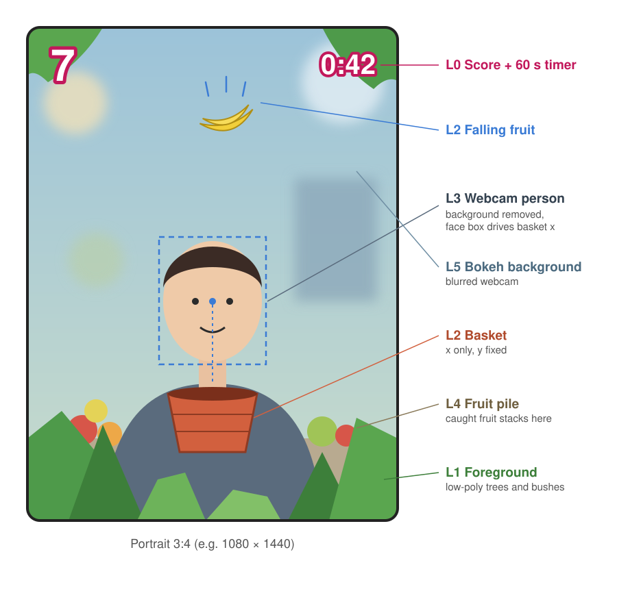
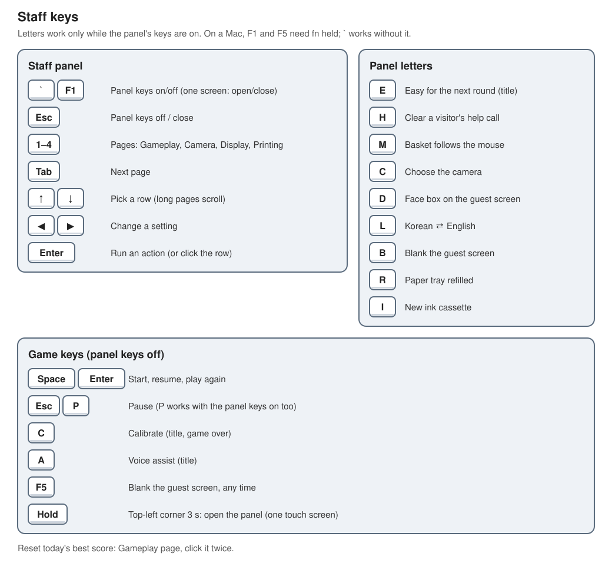
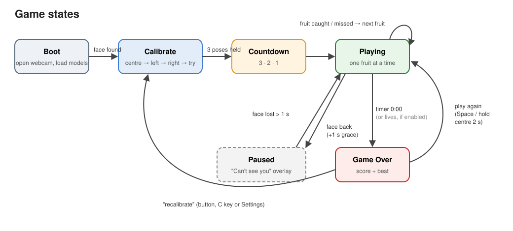
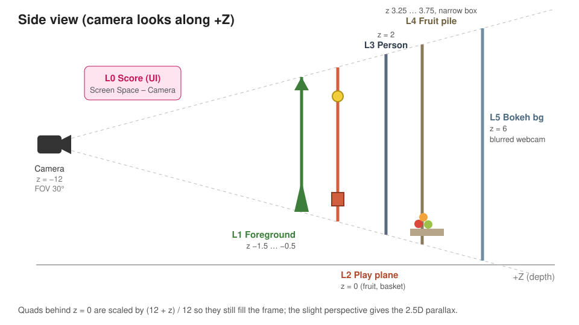
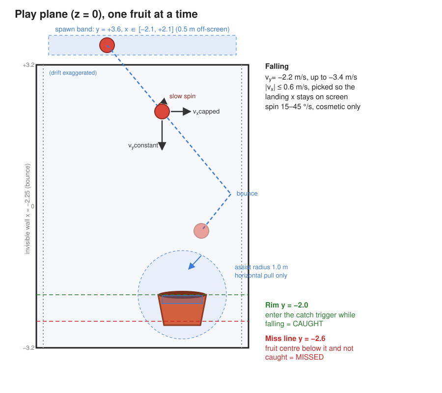
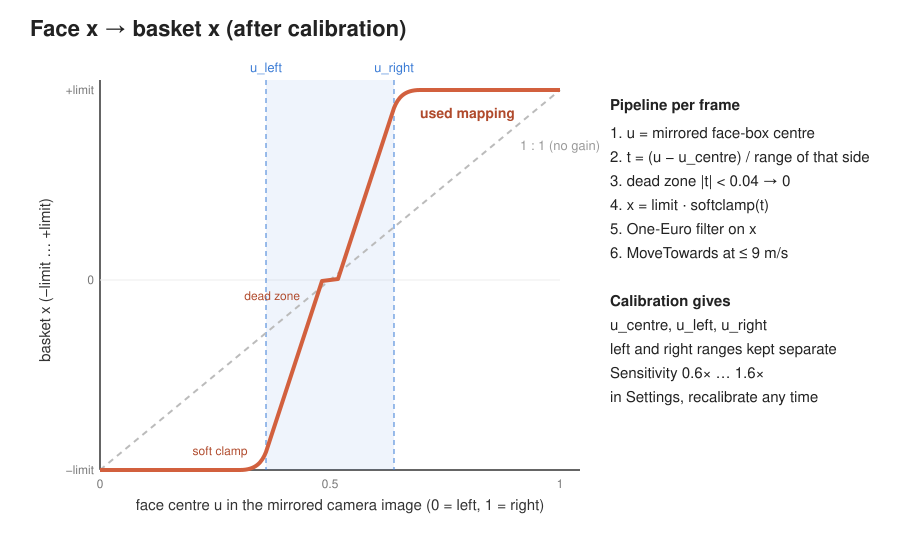
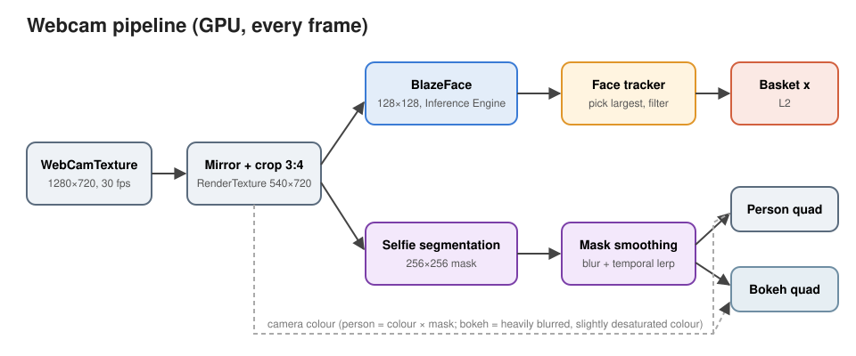
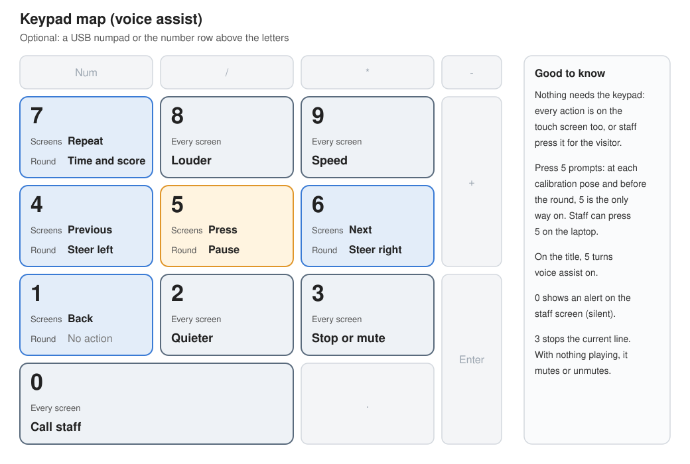

# 지스트의 과일 사진가게 (GIST Fruit Photo Shop) — design & build reference

*한국어 번역: [`DESIGN.ko.md`](DESIGN.ko.md). This English document is the source; the translation follows it.*

An **interactive photo booth designed first for accessibility**: anyone who walks up can play it, whatever their range of movement, eyesight or reading. A visitor stands (or sits) in front of a camera and plays a one-minute fruit-catching game using only head movement: a basket follows their face left and right, and fruit falls from the treetops. Calibration maps each player's own comfortable movement to the whole basket travel, a gentler Easy mode and a **Sound mode** for blind and low-vision players (binaural beeps and a Korean narrator) are one keypress away, and a forgiving assist helps everyone. Every catch drops onto a growing pile behind the player; when the round ends, they pose in front of it and take home a framed four-cut photo, printed or downloaded to their phone. How the booth serves each kind of player is in §2.

The whole thing is styled as **pixel art and voxels**: block-built fruit, trees and basket, a gently pixelated render, a pixel font for Korean and English, and chunky 3D UI.

This document describes the MVP as it should be. Where the current build doesn't match yet, the milestone that closes the gap is named (§19). The history of how each choice was made is in the decisions log (§20). Numbers are starting values to tune in playtesting. **FruitGame** is the project's short name, used in code, asset folders, shaders and menus.



*The diagrams in this document were drawn for the earlier low-poly build. The layout, depths and mechanics they show still apply; only the art style has changed.*

---

## 1. At a glance

| | |
|---|---|
| Title | **지스트의 과일 사진가게**, with a smaller English line underneath: "GIST Fruit Photo Shop" |
| What it is | A booth experience: calibrate → play a 60 s round → pose → take home a framed photo |
| Engine | Unity 6000.6.7f1, URP 17.6, Input System 1.20 |
| ML runtime | Unity Inference Engine (`com.unity.ai.inference` 2.6.1), all on-device |
| Target | **macOS and Windows** standalone. Everything used (WebCamTexture, Inference Engine, URP, HttpListener) is cross-platform; anything macOS-only gets a Windows fallback or is flagged. |
| Screen | **Portrait 9:16 or landscape 16:9**, chosen from the window's shape (reference 1080 × 1920 / 1920 × 1080) and letterboxed in any window; sized for a full-size monitor |
| Booth hardware | A full-size monitor; a **Canon EOS R6** (first generation, mirrorless; called the DSLR here) on clean HDMI through an **Elgato Game Capture 4K X**, which the computer sees as a webcam; a **Canon SELPHY CP1500** photo printer fed with **RP-108** paper (4 × 6 in, the 100 × 148 mm postcard size) (§13, §14; M17). The DSLR isn't connected yet: it needs a **micro HDMI → HDMI** cable or adapter. |
| Control | Face x position from the webcam. Mouse/keyboard fallback for testing (the staff panel's M). |
| Operation | **Mouse only.** Every screen is usable with a mouse; keys are shortcuts for staff. |
| Style | **Pixel / voxel**: voxel models, a gently pixelated render, Neo둥근모 Pro pixel font, keycap-style 3D UI |
| Language | **Korean first** (in-game tone: 해요체), English as a fallback |
| Session | A **60 s timed round**. A lives counter is coded in but switched off. |
| Accessibility | **The core of the design (§2):** head-only control with per-player calibration (§9), so even a small comfortable range covers the whole basket travel; three difficulty modes, Normal, Easy and **Sound mode** for blind and low-vision players (§6, §11); a forgiving assist (§10); mouse-only menus; large, high-contrast Korean-first UI |
| Output | A four-cut photo on a **4 × 6 in (100 × 148 mm) postcard, portrait** (1200 × 1800 at 300 dpi, M17), printed on the SELPHY or downloaded over local Wi-Fi via QR code. Until M17: a 1080 × 1440 image. |

---

## 2. Accessibility by design

The booth is meant to be played by **anyone who walks up**: people with limited neck, arm or upper-body movement, wheelchair users, blind and low-vision visitors, children and older adults, and people who don't read Korean. Every feature below exists for that; the rest of this document describes how each works.

### Who it's for, and how
| Need | What the booth does | Where |
|---|---|---|
| **Limited or one-sided movement** | Control is by head (face) position only, and **calibration** maps each player's own comfortable range, measured separately for each side, to the full basket travel. Tiny ranges are accepted. Hold time and steadiness tolerance are settings for players with tremor. | §8, §9 |
| **Seated players and wheelchair users** | The camera frames the head and shoulders; nothing needs standing, reaching or a controller. Distance prompts ("closer", "farther back") help position the chair. | §8, §9 |
| **Blind and low-vision players** | **Sound mode:** a binaural parking-sensor beep places the fruit by ear, a Korean narrator talks the player through calibration, the round, the score and the photo, and the round itself is gentler. | §11 |
| **Players who need it gentler** | **Easy** (staff key E): the original gentle round, no bombs, one fruit at a time. | §6 |
| **Everyone, by default** | An **assist** pulls fruit toward a basket that's reaching for them; fruit never punish (a miss costs only time, no lives); the game **pauses itself** when the face is lost and resumes when it's back. | §5, §10 |
| **Reading and language** | **Korean first** in friendly 해요체, English from the staff panel (L); one large pixel font; big high-contrast text and keycap buttons; numbers shown as 3D block digits. | §15 |
| **Staff and companions** | Every screen works with a **mouse alone**, so a companion can drive the menus; keys are shortcuts for staff. | §15 |
| **Privacy** | Everything runs on the booth computer: no uploads, phone links only on the local network, and they expire. | §14 |

### Principles
- **Harder through pace, never through more movement.** Difficulty comes from speed, timing and variety (§5); the basket size and the movement it needs never change, so calibration keeps every player's full range.
- **One action, clear feedback.** The only thing to do is move the head; every catch, bounce and miss has its own sound and visual.
- **Forgiving by default, stricter by choice.** The normal round is a real challenge for practised players; Easy and Sound mode are one keypress away, and they reset for the next visitor.
- **The photo is for everyone.** Sound mode guides the pose by voice, and the beauty filter and four-cut print are the same in every mode.

### Staff controls
Staff remember one key: **F1** (or **`**, the key left of 1, since a Mac's F1 is screen brightness unless fn is held) opens the **staff panel** (§15). In the Editor, keys reach the game whichever Game view has focus, so the staff view takes keys too. Every staff action is a row in it, with its letter printed beside it; the letters only work while the panel's keys are on, so they never clash with the game.



| Key | What it does |
|---|---|
| **`** / **F1** | One screen: open or close the staff panel (holding the top-left corner for 3 s does the same on a touch screen). Two screens: turn the panel's keys on or off |
| **1–5** / **Tab** | Panel pages: Gameplay, Camera, Display, Printing, Beauty |
| **↑ ↓**, **◀ ▶**, **Enter** | Pick a setting, change it, run an action (or click); a page with more rows than fit scrolls (mouse wheel, or ↑ ↓ keep the pick in view) |
| **E** | Easy for the next round (title screen) |
| *(click twice)* | Reset today's best score (Gameplay page) |
| **H** | Clear a visitor's call for help (the keypad's 0) |
| **M** | Basket follows the mouse/keyboard instead of the face (testing) |
| **C** | Change camera: every camera plus Auto, with a live preview; click or press its number (remembered); Esc closes |
| **D** | Face box on the guest screen (one screen; with two it's always on the staff mirror) |
| **L** | Korean ⇄ English (also on the Display page) |
| **B** | Blank the guest screen (Sound mode test) |
| **R** / **I** | Paper tray refilled / new ink cassette |
| **Esc** | Close the panel (one screen) or turn its keys off (two screens) |
| **F5** | Blank the guest screen, any time |

The game's own keys stay as they were, matching the visible buttons: **Space / Enter** start, **Esc / P** pause, **C** calibrate and **A** (or the **음성 안내** keycap) voice assist on the title screen. While the panel's keys are on, only **P** reaches the game.

### Testing with players
Playtests with players with limited movement, wheelchair users and blind or low-vision players are part of M6, alongside the general playtest; their notes feed the final tuning.

---

## 3. Player journey



| Step | What happens |
|---|---|
| **Title** | The title screen shows the 3D voxel title **지스트의 과일 사진가게** (its blocks drop in and stack like fruit), the icon and one big **Start** (시작) button. The live camera runs behind it so people walking by see themselves. |
| **How to move** (setup 1 of 3) | "어떻게 움직일까요?": two large cards, each with a looping pixel figure (`MoveDiagram`): **머리를 옆으로** (slide the head sideways, leaning a little; marked **추천해요**) and **고개를 돌려서** (turn the head, for players who find moving their body hard). Sliding is easier to control at Normal pace; turning lets players with limited torso movement play (§8). |
| **Difficulty** (setup 2 of 3) | "난이도를 골라요": **쉬움** (slow, one at a time, no bombs), **보통** (gets faster, with bombs) and **어려움** (very fast, more bombs). With voice assist on, this step is skipped and the Sound round is played (§11). |
| **Calibrate** (setup 3 of 3) | Three held poses (straight, left, right; or turned left and right) measure this player's comfortable range, each after a lead-in to read the prompt, then a short **Try it** (§9). Every visitor calibrates, since each plays once. Back returns to the difficulty step. |
| **Countdown** | 3 · 2 · 1 with a tick sound, and under the number the **rules line** (`ScoreRules.Explain`, from the config's values): "황금 과일은 3점! / 폭탄은 피해요 (-5점)" on two lines, or just the golden half in modes without bombs (Easy, Sound). Voice assist says it before the round as `rules_golden` ("가끔 황금 과일이 떨어져요. 받으면 3점이에요."; its 3 is rendered audio, so it must be re-rendered if `goldenPoints` changes). |
| **Playing** | Exactly one fruit falls at a time; the next appears 0.6 s after the current one is caught or missed (§5–§7). Each catch drops a copy onto the pile behind the player (§12). |
| **Paused** | From the **II** button, or automatically after 1 s without a face ("Can't see you!"); resumes 1 s after the face returns. The pause menu has **Resume** and **Main menu**. |
| **Game over** | When the 60 s run out, the fruit still in the air is allowed to land, then: "Time's up!", a large score, the day's best, the fruit caught, golden fruit, misses and bombs, and **Play again**, **Photo** and **Main menu**. |
| **Photo booth** | Pose in front of this round's pile with the beauty filter on → 3·2·1 → flash → framed preview → **Print**, **Get it on your phone** (QR), **Save**, **Retake** or **Done** (§14). |
| **Back to title** | **Done** or **Main menu** returns to the title screen and clears the pile for the next visitor. |

---

## 4. Look & scene

### Scene layers (front to back)

The scene is a stack of parallel planes along Z, seen through a **perspective camera with a narrow FOV**, so depth gives a gentle 2.5D parallax.



| Layer | What | Z (world) | Notes |
|---|---|---|---|
| **L0** | HUD: score, timer, pause button | UI | Voxel score and timer digits on a 3D UI camera; flat UI on a Screen Space – Overlay canvas inside a "Frame" rect fitted to the game viewport (§15). In landscape the HUD moves into the side areas. |
| **L1** | Foreground | −1.1 … −0.45 | Four small voxel trees (two pines, a cypress, a small oak) toward the bottom corners, with voxel bushes, grass and flowers along the bottom edge. **Varied, not one green:** each plant gets its own leaf tint (base, deep, yellow-green, blue-green or olive), and each flower its own petal colour (pink, white, orange, red, lilac or yellow). Extra small flowers and grass tufts at the front fill the gaps; big bushes are never added there, so nothing climbs higher over the basket. Same 6.3 cm blocks as the rest of the play layer. |
| **L2** | Falling fruit + basket | 0 | The gameplay plane. All gameplay maths happen here in 2D (x, y). |
| **L3** | The player | 2 | The webcam image with the background removed (§13), kept **sharp** with no outline (the 3 px dark outline from M11 read as a black edge in print and was removed, `playerOutline` 0). |
| **L4** | Background fruit pile | ≈ 3.0 … 4.2 | Caught fruit stacks up with physics behind the player (§12). |
| **L4b** | Distant orchard | 4.9 … 6.7 | Two grassy **hills** (`FarHills`), one each side, rising from the ground beside the open middle to a broad top running off the screen edge: a light grass top over grass that darkens gradually with depth, with faint bands barely darker than the grass around them, a few flowers and stones. The orchard stands on them: the two big oak canopies framing the top corners and two pines, plus six smaller trees at varied sizes and depths on the hill slopes, each with its own leaf tint so the layer isn't one flat green. A few fruit blocks (red, orange or yellow per tree) sit on the camera-facing side of each canopy, and three block clouds near the top drift slowly sideways (`LivingScenery`): each moves left or right at 0.07–0.16 m/s, and once it's fully off one edge of the view (worked out from the camera, so portrait and landscape both work) it comes back in from a side, its direction, pace and height picked afresh. Coarser blocks than the play layers and dithered toward the sky, so it all reads as far away. The **centre stays open** so the live room behind the player shows through. No shadows. |
| **L5** | Backdrop | 6 | The live camera frame of the room behind the player, sharp by default (an optional bokeh blur exists). Alternative: a pixel-art orchard illustration (§13). Drawn through the back pixel layer, like L4 and L4b. |

**Camera:** position (0, 0, −12), looking +Z. `ScreenLayout` letterboxes it to the current layout's aspect in any window (black bars from a second camera), stretches the HUD frame to match, and fits its field of view around the play column (below): about 43.6° in portrait and 30° in landscape. One world unit is one metre. Quads that show the whole camera frame (the player cut-out and the backdrop) are sized to the view by `ViewFill`.

**Two orientations.** The game uses **portrait 9:16** or **landscape 16:9**, picked from the window's shape (`GameConfig.orientation`: Auto, Portrait or Landscape; a window in between letterboxes to the nearer one, and the layout switches live: everything sized to the screen listens to `ScreenLayout.Changed`). The **play column** keeps one size in both: the fruit walls at ±2.25 m with their crate stacks (`playColumnWidth` 5.4 m in all) and its height (`playHeight` 6.43 m). Speeds, the basket, calibration, the assist and the pile therefore behave identically, and only what's around the column changes.
- **Portrait 9:16:** the camera fits the column's width, so the view grows taller (about 5.4 × 9.6 m at z = 0). A **canopy band** of leaf clumps hangs across the top, in front of the play plane, so fruit drop out of the leaves (they spawn behind it); a **ground bank** of grass over soil fills the bottom just below the basket, so missed fruit disappear behind it. The score, timer and pause button sit in a row just under the canopy, over the play area.
- **Landscape 16:9:** the camera fits the column's height (6.43 m, so about 11.4 m wide at z = 0). The play column stays in the middle, bounded by **visible walls** that fruit bounce off: stacks of voxel **crates and barrels** (`CrateWalls`, from the low-poly crate pack's Box and barrel models, §16): on each wall line a column of crates with a barrel every fourth piece, flush with the bounce plane, rising from the ground bank into the canopy; outside it, shorter crate stacks step down toward the screen edge, each topped with a barrel with fruit heaped on its lid, and a barrel stands at the foot. Every piece gets its own size (82–112 %), turn and a slightly different wood tint, so the stacks look natural. Each bounce gives a knock, a small wobble of the piece that was hit and a few wood chips. The walls show in portrait too, at the screen edges. The column is deliberately not stretched to the full width: the player's head range would map to a very long basket travel, and fruit would take too long to cross. Outside the walls the orchard, foreground plants and the live room carry on, and the side areas hold the HUD (`SidePanels`): the score above a cream panel headed **점수표** (Scoreboard) with the live score graph and the catch tally on the left; the timer above a **film strip** of the round's three action shots on the right, 3:4 portrait like the printed cuts, each slot filling in as its shot is taken. Small trees, bushes and flowers continue beside the crates, and two far **hills** (below) give the side trees somewhere to stand.
- Spawn height, the miss line and the pile stay tied to the column. The extra scenery covers the largest view in each direction, so nothing switches on or off: the canopy band and ground bank (`SceneryBands`, built from block grids at start) sit beyond the landscape view's top and bottom edges, and the side plants (added by **Build Orchard And Plant Variety**, §16) sit beyond the portrait view's sides.
- The pixel render keeps `renderScale` ½ of the layout's reference size (540 × 960 or 960 × 540), so every game pixel is still 2 × 2 screen pixels on a 1080 screen. In landscape a game pixel covers a little more of the world than in portrait.

### Rendering style

| Element | Spec |
|---|---|
| **Models** | Every model is **voxel**: fruit, basket, trees, bushes and ground are generated from the source low-poly models by an editor voxeliser (§16), so shapes and colours carry over. Block sizes per group: **fruit 4.4 cm** (about 20 blocks across a fruit, so shapes stay readable), **play-layer world 6.3 cm** (basket, foreground trees, bushes, ground), **far layer 9 cm**. Fruit get clean flat colours (5 per fruit, from a shared palette) and every mesh is seamless (§16). |
| **Pixel render** | `PixelRenderer` on the main camera. Two helper cameras draw the game layers at `renderScale` (½: **540 × 720**) into point-filtered textures: **back** (layers Back and Pile: backdrop, far orchard, pile) and **front** (everything else: basket, falling fruit, foreground plants, on a transparent background). The main camera then draws, at full resolution, the back layer on a far quad, the sharp player (layer Person) and the front layer on a near quad (layer PixelComposite), so every game pixel is a crisp 2 × 2 block and the layering needs no depth tricks. `PixelSnap` moves the falling fruit and basket visuals in whole game pixels. No palette limit and no model outlines. |
| **The player** | L3 renders at full resolution, so the beauty filter and the photo stay crisp. The outline is off (`playerOutline` 0); when on, it's drawn around the matte and skipped wherever something in the play layers is in front of the player, so it never traces the basket or bushes (the front layer simply draws over it). The ring is found by sampling the matte on two circles around each pixel, and the soft matte edge blends into the outline colour rather than the scene, so there's no light fringe. The player is always sharp in the photo too (no "pixel me" option). |
| **Depth** | Distance is shown with **ordered dithering** (Bayer 4 × 4, on the game-pixel grid, in 4 steps) toward the sky colour (#A9C6DD) instead of faded colours: strength **0.5 on the pile** and **0.55 on the far orchard** (clouds about a third of that). Textures on dithered layers are sampled at full size only, since their colour atlases are small swatches that blend into rainbow noise at lower mip levels. Falling fruit stay full colour and full contrast, so they never blend into the pile. |
| **Lighting** | One warm directional light (about 50° down, from the upper left) with soft shadows, plus a light-blue/soft-green gradient ambient. Voxel faces are flat-lit, which suits blocks. The player and backdrop are **unlit**, so the webcam image keeps its true colour. |
| **Post-processing** | On the main camera only, over the final composite: tonemapping, colour adjustments, a soft bloom and the vignette. **No depth of field**: blur smears the pixels and the dither. The helper cameras render without post-processing. The rim light on falling fruit stays; it reads as a light edge on the block faces. |

---

## 5. Rules & scoring

- **Caught** = points for that fruit type (all 1; golden 3; ×2 in a combo). The fruit pops into the basket, then a copy drops onto the background pile.
- **Missed** = no penalty in timed mode; it only costs time. The miss is counted. The fruit falls off-screen behind the bottom bushes.
- **Round timer:** 60 s, top-right. It pauses whenever the game pauses. The last 10 s pulse.
- **Lives (coded, off):** `LivesCounter` and a lives HUD exist and are tested, but `GameConfig.endCondition = Timer` keeps them inactive. Switching to `Lives` (or `TimerOrLives`) makes 3 misses end the round, with no other code change.
- **The round gets harder through pace and variety, never through more head movement** (M16.1): calibration still maps each player's own range to the full basket travel, and the basket keeps its size.
  - **Everything ramps evenly** (linear over the round, no steps): fall speed 2.7 → 4.05 m/s (1.5×) and the drift cap 0.7 → 1.8 m/s, so wall bounces become common. The assist stays at full strength all round.
  - **Drops away from the basket:** each fruit drops at least 0.5 m from where the basket is at the start of the round, growing to 1.3 m by the end (`spawnAwayFromBasket`; not in Easy), so the player has to move to it.
  - **Pace:** fruit drop on a beat whose rate climbs in a straight line, from the opening pace (one fruit's fall plus a 0.6 s gap: 3.7 per 10 s) to **9 per 10 s** at the end (`endDropsPer10s`), the same increase every 10 s. Since fruit fall only 1.5× faster by the end while the rate climbs to 9 per 10 s, more of them share the screen late on (up to `maxFruitInAir`, 3). *An earlier version switched to two at once with 20 s left and ramped along a squared curve; that felt like the game suddenly doubled in speed.*
  - **Golden fruit** (**3 per round**, `goldenPerRound`): gold all over with a sparkle trail, 25 % faster, worth **3**; it joins the pile in gold.
  - **Combo:** from the **5th catch in a row**, every catch scores **×2**, with a "N연속! 점수 ×2" pop under the score. A missed fruit or a caught bomb resets the streak.
  - **Bomb** (**4 per round**, `bombsPerRound`, from 15 s in): a dark voxel bomb whose fuse burns at the tip, throwing sparks; the assist never pulls it, and letting it fall past costs nothing. Catching it blows it up (a burst of fire and smoke blocks, a low thud) and costs **5 points** (never below 0), with a red "−5" pop. Bombs never join the pile; game over lists them ("폭탄 n개").
  - **Fixed numbers:** every round has the same number of golden fruit and bombs, so rounds are comparable. Each is scheduled at a random time inside its own equal share of the round (the middle 60 % of it), golden fruit over the whole round and bombs from 15 s, none in the last 5 s (`specialsEndBefore`); the first spawn after a scheduled time takes it.
  - **Easy** and **Sound mode** are gentler rounds for players who need them (§6).
  - **Target:** about 40–50 % of fruit caught for a first-timer and 70–80 % for a practised player, read from the round stats; final values are tuned in M6. *Measured with nobody moving the basket: 29 % of fruit caught and a score of about 5 (it was 68 % before the assist followed the basket's movement). Still to check with real players: the catch rate when moving, and the eased basket's feel.*
- **Best score** is kept per day in PlayerPrefs.

### Fruit types & scoring hooks
Every fruit is its own type, even though all are worth the same for now, so variety-based scoring can come later without a refactor.

- A `FruitType` ScriptableObject per fruit holds its id, display name, model(s), points (= 1), spawn weight, size scale, collider shape and icon. Optional `atlas`/`atlasFar` textures let models from a second pack use their own colour atlas; voxel fruit (M10) won't need them.
- **16 types:** apple, banana, orange, pear, lemon, mango, grapefruit, grapes, cherries, avocado, dragon fruit, coconut, mangosteen (common or fairly common); pineapple, melon and watermelon (rarer). Every fruit is **whole**: the dragon fruit's only model is a half, so it's mirrored into a whole one (§16), and the half-watermelon variant isn't used.
- Score goes through one `ScoreRules.PointsFor(FruitType, context)` function. Today it returns `type.points`; later it can apply combos, streaks or rarity.
- `RoundStats` tracks caught and missed counts **per type** plus a score history (time, score after each catch). Game over shows the tally in two columns and the history as a step graph.

---

## 6. Difficulty modes

Four modes share the same game; only the pace, the assist and what falls change. **Normal** is the default; staff (or a companion, for Sound mode) switch the others on from the title screen, and they reset for the next visitor (Easy after its round, Sound mode when the visit ends).

| | **Normal** | **Easy** | **Hard** | **Sound mode** |
|---|---|---|---|---|
| Who it's for | Most players | Players who need it gentler | Players who want a challenge | Blind and low-vision players (§11) |
| Turned on by | (default) | The setup flow, **E** in the staff panel, or as the staff's default mode | The setup flow, or as the staff's default mode | The title's **음성 안내** button, **A**, or the numpad's 5; "음성 안내 켜짐" tag and a spoken confirmation |
| Fall speed | 2.7 → 4.05 m/s over the round | 2.7 → 3.8 m/s | 2.7 → 5.2 m/s | steady 2.3 m/s |
| Pace | drop rate 3.7 → 9 per 10 s, overlapping late on | one at a time, 0.6 s after the last lands | drop rate 3.7 → 13 per 10 s, up to 4 in the air | one at a time, 1 s after the last lands |
| Where fruit drop | at least 0.5 → 1.3 m from the basket | anywhere | as Normal | anywhere |
| Assist (§10) | 2.6 m, strength 7, follows a moving basket | 1.8 m, strength 4, always on | as Normal | 2.2 m, strength 5.5, always on |
| Golden fruit, combo | 3 golden, combo | 3 golden, combo | 3 golden, combo | 3 golden (with their own beep), combo |
| Bombs | 4, from 15 s | no | 7, from 15 s | no |
| Feedback | visual + sounds | visual + sounds | visual + sounds | binaural beep, chimes and the narrator |
| Ends | — | when the round ends | back on the title screen | back on the title screen |

The values live in `GameConfig` (§17): `easy*`, `hard*` and `auditory*` fields. Hard never shrinks the basket or asks for more movement.

---

## 7. Falling fruit



| Property | Spec |
|---|---|
| Spawn position | Random x in ±2.1 m, at least `spawnAwayFromBasket` (0.5 → 1.3 m over the round) from the basket, at y = +3.6, just above the top edge, so fruit appears to drop out of the canopy |
| Vertical speed | **Constant** per fruit: 2.7 m/s at the start, ramping to at most 3.8 m/s |
| Sideways speed | Random but capped: \|vx\| ≤ 0.7 m/s at the start, up to 1.2 m/s, wide enough that wall bounces are common and visible |
| Walls | Walls at x = ±2.25 reflect vx, so fruit never leaves the play column sideways. They're shown as voxel crate stacks with bounce feedback (§4), which matters in landscape, where the screen is much wider than the column. |
| Spin | 120–240 °/s around a random axis, fast enough to read the fruit's shape. Cosmetic during the scripted fall. |
| Size | Each fruit's longest side is `fruitSize` (0.70 m) × its type's `sizeScale`, whatever its model scale. The scales follow real sizes in order but squeezed into a playable range: cherries 0.8, mangosteen 0.9, lemon 0.92, apple and orange 1, avocado 1.05, pear 1.08, mango 1.12, dragon fruit, grapefruit and grapes 1.15, banana 1.2, coconut 1.25, melon 1.35, pineapple 1.45, watermelon 1.55 (0.56–1.09 m). A size change needs **Bake Fruit** again, so the blocks stay 4.4 cm. |

### Two-phase movement with real basket collisions
Each fruit is a Rigidbody with a sphere collider, locked to z = 0.

1. **Scripted fall:** every physics step its velocity is held at `(vx, −vy)`, so the constant downward speed stays exact. The assist (§10) nudges vx and the walls reflect it.
2. **Knocked:** the moment it touches the basket (rim, side wall or floor edge), the scripted fall stops and physics takes over. The fruit bounces (bounciness 0.45, less for hard hits: from 2 m/s of impact the bounce scales down to 35 % at 7 m/s) and falls under `knockedGravity` (9 m/s²). Knocked speeds are capped (2.2 m/s sideways, 2.5 m/s upward), so the basket never flings fruit across the screen. A knocked fruit that comes back down into the tub is caught as usual, and one that comes to rest on the rim or in the mouth for 0.35 s counts as caught too, so nothing sits there unresolved and blocks the next fruit; one still unresolved after 4 s is caught if it's on the basket and otherwise missed and dropped through. The assist no longer applies, so a basket that arrives late *bangs the fruit away* instead of swallowing it. The basket is a kinematic Rigidbody moved with `MovePosition`, eased (below), so it nudges fruit rather than slamming them.

### Catch / miss detection
- **Caught:** the fruit's centre is inside the tub (below the rim, between the tapered inner walls), detected by a trigger inside the basket. That covers clean drops and lucky bounces off the rim.
- **Missed:** the fruit's centre drops below the miss line (y = −2.6) without being caught, or a knocked fruit is still unresolved after 4 s (in case it balances on the rim).
- **Bump feedback:** every basket contact plays the "tink" and wobbles the basket (sound throttled to once per 0.12 s).
- With solid walls, a medium fruit (radius ≈ 0.35–0.4 m) only drops in cleanly within about ±0.3 m of the basket centre; nearer the edges it clips the rim and physics decides. The assist compensates.

---

## 8. Basket & head control

| Property | Spec |
|---|---|
| Axis | Follows face tracking on x only; y is fixed with the rim at −2.0 (roughly chest height) |
| Size | Mouth **1.3 m** wide, 0.65 m tall, tapering to 0.75 × at the bottom. The model is the crate pack's wooden **basin**, voxelised (§16) with its rim on the catch line, tilted 5° toward the camera so the mouth reads. |
| Travel | x clamped to ±1.55 m, so the basket reaches the crate walls but never passes them |
| Movement | The player's **own comfortable range**, measured by calibration (§9), maps to the **full** basket travel |



### Mapping, per frame
**How to move** is each visitor's choice on the setup flow's first step (`Steering.Mode`; the staff panel's "Steering picked at the start", `GameConfig.steerBy`, is the card picked when the step opens, and the visit falls back to it afterwards). It picks the signal `u` (`HeadSignal`): **Sliding** (the default) uses the face's position, below; **Turning** uses the head's yaw from the face mesh, `u = 0.5 + yaw / turnDegreesPerWidth` (100°), yaw + toward the screen's right, so everything after step 1 is the same. Each way keeps its **own saved calibration**, and calibration's left and right prompts say "turn" (고개를 왼쪽으로 돌려요) while Turning is on. The calibration narration has turn versions of its left and right lines (`calib_left_turn`, `calib_right_turn`, `calib_more_left_turn`, `calib_more_right_turn`); the in-round lines (the Sound mode intro and pose guidance) still say "move your head" and need turn versions if turning players use Sound mode.
1. `u` = horizontal centre of the tracked face box in the **mirrored** camera image, measured across the **3:4 play area** (the middle 3:4 of the camera frame, the part the photos show; 0…1 across it). Mirroring means moving left moves the basket left, like a mirror. Because `u` is relative to the play area rather than the screen, a calibration means the same in portrait and landscape, and with any camera shape.
2. With `d = u − u_centre` and the measured ranges `L = u_centre − u_left`, `R = u_right − u_centre`: one curve `t = lin·d + quad·d²` with `lin = (L² + R²) / (L·R·(L+R))` and `quad = (L − R) / (L·R·(L+R))`, which passes through −1 at the left edge and +1 at the right. Each side keeps its **own** measured range, so a player who moves further one way still reaches both edges, but the speed changes smoothly across the centre instead of jumping between two scales (the old two-line map made one side up to twice as fast, switching at the centre); it's a straight line when the sides match. Past an edge it continues straight at that edge's slope; if one side is over 2.2× the other, it falls back to two lines. **Sensitivity** (0.6×–1.6×) scales on top.
3. Dead zone: `|t| < deadZone → 0`, **0** since the DSLR (it was 0.02 for webcam jitter, and with the centre kink made the middle feel locked).
4. `x = limit · softclamp(t)`: linear through the middle, easing into ±limit past the 0.8 knee, so overshooting your range doesn't feel like hitting a wall.
5. A **One-Euro filter** on x (min cutoff 3 Hz, β 1): steady when still, and small slow moves follow promptly (it was 1 Hz and 0.5 for a noisy webcam, which made slow moves near the centre lag).
6. The basket **eases** toward that x (`SmoothDamp`, about 0.08 s, at most 10 m/s), which absorbs tracker glitches and keeps it from slamming into fruit.

> The basket deliberately moves further than the face does on screen, so it won't sit exactly under the player's chin. Crossing the whole camera shot with your head is unviable, especially for players with limited neck or upper-body movement.

### Face tracking robustness
- With several faces, track the largest box, but stick with the previous target while it still overlaps it (IoU ≥ 0.3).
- Face lost: the basket holds its position. After 1 s the game pauses with "Can't see you!", and resumes 1 s after the face returns (a manual pause still waits for Resume).
- Keyboard ← → / A D and mouse x drive the basket when no webcam is present or when the staff panel's **M** is on.

---

## 9. Calibration

Calibration is what makes the game playable with **any range of head movement**: it measures how far **this** player can comfortably move their head and maps exactly that range to the whole basket travel (§8). A player who can only move a few centimetres gets the same full-width basket as one who can lean across the frame.

### The steps
Every visitor calibrates, as the last step of the setup flow (§3). Each pose starts with a **lead-in** to read the prompt, once per pose (later lines such as "hold it there" don't restart it) ("N초 뒤에 시작해요"): **5 s** for the centre pose, **3 s** for left and right (`calibLeadInCentre`, `calibLeadIn`), so nobody is calibrated before they know what's happening. In Sound mode the lead-in starts once the narrator has finished the prompt.
1. **"Look straight at the camera"**: a 1 s steady hold records `u_centre`.
2. **"Move your head left as far as is comfortable"**: records `u_left`, the furthest *held* position (not a momentary peak).
3. **"Move your head right as far as is comfortable"**: records `u_right`.
4. **Try it**: the basket follows the new mapping, with the rules line (as under the countdown) as the hint; **Looks good** saves, **Redo** repeats, **Back** cancels and keeps the old calibration.

### Accessibility details
- "Steady" means the face stays within ±0.015 (u) for 1 s, shown as a ring filling around the face. Tolerance and hold time are settings, for players with tremor.
- Left and right ranges are stored **separately**; there's no symmetric `min()`.
- A very small range is accepted; there's only a floor of 0.03 per side to keep the maths stable. The dead zone and filter scale with the range, so it stays steady.
- If the face box is under 12 % or over 45 % of the play area's width, a prompt says "move closer" or "move back".
- Prompts use large text plus arrows, and in Sound mode the narrator speaks every step (§11): an introduction, each pose, "hold still" once steady (the progress ring can't be seen), "좋아요!" after each pose, "a little further left/right", closer or farther back, "looking for your face", how to accept or redo, and a closing line.
- Saved in PlayerPrefs. Defaults if skipped: 0.5 / 0.35 / 0.65. **C** recalibrates.

---

## 10. Assist

A slight attractor with a capped radius, to make the game forgiving:

- Only acts on the current falling fruit, only during its **scripted fall** (never once knocked), only while it's **above the rim**, and only within **R = 2.6 m** of the basket mouth. It never fades during the round, but it **follows a moving basket**: full strength while the basket moves at 1.2 m/s or more, lingering about 0.6 s after it stops, and only 15 % for a basket that sits still. Players reaching for a fruit get the full, wide pull; standing still doesn't pay off.
- Adds a **horizontal** acceleration toward the basket's x: `a = strength · (1 − d/R)` with strength 7 m/s² (× the movement factor above), capped so vx never exceeds the drift cap + 1.6 m/s.
- Never touches vertical speed, so the constant fall speed holds.
- It noticeably pulls near-misses in, but a basket that's too late still gets hit and knocks the fruit away. Strength 0 turns it off ("Assist: Off / Low / Normal" in settings, M6).
- **Per mode** (§6): Normal uses the values above and follows the basket's movement; **Easy** uses the original gentle assist (1.8 m, strength 4) and **Sound mode** 2.2 m at strength 5.5, both always on, since those players may not be able to see or reach toward a fruit first.

---

## 11. Sound mode (auditory assist, M18)

A mode for blind and low-vision players: the round is played by ear, and a Korean narrator talks the player through it. It's built on the Game Accessibility Guidelines' advice (use every property of a sound, keep spatial cues consistent, don't overload the player, test with blind players).

### Turning it on
- **Turning it on:** the **소리로 하기** card on the setup flow's difficulty step (a companion or the player picks it; the narrator reads the options aloud for everyone), or **A** on the title screen or that step; the narrator confirms ("소리 모드를 켰어요") and a "소리 모드" tag shows. It stays on for the whole visit (calibration, round, photo) and switches off back on the title screen.
### The round
- **An even gentler round than Easy** (compared in §6): fruit fall steadily (2.3 m/s, no ramp; about 2.4 s from the canopy to the basket), one at a time with a 1 s pause between them, dropping anywhere; the assist reaches 2.2 m at strength 5.5 (about 80 % of the normal assist) and is always on (it doesn't depend on the basket moving); no bombs. Golden fruit stay, with their own sparkly beep.
### The beep
- **Parking-sensor beep, for headphones:** the falling fruit sounds like a **parking sensor** heard from the basket:
  - **Direction is binaural:** the beep is placed left or right by how far the fruit is to the side of the basket, with an interaural time difference (up to about 0.65 ms, Woodworth's formula), a level difference and a softened far ear, so it sits at a precise angle rather than just in one ear. Straight above the basket it's centred.
  - **Beeps speed up** as the basket lines up under the fruit (about 1.5 per second when far, 15 per second when close) and become a **steady tone** when the basket is right under it.
  - **Pitch rises** as the fruit falls closer to the basket, so the player hears it about to land.
  - A bright rising **chime** on a catch (sparklier for a golden fruit) and a soft falling **note** on a miss. The beep ducks while the narrator speaks. Every level, delay and head-shadow change glides sample by sample, and the tone fades rather than cuts, so moving the basket makes no clicks.
### The narrator
- **Who hears it:** only visitors with voice assist on (the title's 음성 안내 button). Everyone else hears one short quiet invitation when they come up to the title.
- **The narrator** (Korean, calm and plain, pre-rendered with Google Cloud Text-to-Speech, ko-KR-Neural2-B, at five speeds from 1× to 2× chosen by the visitor): explains the objective before the countdown, counts down, announces the time left and the score at 45, 30 and 15 seconds ("30초 남았어요, 지금 12점!"), says the final score (not the fruit-by-fruit tally), asks whether to take a photo (a companion presses **사진 찍기**), then guides the pose from face tracking ("조금 왼쪽으로", "조금 가까이", "좋아요, 그대로!") and counts the shot. It also talks the player through calibration: an introduction, each pose (straight ahead, left, right), "hold still" once they're steady (the progress ring can't be seen), "좋아요!" after each pose, "a little further left/right", closer or farther back, "looking for your face", how to accept or redo (a companion presses the button), and a closing line. Every line is a clip rendered once by `Tools/render_narration.py` from `Assets/FruitGame/Resources/NarrationLines.txt` (numbers 0–99 are their own clips), once per speed into `Resources/Narration/s<speed>/`, so it works offline and on Windows.
- **Rendering the voice:** `python3 Tools/render_narration.py --engine google --speeds 1,1.25,1.5,1.75,2` with `GOOGLE_TTS_API_KEY` set (or signed in with `gcloud`); it renders only missing clips (`--force` redoes them, `--only <keys>` picks lines), 6 at a time with a progress bar; `--voice` and `--pitch` pick the voice (ko-KR-Neural2-B, pitch 0). `--engine say` makes quick macOS previews for testing.
### Testing
- **Blind test (staff):** **F5** blanks the screen to black (the HUD too) while still playing, so a sighted tester can check the round can be played by ear alone.
- **Still to do:** a playtest with blind and low-vision players; until then the beep mapping and narration are based on the Game Accessibility Guidelines and our own blindfolded tests.

---

## 12. Background fruit pile

When a fruit is caught, the falling fruit is consumed by the basket. A **pile copy** of the same type then drops from above, behind the player, into a **very narrow invisible container** about one fruit deep, so it stacks like a 2D heap but still looks 3D. Over the round a colourful heap builds up behind the player on a **messy heap of crates and barrels**, so it shows above the shoulders instead of disappearing behind the torso. Nothing stacks inside the basket.

### The crate heap
- A jumble of the crate pack's crates and barrels (`Box_Vox`, `barrel_Vox`, about one in three a barrel), like the side walls: columns across the pile's 6 m width, each piece its own size (0.8–1.15 ×), lean (up to 12°), turn and wood colour (62–85 % brightness with a slight warm or cool shift). **Hazed like the pile fruit:** during play the heap uses a copy of the pile's dither material (`Fruit_Pile_Dither`, the same `pileDither` 0.5 toward the sky #A9C6DD) with the props' palette, so it reads as background; in the photo it switches to full colour with the fruit (`SetPhotoMode`: the booth and each action shot). Stacked from the ground (y = −3.6) to about `heapHeight` 2.1 m (about y = −1.5), just above the shoulders in the usual framing (about y = −1.7 at the pile's depth); columns overlap and the top piece may poke above, so the top is uneven. Built by `FruitPile` (`crate`, `barrel`, `heapHeight`, `heapSize`, `heapTilt`), drawn on the Back layer (behind the player), no shadows.
- Each piece has a box collider on the pile's layer, so fruit settle on the uneven tops; a backup floor 0.35 m under the top keeps fruit from dropping down the gaps.
- Chosen over side stacks or a centre pyramid (2026-11-05) after the first test print: with the usual framing the torso hid the whole ground-level pile.

### The container
- Invisible box colliders: the crate heap's pieces and a backup floor just under its top (y = −3.6 without the heap), left and right walls at x = ±3.0, and front and back walls `pileDepthFactor` (1.15) × the largest fruit's diameter apart, so two fruit can never sit side by side in depth.
- Built by `FruitPile` at runtime from `GameConfig`. Caught fruit are added by `GameStateMachine`; the pile is cleared when a new round starts and when returning to the title.
- Elongated fruit (banana, pear, pineapple, grapes, dragon fruit, avocado) get a capsule along their longest axis; the rest get spheres.
- Fruit keep full 3D rotation and tumble between the walls, which is what makes the pile read as 3D.
- Drop point: a random free x across the container, from y = +3.6.

### Background look
- Pile fruit must never be mistaken for a falling fruit: they're dithered toward the sky colour (§4) and neither cast nor receive shadows. The pile uses `Fruit_Pile_Dither` (the shared fruit palette through `FruitGame/Dither Fade`), with its strength set from `GameConfig.pileDither` at start.
- In the **photo**, the pile and its crate heap switch to full colour so the catch shows off (§14).

### Anti-glitch measures
| Measure | Why |
|---|---|
| Simple colliders: spheres and capsules, never mesh colliders | Stable stacking, cheap |
| Narrow front/back walls instead of a frozen Z axis | Keeps the 2D heap while rotation stays free; nothing tumbles toward the camera |
| Interpolate, collision mode Continuous Dynamic | No tunnelling or jitter at render rate |
| `maxDepenetrationVelocity = 1.5` | Overlaps resolve gently instead of fruit "exploding" out |
| Spawn only where there's free space; otherwise try another x, then spawn higher | Never spawn inside another fruit |
| Physics material: friction 0.8, bounciness 0.05 | Settles quickly |
| **Freeze when settled**: speed < 0.05 m/s for 1.5 s → kinematic | A big pile costs nothing and can't creep |
| Nothing is removed during a round: the heap grows until there's no free spot at the drop height (about 130 fruit, up to 92 % of the screen's height), then stops adding; `pileMax` (400) is only a safety cap. Settled fruit freeze, so a full heap costs little (92 fps in the Editor) | The pile shows the whole round's catch; bounded cost, no floating fruit |
| Its own physics layer `Pile` (8), ignoring every other layer | Can't touch gameplay fruit or the basket |
| Solver iterations 10 / velocity iterations 4 for pile bodies; fixed timestep 1/60 | Better stacking stability |

*Stress-tested: 50 fruit dropped in bursts; it capped at 40, most froze once settled, none escaped, and the heap reached y ≈ −0.9.*

---

## 13. Webcam pipeline



| Stage | Spec |
|---|---|
| **Capture** | `WebcamSource` opens a `WebCamTexture` at **1920 × 1080, 60 fps** (its Requested Size and Requested Fps; the camera picks its nearest mode). Camera choice: `GameConfig.preferredCameraName` if a device name contains it, else the first non-built-in camera (e.g. an iPhone via Continuity Camera, a capture card or a USB webcam), else any. All device names are logged. **Camera menu (the staff panel's C):** lists every camera plus *Auto* (the rule above), with a live preview of the one in use; clicking a row or pressing its number switches cameras on the fly (`WebcamSource.Use`; the old frame stays until the new camera's first frame) and the pick is remembered across restarts (it overrides `preferredCameraName`). English, like the other debug views; its own top canvas, opaque. **Booth camera (M17):** a DSLR or mirrorless camera with **clean HDMI** out into an **Elgato Game Capture 4K X**, a driverless UVC device on macOS and Windows, so it's picked like any webcam. Requested at **1920 × 1080, 60 fps** (60 fps keeps latency down, and 4K is a setting for sharper photos if the computer keeps up); first connected on 2026-11-10, the R6 through the 4K X arrives at 1920 × 1080 with a new picture every frame once the R6 shoots at 59.94p (at 23.98p it came through as 24p padded out to 60). Asking for 3840 × 2160 gives Unity the full 4K but only **30 fps** on macOS, and with the R6 set to 4K the picture came through dark, while 1080p reaches about 54–60 fps in the Editor, so 1080p60 is the setting for play. `cameraRotation` (0 / 90 / 270°, not built yet) will support a camera mounted on its side for portrait, which keeps the full 1080 px across the player instead of a 608 px crop from a landscape frame. **Photo resolution (M17):** `WebcamSource` shrinks every frame to a 960 px long side for tracking and matting, so a 16:9 1080p feed gives the photos a 405 × 540 crop of the player. Measured against the print, this isn't a bottleneck: each cut prints 470 px wide, and the 960 px frame already gives about 405 px across the photo from a 16:9 webcam and 540 px from the R6 on its side. So the 960 px frame stays for photos too (no extra GPU cost); a full-resolution copy is only worth adding if the photos ever print larger. |
| **Prep** | A blit mirrors the **whole** camera frame (vertical flip handled) into a RenderTexture at the camera's own shape, long side 960 (960 × 540 for a 16:9 webcam, 720 × 960 for a 3:4 portrait camera); nothing is cropped, so matting and the debug view see the whole frame. `CameraFrame` describes where it goes: on screen it's fitted to the view's height and centred, so a frame wider than the view is cropped at the sides, and a narrower one (a 3:4 camera in landscape) fills just the middle, its left and right edges fading into the sky over 10 % of its width (the player cut-out fades with it). Face positions are reported in this whole-frame uv and converted to the 3:4 play area for control (§8). `cameraRotation` for a camera on its side comes in M17. |
| **Face detection** | `FaceTracker` runs **BlazeFace short-range** (128×128, six keypoints; Apache-2.0) on the GPU with score filtering and NMS baked into the graph, and async readback so rendering never stalls. Outputs the face box, centre, score, keypoints and last-seen time. ~50–130 detections/s. |
| **Person matting** | `PersonSegmenter` runs **Robust Video Matting MobileNetV3** (fp32, 15 MB; **GPL-3.0**) on the whole frame (rounded up to 1024 × 640 for a 16:9 webcam) with downsample 0.25 baked in, carrying its four recurrent states between frames for temporally stable, strand-level hair edges. It's **time-sliced** with `ScheduleIterable`: a slice of layers per frame, adapted to hold the target frame rate (60), so the game runs at full speed; on the base M5 MacBook Pro the matte updates about 54×/s. Two other models can be chosen in the staff panel (Camera page, Background removal) for comparison: **RVM ResNet-50** (fp32, 107 MB, downsample 0.5: finer hair, but only 6–10 mattes/s on the M5, which looked choppy) and MediaPipe Selfie Segmentation (256×256, Apache-2.0), also the fallback. Both RVM models are kept out of the repo. **FruitGame > ML > Benchmark Models** (`ModelBench`) times every model on the computer it runs on. The input follows the prep aspect (576 × 960 or 960 × 576 after rounding); the time slicing absorbs the larger input, but the matte rate is to be re-checked with a live camera on the booth computer. |
| **Matte cleanup** | `Mask Smooth` blurs each new matte slightly and blends it 85 % with the previous one; the cut-out uses smoothstep(0.05, 0.75), so edges are soft and don't flicker. |
| **Player (L3)** | `PersonCutout` draws camera colour × matte through `FruitGame/Person Cutout` at queue Geometry+500, writing depth only where the person is. The same shader applies the beauty filter in the photo booth (§14) and, from M11, the pixel outline. |
| **Face mesh** | `FaceMesh` runs **MediaPipe Face Mesh v2** (478 points; Apache-2.0) on a crop around the BlazeFace box, **only while the photo booth is open**, to place makeup and the eye reshape precisely. |
| **Backdrop (L5)** | `BokehBackdrop` shows the camera frame sharp and ungraded by default. Its **Bokeh** switch brings back the blurred version: the player masked out, Kawase-blurred at ¼ resolution, slightly desaturated, brightened and tinted, so the room becomes soft bokeh. **Use Illustration** shows a pixel-art orchard illustration instead (`Art/Backdrops/OrchardIllustration.png`, from Photo Booth 2), centre-cropped to 3:4; off by default. |
| **Fallbacks** | No matting model: the person layer shows the full frame. No camera at all: a plain backdrop colour, the person layer hidden, and the mouse/keyboard drives the basket. |

**Booth camera checklist (M17)**
- A **micro HDMI → HDMI** cable (or an adapter on a standard HDMI cable) from the camera to the 4K X's HDMI in. *Not yet available (2026-11-05).*
- Clean HDMI output (no focus points, menus or recording overlays), the camera's auto power-off disabled, and mains power through a dummy battery.
- Continuous autofocus with face detection; manual exposure and white balance under the booth lights, so the image doesn't pump as people move.
- About a 24–35 mm equivalent lens at chest height, framing the player from the waist up with room for the basket travel.
- **Latency:** measure face movement to basket movement on the DSLR path and on a webcam. If HDMI capture adds too much lag for comfortable control, track the face on a separate webcam and use the DSLR only for the picture (two `WebcamSource`s, the face box mapped between them).
- The Elgato 4K X needs a USB 10 Gbps port for 4K at full rate (on a Mac, 10 Gbps mode is a hidden setting in 4K Capture Utility); 1080p60 also works at 5 Gbps.
- **What the R6 sends:** HDMI video is always **16:9**; the sensor's 3:2 doesn't come through, so the 3:4 shot is a crop. The R6's *HDMI resolution* menu is **Auto** or **1080p**; Canon recommends 1080p to avoid delay. It probably sends 4K only in movie mode with 4K movie quality and HDMI on Auto (photo mode tends to send 1080p), which is the first thing to check once the cable arrives. The first R6 is known to overheat in 4K, so test a long session.
- **Plan: 1080p60, camera on its side.** The 3:4 crop is then 1080 × 1440 (upright: 810 × 1080; 4K upright: 1620 × 2160), already twice what a 470 × 627 print cut needs, at the lowest delay. 4K stays a setting if the photos ever need more.

**Cross-platform notes**
- WebCamTexture, Inference Engine (Metal on macOS, DX12/Vulkan on Windows) and URP run on both platforms. GPU backend, with CPU as a fallback.
- macOS needs camera permission: set **Player Settings → Camera Usage Description**, and allow the app under System Settings → Privacy → Camera.
- Windows can block the camera under Settings → Privacy → Camera; show a clear message if no frames arrive.
- Shaders are HLSL only, with no platform-specific paths.

---

## 14. Photo booth

A souvenir photo at the end of a round: the player in front of the fruit pile they just caught, softened with a Korean-style beauty filter, in a branded frame with the title, the lab's and school's logos, and their scores.

### The four-cut photo
The print is a **four-cut** (네컷): three **action shots** taken automatically during the round, plus the **final shot** posed in the booth afterwards.

- **Action shots** (`ActionShots`): spaced evenly through the round (a 60 s round: at 15, 30 and 45 s). Before each, a small **3 · 2 · 1** counter appears under the pause button and the screen flashes lightly (30 %) on every number; then the **shutter** sounds and the scene is captured as it is mid-play (basket and falling fruit included, the pile in full colour, no HUD).
- **Every shot is 3:4 portrait**, whatever the screen layout: the middle of the view, cropped from landscape (1215 × 1620) or seen slightly closer in portrait (1080 × 1440), both a whole number of photo pixels per game pixel and with the same framing (the crate walls at the edges). Everything follows the round timer, so it pauses with the game. A new round discards the previous round's shots.
- **Final shot** (`PhotoBooth`): as before, posed in front of the round's pile.

### Booth flow (mouse-operable, like every screen)
1. **Game over → Photo.**
2. **Pose screen:** the live scene stays up with this round's pile in **full colour**; the basket and fruit spawner are hidden. The beauty filter is already on, so players see how they'll look. "Strike a pose!" and a big **Take photo** button.
3. **3 · 2 · 1** (the countdown tick), then a white flash and the shutter sound.
4. **Preview** of the four-cut print with **Print**, **Get it on your phone**, **Save**, **Retake** (replaces only the final shot) and **Done**.
5. **Done** returns to the title screen and clears the pile.

### What's in the print
| Element | Spec |
|---|---|
| Canvas | Portrait **1080 × 1440**, composed off-screen by `PhotoFrame` at full resolution regardless of window size, on a cream #FFF8EC card. **From M17:** the **postcard, portrait 4 × 6 in (2:3), at 300 dpi: 1200 × 1800**, borderless, with about 3 mm kept clear at every edge for the borderless crop. The booth's paper is **RP-108** (4 × 6 in), so the postcard is the only paper profile for now; other SELPHY sizes (L, card, square) could be added later as profiles with their own layouts. |
| Title | The flat pixel title (`Art/Title/Export/Title.png`) across the top. Without it, `GameConfig.photoCaption` ("GIST Fruit Photo Shop") is shown as text instead. |
| Cuts | A **2 × 2 grid** of **full 3:4 shots, uncropped: 470 × 627 px (40 × 53 mm)** inside an **orange pixel frame** (the orange keycap sprite, 9-sliced; 20 px border and gaps, the frame 1000 × 1314 with about 8 mm beside it): the action shots in reading order, and the **final shot bottom-right with a darker orange #B85C10 outline**. Missing action shots leave their cells empty. Top to bottom: **70 px (6 mm) clear**, the **title (150 px)**, the grid, the **bottom band (180 px)**, 70 px clear; 8 px between them. The 6 mm keeps everything inside the RP-108 sheet's tear-off perforations (the first test print at 4 mm barely cleared them). The same layout for portrait and landscape rounds, since every shot is 3:4. Full-width cuts (45 × 60 mm) were tried and rejected: the grid ran into the trim and the title shrank to 9 mm. |
| Bottom band | Split in thirds, each logo in a 363 × 160 slot at its own aspect ratio: the **event logo** (left; the festival's **열린감각** mark, `Art/Logos/OpenSenses_Logo.png`: the black 열린감각 on a yellow block with magenta, cyan and black layers stepped behind it, redrawn at 2150 × 717 from the festival poster: the rectangles drawn exactly, the lettering traced from the JPEG, enlarged and smoothed; transparent around it; no mipmaps, so it isn't blurred at its printed size; drawn at **0.75** of the slot's width, centred in its slot so its centre mirrors the GIST wordmark's, 373.5 px either side of the card's centre) · this round's **score** as a sticker number with a slate **"점"** just after it (64 px, the pair centred together) · the **GIST wordmark** (right; `Art/Logos/GIST_Wordmark.png`, about 6 mm tall). **No best score:** a souvenir shouldn't rank one visitor against the others. |

### Korean-style beauty filter ("뽀샤시" look)
A port of **GPUPixel**'s beauty filter (Apache-2.0), built into `FruitGame/Person Cutout`, so it touches only the player and shows live on the pose screen as well as in the photo. Overall strength is `GameConfig.beautyStrength` (1; 0 = off). It's **on all the time**, not just in the booth, so the action shots taken mid-round match the final shot on the print (the first test print showed them side by side, filtered and not). The filter's settings or library may change later.

| Step | Spec (current values) |
|---|---|
| Skin smoothing | Guided-filter smoothing: `BeautyPrep` builds a half-res mean and a high-pass variance; each pixel is pulled toward the mean where the variance is low, so edges and features stay crisp. Stronger since the DSLR (2026-11-10): strength **1.4** (`GameConfig.skinSmoothing`, the shader's `_BlurAlpha`; was 0.45, now up to 4), and the mean's 9-tap blur spaced **3** texels apart (`GameConfig.skinSmoothWidth`, up to 4; GPUPixel's 2) and as wide as it is tall (the horizontal pass read the full frame and the vertical one the half-size copy, so it reached half as far sideways). The filter always works on the 960 px frame, so the camera's resolution doesn't change it; the webcam's softer picture just needed less |
| Sharpen | A 3×3 high-pass sharpen (`_Sharpen` 0.15) |
| Whitening | GPUPixel's LUT chain, baked offline into `beauty_skin_lut.png` + `beauty_light_lut.png` (`_Whiten` 0.3), faded out on near-black pixels so hair stays natural |
| Makeup | Cheek blush **faint** (`GameConfig.blushStrength` 0.04, cool pink #FFA3C2, its tone from `blushCoolness`; it was off because the webcam's face tracking was too slow to keep it on the cheeks, and is back at the lowest visible level with the DSLR) and a cool pink lip tint (#F073BD, `GameConfig.lipStrength` 0.22, its tone from `lipCoolness`; the earlier rose read as vermillion on lips), placed from Face Mesh points (falling back to BlazeFace keypoints) and eased over time so nothing jumps |
| Tracking | Makeup and reshape positions come from the face mesh (about 33 updates/s on the M5 with the DSLR), smoothed per update (`FaceMesh.smoothing` 0.3, was 0.5) and eased toward on screen (`PersonCutout.makeupFollow` 30/s, about 33 ms; was 10, about 100 ms, which made blush and lips trail a moving face). **Photos place it exactly:** each shot (the action shots and the final one) keeps a copy of that moment's camera frame and mask, runs the face mesh once on the copy (`FaceMesh.MeasureAsync`, a frame or two; the live mesh waits its turn) and the background removal too (`PersonSegmenter.MatteAsync`: it waits for the time-sliced live run to finish, then runs the model whole on the copy, about one frame of GPU work, with RVM's current recurrent state; the matte is softened like the live one but not blended with earlier frames). The shot is rendered from the copy with that matte, the makeup and reshape set straight from that measurement, and the backdrop showing the same frame (`BokehBackdrop.ShowPhotoFrame`; with the live frame behind a held cut-out, a moving player showed up twice). So nothing in a photo trails the picture. Without a face or a matte it falls back to what's on screen. The guest screen stays live meanwhile |
| Reshape | Eye enlargement `GameConfig.bigEye` 0.2; V-line slimming `faceSlim` 0.025, barely there (it looked unnatural at 0.4) |

Known nits: bright glasses glare picks up a slight cool tint, and eye enlargement bends glasses frames slightly.

### Getting the photo home
- **Print:** `Printer` (M17) saves the PNG and sends it to the **Canon SELPHY CP1500** over **USB-C** (macOS sees it as an IPP-over-USB printer; AirPrint over Wi-Fi is the backup): `lp -o media=Postcard.Fullbleed -o print-scaling=fill -n <copies>`, to `GameConfig.printerName` or the system default. The card is borderless at the paper's own size, never fit-to-page. The SELPHY's postcard is 100 × 148 mm, a little shorter than 4 × 6 in, so `fill` trims about 1 % top and bottom, which the 3 mm trim margin absorbs. Windows uses the shell "print" verb (no queue info). **Once per photo:** the Print button prints the current card once (a Retake makes a new card that can be printed again). A postcard takes about 40 s (three colour passes and a coating), so prints are **queued**: the preview says "Printing… ready in about 40 s", or how many are ahead and the total wait, and the next player can start meanwhile; a background thread reads the queue and the printer's state and alerts (`lpstat`) every 2 s. **Counter:** paper left in the tray (`trayCapacity` 18) and prints left in the ink cassette (`inkCapacity` 36, the RP-108 set's three cassettes), plus a running total, kept across restarts. **Staff:** the printer box (state, queue, paper and ink) is on the staff panel's Printing page, with **R** for the tray refilled and **I** for a new ink cassette. A **warning line** appears by itself, bottom-right, when either is at `printWarnAt` (3) or below, or the printer reports an alert (no paper, no ink, jam). It moves into the Settings panel in M6. **Copies:** `printCopies` 1; 2 for pairs. Failure shows "Couldn't print (is a printer set up?)".
- **Get it on your phone:** `PhotoShare` runs a small `HttpListener` server (port 8765) that serves each photo at an unguessable link `http://<LAN IP>:8765/p/<id>`, a mobile page in the game's pixel style (cream background, the pixel title, Neo둥근모 served from `StreamingAssets/PhonePage/` as a web font, the photo in a dark pixel border, and a pink keycap "Save photo" button that sinks when tapped). A QR code (`QrCode.cs`, an in-project encoder: byte mode, ECC M, versions 1–10) and the link as text are shown on a card. Links expire after 15 minutes.
- **Save** writes `~/Pictures/FruitGame/FruitGame_<date>_<time>_<score>.png` (Windows: `Pictures\FruitGame\`).
- **Booth notes:** phones must be on the same Wi-Fi as the booth computer; venue Wi-Fi with client isolation will block downloads; macOS may ask to allow incoming connections the first time. Email delivery is not part of the MVP.

### Privacy
- Photos are saved only on the booth computer, only when printed, shared or saved; nothing is uploaded anywhere, and phone links work only on the local network and expire.
- A short "Photos are saved on this computer" note sits on the preview screen.
- `photoAutoDeleteDays` (14; 0 keeps them) cleans this game's own saved cards out at startup.

---

## 15. UI, text & feedback

### Typography
- **One font for everything: Neo둥근모 Pro** (SIL OFL 1.1), covering all 11,172 Hangul syllables (16 × 16 grid) and Latin (8 × 16).
- Imported into TextMeshPro as `NeoDunggeunmo Pixel`: a **static raster** atlas (hinted, no anti-aliasing) sampled at the font's native 16 px, point-filtered, 5 texels of padding. The atlas is baked once by **FruitGame > Fonts > Bake Pixel Font** (`PixelFontBaker`): ASCII, a few symbols, Hangul jamo and the 2,350 common Hangul syllables (KS X 1001) from `Art/Fonts/PixelFontCharacters.txt`, plus every character in `Strings.txt`, the Game scene's texts and the photo caption: about 2,500 glyphs in **one** 2048² texture (a glyph on a second atlas is drawn by a separate sub-mesh, which showed up as odd single letters in sticker text). It re-bakes on its own when `Strings.txt` or the list changes, and only if the set actually changed; a re-bake gives the same atlas, so the asset changes in git only when the text does. Every font size is a **multiple of 16 px** on the 1080 × 1440 canvas, so each glyph pixel is a whole number of canvas pixels; inline sizes use absolute values (`<size=64>`), never percentages. No auto-sizing: long labels wrap instead.
- A single weight only: emphasis comes from size, colour and effects, never a fake bold. The `FruitGame/Pixel Text` shader builds effects from whole glyph pixels: the outline dilates the glyph by 1 glyph pixel, and the shadow is the outlined shape shifted 1 glyph pixel down-right. Three materials: **Pixel** (plain, for buttons and panel text), **Sticker** (white face, pink #C2185B outline, dark #590A2E shadow; titles, score and timer, sizes above 64 px) and **Shadow** (shadow only, for sticker-style text at 64 px or less, where an outline clutters Hangul).
- **Korean is the main language**, in **해요체** for all in-game text; **English** is the alternative. Every player-facing string (about 70: labels, HUD and calibration messages, photo booth messages, the phone page, the 16 fruit names) lives in one tab-separated table, `Resources/Strings.txt` (key · Korean · English; `\n` for line breaks, `{0}` for values), so wording can be edited without code. `Strings.Get(key)` returns the current language; static labels carry a `LocalizedText` with their key. `LanguageSwitch` sets the starting language from `GameConfig.language` (Korean) and the staff panel's **L** (or its Language setting) flips Korean ⇄ English; open screens refresh. The staff panel and debug views stay English. Every string was measured to fit its text box in both languages.
- **Korean wraps at spaces:** TextMeshPro's modern Hangul line breaking is on (TMP Settings), so Korean lines break between words, never inside one.
- The font has no arrow glyphs (← →): use ◀ ▶. Check new on-screen characters against the font before using them.

### Title screen & logo
- `VoxelTitle` (on the "Title" object, 2 m in front of the play area, so it renders through the front pixel layer) builds the title at runtime from 1-bit glyph bitmaps in `Art/Title/` (Neo둥근모 at its native 16 px, 1 pixel = 1 block; `README.txt` there has the command to re-render them): the first line is the **pixelated GIST 지스트 logo** (`GIST_Logo_Pixel.png`: the 지스트 mark from `Art/Logos/GIST_Logo.png` at 20 blocks tall, snapped to its red #DF1B14 and dark green #3F584F, keeping its own colours with a cream outline) followed by **의**, and the second line is **과일 사진가게**, the English line **GIST Fruit Photo Shop** at half size below.
- Sticker style in 3D: cream letters **4 blocks deep** (about the stroke's cross-section: 1 block of letter plus the outline ring either side), a pink #C2185B outline set back one block so the fill stands proud, and a dark #590A2E shadow block behind, offset down-right. The logo is extruded the same way. Vertex-coloured blocks lit like the scene (`FruitGame/Voxel Title`), with a slanted band of light sweeping across every 4 s. Always a slight angular wiggle (±4° / ±9°) and scale pulse (±2.5 %) about the title's middle, plus a gentle bob once settled, so it clearly reads as 3D.
- **Icon:** a voxel camera (pink body, dark front plate, white flash and shutter) whose lens is an orange slice; it sits beside the first line.
- **Intro:** whenever the start screen appears, the title, cut into 8-column strips × 4-row slices, drops in left to right and bottom up, each piece landing with a small bounce, so the letters stack up like caught fruit (about 2.5 s). The title shows only on the start screen.
- **Flat exports** (FruitGame > Title > Export PNGs, `TitleExporter`): `Art/Title/Export/Title.png` (1272 × 600, transparent), `Icon.png` (transparent) and `AppIcon.png` (1024 × 1024 on the sky colour), rendered at 4 px per block and scaled up with hard pixels; the title and icon are also copied to `Docs/images/` for the README.

### Buttons, panels & HUD
- **Booth scale:** the booth uses a full-size monitor seen from about 1.5–2 m, so the whole UI is drawn at three-quarters of the 3:4 build's size. UI art and text keep their sizes in canvas units (4 units per art pixel, sizes on the 16 px grid), and the canvas is larger instead: `uiPixelScale` 3 makes its short side 1440 units, so on a 1080-pixel screen an art pixel is 3 screen pixels, still whole. Each screen has a **portrait and a landscape pose** per element (`AspectLayout`: anchors, pivot, position and size, or a 3D object's position and scale, switched live). In landscape the title sits on the left with the hint and the buttons in a column on the right, and the HUD moves into the side areas (§4).
- **Pixel UI art** (`Art/UI/`, 1 pixel = 4 canvas units; sliced Images use Pixels Per Unit Multiplier 0.25): keycap face and lip sprites in pink #C2185B, slate #5A6B7D and orange #F28C26 (dark #1E2233 outline, light top-left edge), and a cream panel with a thick darker bottom edge.
- **Buttons are voxel keycaps** (`KeycapButton`, `VoxelButtons`, `VoxelButtonKit`; M6 1.3): each button is built from blocks, one block per glyph pixel of its label (label font size ÷ 16 canvas units, which is one UI art pixel for the usual 64-unit labels). A flat **tan border** (#B98A5E, darker than the light background so the button stands out; 3 blocks wide, 2 tall, rounded corners) never moves; inside it the **cap** in the button's colour (pink #C2185B, slate #5A6B7D or orange #B8500A) stands **6 blocks** proud, with a 2-block-tall **ridge** two blocks in from its edge in a darker shade, and its **label** in cream blocks raised **4** more on a 2-block dark #1E2233 edge. The blocks under each top layer are darker, so the sides read. **Hover** lifts the cap 2 blocks; **pressing** sinks it flush with the border; a disabled button's cap is greyed. Labels come straight from the pixel font's atlas, so any Korean or English label works; a label too wide for its cap breaks at a space if two lines fit. Each is drawn in **perspective, as if on the inside of a box seen from the middle of the screen**: a button in the middle faces straight out, and the further out one sits, the more its outer edge swings toward the viewer and grows while its inner edge shrinks away (a slight effect, up to 16° each way). On the title, Play, 음성 안내 and 고대비 stand in one column, all 560 wide. **Portrait** keeps its own poses (`AspectLayout`): the title's buttons sit low on the grass below the player with the hint just above 시작, the game-over panel narrows to 1100 so it clears the voice-assist column on the left, and the photo buttons are spaced apart. The canvas scales by whichever side the letterbox fills, so a portrait frame in a landscape window (and the reverse) keeps its proportions. The staff screen stays landscape.
- **How they're drawn:** each button is rendered into its own small image in its place in the UI (one offscreen camera, far from the game, on the HUD3D layer), so panels, fades and transitions treat it like any other image; it's re-rendered only when its state, label, size or place changes. A perspective camera sees each button from `closeness` (5) × its longer side away, turned by its distance from the middle of the screen (`turnDistance` 1.5 × the frame's short side gives 45°, capped at `maxTurn` 16°), so the outer edge comes forward and the button reads as 3D; values edited in the Inspector during play redraw every button. The button's own image stays (invisible) for clicks and its label text (hidden) as the label's source. Turning `enableVoxelButtons` off brings back the flat pixel keycaps (the dark lip with the face on it).
- **Panels** (game over, the phone card) use the cream panel sprite.
- **Score** (top-left) and **timer** (top-right) show only while a round is on (countdown, play, pause), not on the title, calibration, game-over or photo booth screens. They are **3D block digits** (`VoxelText` on the HUD text objects): Neo둥근모 digit glyphs (`Art/UI/Digits.png`) extruded in the title's sticker style, 1 glyph pixel = 1 block at the text's size. Same 4-block extrusion as the title; each character has its own sticker cell, so digits never overlap. They mirror the text objects' value, visibility and scale, so the score's pop and the timer's last-10-seconds pulse carry over. Each digit wiggles (±6° / ±12°) and pulses (±4 %) gently, and when the score goes up the digits **bump straight toward the camera** (18 % of their distance) and swell 25 % for 0.6 s, growing in place. They're drawn by the **HUD camera** (`HudCamera`): a perspective overlay camera (30° FOV) stacked on the main camera, seeing only the HUD3D layer, matched to the main camera's 3:4 viewport, with the digits at the distance where 1 unit = 1 pixel, so the perspective shows their sides. The photo booth turns stacked cameras off while capturing, so the HUD never appears in photos.
- **Lives:** three small fruit icons under the score, hidden while lives are off.

### Screens

| Screen | Contents | Shortcut |
|---|---|---|
| **Title** | Voxel title with icon and English line, the hint, **Start**, **음성 안내**, **고대비** | Space / Enter = start; A = voice assist (§6) |
| **Setup** (`SetupFlow`) | Step dots (● ○ ○), the question, cream cards in the middle half of the screen with the game showing around them (520 units wide with a picture, 440 without; the keyboard's pick framed in pink), **Back** | ◀ ▶ pick, Space / Enter choose, Esc back, A = Sound mode on the difficulty step |
| **Calibration** | Pose prompts with arrows, the steady ring around the face, **Try it** with **Looks good** / **Redo**, **Back** | Esc = back |
| **Playing** | Score, timer, **II** pause button at the top centre | P / Esc = pause |
| **Pause** | Dimmed game, **Resume**, **Main menu** (abandons the round) | P / Esc / Space = resume |
| **Game over** | "Time's up!", a large score, the day's best, the fruit in centred rows, golden, missed and bombs, **Play again**, **Photo**, **Main menu** | Space = play again |
| **Photo booth** | Pose / countdown / preview, as in §14 | — |

The **staff panel** (`StaffPanel`, English like every staff view; keys in §2) is a column on the staff screen with two screens, or over the right of the guest screen with one, opened by **F1** or a 3 s hold on the top-left corner. At the top, a **Status** card: the camera, face (score, rate, position in the play area), matte and face-mesh lines (with the head's yaw, pitch and roll), the person mask at the camera's shape, and a printer line (red when the printer reports a problem). Below, five pages of settings (◀ ▶) and actions (a letter, Enter or a click):
- **Gameplay:** the mode each visit starts in (Normal, Easy or Sound; Easy and Sound fall back to it after a round or visit), the steering picked at the start (sliding or turning), assist (off, low, normal: `assistScale`), head sensitivity, calibration stillness and hold time, round length (from the next round), Easy for the next round (E), Recalibrate, basket follows the mouse (M).
- **Camera:** change camera (C, the camera menu), mirror the camera, background-removal model, rotation (comes with the DSLR, M17), face box on the guest screen (D).
- **Display:** orientation, language, one or two screens (after a restart), blank the guest screen (B).
- **Printing:** copies per print, which printer (the system default or any the Mac knows), paper refilled (R), new ink cassette (I), and the printer box (state, alerts, queue, paper and ink, total printed).
- **Beauty:** skin smoothing (0–4) and its width (1–4 texels), both in steps of 0.2; blush (off to 0.3) and lip tint (off to 0.8), both in steps of 0.01; and a tone for each. A tone of 0.5 is the material's own cool pink; lower turns it warmer (peach, rose), higher cooler (lilac, berry), by up to 25° of hue. They apply live (`GameConfig.skinSmoothing`, `skinSmoothWidth`, `blushStrength`, `blushCoolness`, `lipStrength`, `lipCoolness`).

Settings are **saved on this computer** (PlayerPrefs) and come back at the next launch, before the screens are set up; **Reset settings to defaults** (two clicks) goes back to GameConfig. In the Editor, the GameConfig asset is put back as it was when play mode ends. With one screen, the face box shows on the guest screen while **D** is on; with two, it's always on the staff mirror.

### Juice & audio
- A catch squashes the basket for 0.12 s and bursts a few block particles; a miss plays a soft thud; a rustle from the canopy telegraphs each spawn.
- Sounds: pop (catch), tink (rim), thud (miss), rustle (spawn), pile land, countdown tick, round over, and the camera shutter (action shots and the final shot). All short, one mixer, nothing loud. A gentle ambience loop is a polish item.

### Booth operation & finish (M6)
The full list and its order are the **M6 plan** in §19; the booth-side pieces:
- **Attract mode:** after 30 s on the title screen with nobody in front of the camera, the title and buttons give way to a sample round playing itself in silence (`DemoPilot` steers the basket at a person's pace, dodging bombs and sometimes missing), with only the score showing (no clock, since it plays to a score, and no side panels) and three invitation lines in a strip along the top. It plays on until the score reaches `demoScoreTarget` (200), then the screen fades out over `demoFade` (0.6 s), the round restarts at 0 behind it and it fades back in (`ScreenFade`). It loops until a face, a touch or a key brings the title back at once, and nothing from it is saved (`IdleWatch`). With voice assist as the booth's default mode, only the invitations show.
- **Screen transitions:** the old panel drops away in 0.1 s and the new one rises with a small overshoot in 0.2 s (`UiTransition`); nothing flashes, and with voice assist on panels leave at once so the spoken button list stays true.
- **Walk-away reset:** with no face and no touch for 20 s on any screen of a visit (setup, calibration, the voice gates, game over, the booth), a 20 s warning appears, then the game returns to the title, so the next visitor starts clean. During play the face-lost pause applies; a pause longer than 60 s ends the round, after the same warning.
- **Two screens** (`StaffScreen`, `GameConfig.screens`): the guests play on the external touch display, set as the macOS **main display** (System Settings › Displays), and the laptop shows the **staff screen**. Its left two-thirds is a live **mirror** of the guest screen (copied `staffMirrorRate` 30× a second, with its UI) with the **face box** drawn over it; the right column is the **staff panel** (below), always shown; F1 turns its keys on. Staff use the trackpad and keys. **Debug views never appear on the guest screen** with two screens. Major problems show on both: in full for staff, and as a friendly line for the player: with the printer offline, stopped or out of paper or ink, the preview says "프린터가 잠시 쉬고 있어요. 휴대폰으로 받아 가세요!" and Print doesn't send the job.
- **One screen** (the MacBook alone, or a loose cable at the event): the guest view fills the display and the staff panel opens over its right side on **F1** (or a 3 s corner hold). `screens` **Auto** picks two screens in a build whenever a second display is connected, and in the Editor whenever a Game view is set to Display 2 (checked when play starts); **Two** forces two. In the Editor, `Screen` and the screen capture follow whichever Game view has focus, so `GuestDisplay` uses the Display 1 Game view's own size (for `ScreenLayout`) and picture (for the mirror) instead; in a build both are the main display anyway.
- **Transitions and feedback:** every screen change animated, and the score and tally counting up on game over.
- **Audio (later):** button clicks, an ambience loop (birds, leaves) and one staff volume; on hold, since there may be no speaker at the event.
- **Kiosk build:** full screen without window chrome, starts on login, keeps the display awake and restarts after a crash; the cursor stays available for mouse operation but hides after 3 s without movement.
- **Finish pass:** once the UI is final, run **FruitGame > Fonts > Check All Text** in play mode on each screen (one point-filtered atlas, every character present, sizes in multiples of 16, the pixel shader); a boot screen while models load, consistent spacing on every screen in both orientations and languages, and a playtest with real visitors on the booth hardware.

---

## 16. Art & assets

### Art direction
- **Palette:** leaf greens #3D7F3A / #5AA64F / #82C068, basket terracottas #D2603E / #8E3B23, accent pink #C2185B, sky #A9C6DD / #9CC3D9. Fruit keep their own colours.
- **Voxels everywhere in 3D**, pixel art everywhere in 2D, one pixel font. No smooth gradients or soft shadows in UI art.

### Sources
| Asset | Source | Use |
|---|---|---|
| Fruit | **Low Poly Food** (9 fruit, two variants each) and **PolyOne Free Fruits** (7 more; from the sister project Photo Booth 2) | Voxelised (M10) for falling and pile fruit |
| Trees | **Low Poly Trees (Lite)**: oak, pine, cypress | Voxelised for the foreground and far layers. Licence forbids redistribution: keep out of public repos. |
| Bushes, grass, flowers, rocks | **Kenney Nature Kit** (CC0), recoloured to the tree greens | Voxelised for the bottom edge |
| Basket | The **basin** from a low-poly crate pack (provided by the project owner; licence to confirm, kept out of the repo) | Voxelised by Bake Props at 1.6 m across, rope handles recoloured; the earlier generated tub (`FruitGame Extras/Basket/make_basket.py`) is kept, switched off, in the scene |
| Bomb | **Low Poly Bomb** (provided by the project owner; licence to confirm, kept out of the repo) | Voxelised by Bake Props at 0.88 m with its grey body darkened toward black and a "Fuse Tip" marker for the burning fuse |
| Crate walls | **Box** and **barrel** from the same crate pack | Voxelised by Bake Props (crate 0.7 m with carved plank grooves, barrel 0.6 m with its recessed lid filled) |
| Orchard illustration | Pixel-art orchard from Photo Booth 2 | Title screen background; optional game backdrop |
| Pixel buttons | Photo Booth 2's pixel buttons | Reference for the keycap button style |
| Logos | GIST wordmark and the 열린감각 event logo (`Art/Logos/`; the event logo redrawn from the festival poster) | Photo frame |
| Font | **Neo둥근모 Pro** v1.020 (`Art/Fonts/`, with `NeoDunggeunmo-OFL.txt`), OFL | All text |
| Audio | Kenney audio packs (CC0); camera shutter "Camera" by themightyglider (OpenGameArt, CC0) | All sounds |

New downloads go into `~/Documents/3D Assets/` first and are shown for a yes/no before being imported.

### Voxel pipeline (M10)
Editor tools under **FruitGame > Voxels** and **FruitGame > Scene** (`Scripts/Editor/Voxels/`), all re-runnable; block sizes come from `GameConfig` (§17):
- **`VoxelMesher`** turns triangles into blocks: every grid cell a triangle passes through becomes a block, the enclosed inside is filled, and only faces touching outside air are emitted. Vertices are welded on the integer grid (per corner, face direction and colour), so faces meet exactly: no T-junctions, no seams. Flat-coloured models keep the material of the nearest triangle per block (so the basket's alternating wicker and every plant's colours carry over).
- **Make Whole Fruit From Halves** (`FruitMirror`): for a fruit whose model is cut in half (the dragon fruit), finds the cut (the largest flat face) and adds the half's mirror image across it, saving a whole-fruit prefab next to the source model (kept out of the repo with it) as the type's source model. Run it before Bake Fruit.
- **Bake Fruit**: each `FruitType`'s source models (kept in `sourceModels`) become voxel prefabs in `Art/Voxels/Fruit/`, about 20 blocks across (17–26 by fruit size). Colours are cleaned up: each block averages the texture under it, then the blocks are reduced to `fruitColors` (5) colours per fruit with k-means. All fruit share one 16 × 16 point-filtered `FruitPalette.png` (plus `FruitPalette_Far.png`, hazed 65 % for the pile), set as each type's `atlas`/`atlasFar`, so the live, pile and photo materials work unchanged. 26 models bake in about 2 s, 500–2,500 faces each.
- **Mark Scene Meshes / Bake Scene**: every mesh under L1, L2 and L4b gets a `VoxelSource` that remembers its smooth original; baking rebuilds it at the object's own scale (world 6.3 cm, far 9 cm) into `Art/Voxels/World/`. 41 scene meshes → 39 block meshes, about 82k faces. Built-in cubes (fruit blocks, clouds) are skipped.
- **Bake Props**: the crate pack's crate, barrel and basin become voxel prefabs in `Art/Voxels/Props/` at set sizes (4.4 cm blocks; the basin 6.3 cm), coloured through a shared `PropPalette.png`. A per-model block edit carves one-block plank grooves into the crate (its inside filled with dark wood so they show depth), closes the barrel's recessed lid, and turns the basin's near-black rope handles rope-coloured, since dark blocks read as holes.
- **Build Orchard And Plant Variety** (`OrchardBuilder`) builds the L1/L4b variety from §4 into `Generated` containers with palette-material tints (`<material>__<variant>`), replacing them on every run. Run it before marking and baking.
- OBJ colours need care: Unity reads OBJ `Kd` as linear, so `ArtLibrary` rebuilds OBJ materials as palette materials with the intended sRGB colours.

---

## 17. Tunables (`GameConfig` ScriptableObject)

| Key | Default | Notes |
|---|---|---|
| `endCondition` | `Timer` | `Timer` / `Lives` / `TimerOrLives` |
| `roundDuration` / `countdownSeconds` | 60 s / 3 | |
| `lives` | 3 | only when the end condition includes lives |
| `fallSpeedStart` / `fallSpeedMax` | 2.7 / 4.05 m/s | over the round (`difficultyCurve` 1 = linear) |
| `driftCapStart` / `driftCapMax` | 0.7 / 1.8 m/s | |
| `nextFruitDelay` → `nextFruitDelayEnd` | 0.6 → 0.3 s | the gap after a fruit lands (the beat below usually comes first) |
| `endDropsPer10s` | 9 | the drop rate at the end; it climbs linearly from about 3.7 per 10 s |
| `assistEndLevel` | 1 | assist strength at the end of the round (1 = no fade) |
| `maxFruitInAir` / `spawnAwayFromBasket` | 3 / 0.5 → 1.3 m | |
| `assistFullAtSpeed` / `assistLinger` / `assistIdleLevel` | 1.2 m/s / 0.6 s / 0.15 | the assist follows a moving basket (normal round only) |
| `easyAssistRadius` / `easyAssistStrength` / `easyAssistExtraSpeedCap` | 1.8 m / 4 m/s² / 1.0 m/s | Easy: the original assist, always on |
| `auditoryAssistRadius` / `auditoryAssistStrength` / `auditoryAssistExtraSpeedCap` | 2.2 m / 5.5 m/s² / 1.3 m/s | auditory mode, always on |
| `goldenPerRound` / `goldenSpeedFactor` / `goldenPoints` | 3 / 1.25 / 3 | |
| `bombsPerRound` / `bombAfterSeconds` / `bombPenalty` | 4 / 15 s / 5 | |
| `specialsEndBefore` | 5 s | no golden fruit or bomb scheduled in the round's last seconds |
| `comboFrom` / `comboMultiplier` | 5 / ×2 | |
| `easyFallSpeedMax` / `easyDriftCapMax` | 3.8 / 1.2 m/s | Easy's ramp |
| `hardFallSpeedMax` / `hardDriftCapMax` / `hardNextFruitDelayEnd` / `hardEndDropsPer10s` / `hardMaxFruitInAir` / `hardBombsPerRound` | 5.2 m/s / 2.1 m/s / 0.2 s / 13 / 4 / 7 | Hard (M6 2.6) |
| `spinDegPerSec` | 120–240 | |
| `spawnXRange` / `spawnY` | ±2.1 m / 3.6 | |
| `fruitSize` | 0.70 m | × each type's `sizeScale` |
| `wallX` / `rimY` / `missY` / `despawnY` | 2.25 / −2.0 / −2.6 / −4.2 | |
| `basketMouthWidth` / `basketHeight` / `basketTaper` / `basketWallThickness` | 1.3 m / 0.65 m / 0.75 / 0.08 | colliders are built from these and the model scaled to match |
| `basketXLimit` / `basketMaxSpeed` / `basketSmoothTime` | 1.55 m / 10 m/s / 0.08 s | |
| `knockedGravity` / `fruitBounciness` / `fruitFriction` / `knockedTimeout` | 9 m/s² / 0.45 / 0.3 / 4 s | physics after a basket hit |
| `knockedMaxSideSpeed` / `knockedMaxUpSpeed` / `hardHitRange` / `hardHitBounceScale` / `restCatchTime` | 2.2 / 2.5 m/s / 2–7 m/s / 0.35 / 0.35 s | |
| `pileZ` / `pileDepthFactor` | 3.6 / 1.15 × largest fruit | |
| `pileFloorY` / `pileHalfWidth` / `pileSpawnY` | −3.6 / 3.0 / 3.6 | |
| `pileMax` / `pileFreezeSpeed` / `pileFreezeTime` | 400 / 0.05 m/s / 1.5 s | a safety cap; the heap normally stops when full |
| `assistRadius` / `assistStrength` / `assistExtraSpeedCap` | 2.6 m / 7 m/s² / 1.6 m/s | strength 0 = off |
| `assistScale` / `defaultMode` | 1 / Normal | staff panel: assist level (0 off, 0.5 low, 1 normal) and the mode each visit starts in |
| `sensitivity` | 1.0 | 0.6–1.6 |
| `deadZone` / `softClampKnee` | 0 / 0.8 | in t units |
| `calibMinRangePerSide` | 0.03 | |
| `oneEuroMinCutoff` / `oneEuroBeta` | 3 / 1 | basket x in metres; were 1 / 0.5 for a webcam |
| `steadyTolerance` / `steadyHoldTime` | 0.015 / 1.0 s | raise for tremor |
| `calibLeadInCentre` / `calibLeadIn` | 5 s / 3 s | time to read each calibration prompt before the pose counts |
| `steerBy` / `turnDegreesPerWidth` | Slide / 100° | the card picked when the setup flow opens; how many degrees of turn count as the whole camera width |
| `faceLostPauseDelay` / `faceReturnGrace` | 1.0 s / 1.0 s | |
| `photoCaption` | "GIST Fruit Photo Shop" | `{date}` is available if a date is wanted later |
| `beautyStrength` / `bigEye` / `faceSlim` | 1 / 0.2 / 0.025 | per-step beauty values live on the `Person_Cutout` material (§14) |
| `fruitBlockSize` / `worldBlockSize` / `farBlockSize` | 0.044 / 0.063 / 0.09 m | re-bake after changing (FruitGame > Voxels) |
| `fruitColors` | 5 | colours per fruit after clean-up |
| `language` | Korean | starting language; the staff panel's L flips to English |
| `mirrorCamera` | on | show the camera mirrored (staff panel, Camera page) |
| `screens` / `staffMirrorRate` | Auto / 30 per s | one or two screens; how often the staff mirror refreshes |
| `preferredCameraName` | "Symplectomorphism" | part of a device name; empty = first non-built-in camera |
| `keyboardBasketSpeed` | 7 m/s | fallback input |
| `renderScale` | 0.5 | pixel render size as a fraction of the layout's reference size |
| `pileDither` / `farDither` | 0.5 / 0.55 | far dither is baked into materials: re-run Build Orchard after changing |
| `playerOutline` / `playerOutlineColor` | 0 (off) / #1E2233 | at 1080 wide; was 3 px until the first test print |
| `orientation` | Auto | Auto / Portrait / Landscape |
| `playColumnWidth` / `playHeight` | 5.4 / 6.43 m | the play column at z = 0, crate walls included: fitted across in portrait, top to bottom in landscape |
| `uiPixelScale` | 3 | screen pixels per UI art pixel on a 1080 screen (4 was the 3:4 build) |
| `cameraRotation`; `WebcamSource` Requested Size / Fps | 0°; 1920 × 1080 / 60 | M17; 90° or 270° for a camera on its side (rotation not built yet) |
| `printerName` / `printMedia` | (default printer) / Postcard.Fullbleed | M17 |
| `printCopies` / `printSeconds` | 1 / 40 s | M17; the wait shown after Print |
| `trayCapacity` / `inkCapacity` / `printWarnAt` | 18 / 36 / 3 | M17 print counter |
| `attractAfter` / `walkAwayAfter` / `timeoutWarning` / `pauseLimit` | 30 s / 20 s / 20 s / 60 s | M6 |
| `photoAutoDeleteDays` | 14 | saved cards older than this are deleted at startup (0 keeps them) |

---

## 18. Project layout & scripts

```
Assets/FruitGame/
  Art/        Beauty/ (GPUPixel LUTs + licence)  Fonts/ (Neo둥근모 Pro + Pixel/Sticker/Shadow materials)  Logos/  Title/ (glyph bitmaps, Export/)  UI/ (keycap and panel sprites, Digits)  Backdrops/  Materials/ (Palette/, incl. tint variants)  Voxels/ (Fruit/, World/, FruitPalette)  Models/ (Fruits/, FruitsPolyOne/, Trees/, Nature/, Basket/)  Rendering/
  Audio/      7 clips
  Config/     GameConfig.asset  FruitTypes/ (16 types)
  ML/         blaze_face_short_range.onnx + anchors  rvm_resnet50_fp32.onnx  rvm_mobilenetv3_fp32.onnx  selfie_segmentation.onnx  face_mesh.onnx  CREDITS.txt
  Prefabs/    Art/ (fruit, trees, nature, basket)
  Scenes/     Boot.unity (builds start here)  Game.unity
  Shaders/    PersonCutout  BeautyPrep  MaskSmooth  BokehBlur  BokehBackdrop  FruitRim  PixelText  DitherFade  PixelComposite  VoxelTitle
  Scripts/
    Core/      GameConfig, GameStateMachine, IdleWatch, BootLoader, SaveData, RoundTimer, LivesCounter, ScreenLayout, GuestDisplay, ViewFill, Difficulty
    Art/       VoxelSource, PixelRenderer, PixelSnap, BlockMesh, VoxelTitle, SceneryBands, FarHills, LivingScenery, BlockFx, BombFuse, GoldenSparkle
    Control/   BasketInputSource, FallbackInput, BasketInputRouter, DemoPilot, FaceToBasketMapper, OneEuroFilter, CalibrationData, CalibrationController
    Gameplay/  FruitType, ScoreRules, RoundStats, FruitSpawner, FallingFruit, BasketController, BasketAssist, FruitPile, PileFruit, CrateWalls
    Webcam/    WebcamSource, CameraFrame, FaceTracker, PersonSegmenter, PersonCutout, FaceMesh, BokehBackdrop
    Photo/     PhotoBooth, PhotoFrame, PhotoShare, QrCode, ActionShots
    UI/        GameHUD, UiTransition, SetupFlow, FaceDebugOverlay, StaffScreen, StaffPanel, StaffAlert, ScreenFade, CameraMenu, KeycapButton, VoxelButtons, VoxelButtonKit, VoxelText, HudCamera, HighContrast, Strings, LocalizedText, LanguageSwitch, AspectLayout, SidePanels
    Feedback/  AudioFeedback, AuditoryCues, Narrator, VoiceAssist
    Editor/    ArtLibrary, TitleExporter, PixelFontBaker, Voxels/ (VoxelMesher, VoxelBaker, OrchardBuilder)
  Resources/  Strings.txt (the Korean/English string table), NarrationLines.txt, Narration/s100…s200/ (the voice, per speed)
```

`Art/FarHills` builds the far hills at start; OrchardBuilder seats the side trees on `FarHills.SurfaceY`.


**How the pieces connect**
- `BasketInputSource` is the control seam: `FaceToBasketMapper` and `FallbackInput` implement it, `BasketInputRouter` picks one, and `BasketController` doesn't care which.
- `GameStateMachine` owns the flow (states: Boot, Setup, Calibrate, Gate, Countdown, Playing, RoundEnding, Paused, GameOver, Photo) and exposes public methods (`Confirm`, `StartRound`, `TogglePause`, `ReturnToMenu`, `StartCalibration`, `StartPhoto`) that the buttons call.
- **The scene is hand-maintained:** `Game.unity` is the source of truth, edited in the Editor (and live by Claude, then saved). The original code scene builder is archived in `Docs/archive/` for reference.

Scene hierarchy: `Main Camera`, `Directional Light`, `L1_Foreground` (also the scenery bands), `L2_Play` (basket, spawner, walls, crate walls), `L3_Person`, `L4_Pile`, `L5_Bokeh`, `UI` (Canvas with the Frame, incl. the side panels), `Photo Frame` (off-screen at y = 1000), `Systems` (state machine, webcam, trackers, photo booth).

---

## 19. Milestones & roadmap

Gameplay, face control, the webcam pipeline, the photo booth, the pixel/voxel look, the title and Korean localisation are done (M1–M15). What's left is fitting the booth to the event hardware and finishing it: **M16** adapts the game to portrait 9:16 and landscape 16:9 at booth scale, **M16.1** makes the round harder, **M17** connects the DSLR capture and the SELPHY printer, and **M6** comes last so it polishes the final layouts.

| # | Goal | Status / done when |
|---|---|---|
| **M1** | Greybox loop | ✅ One fruit at a time, catch/miss, per-type score and stats, the 60 s timer, game over and restart; lives coded but off. |
| **M1.1** | Playtest 1 fixes | ✅ Real basket collisions, bigger assist, faster tuning, mouse-only menus, two-column tally. |
| **M2** | First art pass | ✅ Low-poly fruit, trees, bushes, basket, lighting, the score counter and the 3:4 frame (being restyled in M8–M13). |
| **M3** | Face control | ✅ Webcam in, BlazeFace, the face→basket mapping with One-Euro filter, calibration, the face-lost pause. |
| **M4** | Player & backdrop | ✅ RVM matting, time-sliced to keep the game at full frame rate; the person cut-out; the backdrop (sharp, with optional bokeh). |
| **M5** | Fruit pile | ✅ The narrow-container pile with every anti-glitch measure, stress-tested with 50 fruit. |
| **M7** | Photo booth | ✅ Capture, the frame with logos and scores, the GPUPixel beauty filter with Face Mesh reshape, print and QR sharing. |
| **M7.1** | Photo Booth 2 imports | ✅ GIST wordmark in the frame, 7 PolyOne fruit types, the score-over-time graph, a Korean fallback font. |
| **M8** | Style test | ✅ The current models, voxels at full resolution, and voxels at ½ and ⅓ resolution (plus finer blocks, dither vs haze, a shimmer test and a keycap button mockup) compared in throwaway renders (a voxeliser prototype, a dither shader and a capture rig, removed after M11 superseded them; `Game.unity` untouched). **Picked:** voxels at ½ resolution; blocks fruit 4.4 / world 6.3 / far 9 cm; dither 0.5 / 0.55; no depth of field; 3 px player outline; no palette limit or model outlines; a fuller far orchard. *Rendered with a silhouette stand-in; re-check the outline with a real player in M11.* |
| **M9** | Pixel font | ✅ Neo둥근모 Pro as a crisp raster TMP font (`NeoDunggeunmo Pixel`) with the `FruitGame/Pixel Text` shader and Pixel / Sticker / Shadow materials; all 46 texts switched, sizes on the 16 px grid, auto-size off; percentage size tags replaced; ← → swapped for ◀ ▶; score and timer moved inside the frame; Fredoka and Jua removed (to the Trash). Every screen checked at 1080 × 1440 in English, and the start and game-over screens in Korean; all Korean labels measured to fit. Also fixed: the photo preview no longer sits behind the share buttons. |
| **M10** | Voxel models | ✅ `VoxelMesher` (welded, seamless), **Bake Fruit** (26 models, 5 clean colours each from one shared palette), **Bake Scene** (41 meshes at 6.3 / 9 cm via `VoxelSource`) and **Build Orchard And Plant Variety** (6 extra far trees, leaf tints, 55 fruit blocks, 3 clouds; 12 extra flowers and grass tufts, plant and petal tints), all re-runnable from the FruitGame menu. Sizes, colliders, basket walls and the pile container unchanged. *Checked in play: no seams, catches and misses still register, 200–350 fps in the Editor.* |
| **M11** | Pixel render & world | ✅ `PixelRenderer` (back/front ½-res layers around the sharp player; new layers Person, Back, PixelComposite), `PixelSnap` on falling fruit and the basket, the player outline in `FruitGame/Person Cutout`, `FruitGame/Dither Fade` on the pile and the whole far orchard (rebuilt by Build Orchard), depth of field off, and the illustration backdrop option. The photo booth renders both layers before capturing, so photos show the pile in full colour without the basket. The HUD canvas moved to the UI layer. *Checked with the silhouette stand-in: layering, outline (no fringe, nothing traced along the basket), dither, photo, 100–350 fps in the Editor. Still to check with a real player on camera.* |
| **M12** | Title & logo | ✅ `VoxelTitle` (pixel GIST 지스트 logo + 의 / 과일 사진가게 + English line, sticker-style blocks from Neo둥근모 bitmaps, light sweep, bob), the voxel camera icon with an orange-slice lens, the drop-in intro on the start screen, and flat PNG exports (title, icon, 1024 app icon) via FruitGame > Title > Export PNGs. The old TMP title is hidden and the hint moved below the title. |
| **M13** | 3D UI | ✅ All 19 buttons are pixel keycaps (`KeycapButton`: hover lifts 1 px, press sinks), the game-over panel and phone card use the cream pixel panel, and the score and timer are 3D block digits (`VoxelText`) on a stacked orthographic HUD camera (layer HUD3D), with the existing pop and pulse kept. Revised after review: 4-block extrusion for all block text (title, logo, digits), wiggle and pulse everywhere, a perspective HUD camera, digits spaced by full sticker cells, and a bump toward the camera on each catch instead of a spin. `BlockMesh.Sticker` is now shared by the title and the digits. *Checked: start, play, game over, hover/press states, and a photo without HUD.* |
| **M14** | Photo frame restyle + four-cut | ✅ The print is a **four-cut**: `ActionShots` takes three shots during the round (15/30/45 s, with a small 3·2·1 counter, light flashes and a shutter) and the booth's final shot completes the 2 × 2 grid, highlighted with a darker orange outline. The print is a cream card with the pixel title, an orange pixel frame and pixel-panel placeholders. The phone page is restyled to match (pixel font, keycap button), and the camera shutter sound (CC0) is used for every shot. *Checked: a full round with three action shots and the final shot composed into the print, every phone-page route, and the page at phone size.* |
| **M15** | Korean localisation | ✅ About 70 strings in `Resources/Strings.txt` (Korean 해요체 + English), `Strings` / `LocalizedText` / `LanguageSwitch` (Korean by default, F3 flips), 26 scene labels and every code-set message (HUD, calibration, photo booth, phone page, fruit names) through the table. Fit measured for every string in both languages (104/104 after enlarging the face-lost title layout, letting the logo placeholders wrap, and giving the print-failure message two lines). *Checked: Korean start and game-over screens, the English flip (including the game-over lines), and the phone page in Korean.* |
| **M15.1** | Labmate setup manual | ✅ Kept outside the repo, in `~/Documents/3D Assets/FruitGame Private Share/`. Rebuilt 2026-11-10: one zip of every repo-excluded file at its project path (`FruitGame-Assets.zip`, with licence notes), double-click installers that pick the project folder, unpack, check every file and restore any `.meta` Unity deleted from git (macOS `.command`; Windows `.bat` + `.ps1`), a Korean and an English guide, and `maintainer/make-share.sh` for the lead, which rebuilds the zip and the share zip to send. *Checked: on a fresh clone with one `.meta` deleted, the macOS installer put all 93 files in place and restored the `.meta`. The Windows installer hasn't been run on Windows yet.* |
| **M16** | Two orientations at booth scale | ✅ `ScreenLayout` (replaces `PortraitLetterbox`: 9:16 or 16:9 from the window, letterboxed, the field of view fitted around a fixed play column, live switching), the pixel layers, webcam prep, cut-out, calibration ring and photo size following the layout, `ViewFill` for the full-frame quads; `CrateWalls` (crates and barrels from the voxelised crate pack, sizes and tints varied, fruit on the outer barrels, bounce wobble, chips and knock), the voxelised basin as the basket, `FarHills` under the side trees, `SceneryBands` (canopy band and ground bank), side plants from Build Orchard; the booth-scale canvas (`uiPixelScale` 3), `AspectLayout` poses for the HUD, title screen, game over and the 3D title, the landscape `SidePanels` (점수표 with the live graph and tally, a three-slot 3:4 film strip), every photo 3:4 portrait, the whole camera frame kept and fitted to the view's height (edges faded when narrower than the view), face control and calibration measured in the 3:4 play area, the debug overlay on top, the landscape title and buttons centred vertically and the film strip centred under the timer, and a larger portrait photo preview. *Checked in both orientations with the camera off: title, a round with action shots filling the film strip, game over, the photo preview, live switching, 340–355 fps in the Editor. Still to do: re-check the matte with a live camera (none was sending frames), the preview screen's landscape arrangement moves to M17 with the postcard print.* |
| **M16.1** | Harder round | ✅ An even ramp (linear fall speed, drift and assist; a drop rate that climbs in a straight line, overlapping late on: `GameConfig.DropIntervalAt`), golden fruit (`FruitType.Golden`, `GoldenSparkle`), the ×2 combo from 5 in a row (`ScoreRules`), bombs from the user's low-poly bomb (voxelised by Bake Props, darkened, with `BombFuse` sparks at the fuse tip and a `BlockFx` explosion), score popups, the bombs line on game over, and Easy on E (`Difficulty`). *Checked in play with the camera off: bombs and golden fruit fall and score as designed, the combo pop, the game-over line; the drop rate 3.7 → 9 per 10 s in even steps (about 38 drops a round); an idle basket catches 35–40 %.* |
| **M18** | Auditory assist mode | ✅ The mode in §11: the toggle (keycap + A), the gentler auditory round, the binaural parking-sensor beep synthesised in code (ITD, ILD, head shadow, rate, steady tone, pitch, golden timbre, catch chime and miss note), the narrator (script, Google TTS render script, clip playback with ducking, announcements at 45/30/15 s, final score, photo prompt and pose guidance, calibration prompts) and the F5 blind test. *Done when:* a sighted tester with the screen blanked can catch most fruit by ear, and the narration runs through a whole visit; then a playtest with a blind player. *Checked in play with the camera off: the keycap and A toggle with the spoken confirmation, the intro holding the countdown, the 45/30/15 s announcements with scores, the final score and photo prompt, pose guidance and the shutter line, the mode turning off after the visit, the F5 cover; the binaural render measured (left/right level 0.22/0.08 and 0.73 ms delay at 90°, centred at 0°). Narration rendered with Google Cloud TTS (ko-KR-Neural2-B). A playtest with a blind player is still to come.* |
| **M17** | Booth hardware | Two halves, printer first. **Printer (now):** the print at paper size (the RP-108 postcard, 1200 × 1800 portrait, a 2 × 2 grid of uncropped 3:4 cuts with the title and the logo/score band), the SELPHY over USB-C borderless at exact size, the print queue with status, the paper/ink counter and copies; tested with the current webcam. **Camera (waits for a micro HDMI → HDMI cable or adapter):** the DSLR → Elgato 4K X input (device match, resolution, frame rate, rotation), latency measured against a webcam (with the separate tracking webcam as the fallback), the camera checklist. *Done when:* a real round on the DSLR prints correctly on the CP1500 and the phone download still works. |
| **M6** | Polish & builds | The numbered plan below (**M6 plan**): the new look (natural greenery, living scenery, voxel buttons, fruit sizes, the 열린감각 logo, transitions, a smaller UI, the game-over redesign and the remaining UI fixes), gameplay (fixed golden and bomb counts, MediaPipe segmentation and face tracking, four difficulties on the menu), the two-screen kiosk with a staff view and touch guest display, coherent staff keys and the Settings panel, attract and walk-away reset, beauty filter tweaks, kiosk builds and playtests. *Done when:* every item is ticked or deliberately dropped, and a playtest with real visitors on the booth hardware has run. *P1 built (2026-11-07), to review. Voice and kiosk accessibility standards (item 6) added 2026-11-10, ahead of the remaining items.* |

**Dependencies:** M8 gated M10 and M11; M12–M15 needed M9. **M18** comes next, before M17 (asked, 2026-11-05). **M16** comes before the printer half of **M17** (the print layouts follow the shot aspect) and before **M6** (which polishes the final layouts). **M16.1** follows M16 directly, so difficulty is tuned in the final layouts; its values get their last adjustment in M6. The printer half of M17 is built; the camera half waits for the micro HDMI → HDMI cable or adapter, so **M6** starts meanwhile (2026-11-07), in the priority order of its plan.

### M6 plan

Agreed on 2026-11-07, while the camera half of M17 waits for its cable. Items are numbered by area; **(P1–P5)** gives each one's priority, and the order of work is the priority list at the end. Each look item (P3) starts with its layout and feel questions to the user before it's built. As an item is built, the chapters it changes are revised in place and the item is ticked here.

**1. Visual style**

| # | Item | Notes | Pri. |
|---|---|---|---|
| 1.1 | **Natural greenery** *(built, to review)* | Shift every leaf, shrub and grass colour to a darker, more natural green; make the background greenery denser, with more shrubs. | P3 |
| 1.2 | **Living scenery** *(built, to review)* | Wind on the trees' and shrubs' leaves, with a separate motion for the flowers; a few butterflies flying about; more small ambient animation overall. | P3 |
| 1.3 | **3D voxel buttons** *(built, to review)* | Each button is its own rounded-square voxel model. The outermost ring is a flat cream border that stays put; inside it, the cap sinks when pressed and has a raised ridge about two voxels in from its edge as its outline; the label is extruded text on the cap. Replaces the flat keycap sprites (§15) and fixes the uneven button sizes. **Built (2026-11-08)** as chosen: one block per UI art pixel (per label pixel on smaller buttons), seen from the screen's middle with a slight view from above, cream raised labels with a dark edge, hover lift only. | P3 |
| 1.4 | **Fruit sizes** *(built, to review)* | Roughly true to life relative to each other (small fruit smaller, big fruit bigger) but kept playable. Rendered first in a row at in-game size for the user to correct; the user approved the proposed scales and asked for the sliced fruit to be whole (the dragon fruit mirrored from its half, the half-watermelon dropped). | P1 |
| 1.5 | **열린감각 logo** *(built, to review)* | Replaces the Festival NADA logo on the card: the Korean text 열린감각 with its multicoloured rectangles, background removed, as a PNG at the best quality the source (`open_senses.jpg`) allows. | P1 |
| 1.6 | **Screen transitions** *(built, to review)* | Every change of UI screen is animated (replacing the plan for pixel block-dissolve wipes only). | P3 |
| 1.7 | **Smaller UI** *(kept at `uiPixelScale` 3, to review on the venue display)* | The whole UI a little smaller for a **32-inch** guest display; essential text stays at least 7.25 mm tall (6.9); the final scale is set once the two-screen setup (3.1) fixes which display the guests see. | P3 |
| 1.8 | **Game-over panel redesign** *(built, to review)* | A finished layout with a large score, a small line for the day's best, the fruit in centred rows and the buttons below. Takes in 2.4 (the fruit list overflowing the landscape panel), 2.5 (the score graph dropped) and 4.3 (whether the best score stays). | P3 |
| 1.9 | **HUD only during the round** *(built, to review)* | No score or timer on the title, calibration, pose or preview screens. | P1 |
| 1.10 | **Other UI fixes** *(built, to review)* | a. Korean lines break only at spaces (the calibration title broke as "봐 주 / 세요"); b. the title hint sits with the buttons instead of floating apart; c. the 점수표 tally keeps one text size between play and pause; d. the play screen's faint ghost text under the score and the "2" placeholder in the film strip removed; e. on the pose and preview screens the buttons stay clear of the player, the preview card is larger, the preview says a print takes about 40 s, and a printer problem is shown to the player (with the phone download still offered). 1.10a is P1 *(built, to review)*. The crate heap stays empty on the title screen (decided). | P4 |

**2. Gameplay and mechanics**

| # | Item | Notes | Pri. |
|---|---|---|---|
| 2.1 | **Fixed golden and bomb counts** *(built, to review)* | The same number of golden fruit and bombs every round, at random times, instead of a random chance per drop. | P1 |
| 2.2 | **Lighter background removal** *(built, to review)* | RVM is too choppy on a base M5 MacBook Pro. **Measured on the M5 (2026-11-08)**, one full run on the GPU: RVM ResNet-50 35.7 ms (live: 6–10 mattes/s), RVM MobileNetV3 at downsample 0.5 17.1 ms and at 0.25 6.7 ms (live: 54 mattes/s, game at 90 fps), MediaPipe selfie segmentation 1.8 ms (live: 136/s). On the same frame, MobileNetV3's mask is clean with slightly softer hair than ResNet-50's; MediaPipe's has blocky edges and mistook a patch of the background for the person. **Chosen: RVM MobileNetV3 at 0.25** (decision 67). Measure MediaPipe's selfie segmenter (through Sentis or the MediaPipe Unity plugin) against RVM on that machine; the other option is dropping background removal and showing the camera frame another way. Evaluated together with 2.3. | P2 |
| 2.3 | **Finer face tracking with head rotation** *(built: chosen per visitor, to review)* | BlazeFace at 128 × 128 gives only a box and six points. **Measured:** BlazeFace 2.4 ms, Face Mesh v2 (478 points, already in the project for the beauty filter) 4.8 ms; live, the mesh updates about 25–27×/s, bound by the 30 fps camera. `FaceMesh` now works out the head's yaw, pitch and roll from its 3D points (eye corners across, forehead to chin down), shown in the F1 view, to judge whether rotation steering would work. Try MediaPipe Face Landmarker (478 points and a head-pose matrix: yaw, pitch, roll), which also allows steering by turning the head instead of moving it. 2.2 and 2.3 could share one MediaPipe pipeline. After trying both (2026-11-08): turning lets players with limited torso movement play but is harder to control and disorienting at Normal pace, so each visitor now picks on the setup flow, with sliding recommended. | P2 |
| 2.4 | **Fruit list overflow** *(built, to review)* | The fruit list overflows the left panel in landscape. Fixed in 1.8. | P3 |
| 2.5 | **No score graph** *(built, to review)* | The score-over-time graph is dropped from game over and the landscape side panel. Done in 1.8. | P3 |
| 2.6 | **Four difficulties** *(built, to review; final feel check is by hand)* | Voice assist on its own title button; Easy, Normal and a new **Hard** as three cards on the setup flow's difficulty step (the title stays simple); later the difficulty can also appear on the print. Includes the final tuning of all four modes (fall speed, assist, golden and bomb counts, combo, round length).  Compared with a simple catch simulation (an ideal player at several head speeds), which only ranks the modes; people will find them harder. | P3 |

**3. Kiosk deployment**

| # | Item | Notes | Pri. |
|---|---|---|---|
| 3.1 | **Two screens** *(built, to review; touch test waits for the display)* | The game runs on the staff laptop, with an external **touch display** for the guests. The laptop screen is the **staff view**: a mirror of the guest screen plus the debug views, printer status, camera menu and settings; the guest display shows only the game. Guest buttons work by touch (taps as clicks). Major problems (printer offline, no camera) are shown on **both** screens: in full on the staff view, as a short friendly line to the player. With one display connected (working on the MacBook alone, or a loose cable at the event), the game falls back to the guest screen with the staff panel on a key. **First step:** test the actual touch display on macOS, which has no proper touch support: most touch monitors act as a single-finger mouse, and with two screens the touches can land on the wrong one (fixes: a touch driver such as UPDD, or a Windows laptop). **Testing on the MacBook alone:** two Game views in the editor set to Display 1 and 2; the single-screen fallback; for real builds, a virtual second display (BetterDisplay) or an iPad with Sidecar. **Built (2026-11-08)**, layout chosen by the user: mirror left, staff column right; debug staff-only; trackpad and keys; one screen unchanged. Checked in the Editor with a second Game view on Display 2: the mirror and face box line up, the guest screen has no debug. Still to check on real hardware: clicks on the staff screen in a build (Unity's input across two displays), and touch on the guest display. | P2 |
| 3.2 | **Coherent staff keys** *(built, to review)* | Rework the F-keys and letter keys into a layout that's easy to remember, together with 3.1. Includes the staff **Settings** panel on the staff view (camera, print counter, assist, orientation, language, default difficulty), replacing the separate F4 camera menu and F6 printer box. **Built (2026-11-08)** as the user chose: F1 opens one staff panel with every action's letter printed on it (letters only while its keys are on), all four settings groups, saved with a reset, and a 3 s corner hold for touch-only booths. Checked in the Editor in both modes: the panel opens and closes, settings change and save, Reset clears them, the letter actions work. | P2 |
| 3.3 | **Attract mode and walk-away reset** *(built, to review)* | A self-playing sample round after 30 s with nobody in front of the camera; back to the title 20 s after a 20 s warning with no face on the game-over or booth screens; a pause longer than 60 s ends the round. Each timeout follows 6.7 (a warning 20 s ahead and a way to extend: any touch or key, or the face coming back). The walk-away also covers setup, calibration and the voice gates, so an abandoned visit can't block the next one. | P4 |
| 3.4 | **Booth basics** *(built, to review)* | A boot screen while the models load (a `Boot` scene that builds start in); saved cards deleted at startup after `photoAutoDeleteDays` (14). Phone links already expire after 15 minutes. | P4 |
| 3.5 | **Kiosk builds** | Unity 6000.6.8f1 first; then macOS and Windows builds: full screen, starts on login, keeps the display awake, restarts after a crash, camera permission prompts, the cursor hidden when idle. | P5 |

**4. Photo booth**

| # | Item | Notes | Pri. |
|---|---|---|---|
| 4.1 | **Beauty filter tweaks** *(built, to review)* | Lip tint a cooler pink instead of the current near-vermillion; the face-shape morph back on, very slightly. A fuller beauty pass follows once the DSLR is connected (5.3). | P1 |
| 4.2 | **Print and phone follow-ups** | A new test print with the crate heap (waits for the printer); the phone download page updated for the portrait card *(built)*. | P4 |
| 4.3 | **Best score on game over** *(built, to review)* | Decide whether it goes too, matching the no-ranking card (decision 63). Settled in 1.8: it stays as a small line, and it's the day's best. | P3 |

**5. Later**

| # | Item | Notes | Pri. |
|---|---|---|---|
| 5.1 | **Audio** | Ambience loop and staff volume. On hold. Button clicks and the speaker question moved to 6.10 and 6.6. | P5 |
| 5.2 | **Playtests** | Accessibility playtests (limited movement, wheelchair users, blind and low-vision players) and a playtest with visitors on the booth hardware. The first accessibility tests move up to 6.13. | P5 |
| 5.3 | **Camera half of M17, then the full beauty pass** | Waits for the micro HDMI → HDMI cable. | P5 |

**6. Voice guidance and kiosk accessibility standards** *(added 2026-11-10; before everything else)*

The targets, in order of authority for this booth: the Korean verification criteria (MSIT notice, Annex 5: "**K**" below, with its item number) and the KIOSK UI Platform's voice guide ("**UI**"); then, for what those leave out, Section 508 ("**508**"), the ADA Standards §707 ("**ADA**"), EN 301 549 ("**EN**"), WCAG2ICT and the Game Accessibility Guidelines. The booth aims to meet them; it hasn't been certified, and whether the law obliges a temporary event booth is a question for the organisers. A real-time game is exempt from timing rules only for the round itself.

**Event scope (2026-11-10):** the event is on 2026-11-13 and the booth is **staffed**, so the unmanned-kiosk rules are targets where they help a visitor and staff cover the rest. See the three-day plan under the table.

| # | Item | What changes, and why | Pri. |
|---|---|---|---|
| 6.1 | **Voice on every screen** | Today only setup, calibration, the round's announcements and the pose are spoken. Add the title (what this is and how to start the voice), the pause screen, the full game over (score, tally, missed, bombs, and the choices), the preview and every print or phone state. Each screen says where the visitor is (step N of M), what's on it, what to do, and **where each control is** (K 3.a; UI "same level of information as the screen", position detail; ADA 707.5; EN 5.1.3.1). | P0 |
| 6.2 | **Speech controls** | Stop, repeat the last line (or the line that fits the moment), volume, speed and voice on/off, usable without sight, on every screen. None exists for the visitor now (K 3.a, 3.c; UI; 508 402.2.4; EN 5.1.3.4; ADA 707.5.1). | P0 |
| 6.3 | **Interruption rules** | Every key press or screen change cuts the current line and starts the new one; nothing queues across screens. `Say` queues today and only some paths use `SayNow`. The Sound mode intro holds the countdown and can't be skipped; make it skippable. No other long sound may play over speech (UI; EN 5.1.3.5, 5.1.3.10). | P0 |
| 6.4 | **Operation by keypad, without a companion** | Everything a touch can select must also work from a physical keypad with a logical focus order, a visible focus, spoken focus, no focus traps, and tactile marks, with braille or raised labels on its keys and instructions for starting the voice (K 3.d–f, 3.k; ADA 707.6, 707.8; 508 402.2.5, 407.3). Today the keys cover only the setup cards and Confirm, and the script asks a companion to press 사진 찍기 and 좋아요. Steering also gets a keypad alternative to head movement (WCAG 2.5.4; 508 302.7). **Decided:** a USB numpad with raised stickers if the venue setup allows one (a custom button box is out, with three days left), and the same focus works without it, staff pressing touch controls for the visitor. | P0 |
| 6.5 | **Rewrite and re-render the script** | Short, plain, calm and friendly (UI asks for a calm tone; the voice is "fast and lively" at 1.5× and +5 semitones, so choose a calmer default). Consistent names matching the on-screen labels, 확인 / 취소 for yes and no, confirmation of each choice, the options' positions (`walk_difficulty` has none), turn variants of the in-round lines (§8). Speed needs clips rendered at about three speeds, because changing playback speed in Unity also changes pitch. English lines too, while English can be displayed (EN 5.1.3.14). | P0 |
| 6.6 | **Audio output and levels** | **Decided:** there may or may not be a speaker (the venue display's, the MacBook's), so the voice works on any output, headphones are the dependable one, and levels are measured only if a speaker is used. Where one is: speaker reaches 65 dBA, range at least 18 dB, steps under 12 dB, back to 65 dBA or less after each visit (UI; K 5.c; 508 402.3.2; EN 5.1.3.12–13), **measured with a sound meter at the booth**. Headphone socket with its own volume, speaker off while connected (K 3.b, two connection types for the top grade); the voice says where it is. Separate speech and beep volumes (Game Accessibility Guidelines). | P0 |
| 6.7 | **Spoken errors, warnings and time limits** | Face lost, no camera, printer down, print or phone failures are spoken with what to do next (UI; EN 5.1.3.15; ADA 707.5). Before any automatic timeout (3.3's 20 s and 60 s resets): a visual and spoken warning at least 20 s ahead and a simple way to extend (K 2.b; 508 407.5; WCAG 2.2.1). The attract loop can be stopped (K 2.a). | P0 |
| 6.8 | **Speech for the result** | The photo and print described aloud: four shots, score, and when and **where** the print comes out, and that it's finished (EN 5.1.3.6, 5.1.3.16; ADA 707.5.2; UI device locations). A non-visual way to receive the phone copy (staff help counts until there's better; the QR alone doesn't). Personal details are never spoken over the speaker (K 10.b; EN 5.1.3.9): the current flow has none. | P0 |
| 6.9 | **Low vision** | Contrast at least 4.5:1 for essential text (K 3.i): the cream label on the **orange button is about 2.3:1** and fails; pink (5.6:1) and slate (5.2:1) pass. A high-contrast mode at 7:1 the visitor can turn on, as its own toggle (K 3.j). Essential text at least 7.25 mm tall on the real display, which limits 1.7 (K 3.g). Enlarge to 200% without losing anything (K 3.h): **not for this event** (decision 73), since text already clears 7.25 mm on a 32-inch display, and a large-text mode risks layout bugs on every screen; it stays open for afterwards. Nothing relies on colour alone (K 4.a). No flashing at 3 times a second or more (K 8.a): check the photo flashes. | P0 |
| 6.10 | **Deaf and hard-of-hearing visitors** | Everything spoken also shows on screen, including captions of narrator lines; button presses give a visual plus a sound or touch response, which brings the click sounds forward from 5.1 (K 5.a, 7.b; EN 5.1.5). Any Sound mode information needed to play has a visual counterpart. | P0 |
| 6.11 | **Going back and getting help** | Cancel or go back at any step, including after the round (K 7.a, 7.d); a call-staff control, on the keypad too (K 7.e); symbols come with text (K 7.f). | P0 |
| 6.12 | **The booth itself** | Every control 400–1,220 mm from the floor, essential screen information no higher than 1,400 mm (K 9.a–b; 508 407.8), which constrains the 32-inch display's mounting and portrait layout. Touch targets at least 12 × 12 mm, 2.5 mm apart (K 1.b–c). Print tray per K 1.i. A voice device announcing the kiosk's location, or staff with a call bell (Korean decree's alternatives). | P0 |
| 6.13 | **Test with the people it's for** | Ahead of 5.2's general playtest, at least blind and low-vision testers on the voice flow; the criteria's panel is 12: 3 non-disabled, 2 blind, 2 low-vision, 2 wheelchair users, 1 deaf or speech-impaired, 2 aged 65+ (K part 2; UI). | P0 |

**Built for the event (2026-11-10), to review.** All in software, none needing the numpad: voice assist as its own title button (`VoiceAssist`, also the numpad's 5), which plays the Sound round and skips the difficulty step; a short quiet invitation when someone comes up to the title; one voice path (`Narrator`) where a new screen or key cuts the line, with repeat, stop or mute, four volume steps of 6 dB and a speed choice, all reset after each visit; a touch column of speech controls and a caption strip while voice assist is on; every screen spoken from a rewritten script (`Resources/NarrationLines.txt`), errors included; each screen ends by naming its buttons in the order 4 and 6 move through them, generated from the screen so it can't go out of step (positions were dropped); a key that only answers briefly (a button name, volume, speed) replays any instructions it cut off; at each calibration pose (centre, left, right) and before the round, voice assist waits for 5 once the direction or instructions are understood; 5 is the only way on, and staff press it on the laptop when there is no numpad; button clicks; a high-contrast toggle on the title; the orange buttons darkened to pass 4.5:1. **Optional numpad** (or number row): 7 repeat, 8 and 2 volume, 9 speed, 3 stop or mute, 4 and 6 pick a button with its name spoken (they steer in the round), 5 press, 1 back, 0 call staff (a silent red bar on the staff screen until staff clear it, since the booth's one audio output must stay the visitor's; the intro names the key); in the round 7 says the time and score. The voice is rendered per speed in MP3 (`Tools/render_narration.py --speeds`, into `Resources/Narration/s<speed>/`), with speeds offered only once rendered.



*Covered by staff, not built:* the location announcement and call bell, the phone copy for blind visitors, heights and mounting, braille beyond keypad stickers, certification and the 12-person panel. *Not done:* large text, English voice lines (voice assist is Korean only), the per-fruit tally read aloud (totals only), level measurement until there's a speaker.

Sources: [KIOSK UI voice guide](https://kioskui.or.kr/index.do?menu_id=00001048) and its [spoken example](https://kioskui.or.kr/index.do?menu_id=00001089); MSIT verification criteria, Annex 5 (law.go.kr); [Korean Ministry of Health and Welfare](https://mohw.go.kr/board.es?act=view&bid=0027&list_no=1487865&mid=a10503000000) on the decree; [Section 508](https://www.access-board.gov/ict/); [ADA Standards §707](https://www.access-board.gov/ada/#ada-707); [EN 301 549 V3.2.1](https://www.etsi.org/deliver/etsi_en/301500_301599/301549/03.02.01_60/en_301549v030201p.pdf); [WCAG2ICT](https://www.w3.org/TR/wcag2ict-22/); [Game Accessibility Guidelines](https://gameaccessibilityguidelines.com/full-list/). KS X 9211 itself is a paid standard, revised 2025-12-23, and wasn't read; check Annex 5 against the current notice before citing conformance.

**Priority order**

| Tier | Order | Items |
|---|---|---|
| **P0** Voice and kiosk accessibility standards (before everything else still open) | 0 | 6.1–6.13 *(software built, to review)*; 6.13 once the voice flow runs |
| **P1** Quick wins | 1–6 | 1.5 logo · 1.9 HUD only during the round · 2.1 fixed golden and bomb counts · 4.1 beauty filter tweaks · 1.10a Korean line breaks · 1.4 fruit lineup for review |
| **P2** Foundations (they change what follows) | 7–9 | 2.2 + 2.3 MediaPipe test on the M5 · 3.1 two screens (touch test first) · 3.2 staff keys and Settings panel |
| **P3** The new look | 10–14 | 1.3 voxel buttons · 1.1 greenery, then 1.2 living scenery · 1.7 UI size and 1.6 transitions · 1.8 game-over redesign (with 2.4, 2.5, 4.3) · 2.6 four difficulties and tuning |
| **P4** Booth flow | 15–18 | 1.10b–e other UI fixes · 3.3 attract and walk-away · 3.4 boot screen and photo clean-up · 4.2 test print and phone page |
| **P5** Shipping and later | 19–22 | 3.5 Unity upgrade and kiosk builds · 5.2 playtests · 5.3 DSLR and beauty pass · 5.1 audio |

Item 6 (P0) comes first because it changes the script, the input model and the screens the look work (P3) would otherwise be redone around. The tracking models (P2) come before the look (P3) because a slower or different model could change the gameplay and the photo, and the two-screen setup decides where staff information lives and the UI scale.

### Open questions
1. **Event logo quality:** the 열린감각 logo was redrawn from the poster JPEG (the logo is about 360 × 120 there); swap in the festival's own vector or PNG if they supply one.
2. **Public repository:** handled by `.gitignore` (decision 39). Still to decide: whether the GIST logos and the 열린감각 logo stay in the public repo. (The two old README PDFs were removed.)
3. **Camera cable:** the camera (a Canon EOS R6, first generation) has a micro HDMI (Type D) port, so it needs a micro HDMI → HDMI cable or adapter to reach the Elgato 4K X. Until then the camera half of M17 is on hold.
4. **Display:** most likely a **32-inch touch display** for the guests, run from the staff laptop (M6 3.1). Still open: whether it stands portrait or landscape, the viewing distance, and whether its touch works on macOS with two screens (a touch driver or a Windows laptop otherwise).
5. **Camera:** the DSLR model (it needs clean HDMI out and mains power) and lens, and the booth computer (USB 10 Gbps for 4K capture).

---

## 20. Decisions log

| # | Question | Decision |
|---|---|---|
| 1 | End condition | **60 s timer.** A lives counter is coded in but unused, as a fallback (`endCondition` switch). |
| 2 | Background pile | A **copy** drops behind the player into a **very narrow invisible container**, so fruit stacks like 2D but looks 3D. Nothing stacks in the basket. |
| 3 | Basket vs. face | The basket **may move away from under the chin**. Crossing the whole shot with your head is unviable, and the game is aimed at **accessibility**. Per-player **calibration** of left/right head range gives the finest control. |
| 4 | Fruit variety | All worth the same for now, but **each fruit is tracked as its own type**, so variety-based scoring can come later. |
| 5 | Third-party assets | **Download first** into `~/Documents/3D Assets/` and **show them immediately** for a yes/no. |
| 6 | Platform | **macOS and Windows**; macOS only is acceptable if something can't be made cross-platform. |
| 7 | Fruit vs basket (playtest 1) | Fruit get **real physics collisions with the basket**: hitting the rim or a side bangs them away; the assist radius and strength go up so the attractor is noticeable. |
| 8 | Tuning (playtest 1) | Faster initial fall (2.7 m/s), wider sideways range (0.7–1.2 m/s) so wall bounces are visible, basket top speed doubled (18 m/s). |
| 9 | Booth UI (playtest 1) | **Everything mouse-operable**; the pause menu gets **Main menu**. |
| 10 | Game over layout (playtest 1) | Same-size score; a smaller **two-column** fruit tally so long runs don't overflow. |
| 11 | Ordering (2026-10-27) | More UI tweaks to come later; the art pass went first. Keep UI code easy to restyle. |
| 12 | Art tweaks (2026-10-27) | Fruit ×1.6 (0.88 m) with the basket scaled to 1.6 m; spin 120–240 °/s; basket tilt 5°; four small foreground trees; hazy distant trees. |
| 13 | Fruit pile | Built early (M5 before M3/M4). |
| 14 | Scene builder | Retired; the scene is edited directly and stays visible in the Editor. |
| 15 | Pile readability | Pile fruit hazed like the distant trees, with no shadows, so they read as background and never compete with the falling fruit. (Becomes dithering in the pixel style, decision 25.) |
| 16 | Depth cues | Rim light on live fruit and a slight depth-of-field blur on far layers kept; a ground shadow was tried and scrapped; a smaller pile and lower cap rejected. (Re-evaluated in M11.) |
| 17 | Photo booth (2026-10-27) | A photo with the last round's pile, a Korean-style beauty filter, a frame with the lab's and school's logos, and the scores. |
| 18 | Photo booth details | Placeholder logos until the files arrive; print first, QR download second, email only as a fallback (not built); event caption yes; pile in full colour. |
| 19 | Segmentation quality | *Superseded by 67 for the model size.* Quality over performance: **RVM (GPL-3.0)** over MODNet (Apache-2.0) for its temporal stability; time-sliced so the game keeps its frame rate. |
| 20 | Beauty filter direction | Stronger, SNOW/SODA-flavoured (not Douyin-strong). No budget for paid SDKs, so port **GPUPixel** (Apache-2.0). |
| 21 | V-line off | The face slimming looked unnatural: `faceSlim` = 0. The code remains. |
| 22 | Gentler beauty | Every beauty setting halved from the tuned values: smoothing 0.45, sharpen 0.15, whitening 0.3, blush 0.07, lips 0.225, eye enlargement 0.2. |
| 23 | Bokeh off (for now) | The backdrop shows the plain, sharp camera frame by default; the **Bokeh** switch brings the blurred room back. |
| 24 | Assets from Photo Booth 2 (2026-10-28) | Brought over from the sister project: the **GIST wordmark** as the school logo (slot widened to 330 px; logos import at their true size so they keep their aspect ratio), the **Jua** font as a Korean fallback, **7 PolyOne fruit types** (grapes, cherries, dragon fruit, coconut, avocado, mangosteen, watermelon), and a **score-over-time graph** on the game-over panel. |
| 25 | Pixel / voxel redesign (2026-10-28) | The look moves to **pixel / voxel**, and the game is titled **지스트의 과일 사진가게**. **Neo둥근모 Pro** (OFL) for both languages, replacing Fredoka and Jua. Models voxelised from the existing ones; a hybrid of voxels and a gentle low-res render; the player stays sharp with a pixel outline; depth by dithering; keycap pixel buttons with true-3D voxel title, score and timer. Roadmap M8–M15, with M6 moved to the end. |
| 26 | One design document (2026-10-28) | While the MVP is in progress, changes are folded into the relevant chapters instead of being appended as new ones; this log keeps the history. The pre-revision document is archived as `Docs/archive/DESIGN-2026-10-28-before-revision.md`. |
| 27 | Language & tone (2026-10-28) | The game will be fully in Korean, in-game text in 해요체; the README is in Korean in 합니다체; this design doc stays in English. |
| 28 | Style test results (M8, 2026-10-28) | **Voxels at ½ resolution** (C), with finer fruit blocks (4.4 cm) so fruit stay readable, 6.3 cm for the play-layer world, and **9 cm for the far layer** (12–16 cm read too coarse, 6.3 cm too flat). The far trees looked monotone, so the far layer becomes a fuller orchard: more trees at the sides, per-tree leaf tints, fruit blocks on the canopies and block clouds, with the centre left open. Dithered depth over faded colours; depth of field dropped; 3 px player outline; keycap buttons as mocked up. |
| 29 | Plant variety (2026-10-28) | The foreground plants get the same treatment as the far orchard: a leaf tint per plant, a petal colour per flower, and extra small flowers and grass tufts in the gaps at the front (no big bushes, which hid the flowers and covered the basket). Block size unchanged (6.3 cm). |
| 30 | Pixel text details (M9, 2026-10-28) | A raster atlas at the native 16 px with whole-glyph-pixel outline and shadow, rather than SDF, so the outline keeps pixel-art corners. Small sticker text (≤ 64 px) drops the outline and keeps the shadow, because the outline clutters Hangul at that size. |
| 31 | Voxel baking (M10, 2026-10-28) | Blocks are baked to assets in the Editor rather than built at runtime, so the game loads ready-made meshes. Faces are welded per grid corner rather than merged into larger quads, which avoids T-junction cracks at the cost of more triangles (still light). Fruit colours come from one shared palette texture, so the existing atlas swap keeps working for live, pile and photo materials. |
| 32 | Pixel render (M11, 2026-10-28) | Two half-resolution layers (behind and in front of the player) composited around the full-resolution player, rather than one low-res render plus a depth mask. Correct overlap comes for free and the outline needs no occlusion pass. Dither strengths and the outline are `GameConfig` fields. Bloom, vignette and the rim light stay; depth of field goes. |
| 33 | Title & logo (M12, 2026-10-29) | The title is built at runtime from glyph bitmaps (no baked meshes), so changing the text only means re-rendering the bitmaps. It lives in the world in front of the play area, so it gets the same pixel render and lighting as everything else. The intro drops strips and slices rather than whole letters, so the title visibly stacks up. |
| 34 | Logo in the title (2026-10-29) | 지스트 in the title is the school's own 지스트 logo, pixelated to 20 blocks and kept in its red and green, instead of being set in the pixel font. The tiny "GIST" letters inside the logo are dropped at that size. |
| 35 | English title line (2026-10-29) | The English line under the title stays **"GIST Fruit Photo Shop"**. |
| 36 | Photo caption (2026-10-29) | The photo caption is **"GIST Fruit Photo Shop"**, the English title line, with no date. |
| 37 | Lab logo (2026-10-29) | TBD: there may be no lab logo. The placeholder stays for now. *(Superseded by 59: the slot holds the event logo.)* |
| 38 | No "pixel me" photo (2026-10-29) | The player is always sharp in the photo. |
| 39 | Public repository (2026-10-29) | The game won't be sold or shipped, but the project will be a public GitHub repo for a while, and publishing a file in a public repo counts as distributing it, monetised or not. Before going public: keep the RVM model (GPL-3.0) out of the repo with a download step, or include it with the GPL-3.0 licence text and a source link; and keep **Low Poly Trees** (its licence says "do not redistribute or resell, even if modified"), **Low Poly Food** and **PolyOne Free Fruits** (terms to check) out of it, including the voxel meshes baked from them. |
| 40 | Git setup (2026-10-29) | The project is a git repository (`main`). `.gitignore` covers Unity's generated folders and crash-recovery scenes, and excludes the RVM model, the Low Poly Trees / Low Poly Food / PolyOne files, the voxel meshes baked from them and the orchard illustration, while keeping their `.meta` files so references survive. The README's 준비 section lists where to get each file; put them in place before first opening the project. About 870 files / 23 MB are tracked. |
| 41 | 3D UI (M13, 2026-10-29) | Keycaps are flat pixel sprites (a face moving over a lip), not 3D meshes, so they stay crisp and cheap. Only the score and timer are true 3D, on an overlay camera that mirrors the existing HUD text objects, so game code didn't change. |
| 42 | 3D text fixes (2026-10-29) | The HUD digits lost their cream fill and blinked because the orthographic HUD camera's near plane cut through them; they now sit at a safe distance from a perspective camera. Digits overlapped because they advanced by glyph width + 1 instead of the full sticker width. All block text is 4 blocks deep and always wiggles and pulses slightly, so the 3D reads; the score bumps straight toward the camera on a catch instead of flipping. |
| 43 | Four-cut photo (2026-10-29) | The print became a four-cut: three action shots spaced evenly through the round (each with a small 3·2·1 counter and light flashes, then a shutter) plus the final posed shot, in a 2 × 2 grid with the final shot outlined in a darker orange (the frame is orange; first built pink with a grey highlight, changed on request). Action shots skip the beauty filter (they're mid-play). The pixel title replaces the caption text at the top, since it already reads "GIST Fruit Photo Shop". |
| 44 | Shutter sound (2026-10-29) | "Camera" by themightyglider (OpenGameArt, CC0), downloaded to `~/Documents/3D Assets/Downloads/` and imported as `Audio/camera_shutter.ogg`. The score bump is now 0.3 s. |
| 45 | Localisation (M15, 2026-10-29) | A small in-project string table (one TSV in Resources) instead of Unity's Localization package: about 70 strings, two languages, no Addressables, and easy for anyone to edit. Korean is the default; F3 flips to English for staff or visitors. |
| 46 | Static pixel font (2026-11-03) | The font asset was dynamic: TMP added glyphs as text was drawn and Unity cleared them again, so the asset kept changing in git. It is now baked once with a fixed character set (§15). The common-syllable set covers names (the F1 overlay shows the camera's name) and most new wording without a re-bake. |
| 47 | Two orientations (2026-11-03) | Portrait 9:16 and landscape 16:9 replace 3:4. The play column keeps one size in both, so the game plays the same. Landscape doesn't stretch the play area across the screen (the head range would map to a very long travel, and fruit would take too long to cross); visible crate walls bound the column, and the sides carry the HUD and the four-cut film strip. |
| 48 | Booth hardware (2026-11-03) | A DSLR via clean HDMI into an Elgato Game Capture 4K X (UVC, so the game still sees an ordinary webcam) and a Canon SELPHY CP1500 on USB-C. Postcard paper is assumed until the film is confirmed. Every print layout is landscape on the paper (four 9:16 cuts in a row, or a 2 × 2 grid of 16:9 cuts), so the printer setting never changes between orientations. *(Layout superseded by 61: a portrait card.)* |
| 49 | Booth-scale UI (2026-11-03) | A full-size monitor makes the UI oversized: the UI pixel scale drops from 4 to 3 canvas units and text by a step or two. It's part of M16, since every layout is redone there anyway; M6 does the final finish. |
| 50 | Harder round (2026-11-03) | The round was too easy. Difficulty rises through pace and variety (faster ramp, shorter gaps, two fruit at once late on, a fading assist, golden and rotten fruit, combos) rather than a smaller basket or more head travel, which would undo the accessibility of calibration. Done right after M16, with the final tuning in M6. |
| 51 | M16 details (2026-11-03) | The booth UI scale is a larger canvas (short side 1440 units) rather than resized elements, so every sprite and font size stays on its pixel grid with no per-element edits. The portrait extra height is filled by a canopy band (fruit drop out of the leaves) and a ground bank (missed fruit vanish behind it), built from block grids like the title. The crates are placeholders: the user will supply a low-poly crate model to voxelise. Portrait keeps the HUD over the play area, under the canopy (asked, 2026-11-03); landscape puts the title left and buttons right, and the game-over panel wide. |
| 52 | M16 review (2026-11-04) | Every photo is 3:4 portrait in both layouts (the print's cuts), so the landscape film strip shows the three action shots at 3:4 rather than the whole screen. The walls use the user's low-poly crate pack (crates and barrels only), voxelised with plank grooves and varied in size and tint; its basin is the basket. Far hills give the side trees ground to stand on, with a soft top-to-bottom gradient (strong bands looked like a layer cake). The pack's licence is unknown, so it's kept out of the repo and shared in the private zips (zip 5). |
| 53 | Camera frame (2026-11-04) | The booth camera will most likely send 3:4 portrait, so the camera frame is kept whole at its own shape instead of being cropped to the screen: fitted to the view's height, with faded edges when it's narrower than the view (landscape), cropped at the sides when wider. Face positions are measured in the 3:4 play area, so calibrating in one layout and playing in the other no longer changes the sensitivity. |
| 54 | Harder round (2026-11-04) | Bombs replace the rotten fruit idea (the user's low-poly bomb, with a burning fuse), costing 5 points; golden fruit and a ×2 combo from 5 in a row reward skill. Easy is a staff key (E) on the title screen until the M6 settings panel, and resets after each round. |
| 55 | Even pacing (2026-11-05) | The first harder round switched to two fruit at once with 20 s left on top of a squared speed curve, which felt like a sudden doubling. Now every lever is linear, and the drop rate itself climbs in a straight line (3.7 → 9 per 10 s), so the round speeds up by the same amount every few seconds. |
| 56 | Basket feel and assist (2026-11-05) | The basket eases toward the head (SmoothDamp, 10 m/s cap) instead of snapping at 18 m/s, and tracking is finer (smaller dead zone). Knocked fruit have capped speeds and hard hits bounce less; fruit resting on the rim count as caught, so none get stuck. Fruit fall only 1.5× faster by the end while the drop rate climbs the same, so more share the screen. Fruit drop away from the basket, and the assist is wider and stronger and never fades, but follows the basket's movement, so a still basket catches about 29 % (68 % without that). |
| 57 | Smaller basket and fruit (2026-11-05) | With the assist following the basket, the round felt too easy, so the basket shrank to a 1.3 m mouth (0.65 m deep; the voxel basin scaled to match) and fruit to 0.70 m across, keeping the assist as it was. Basket travel widened to ±1.55 m so it still reaches the walls. |
| 58 | Auditory assist mode (2026-11-05) | For blind and low-vision players: parking-sensor beeps (faster then steady when lined up, pitch rising as the fruit nears) placed binaurally by the fruit's offset from the basket, for headphones; a Korean narrator from Google Cloud TTS (chosen over the macOS voice for liveliness); a keycap plus staff key A; fruit and golden fruit only; an F5 blank-screen test. |
| 59 | Event logo (2026-11-05) | The left logo slot holds the event's logo (숨겨진 감각축제, Festival NADA & nest NADA) instead of a lab logo, which closes decision 37. Only a small JPEG was available, so its white background was turned into alpha (colour to alpha, so the soft edges keep no white fringe); at the printed size the resolution is enough. |
| 60 | Printer paper and camera cable (2026-11-05) | The SELPHY is fed with **RP-108** (4 × 6 in, 108 sheets, three 36-print cassettes), which confirms the postcard layout and drops the other paper profiles for now. The DSLR can't reach the Elgato 4K X yet (no micro HDMI → HDMI adapter), so M17 starts with the printer half and the camera half follows once the adapter arrives. |
| 61 | Portrait print card (2026-11-05) | With every shot 3:4, the print is the 4 × 6 in card **upright (2:3, 1200 × 1800)** with a 2 × 2 grid of uncropped 3:4 cuts (40 × 53 mm each), the title above and the logos and score below, all inside the 3 mm borderless trim. Four cuts in a row on a landscape card would make each about 40 % smaller. This replaces decision 48's landscape-only layouts; with one layout the printer setting still never changes. |
| 62 | Printer half of M17 (2026-11-05) | Printing stays the player's choice (a Print button, once per card), not automatic, so paper isn't spent on players who only want the phone download. The paper and ink counter lives in a staff box on F6 (P is pause) until the M6 Settings panel, with a warning line that appears by itself. The planned full-resolution camera copy for photos was dropped: the 960 px frame already covers a 470 px print cut. The GIST wordmark stays on the card. |
| 63 | After the first test print (2026-11-05) | The print worked; from the real card: 6 mm clear at the top and bottom (title and bottom band slightly smaller) to stay inside the RP-108 tear-off perforations; the event logo's grey text darkened to the card's slate; the best score removed and the score shown as "68점", since a souvenir shouldn't rank visitors; the player outline removed (it read as a black edge); the beauty filter on all the time so the four cuts match; the pile raised on a crate platform so it shows above the shoulders; the F6 printer box in English like the other debug views. |
| 64 | Messy crate heap and camera menu (2026-11-05) | The platform under the pile became a jumble of crates and barrels like the walls (each its own size, lean and colour, with its own collider so fruit settle on the uneven tops) instead of a neat block. Choosing a camera moved from editing `preferredCameraName` to a staff menu on F4 (P is pause, F1–F3 and F5–F6 taken), kept apart from the F1 debug view so the camera list doesn't sit on screen during play. |
| 65 | M6 plan (2026-11-07) | While the camera cable is missing, M6 starts, from a numbered list of the user's notes plus the screen review, in five priority tiers: quick wins, then the foundations (MediaPipe for segmentation and head-rotation tracking, since RVM is choppy on a base M5; the two-screen setup with a staff view and a touch guest display; coherent staff keys), then the new look, booth flow, and shipping. The score graph is dropped; Easy becomes one of four difficulties on the menu (Sound, Easy, Normal, Hard); golden fruit and bombs come in fixed numbers per round; the event logo becomes 열린감각; printer problems are shown to the player as well as staff; the crate heap stays empty on the title screen. Audio waits, since there may be no speaker. |
| 66 | Fruit sizes and whole fruit (2026-11-07) | Fruit sizes now follow real sizes in order (cherries smallest, watermelon largest, 0.8–1.55 × the base size) instead of nearly all the same, squeezed so small fruit stay catchable. Sliced models went: the dragon fruit's only model was a half, so a mirrored copy closes it into a whole fruit (no whole model was available); the half watermelon was one of two variants and is simply dropped. |
| 67 | Lighter matting (2026-11-08) | **RVM MobileNetV3** at downsample 0.25 replaces RVM ResNet-50 as the matting model: on the base M5 MacBook Pro it updates the cut-out about 54×/s instead of 6–10 (which looked choppy), with a clean edge and only slightly softer hair. MediaPipe's selfie segmentation was faster still but had blocky edges and false patches. Same authors and GPL-3.0 licence as before; the ResNet and MediaPipe stay switchable on F7 for comparison. |
| 68 | Two screens (2026-11-08) | The guest touch display is the main display and the laptop the staff screen: a live mirror of the guest screen (left two-thirds, face box drawn on it) and a staff column (status and mask, printer, camera, settings), operated by trackpad and keys. Debug views are staff-only with two screens; with one screen everything stays as before, on keys. Guest-facing problems get a friendly line: an offline printer sends players to the phone download instead of queuing a print that won't come out. |
| 69 | Staff panel and keys (2026-11-08) | Staff remember one key: **F1** opens a staff panel holding every staff action and setting, each action's letter printed beside it and only active while the panel's keys are on, so letters never clash with the game. F2–F4, F6 and F7 are gone; F5 (blank screen) stays as an always-on key. Settings cover gameplay, camera, display and printing, are saved on the computer with a reset to GameConfig, and a 3 s hold on the top-left corner opens the panel on a touch-only booth. Easy moved from the title's E into the panel, ahead of the four-difficulty menu (M6 2.6). |
| 70 | Steering by head turn, and calibration lead-ins (2026-11-08) | The head-angle readout tracked well, so turning the head (yaw) is now a staff setting beside sliding, to compare which feels more natural before choosing; each keeps its own calibration. Calibration gives 5 s before the centre pose and 3 s before each side to read the prompt (after the narration, by ear), so players aren't calibrated off guard. Switching to turning for good means rewriting the narration scripts. |
| 71 | Setup flow (2026-11-08) | Turning helps players with limited torso movement but is harder to control and disorienting at Normal pace, so the visitor chooses. The title shows only Start; each visit then goes step by step: how to move (animated pixel figures; sliding recommended, turning for limited torso movement) → difficulty (Easy, Normal, Sound) → calibration, since each visitor plays once. The narrator reads the walkthrough and calibration aloud for everyone (quieter outside Sound mode), which is how Sound mode is found now that its title keycap is gone. Hard joins the difficulty step later. |
| 72 | Voxel buttons (2026-11-08) | Buttons are built from blocks (cream border, cap with a ridge, raised cream label on a dark edge) and rendered into images in the UI rather than drawn as 3D on the HUD camera, so panels and transitions layer them correctly. Each is seen as if from the screen's middle, as the user asked (each button faces the middle), plus a slight view from above so pressing visibly sinks the cap. Blocks follow each label's pixel size so smaller buttons keep their labels at today's size; button sizes get their final pass with the smaller UI (1.7). |
| 73 | Voice and kiosk standards (2026-11-10) | The voice guidance follows government guidance rather than our own judgement: the Korean kiosk verification criteria and KIOSK UI voice guide first, then Section 508, ADA §707, EN 301 549 and WCAG2ICT for what they leave out. It becomes M6 item 6 at a new top priority, ahead of all remaining work. The booth is staffed, so staff cover the unmanned-kiosk requirements that software can't reasonably meet in the three days before the event. Voice assist is its own title option, no longer a difficulty card. Speeds are 1.0–2.0×. High contrast is a toggle; large text waits, since the existing text already clears the minimum height on a 32-inch display. |
| 74 | Documentation (2026-11-10) | The Korean README is the default on GitHub, with an English README beside it and a Korean translation of this document (`DESIGN.ko.md`); this English document stays the source, and the translation follows it. Both READMEs open with running the booth, written for staff working without the project lead, then first-time setup for people new to GitHub. People and AI agents are pointed to this document first (`AGENTS.md`, `CLAUDE.md`). The private asset share became one zip with double-click installers. |
| 75 | Linear through the centre (2026-11-10) | With the DSLR's clean picture, the centre felt locked and eased: the dead zone, the jump between the left and right scales at the centre (27 % on the user's own calibration), and heavy smoothing of slow moves. The dead zone is now 0, one smooth curve replaces the two scales, and the filter's cutoff is 3 Hz. |
