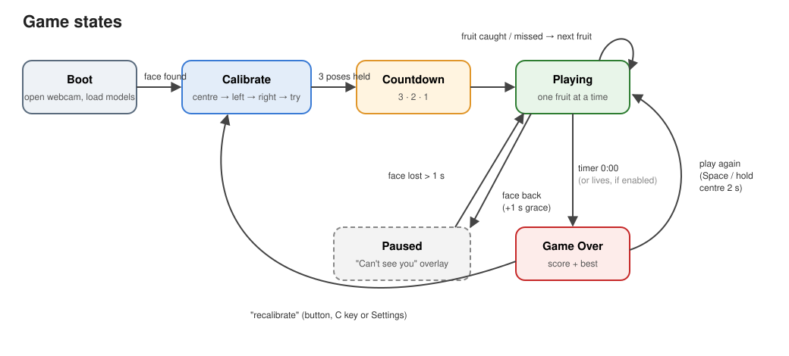
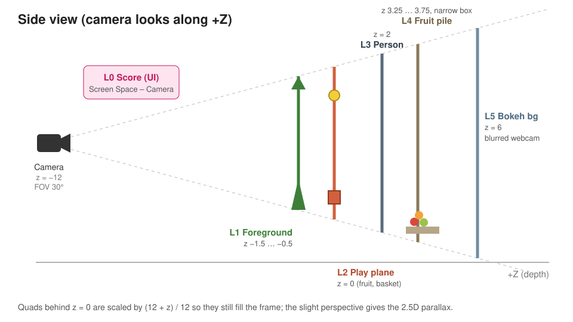
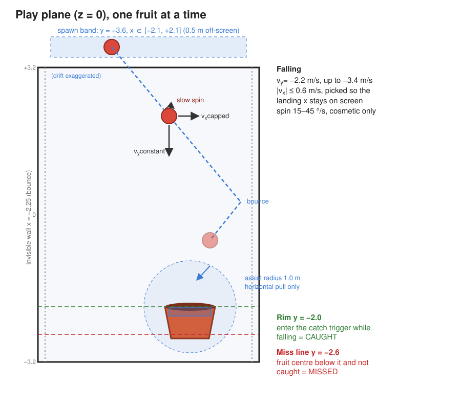
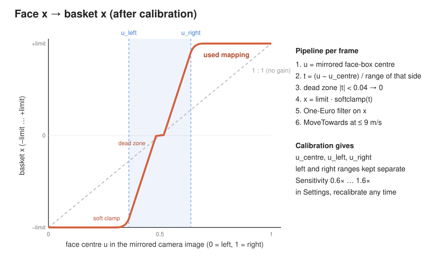
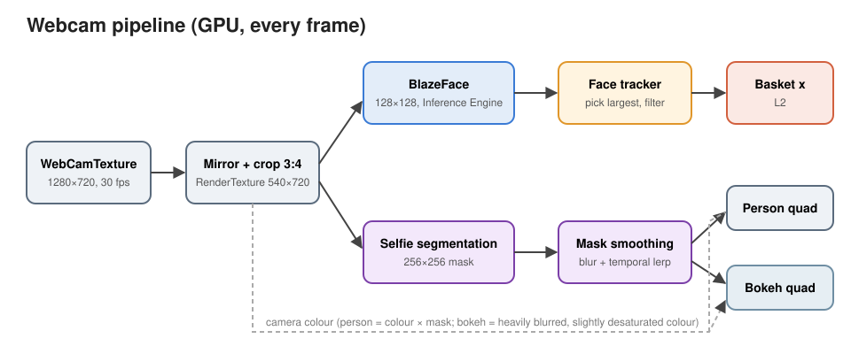

# 지스트의 과일 사진가게 (FruitGame) — design & build reference

An **interactive, accessibility-focused photo booth**. A visitor stands in front of a webcam and plays a one-minute fruit-catching game using only head movement: a basket follows their face left and right, and fruit falls one at a time from the treetops. Every catch drops onto a growing pile behind them. When the round ends, they pose in front of their pile and take home a framed photo, printed or downloaded to their phone.

The whole thing is styled as **pixel art and voxels**: block-built fruit, trees and basket, a gently pixelated render, a pixel font for Korean and English, and chunky 3D UI.

This document describes the MVP as it should be. Where the current build doesn't match yet, the milestone that closes the gap is named (§15). The history of how each choice was made is in the decisions log (§16). Numbers are starting values to tune in playtesting.


*The diagrams in this document were drawn for the earlier low-poly build. The layout, depths and mechanics they show still apply; only the art style has changed.*

---

## 1. At a glance

| | |
|---|---|
| Title | **지스트의 과일 사진가게**, with a smaller English line underneath: "GIST Fruit Photo Shop" |
| What it is | A booth experience: calibrate → play a 60 s round → pose → take home a framed photo |
| Engine | Unity 6000.6.7f1, URP 17.6, Input System 1.20 |
| ML runtime | Unity Inference Engine (`com.unity.ai.inference` 2.6.1), all on-device |
| Target | **macOS and Windows** standalone. Everything used (WebCamTexture, Inference Engine, URP, HttpListener) is cross-platform; anything macOS-only gets a Windows fallback or is flagged. |
| Screen | **Portrait 3:4**, reference 1080 × 1440, letterboxed in any window |
| Control | Face x position from the webcam. Mouse/keyboard fallback for testing (F2). |
| Operation | **Mouse only.** Every screen is usable with a mouse; keys are shortcuts for staff. |
| Style | **Pixel / voxel**: voxel models, a gently pixelated render, Neo둥근모 Pro pixel font, keycap-style 3D UI |
| Language | **Korean first** (in-game tone: 해요체), English as a fallback |
| Session | A **60 s timed round**. A lives counter is coded in but switched off. |
| Accessibility | Per-player calibration of head movement, so even a small comfortable range covers the whole basket travel; forgiving rules; large, high-contrast UI |
| Output | A 1080 × 1440 framed photo: printed, or downloaded over local Wi-Fi via QR code |

---

## 2. Player journey



| Step | What happens |
|---|---|
| **Title** | The title screen shows the 3D voxel title **지스트의 과일 사진가게** (its blocks drop in and stack like fruit), the icon, and big **Play** and **Calibrate** buttons. The live camera runs behind it so people walking by see themselves. |
| **Calibrate** | Three held poses (straight, left, right) measure this player's comfortable head range, then a short **Try it** where the basket follows the new mapping (§6). Runs automatically the first time; afterwards it's optional from the title screen. |
| **Countdown** | 3 · 2 · 1 with a tick sound. |
| **Playing** | Exactly one fruit falls at a time; the next appears 0.6 s after the current one is caught or missed (§4–§5). Each catch drops a copy onto the pile behind the player (§8). |
| **Paused** | From the **II** button, or automatically after 1 s without a face ("Can't see you!"); resumes 1 s after the face returns. The pause menu has **Resume** and **Main menu**. |
| **Game over** | When the 60 s run out, the fruit still in the air is allowed to land, then: "Time's up!", the score, the best score, a score-over-time graph, the per-fruit tally, and **Play again**, **Photo** and **Main menu**. |
| **Photo booth** | Pose in front of this round's pile with the beauty filter on → 3·2·1 → flash → framed preview → **Print**, **Get it on your phone** (QR), **Save**, **Retake** or **Done** (§10). |
| **Back to title** | **Done** or **Main menu** returns to the title screen and clears the pile for the next visitor. |

---

## 3. Look & scene

### Scene layers (front to back)

The scene is a stack of parallel planes along Z, seen through a **perspective camera with a narrow FOV**, so depth gives a gentle 2.5D parallax.



| Layer | What | Z (world) | Notes |
|---|---|---|---|
| **L0** | HUD: score, timer, pause button | UI | Voxel score and timer digits on a 3D UI camera; flat UI on a Screen Space – Overlay canvas inside a "Frame" rect fitted to the 3:4 viewport (§11). |
| **L1** | Foreground | −1.1 … −0.45 | Four small voxel trees (two pines, a cypress, a small oak) toward the bottom corners, with voxel bushes, grass and flowers along the bottom edge. **Varied, not one green:** each plant gets its own leaf tint (base, deep, yellow-green, blue-green or olive), and each flower its own petal colour (pink, white, orange, red, lilac or yellow). Extra small flowers and grass tufts at the front fill the gaps; big bushes are never added there, so nothing climbs higher over the basket. Same 6.3 cm blocks as the rest of the play layer. |
| **L2** | Falling fruit + basket | 0 | The gameplay plane. All gameplay maths happen here in 2D (x, y). |
| **L3** | The player | 2 | The webcam image with the background removed (§9), kept **sharp** and given a 3 px dark pixel outline (#1E2233) so it sits in the pixel world. |
| **L4** | Background fruit pile | ≈ 3.0 … 4.2 | Caught fruit stacks up with physics behind the player (§8). |
| **L4b** | Distant orchard | 5.2 … 5.95 | A layered orchard along the sides and top: the two big oak canopies framing the top corners and two pines, plus six smaller trees at varied sizes and depths pushed out to the edges, each with its own leaf tint so the layer isn't one flat green. A few fruit blocks (red, orange or yellow per tree) sit on the camera-facing side of each canopy, and three block clouds drift near the top. Coarser blocks than the play layers and dithered toward the sky, so it all reads as far away. The **centre stays open** so the live room behind the player shows through. No shadows. |
| **L5** | Backdrop | 6 | The live camera frame of the room behind the player, sharp by default (an optional bokeh blur exists). Alternative: a pixel-art orchard illustration (§9). Drawn through the back pixel layer, like L4 and L4b. |

**Camera:** position (0, 0, −12), looking +Z, vertical FOV 30°. `PortraitLetterbox` keeps it at 3:4 in any window size (black bars from a second camera) and stretches the HUD frame to match. At z = 0 the visible area is about **4.8 m wide × 6.4 m tall**; one world unit is one metre. Quads behind z = 0 are scaled by `(12 + z) / 12` so they still fill the frame exactly.

### Rendering style

| Element | Spec |
|---|---|
| **Models** | Every model is **voxel**: fruit, basket, trees, bushes and ground are generated from the source low-poly models by an editor voxeliser (§12), so shapes and colours carry over. Block sizes per group: **fruit 4.4 cm** (about 20 blocks across a fruit, so shapes stay readable), **play-layer world 6.3 cm** (basket, foreground trees, bushes, ground), **far layer 9 cm**. Fruit get clean flat colours (5 per fruit, from a shared palette) and every mesh is seamless (§12). |
| **Pixel render** | `PixelRenderer` on the main camera. Two helper cameras draw the game layers at `renderScale` (½: **540 × 720**) into point-filtered textures: **back** (layers Back and Pile: backdrop, far orchard, pile) and **front** (everything else: basket, falling fruit, foreground plants, on a transparent background). The main camera then draws, at full resolution, the back layer on a far quad, the sharp player (layer Person) and the front layer on a near quad (layer PixelComposite), so every game pixel is a crisp 2 × 2 block and the layering needs no depth tricks. `PixelSnap` moves the falling fruit and basket visuals in whole game pixels. No palette limit and no model outlines. |
| **The player** | L3 renders at full resolution, so the beauty filter and the photo stay crisp. Its outline (3 px, #1E2233) is drawn around the matte and skipped wherever something in the play layers is in front of the player, so it never traces the basket or bushes (the front layer simply draws over it). The ring is found by sampling the matte on two circles around each pixel, and the soft matte edge blends into the outline colour rather than the scene, so there's no light fringe. The player is always sharp in the photo too (no "pixel me" option). |
| **Depth** | Distance is shown with **ordered dithering** (Bayer 4 × 4, on the game-pixel grid, in 4 steps) toward the sky colour (#A9C6DD) instead of faded colours: strength **0.5 on the pile** and **0.55 on the far orchard** (clouds about a third of that). Textures on dithered layers are sampled at full size only, since their colour atlases are small swatches that blend into rainbow noise at lower mip levels. Falling fruit stay full colour and full contrast, so they never blend into the pile. |
| **Lighting** | One warm directional light (about 50° down, from the upper left) with soft shadows, plus a light-blue/soft-green gradient ambient. Voxel faces are flat-lit, which suits blocks. The player and backdrop are **unlit**, so the webcam image keeps its true colour. |
| **Post-processing** | On the main camera only, over the final composite: tonemapping, colour adjustments, a soft bloom and the vignette. **No depth of field**: blur smears the pixels and the dither. The helper cameras render without post-processing. The rim light on falling fruit stays; it reads as a light edge on the block faces. |

---

## 4. Rules & scoring

- **Caught** = points for that fruit type (all 1 for now). The fruit pops into the basket, then a copy drops onto the background pile.
- **Missed** = no penalty in timed mode; it only costs time. The miss is counted. The fruit falls off-screen behind the bottom bushes.
- **Round timer:** 60 s, top-right. It pauses whenever the game pauses. The last 10 s pulse.
- **Lives (coded, off):** `LivesCounter` and a lives HUD exist and are tested, but `GameConfig.endCondition = Timer` keeps them inactive. Switching to `Lives` (or `TimerOrLives`) makes 3 misses end the round, with no other code change.
- **Difficulty ramp:** driven by elapsed round time. Fall speed goes from 2.7 to 3.8 m/s and the drift cap from 0.7 to 1.2 m/s along an ease-in curve. It stays easy on purpose.
- **Best score** is saved in PlayerPrefs.

### Fruit types & scoring hooks
Every fruit is its own type, even though all are worth the same for now, so variety-based scoring can come later without a refactor.

- A `FruitType` ScriptableObject per fruit holds its id, display name, model(s), points (= 1), spawn weight, size scale, collider shape and icon. Optional `atlas`/`atlasFar` textures let models from a second pack use their own colour atlas; voxel fruit (M10) won't need them.
- **16 types:** apple, banana, orange, pear, lemon, mango, grapefruit, grapes, cherries, avocado, dragon fruit, coconut, mangosteen (common or fairly common); pineapple, melon and watermelon (rarer and a bit bigger).
- Score goes through one `ScoreRules.PointsFor(FruitType, context)` function. Today it returns `type.points`; later it can apply combos, streaks or rarity.
- `RoundStats` tracks caught and missed counts **per type** plus a score history (time, score after each catch). Game over shows the tally in two columns and the history as a step graph.

---

## 5. Falling fruit



| Property | Spec |
|---|---|
| Spawn position | Random x in ±2.1 m, at y = +3.6, just above the top edge, so fruit appears to drop out of the canopy |
| Vertical speed | **Constant** per fruit: 2.7 m/s at the start, ramping to at most 3.8 m/s |
| Sideways speed | Random but capped: \|vx\| ≤ 0.7 m/s at the start, up to 1.2 m/s, wide enough that wall bounces are common and visible |
| Walls | Invisible walls at x = ±2.25 reflect vx, so fruit never leaves the screen sideways |
| Spin | 120–240 °/s around a random axis, fast enough to read the fruit's shape. Cosmetic during the scripted fall. |
| Size | Every fruit is normalised to about **0.88 m** across (`fruitSize` × the type's `sizeScale`), whatever its model scale |

### Two-phase movement with real basket collisions
Each fruit is a Rigidbody with a sphere collider, locked to z = 0.

1. **Scripted fall:** every physics step its velocity is held at `(vx, −vy)`, so the constant downward speed stays exact. The assist (§7) nudges vx and the walls reflect it.
2. **Knocked:** the moment it touches the basket (rim, side wall or floor edge), the scripted fall stops and physics takes over. The fruit bounces (bounciness 0.45) and falls under `knockedGravity` (9 m/s²). The assist no longer applies, so a basket that arrives late *bangs the fruit away* instead of swallowing it. The basket is a kinematic Rigidbody moved with `MovePosition`, so a fast basket also shoves fruit sideways.

### Catch / miss detection
- **Caught:** the fruit's centre is inside the tub (below the rim, between the tapered inner walls), detected by a trigger inside the basket. That covers clean drops and lucky bounces off the rim.
- **Missed:** the fruit's centre drops below the miss line (y = −2.6) without being caught, or a knocked fruit is still unresolved after 4 s (in case it balances on the rim).
- **Bump feedback:** every basket contact plays the "tink" and wobbles the basket (sound throttled to once per 0.12 s).
- With solid walls, a fruit (radius ≈ 0.44 m) only drops in cleanly within about ±0.3 m of the basket centre; nearer the edges it clips the rim and physics decides. The assist compensates.

---

## 6. Basket & face control

| Property | Spec |
|---|---|
| Axis | Follows face tracking on x only; y is fixed with the rim at −2.0 (roughly chest height) |
| Size | Mouth **1.6 m** wide (a third of the screen), 0.8 m tall, tapering to 0.75 × at the bottom. The model tilts 5° toward the camera so the mouth reads. |
| Travel | x clamped to ±1.45 m so the basket never leaves the screen |
| Movement | The player's **own comfortable range** maps to the **full** basket travel |



### Mapping, per frame
1. `u` = horizontal centre of the tracked face box in the **mirrored** camera image (0…1). Mirroring means moving left moves the basket left, like a mirror.
2. `t = (u − u_centre) / (u_centre − u_left)` left of centre, and `(u − u_centre) / (u_right − u_centre)` right of centre. Each side uses its **own** measured range, so a player who turns further one way still reaches both edges. **Sensitivity** (0.6×–1.6×) scales on top.
3. Dead zone: `|t| < 0.04 → 0`, so small head jitter at rest doesn't move the basket.
4. `x = limit · softclamp(t)`: linear through the middle, easing into ±limit past the 0.8 knee, so overshooting your range doesn't feel like hitting a wall.
5. A **One-Euro filter** on x (min cutoff 1.2, β 0.4): smooth when still, responsive when moving fast.
6. `MoveTowards` with a max speed of 18 m/s to absorb tracker glitches.

> The basket deliberately moves further than the face does on screen, so it won't sit exactly under the player's chin. Crossing the whole camera shot with your head is unviable, especially for players with limited neck or upper-body movement.

### Calibration
Calibration measures how far **this** player can comfortably move their head, so they get the finest possible control.

1. **"Look straight at the camera"**: a 1 s steady hold records `u_centre`.
2. **"Move your head left as far as is comfortable"**: records `u_left`, the furthest *held* position (not a momentary peak).
3. **"Move your head right as far as is comfortable"**: records `u_right`.
4. **Try it**: the basket follows the new mapping; **Looks good** saves, **Redo** repeats, **Back** cancels and keeps the old calibration.

Accessibility details:
- "Steady" means the face stays within ±0.015 (u) for 1 s, shown as a ring filling around the face. Tolerance and hold time are settings, for players with tremor.
- Left and right ranges are stored **separately**; there's no symmetric `min()`.
- A very small range is accepted; there's only a floor of 0.03 per side to keep the maths stable. The dead zone and filter scale with the range, so it stays steady.
- If the face box is under 12 % or over 45 % of the frame width, a prompt says "move closer" or "move back".
- Prompts use large text plus arrows; optional voice/sound cues are a polish item.
- Saved in PlayerPrefs. Defaults if skipped: 0.5 / 0.35 / 0.65. **C** recalibrates.

### Face tracking robustness
- With several faces, track the largest box, but stick with the previous target while it still overlaps it (IoU ≥ 0.3).
- Face lost: the basket holds its position. After 1 s the game pauses with "Can't see you!", and resumes 1 s after the face returns (a manual pause still waits for Resume).
- Keyboard ← → / A D and mouse x drive the basket when no webcam is present or when **F2** is toggled.

---

## 7. Assist attractor

A slight attractor with a capped radius, to make the game forgiving:

- Only acts on the current falling fruit, only during its **scripted fall** (never once knocked), only while it's **above the rim**, and only within **R = 1.8 m** of the basket mouth.
- Adds a **horizontal** acceleration toward the basket's x: `a = strength · (1 − d/R)` with strength 4 m/s², capped so vx never exceeds the drift cap + 1.0 m/s.
- Never touches vertical speed, so the constant fall speed holds.
- It noticeably pulls near-misses in, but a basket that's too late still gets hit and knocks the fruit away. Strength 0 turns it off ("Assist: Off / Low / Normal" in settings, M6).

---

## 8. Background fruit pile

When a fruit is caught, the falling fruit is consumed by the basket. A **pile copy** of the same type then drops from above, behind the player, into a **very narrow invisible container** about one fruit deep, so it stacks like a 2D heap but still looks 3D. Over the round a colourful heap builds up behind the player, partly hidden by the foreground. Nothing stacks inside the basket.

### The container
- Invisible box colliders: a floor (y = −3.6), left and right walls at x = ±3.0, and front and back walls `pileDepthFactor` (1.15) × the largest fruit's diameter apart, so two fruit can never sit side by side in depth.
- Built by `FruitPile` at runtime from `GameConfig`. Caught fruit are added by `GameStateMachine`; the pile is cleared when a new round starts and when returning to the title.
- Elongated fruit (banana, pear, pineapple, grapes, dragon fruit, avocado) get a capsule along their longest axis; the rest get spheres.
- Fruit keep full 3D rotation and tumble between the walls, which is what makes the pile read as 3D.
- Drop point: a random free x across the container, from y = +3.6.

### Background look
- Pile fruit must never be mistaken for a falling fruit: they're dithered toward the sky colour (§3) and neither cast nor receive shadows. The pile uses `Fruit_Pile_Dither` (the shared fruit palette through `FruitGame/Dither Fade`), with its strength set from `GameConfig.pileDither` at start.
- In the **photo**, the pile switches to full colour so the catch shows off (§10).

### Anti-glitch measures
| Measure | Why |
|---|---|
| Simple colliders: spheres and capsules, never mesh colliders | Stable stacking, cheap |
| Narrow front/back walls instead of a frozen Z axis | Keeps the 2D heap while rotation stays free; nothing tumbles toward the camera |
| Interpolate, collision mode Continuous Dynamic | No tunnelling or jitter at render rate |
| `maxDepenetrationVelocity = 1.5` | Overlaps resolve gently instead of fruit "exploding" out |
| Spawn only where there's free space; otherwise try another x, then spawn higher | Never spawn inside another fruit |
| Physics material: friction 0.8, bounciness 0.05 | Settles quickly |
| **Freeze when settled**: speed < 0.05 m/s for 1.5 s → kinematic | A big pile costs nothing and can't creep |
| Cap of **40** pile fruit; past that the oldest shrinks away over 0.3 s and the frozen fruit wake to settle into the gap | Bounded cost, no floating fruit |
| Its own physics layer `Pile` (8), ignoring every other layer | Can't touch gameplay fruit or the basket |
| Solver iterations 10 / velocity iterations 4 for pile bodies; fixed timestep 1/60 | Better stacking stability |

*Stress-tested: 50 fruit dropped in bursts; it capped at 40, most froze once settled, none escaped, and the heap reached y ≈ −0.9.*

---

## 9. Webcam pipeline



| Stage | Spec |
|---|---|
| **Capture** | `WebcamSource` opens a `WebCamTexture` (1280×720 at 30 fps requested). Camera choice: `GameConfig.preferredCameraName` if a device name contains it, else the first non-built-in camera (e.g. an iPhone via Continuity Camera, a capture card or a USB webcam), else any. All device names are logged. |
| **Prep** | A blit mirrors the frame and centre-crops it to 3:4 into a 540×720 RenderTexture. Rotation and vertical flip reported by the device are handled here. |
| **Face detection** | `FaceTracker` runs **BlazeFace short-range** (128×128, six keypoints; Apache-2.0) on the GPU with score filtering and NMS baked into the graph, and async readback so rendering never stalls. Outputs the face box, centre, score, keypoints and last-seen time. ~50–130 detections/s. |
| **Person matting** | `PersonSegmenter` runs **Robust Video Matting** (ResNet-50 fp32; **GPL-3.0**) at 576×768 with downsample 0.5 baked in, carrying its four recurrent states between frames for temporally stable, strand-level hair edges. It's **time-sliced** with `ScheduleIterable`: a slice of layers per frame, adapted to hold the target frame rate (60), so the game runs at full speed while the matte updates ~20×/s. MediaPipe Selfie Segmentation (256×256, Apache-2.0) is the fallback model. |
| **Matte cleanup** | `Mask Smooth` blurs each new matte slightly and blends it 85 % with the previous one; the cut-out uses smoothstep(0.05, 0.75), so edges are soft and don't flicker. |
| **Player (L3)** | `PersonCutout` draws camera colour × matte through `FruitGame/Person Cutout` at queue Geometry+500, writing depth only where the person is. The same shader applies the beauty filter in the photo booth (§10) and, from M11, the pixel outline. |
| **Face mesh** | `FaceMesh` runs **MediaPipe Face Mesh v2** (478 points; Apache-2.0) on a crop around the BlazeFace box, **only while the photo booth is open**, to place makeup and the eye reshape precisely. |
| **Backdrop (L5)** | `BokehBackdrop` shows the camera frame sharp and ungraded by default. Its **Bokeh** switch brings back the blurred version: the player masked out, Kawase-blurred at ¼ resolution, slightly desaturated, brightened and tinted, so the room becomes soft bokeh. **Use Illustration** shows a pixel-art orchard illustration instead (`Art/Backdrops/OrchardIllustration.png`, from Photo Booth 2), centre-cropped to 3:4; off by default. |
| **Fallbacks** | No matting model: the person layer shows the full frame. No camera at all: a plain backdrop colour, the person layer hidden, and the mouse/keyboard drives the basket. |

**Cross-platform notes**
- WebCamTexture, Inference Engine (Metal on macOS, DX12/Vulkan on Windows) and URP run on both platforms. GPU backend, with CPU as a fallback.
- macOS needs camera permission: set **Player Settings → Camera Usage Description**, and allow the app under System Settings → Privacy → Camera.
- Windows can block the camera under Settings → Privacy → Camera; show a clear message if no frames arrive.
- Shaders are HLSL only, with no platform-specific paths.

---

## 10. Photo booth

A souvenir photo at the end of a round: the player in front of the fruit pile they just caught, softened with a Korean-style beauty filter, in a branded frame with the title, the lab's and school's logos, and their scores.

### The four-cut photo
The print is a **four-cut** (네컷): three **action shots** taken automatically during the round, plus the **final shot** posed in the booth afterwards.

- **Action shots** (`ActionShots`): spaced evenly through the round (a 60 s round: at 15, 30 and 45 s). Before each, a small **3 · 2 · 1** counter appears under the pause button and the screen flashes lightly (30 %) on every number; then the **shutter** sounds and the scene is captured as it is mid-play (basket and falling fruit included, the pile in full colour, no HUD). Everything follows the round timer, so it pauses with the game. A new round discards the previous round's shots.
- **Final shot** (`PhotoBooth`): as before, posed in front of the round's pile.

### Booth flow (mouse-operable, like every screen)
1. **Game over → Photo.**
2. **Pose screen:** the live scene stays up with this round's pile in **full colour**; the basket and fruit spawner are hidden. The beauty filter is already on, so players see how they'll look. "Strike a pose!" and a big **Take photo** button.
3. **3 · 2 · 1** (the countdown tick), then a white flash and the shutter sound.
4. **Preview** of the four-cut print with **Print**, **Get it on your phone**, **Save**, **Retake** (replaces only the final shot) and **Done**.
5. **Done** returns to the title screen and clears the pile.

### What's in the print
| Element | Spec |
|---|---|
| Canvas | Portrait **1080 × 1440**, composed off-screen by `PhotoFrame` at full resolution regardless of window size, on a cream #FFF8EC card |
| Title | The flat pixel title (`Art/Title/Export/Title.png`) across the top. Without it, `GameConfig.photoCaption` ("GIST Fruit Photo Shop") is shown as text instead. |
| Cuts | A **2 × 2 grid** (478 × 452 per cell) inside an **orange pixel frame** (the orange keycap sprite, 9-sliced): the action shots in reading order, and the **final shot bottom-right with a darker orange #B85C10 outline**. Each 3:4 shot is cropped to its cell, trimming a little more from the top (sky) than the bottom (`cropFromBottom` 0.35). Missing action shots leave their cells empty. |
| Bottom band | **Lab logo** (left; pixel panel placeholder, TBD: there may not be one) · this round's **score** (sticker) and **"Best n"** (centre) · **GIST school logo** (right; `Art/Logos/GIST_Wordmark.png` in a 330 × 190 slot). Logos keep their aspect ratio. |

### Korean-style beauty filter ("뽀샤시" look)
A port of **GPUPixel**'s beauty filter (Apache-2.0), built into `FruitGame/Person Cutout`, so it touches only the player and shows live on the pose screen as well as in the photo. Overall strength is `GameConfig.beautyStrength` (1; 0 = off), active only while the booth is open.

| Step | Spec (current values) |
|---|---|
| Skin smoothing | Guided-filter smoothing: `BeautyPrep` builds a half-res mean and a high-pass variance; each pixel is pulled toward the mean where the variance is low, so edges and features stay crisp (`_BlurAlpha` 0.45) |
| Sharpen | A 3×3 high-pass sharpen (`_Sharpen` 0.15) |
| Whitening | GPUPixel's LUT chain, baked offline into `beauty_skin_lut.png` + `beauty_light_lut.png` (`_Whiten` 0.3), faded out on near-black pixels so hair stays natural |
| Makeup | Soft cheek blush (`_BlushStrength` 0.07) and a lip tint (`_LipStrength` 0.225), placed from Face Mesh points (falling back to BlazeFace keypoints) and eased over time so nothing jumps |
| Reshape | Eye enlargement `GameConfig.bigEye` 0.2; V-line slimming `faceSlim` 0 (off: it looked unnatural) |

Known nits: bright glasses glare picks up a slight cool tint, and eye enlargement bends glasses frames slightly.

### Getting the photo home
- **Print:** `PhotoShare.Print` saves the PNG, then sends it to the default printer (macOS `lp -o fit-to-page`, optional `printerName`; Windows shell "print" verb). Failure shows "Couldn't print (is a printer set up?)".
- **Get it on your phone:** `PhotoShare` runs a small `HttpListener` server (port 8765) that serves each photo at an unguessable link `http://<LAN IP>:8765/p/<id>`, a mobile page in the game's pixel style (cream background, the pixel title, Neo둥근모 served from `StreamingAssets/PhonePage/` as a web font, the photo in a dark pixel border, and a pink keycap "Save photo" button that sinks when tapped). A QR code (`QrCode.cs`, an in-project encoder: byte mode, ECC M, versions 1–10) and the link as text are shown on a card. Links expire after 15 minutes.
- **Save** writes `~/Pictures/FruitGame/FruitGame_<date>_<time>_<score>.png` (Windows: `Pictures\FruitGame\`).
- **Booth notes:** phones must be on the same Wi-Fi as the booth computer; venue Wi-Fi with client isolation will block downloads; macOS may ask to allow incoming connections the first time. Email delivery is not part of the MVP.

### Privacy
- Photos are saved only on the booth computer, only when printed, shared or saved; nothing is uploaded anywhere, and phone links work only on the local network and expire.
- A short "Photos are saved on this computer" note sits on the preview screen.
- An optional `photoAutoDeleteDays` setting (M6) cleans old photos out at startup.

---

## 11. UI, text & feedback

### Typography
- **One font for everything: Neo둥근모 Pro** (SIL OFL 1.1), covering all 11,172 Hangul syllables (16 × 16 grid) and Latin (8 × 16).
- Imported into TextMeshPro as `NeoDunggeunmo Pixel`: a dynamic **raster** atlas (hinted, no anti-aliasing) sampled at the font's native 16 px, point-filtered, 5 texels of padding. Every font size is a **multiple of 16 px** on the 1080 × 1440 canvas, so each glyph pixel is a whole number of canvas pixels; inline sizes use absolute values (`<size=64>`), never percentages. No auto-sizing: long labels wrap instead.
- A single weight only: emphasis comes from size, colour and effects, never a fake bold. The `FruitGame/Pixel Text` shader builds effects from whole glyph pixels: the outline dilates the glyph by 1 glyph pixel, and the shadow is the outlined shape shifted 1 glyph pixel down-right. Three materials: **Pixel** (plain, for buttons and panel text), **Sticker** (white face, pink #C2185B outline, dark #590A2E shadow; titles, score and timer, sizes above 64 px) and **Shadow** (shadow only, for sticker-style text at 64 px or less, where an outline clutters Hangul).
- **Korean is the main language**, in **해요체** for all in-game text; **English** is the alternative. Every player-facing string (about 70: labels, HUD and calibration messages, photo booth messages, the phone page, the 16 fruit names) lives in one tab-separated table, `Resources/Strings.txt` (key · Korean · English; `\n` for line breaks, `{0}` for values), so wording can be edited without code. `Strings.Get(key)` returns the current language; static labels carry a `LocalizedText` with their key. `LanguageSwitch` sets the starting language from `GameConfig.language` (Korean) and **F3** flips Korean ⇄ English for staff; open screens refresh. The F1 debug overlay stays English. Every string was measured to fit its text box in both languages.
- The font has no arrow glyphs (← →): use ◀ ▶. Check new on-screen characters against the font before using them.

### Title screen & logo
- `VoxelTitle` (on the "Title" object, 2 m in front of the play area, so it renders through the front pixel layer) builds the title at runtime from 1-bit glyph bitmaps in `Art/Title/` (Neo둥근모 at its native 16 px, 1 pixel = 1 block; `README.txt` there has the command to re-render them): the first line is the **pixelated GIST 지스트 logo** (`GIST_Logo_Pixel.png`: the 지스트 mark from `Art/Logos/GIST_Logo.png` at 20 blocks tall, snapped to its red #DF1B14 and dark green #3F584F, keeping its own colours with a cream outline) followed by **의**, and the second line is **과일 사진가게**, the English line **GIST Fruit Photo Shop** at half size below.
- Sticker style in 3D: cream letters **4 blocks deep** (about the stroke's cross-section: 1 block of letter plus the outline ring either side), a pink #C2185B outline set back one block so the fill stands proud, and a dark #590A2E shadow block behind, offset down-right. The logo is extruded the same way. Vertex-coloured blocks lit like the scene (`FruitGame/Voxel Title`), with a slanted band of light sweeping across every 4 s. Always a slight angular wiggle (±4° / ±9°) and scale pulse (±2.5 %) about the title's middle, plus a gentle bob once settled, so it clearly reads as 3D.
- **Icon:** a voxel camera (pink body, dark front plate, white flash and shutter) whose lens is an orange slice; it sits beside the first line.
- **Intro:** whenever the start screen appears, the title, cut into 8-column strips × 4-row slices, drops in left to right and bottom up, each piece landing with a small bounce, so the letters stack up like caught fruit (about 2.5 s). The title shows only on the start screen.
- **Flat exports** (FruitGame > Title > Export PNGs, `TitleExporter`): `Art/Title/Export/Title.png` (1272 × 600, transparent), `Icon.png` (transparent) and `AppIcon.png` (1024 × 1024 on the sky colour), rendered at 4 px per block and scaled up with hard pixels; the title and icon are also copied to `Docs/images/` for the README.

### Buttons, panels & HUD
- **Pixel UI art** (`Art/UI/`, 1 pixel = 4 canvas units; sliced Images use Pixels Per Unit Multiplier 0.25): keycap face and lip sprites in pink #C2185B, slate #5A6B7D and orange #F28C26 (dark #1E2233 outline, light top-left edge), and a cream panel with a thick darker bottom edge.
- **Buttons are keycaps** (`KeycapButton`): the button's image is the dark lip and a Face child carries the label, leaving 3 pixels of lip below. Hover lifts the face 1 pixel; pressing sinks it so the lip disappears. Positions snap in whole pixels. Large hit areas (≥ 110 canvas units tall) keep the mouse-only booth easy.
- **Panels** (game over, the phone card) use the cream panel sprite.
- **Score** (top-left) and **timer** (top-right) are **3D block digits** (`VoxelText` on the HUD text objects): Neo둥근모 digit glyphs (`Art/UI/Digits.png`) extruded in the title's sticker style, 1 glyph pixel = 1 block at the text's size. Same 4-block extrusion as the title; each character has its own sticker cell, so digits never overlap. They mirror the text objects' value, visibility and scale, so the score's pop and the timer's last-10-seconds pulse carry over. Each digit wiggles (±6° / ±12°) and pulses (±4 %) gently, and when the score goes up the digits **bump straight toward the camera** (18 % of their distance) and swell 25 % for 0.6 s, growing in place. They're drawn by the **HUD camera** (`HudCamera`): a perspective overlay camera (30° FOV) stacked on the main camera, seeing only the HUD3D layer, matched to the main camera's 3:4 viewport, with the digits at the distance where 1 unit = 1 pixel, so the perspective shows their sides. The photo booth turns stacked cameras off while capturing, so the HUD never appears in photos.
- **Lives:** three small fruit icons under the score, hidden while lives are off.

### Screens

| Screen | Contents | Shortcut |
|---|---|---|
| **Title** | Voxel title with icon and English line, the hint, **Play**, **Calibrate** | Space / Enter = play |
| **Calibration** | Pose prompts with arrows, the steady ring around the face, **Try it** with **Looks good** / **Redo**, **Back** | Esc = back |
| **Playing** | Score, timer, **II** pause button at the top centre | P / Esc = pause |
| **Pause** | Dimmed game, **Resume**, **Main menu** (abandons the round) | P / Esc / Space = resume |
| **Game over** | "Time's up!", score, best, score-over-time graph, two-column fruit tally, missed count, **Play again**, **Photo**, **Main menu** | Space = play again |
| **Photo booth** | Pose / countdown / preview, as in §10 | — |

A **Settings** panel (M6) adds sensitivity, recalibrate, steady-hold tolerance and time, assist, camera device and mirror, all mouse-operable. The **F1** debug overlay shows the face box, the matte, the mapping value t and FPS; it's off by default at the booth (M6).

### Juice & audio
- A catch squashes the basket for 0.12 s and bursts a few block particles; a miss plays a soft thud; a rustle from the canopy telegraphs each spawn.
- Sounds: pop (catch), tink (rim), thud (miss), rustle (spawn), pile land, countdown tick, round over, and the camera shutter (action shots and the final shot). All short, one mixer, nothing loud. A gentle ambience loop is a polish item.

---

## 12. Art & assets

### Art direction
- **Palette:** leaf greens #3D7F3A / #5AA64F / #82C068, basket terracottas #D2603E / #8E3B23, accent pink #C2185B, sky #A9C6DD / #9CC3D9. Fruit keep their own colours.
- **Voxels everywhere in 3D**, pixel art everywhere in 2D, one pixel font. No smooth gradients or soft shadows in UI art.

### Sources
| Asset | Source | Use |
|---|---|---|
| Fruit | **Low Poly Food** (9 fruit, two variants each) and **PolyOne Free Fruits** (7 more; from the sister project Photo Booth 2) | Voxelised (M10) for falling and pile fruit |
| Trees | **Low Poly Trees (Lite)**: oak, pine, cypress | Voxelised for the foreground and far layers. Licence forbids redistribution: keep out of public repos. |
| Bushes, grass, flowers, rocks | **Kenney Nature Kit** (CC0), recoloured to the tree greens | Voxelised for the bottom edge |
| Basket | Our own: `FruitGame Extras/Basket/make_basket.py` → a 10-sided tapered tub with a chunky rim and two bands | Voxelised; scaled to `basketMouthWidth`/`basketHeight` so it lines up with the physics walls |
| Orchard illustration | Pixel-art orchard from Photo Booth 2 | Title screen background; optional game backdrop |
| Pixel buttons | Photo Booth 2's pixel buttons | Reference for the keycap button style |
| Logos | GIST wordmark (`Art/Logos/`); lab logo to come | Photo frame |
| Font | **Neo둥근모 Pro** v1.020 (`Art/Fonts/`, with `NeoDunggeunmo-OFL.txt`), OFL | All text |
| Audio | Kenney audio packs (CC0); camera shutter "Camera" by themightyglider (OpenGameArt, CC0) | All sounds |

New downloads go into `~/Documents/3D Assets/` first and are shown for a yes/no before being imported.

### Voxel pipeline (M10)
Editor tools under **FruitGame > Voxels** and **FruitGame > Scene** (`Scripts/Editor/Voxels/`), all re-runnable; block sizes come from `GameConfig` (§13):
- **`VoxelMesher`** turns triangles into blocks: every grid cell a triangle passes through becomes a block, the enclosed inside is filled, and only faces touching outside air are emitted. Vertices are welded on the integer grid (per corner, face direction and colour), so faces meet exactly: no T-junctions, no seams. Flat-coloured models keep the material of the nearest triangle per block (so the basket's alternating wicker and every plant's colours carry over).
- **Bake Fruit**: each `FruitType`'s source models (kept in `sourceModels`) become voxel prefabs in `Art/Voxels/Fruit/`, about 20 blocks across (17–26 by fruit size). Colours are cleaned up: each block averages the texture under it, then the blocks are reduced to `fruitColors` (5) colours per fruit with k-means. All fruit share one 16 × 16 point-filtered `FruitPalette.png` (plus `FruitPalette_Far.png`, hazed 65 % for the pile), set as each type's `atlas`/`atlasFar`, so the live, pile and photo materials work unchanged. 26 models bake in about 2 s, 500–2,500 faces each.
- **Mark Scene Meshes / Bake Scene**: every mesh under L1, L2 and L4b gets a `VoxelSource` that remembers its smooth original; baking rebuilds it at the object's own scale (world 6.3 cm, far 9 cm) into `Art/Voxels/World/`. 41 scene meshes → 39 block meshes, about 82k faces. Built-in cubes (fruit blocks, clouds) are skipped.
- **Build Orchard And Plant Variety** (`OrchardBuilder`) builds the L1/L4b variety from §3 into `Generated` containers with palette-material tints (`<material>__<variant>`), replacing them on every run. Run it before marking and baking.
- OBJ colours need care: Unity reads OBJ `Kd` as linear, so `ArtLibrary` rebuilds OBJ materials as palette materials with the intended sRGB colours.

---

## 13. Tunables (`GameConfig` ScriptableObject)

| Key | Default | Notes |
|---|---|---|
| `endCondition` | `Timer` | `Timer` / `Lives` / `TimerOrLives` |
| `roundDuration` / `countdownSeconds` | 60 s / 3 | |
| `lives` | 3 | only when the end condition includes lives |
| `fallSpeedStart` / `fallSpeedMax` | 2.7 / 3.8 m/s | eased over the round (`difficultyCurve` 2) |
| `driftCapStart` / `driftCapMax` | 0.7 / 1.2 m/s | |
| `spinDegPerSec` | 120–240 | |
| `spawnXRange` / `spawnY` / `nextFruitDelay` | ±2.1 m / 3.6 / 0.6 s | |
| `fruitSize` | 0.88 m | × each type's `sizeScale` |
| `wallX` / `rimY` / `missY` / `despawnY` | 2.25 / −2.0 / −2.6 / −4.2 | |
| `basketMouthWidth` / `basketHeight` / `basketTaper` / `basketWallThickness` | 1.6 m / 0.8 m / 0.75 / 0.08 | colliders are built from these and the model scaled to match |
| `basketXLimit` / `basketMaxSpeed` | 1.45 m / 18 m/s | |
| `knockedGravity` / `fruitBounciness` / `fruitFriction` / `knockedTimeout` | 9 m/s² / 0.45 / 0.3 / 4 s | physics after a basket hit |
| `pileZ` / `pileDepthFactor` | 3.6 / 1.15 × largest fruit | |
| `pileFloorY` / `pileHalfWidth` / `pileSpawnY` | −3.6 / 3.0 / 3.6 | |
| `pileMax` / `pileFreezeSpeed` / `pileFreezeTime` | 40 / 0.05 m/s / 1.5 s | |
| `assistRadius` / `assistStrength` / `assistExtraSpeedCap` | 1.8 m / 4 m/s² / 1.0 m/s | strength 0 = off |
| `sensitivity` | 1.0 | 0.6–1.6 |
| `deadZone` / `softClampKnee` | 0.04 / 0.8 | in t units |
| `calibMinRangePerSide` | 0.03 | |
| `oneEuroMinCutoff` / `oneEuroBeta` | 1.2 / 0.4 | basket x in metres |
| `steadyTolerance` / `steadyHoldTime` | 0.015 / 1.0 s | raise for tremor |
| `faceLostPauseDelay` / `faceReturnGrace` | 1.0 s / 1.0 s | |
| `photoCaption` | "GIST Fruit Photo Shop" | `{date}` is available if a date is wanted later |
| `beautyStrength` / `bigEye` / `faceSlim` | 1 / 0.2 / 0 | per-step beauty values live on the `Person_Cutout` material (§10) |
| `fruitBlockSize` / `worldBlockSize` / `farBlockSize` | 0.044 / 0.063 / 0.09 m | re-bake after changing (FruitGame > Voxels) |
| `fruitColors` | 5 | colours per fruit after clean-up |
| `language` | Korean | starting language; F3 flips to English |
| `preferredCameraName` | "Symplectomorphism" | part of a device name; empty = first non-built-in camera |
| `keyboardBasketSpeed` | 7 m/s | fallback input |

| `renderScale` | 0.5 | pixel render size as a fraction of 1080 × 1440 |
| `pileDither` / `farDither` | 0.5 / 0.55 | far dither is baked into materials: re-run Build Orchard after changing |
| `playerOutline` / `playerOutlineColor` | 3 px / #1E2233 | at 1080 wide; 0 = off |

---

## 14. Project layout & scripts

```
Assets/FruitGame/
  Art/        Beauty/ (GPUPixel LUTs + licence)  Fonts/ (Neo둥근모 Pro + Pixel/Sticker/Shadow materials)  Logos/  Title/ (glyph bitmaps, Export/)  UI/ (keycap and panel sprites, Digits)  Backdrops/  Materials/ (Palette/, incl. tint variants)  Voxels/ (Fruit/, World/, FruitPalette)  Models/ (Fruits/, FruitsPolyOne/, Trees/, Nature/, Basket/)  Rendering/
  Audio/      7 clips
  Config/     GameConfig.asset  FruitTypes/ (16 types)
  ML/         blaze_face_short_range.onnx + anchors  rvm_resnet50_fp32.onnx  selfie_segmentation.onnx  face_mesh.onnx  CREDITS.txt
  Prefabs/    Art/ (fruit, trees, nature, basket)
  Scenes/     Game.unity
  Shaders/    PersonCutout  BeautyPrep  MaskSmooth  BokehBlur  BokehBackdrop  FruitRim  PixelText  DitherFade  PixelComposite  VoxelTitle
  Scripts/
    Core/      GameConfig, GameStateMachine, SaveData, RoundTimer, LivesCounter, PortraitLetterbox
    Art/       VoxelSource, PixelRenderer, PixelSnap, BlockMesh, VoxelTitle
    Control/   BasketInputSource, FallbackInput, BasketInputRouter, FaceToBasketMapper, OneEuroFilter, CalibrationData, CalibrationController
    Gameplay/  FruitType, ScoreRules, RoundStats, FruitSpawner, FallingFruit, BasketController, BasketAssist, FruitPile, PileFruit
    Webcam/    WebcamSource, FaceTracker, PersonSegmenter, PersonCutout, FaceMesh, BokehBackdrop
    Photo/     PhotoBooth, PhotoFrame, PhotoShare, QrCode, ActionShots
    UI/        GameHUD, ScoreGraph, FaceDebugOverlay, KeycapButton, VoxelText, HudCamera, Strings, LocalizedText, LanguageSwitch
  Resources/  Strings.txt (the Korean/English string table)
    Feedback/  AudioFeedback
    Editor/    ArtLibrary, TitleExporter, Voxels/ (VoxelMesher, VoxelBaker, OrchardBuilder)
```

**Planned additions:** and `UI/SettingsUI` (M6).

**How the pieces connect**
- `BasketInputSource` is the control seam: `FaceToBasketMapper` and `FallbackInput` implement it, `BasketInputRouter` picks one, and `BasketController` doesn't care which.
- `GameStateMachine` owns the flow (states: Boot, Calibrate, Countdown, Playing, RoundEnding, Paused, GameOver, Photo) and exposes public methods (`Confirm`, `StartRound`, `TogglePause`, `ReturnToMenu`, `StartCalibration`, `StartPhoto`) that the buttons call.
- **The scene is hand-maintained:** `Game.unity` is the source of truth, edited in the Editor (and live by Claude, then saved). The original code scene builder is archived in `Docs/archive/` for reference.

Scene hierarchy: `Main Camera`, `Directional Light`, `L1_Foreground`, `L2_Play` (basket, spawner, walls), `L3_Person`, `L4_Pile`, `L5_Bokeh`, `UI` (Canvas with the Frame), `Photo Frame` (off-screen at y = 1000), `Systems` (state machine, webcam, trackers, photo booth).

---

## 15. Milestones & roadmap

Gameplay, face control, the webcam pipeline and the photo booth are working. What remains for the MVP is the pixel/voxel look, the title, localisation and polish. **M8** is a decision gate that settles block size and render resolution before the big conversion; **M6** comes last so it polishes the final look.

| # | Goal | Status / done when |
|---|---|---|
| **M1** | Greybox loop | ✅ One fruit at a time, catch/miss, per-type score and stats, the 60 s timer, game over and restart; lives coded but off. |
| **M1.1** | Playtest 1 fixes | ✅ Real basket collisions, bigger assist, faster tuning, mouse-only menus, two-column tally. |
| **M2** | First art pass | ✅ Low-poly fruit, trees, bushes, basket, lighting, the score counter and the 3:4 frame (being restyled in M8–M13). |
| **M3** | Face control | ✅ Webcam in, BlazeFace, the face→basket mapping with One-Euro filter, calibration, the face-lost pause. |
| **M4** | Player & backdrop | ✅ RVM matting, time-sliced to keep the game at full frame rate; the person cut-out; the backdrop (sharp, with optional bokeh). |
| **M5** | Fruit pile | ✅ The narrow-container pile with every anti-glitch measure, stress-tested with 50 fruit. |
| **M7** | Photo booth | ✅ Capture, the frame with logos and scores, the GPUPixel beauty filter with Face Mesh reshape, print and QR sharing. |
| **M7.1** | Photo Booth 2 imports | ✅ GIST wordmark in the frame, 7 PolyOne fruit types, the score-over-time graph, a Korean fallback font. |
| **M8** | Style test | ✅ The current models, voxels at full resolution, and voxels at ½ and ⅓ resolution (plus finer blocks, dither vs haze, a shimmer test and a keycap button mockup) compared in throwaway renders (a voxeliser prototype, a dither shader and a capture rig, removed after M11 superseded them; `Game.unity` untouched). **Picked:** voxels at ½ resolution; blocks fruit 4.4 / world 6.3 / far 9 cm; dither 0.5 / 0.55; no depth of field; 3 px player outline; no palette limit or model outlines; a fuller far orchard. *Rendered with a silhouette stand-in; re-check the outline with a real player in M11.* |
| **M9** | Pixel font | ✅ Neo둥근모 Pro as a crisp raster TMP font (`NeoDunggeunmo Pixel`) with the `FruitGame/Pixel Text` shader and Pixel / Sticker / Shadow materials; all 46 texts switched, sizes on the 16 px grid, auto-size off; percentage size tags replaced; ← → swapped for ◀ ▶; score and timer moved inside the frame; Fredoka and Jua removed (to the Trash). Every screen checked at 1080 × 1440 in English, and the start and game-over screens in Korean; all Korean labels measured to fit. Also fixed: the photo preview no longer sits behind the share buttons. |
| **M10** | Voxel models | ✅ `VoxelMesher` (welded, seamless), **Bake Fruit** (26 models, 5 clean colours each from one shared palette), **Bake Scene** (41 meshes at 6.3 / 9 cm via `VoxelSource`) and **Build Orchard And Plant Variety** (6 extra far trees, leaf tints, 55 fruit blocks, 3 clouds; 12 extra flowers and grass tufts, plant and petal tints), all re-runnable from the FruitGame menu. Sizes, colliders, basket walls and the pile container unchanged. *Checked in play: no seams, catches and misses still register, 200–350 fps in the Editor.* |
| **M11** | Pixel render & world | ✅ `PixelRenderer` (back/front ½-res layers around the sharp player; new layers Person, Back, PixelComposite), `PixelSnap` on falling fruit and the basket, the player outline in `FruitGame/Person Cutout`, `FruitGame/Dither Fade` on the pile and the whole far orchard (rebuilt by Build Orchard), depth of field off, and the illustration backdrop option. The photo booth renders both layers before capturing, so photos show the pile in full colour without the basket. The HUD canvas moved to the UI layer. *Checked with the silhouette stand-in: layering, outline (no fringe, nothing traced along the basket), dither, photo, 100–350 fps in the Editor. Still to check with a real player on camera.* |
| **M12** | Title & logo | ✅ `VoxelTitle` (pixel GIST 지스트 logo + 의 / 과일 사진가게 + English line, sticker-style blocks from Neo둥근모 bitmaps, light sweep, bob), the voxel camera icon with an orange-slice lens, the drop-in intro on the start screen, and flat PNG exports (title, icon, 1024 app icon) via FruitGame > Title > Export PNGs. The old TMP title is hidden and the hint moved below the title. |
| **M13** | 3D UI | ✅ All 19 buttons are pixel keycaps (`KeycapButton`: hover lifts 1 px, press sinks), the game-over panel and phone card use the cream pixel panel, and the score and timer are 3D block digits (`VoxelText`) on a stacked orthographic HUD camera (layer HUD3D), with the existing pop and pulse kept. Revised after review: 4-block extrusion for all block text (title, logo, digits), wiggle and pulse everywhere, a perspective HUD camera, digits spaced by full sticker cells, and a bump toward the camera on each catch instead of a spin. `BlockMesh.Sticker` is now shared by the title and the digits. *Checked: start, play, game over, hover/press states, and a photo without HUD.* |
| **M14** | Photo frame restyle + four-cut | ✅ The print is a **four-cut**: `ActionShots` takes three shots during the round (15/30/45 s, with a small 3·2·1 counter, light flashes and a shutter) and the booth's final shot completes the 2 × 2 grid, highlighted with a darker orange outline. The print is a cream card with the pixel title, an orange pixel frame and pixel-panel placeholders. The phone page is restyled to match (pixel font, keycap button), and the camera shutter sound (CC0) is used for every shot. *Checked: a full round with three action shots and the final shot composed into the print, every phone-page route, and the page at phone size.* |
| **M15** | Korean localisation | ✅ About 70 strings in `Resources/Strings.txt` (Korean 해요체 + English), `Strings` / `LocalizedText` / `LanguageSwitch` (Korean by default, F3 flips), 26 scene labels and every code-set message (HUD, calibration, photo booth, phone page, fruit names) through the table. Fit measured for every string in both languages (104/104 after enlarging the face-lost title layout, letting the logo placeholders wrap, and giving the print-failure message two lines). *Checked: Korean start and game-over screens, the English flip (including the game-over lines), and the phone page in Korean.* |
| **M15.1** | Labmate setup manual | ✅ Kept outside the repo, in `~/Documents/3D Assets/FruitGame Private Share/`: `FruitGame 설치 안내.md` (Korean: clone, unzip the shared files into the project **before** first opening Unity, open, optional re-bake, run, troubleshooting, licences), four zips of the repo-excluded files at their project paths (1 Model · 2 Fruit · 3 Trees · 4 Extras, each with its licence note in an ignored `FruitGame-licences/` folder), and `make-private-zips.sh` to rebuild them. *Checked: a clean copy of the repo plus the four zips gives exactly the working project's files, with no orphan `.meta`.* |
| **M6** | Polish & builds | Assist tuning, juice, ambience, the settings screen, debug overlay off by default, photo auto-delete; macOS and Windows builds with camera permission prompts. |

**Dependencies:** M8 gates M10 and M11. M9 can start any time. M12 needs M9 (glyphs) and M10 (the block mesher). M13 needs M9 and M10. M14 needs M9 and M12. M15 needs M9.

### Open questions
1. **Lab logo:** TBD; there may not be one. The frame keeps a placeholder until then (or the slot can be dropped).
2. **Public repository:** handled by `.gitignore` (decision 39). Before publishing, also decide whether to keep the GIST logos in a public repo (school marks) and the two old README PDFs (`README.pdf`, `Docs/FruitGame-README-M3.pdf`), which describe the pre-revision design.
---

## 16. Decisions log

| # | Question | Decision |
|---|---|---|
| 1 | End condition | **60 s timer.** A lives counter is coded in but unused, as a fallback (`endCondition` switch). |
| 2 | Background pile | A **copy** drops behind the player into a **very narrow invisible container**, so fruit stacks like 2D but looks 3D. Nothing stacks in the basket. |
| 3 | Basket vs. face | The basket **may move away from under the chin**. Crossing the whole shot with your head is unviable, and the game is aimed at **accessibility**. Per-player **calibration** of left/right head range gives the finest control. |
| 4 | Fruit variety | All worth the same for now, but **each fruit is tracked as its own type**, so variety-based scoring can come later. |
| 5 | Third-party assets | **Download first** into `~/Documents/3D Assets/` and **show them immediately** for a yes/no. |
| 6 | Platform | **macOS and Windows**; macOS only is acceptable if something can't be made cross-platform. |
| 7 | Fruit vs basket (playtest 1) | Fruit get **real physics collisions with the basket**: hitting the rim or a side bangs them away; the assist radius and strength go up so the attractor is noticeable. |
| 8 | Tuning (playtest 1) | Faster initial fall (2.7 m/s), wider sideways range (0.7–1.2 m/s) so wall bounces are visible, basket top speed doubled (18 m/s). |
| 9 | Booth UI (playtest 1) | **Everything mouse-operable**; the pause menu gets **Main menu**. |
| 10 | Game over layout (playtest 1) | Same-size score; a smaller **two-column** fruit tally so long runs don't overflow. |
| 11 | Ordering (2026-10-27) | More UI tweaks to come later; the art pass went first. Keep UI code easy to restyle. |
| 12 | Art tweaks (2026-10-27) | Fruit ×1.6 (0.88 m) with the basket scaled to 1.6 m; spin 120–240 °/s; basket tilt 5°; four small foreground trees; hazy distant trees. |
| 13 | Fruit pile | Built early (M5 before M3/M4). |
| 14 | Scene builder | Retired; the scene is edited directly and stays visible in the Editor. |
| 15 | Pile readability | Pile fruit hazed like the distant trees, with no shadows, so they read as background and never compete with the falling fruit. (Becomes dithering in the pixel style, decision 25.) |
| 16 | Depth cues | Rim light on live fruit and a slight depth-of-field blur on far layers kept; a ground shadow was tried and scrapped; a smaller pile and lower cap rejected. (Re-evaluated in M11.) |
| 17 | Photo booth (2026-10-27) | A photo with the last round's pile, a Korean-style beauty filter, a frame with the lab's and school's logos, and the scores. |
| 18 | Photo booth details | Placeholder logos until the files arrive; print first, QR download second, email only as a fallback (not built); event caption yes; pile in full colour. |
| 19 | Segmentation quality | Quality over performance: **RVM (GPL-3.0)** over MODNet (Apache-2.0) for its temporal stability; time-sliced so the game keeps its frame rate. |
| 20 | Beauty filter direction | Stronger, SNOW/SODA-flavoured (not Douyin-strong). No budget for paid SDKs, so port **GPUPixel** (Apache-2.0). |
| 21 | V-line off | The face slimming looked unnatural: `faceSlim` = 0. The code remains. |
| 22 | Gentler beauty | Every beauty setting halved from the tuned values: smoothing 0.45, sharpen 0.15, whitening 0.3, blush 0.07, lips 0.225, eye enlargement 0.2. |
| 23 | Bokeh off (for now) | The backdrop shows the plain, sharp camera frame by default; the **Bokeh** switch brings the blurred room back. |
| 24 | Assets from Photo Booth 2 (2026-10-28) | Brought over from the sister project: the **GIST wordmark** as the school logo (slot widened to 330 px; logos import at their true size so they keep their aspect ratio), the **Jua** font as a Korean fallback, **7 PolyOne fruit types** (grapes, cherries, dragon fruit, coconut, avocado, mangosteen, watermelon), and a **score-over-time graph** on the game-over panel. |
| 25 | Pixel / voxel redesign (2026-10-28) | The look moves to **pixel / voxel**, and the game is titled **지스트의 과일 사진가게**. **Neo둥근모 Pro** (OFL) for both languages, replacing Fredoka and Jua. Models voxelised from the existing ones; a hybrid of voxels and a gentle low-res render; the player stays sharp with a pixel outline; depth by dithering; keycap pixel buttons with true-3D voxel title, score and timer. Roadmap M8–M15, with M6 moved to the end. |
| 26 | One design document (2026-10-28) | While the MVP is in progress, changes are folded into the relevant chapters instead of being appended as new ones; this log keeps the history. The pre-revision document is archived as `Docs/archive/DESIGN-2026-10-28-before-revision.md`. |
| 27 | Language & tone (2026-10-28) | The game will be fully in Korean, in-game text in 해요체; the README is in Korean in 합니다체; this design doc stays in English. |
| 28 | Style test results (M8, 2026-10-28) | **Voxels at ½ resolution** (C), with finer fruit blocks (4.4 cm) so fruit stay readable, 6.3 cm for the play-layer world, and **9 cm for the far layer** (12–16 cm read too coarse, 6.3 cm too flat). The far trees looked monotone, so the far layer becomes a fuller orchard: more trees at the sides, per-tree leaf tints, fruit blocks on the canopies and block clouds, with the centre left open. Dithered depth over faded colours; depth of field dropped; 3 px player outline; keycap buttons as mocked up. |
| 29 | Plant variety (2026-10-28) | The foreground plants get the same treatment as the far orchard: a leaf tint per plant, a petal colour per flower, and extra small flowers and grass tufts in the gaps at the front (no big bushes, which hid the flowers and covered the basket). Block size unchanged (6.3 cm). |
| 30 | Pixel text details (M9, 2026-10-28) | A raster atlas at the native 16 px with whole-glyph-pixel outline and shadow, rather than SDF, so the outline keeps pixel-art corners. Small sticker text (≤ 64 px) drops the outline and keeps the shadow, because the outline clutters Hangul at that size. |
| 31 | Voxel baking (M10, 2026-10-28) | Blocks are baked to assets in the Editor rather than built at runtime, so the game loads ready-made meshes. Faces are welded per grid corner rather than merged into larger quads, which avoids T-junction cracks at the cost of more triangles (still light). Fruit colours come from one shared palette texture, so the existing atlas swap keeps working for live, pile and photo materials. |
| 32 | Pixel render (M11, 2026-10-28) | Two half-resolution layers (behind and in front of the player) composited around the full-resolution player, rather than one low-res render plus a depth mask. Correct overlap comes for free and the outline needs no occlusion pass. Dither strengths and the outline are `GameConfig` fields. Bloom, vignette and the rim light stay; depth of field goes. |
| 33 | Title & logo (M12, 2026-10-29) | The title is built at runtime from glyph bitmaps (no baked meshes), so changing the text only means re-rendering the bitmaps. It lives in the world in front of the play area, so it gets the same pixel render and lighting as everything else. The intro drops strips and slices rather than whole letters, so the title visibly stacks up. |
| 34 | Logo in the title (2026-10-29) | 지스트 in the title is the school's own 지스트 logo, pixelated to 20 blocks and kept in its red and green, instead of being set in the pixel font. The tiny "GIST" letters inside the logo are dropped at that size. |
| 35 | English title line (2026-10-29) | The English line under the title stays **"GIST Fruit Photo Shop"**. |
| 36 | Photo caption (2026-10-29) | The photo caption is **"GIST Fruit Photo Shop"**, the English title line, with no date. |
| 37 | Lab logo (2026-10-29) | TBD: there may be no lab logo. The placeholder stays for now. |
| 38 | No "pixel me" photo (2026-10-29) | The player is always sharp in the photo. |
| 39 | Public repository (2026-10-29) | The game won't be sold or shipped, but the project will be a public GitHub repo for a while, and publishing a file in a public repo counts as distributing it, monetised or not. Before going public: keep the RVM model (GPL-3.0) out of the repo with a download step, or include it with the GPL-3.0 licence text and a source link; and keep **Low Poly Trees** (its licence says "do not redistribute or resell, even if modified"), **Low Poly Food** and **PolyOne Free Fruits** (terms to check) out of it, including the voxel meshes baked from them. |
| 40 | Git setup (2026-10-29) | The project is a git repository (`main`). `.gitignore` covers Unity's generated folders and crash-recovery scenes, and excludes the RVM model, the Low Poly Trees / Low Poly Food / PolyOne files, the voxel meshes baked from them and the orchard illustration, while keeping their `.meta` files so references survive. The README's 준비 section lists where to get each file; put them in place before first opening the project. About 870 files / 23 MB are tracked. |
| 41 | 3D UI (M13, 2026-10-29) | Keycaps are flat pixel sprites (a face moving over a lip), not 3D meshes, so they stay crisp and cheap. Only the score and timer are true 3D, on an overlay camera that mirrors the existing HUD text objects, so game code didn't change. |
| 42 | 3D text fixes (2026-10-29) | The HUD digits lost their cream fill and blinked because the orthographic HUD camera's near plane cut through them; they now sit at a safe distance from a perspective camera. Digits overlapped because they advanced by glyph width + 1 instead of the full sticker width. All block text is 4 blocks deep and always wiggles and pulses slightly, so the 3D reads; the score bumps straight toward the camera on a catch instead of flipping. |
| 43 | Four-cut photo (2026-10-29) | The print became a four-cut: three action shots spaced evenly through the round (each with a small 3·2·1 counter and light flashes, then a shutter) plus the final posed shot, in a 2 × 2 grid with the final shot outlined in a darker orange (the frame is orange; first built pink with a grey highlight, changed on request). Action shots skip the beauty filter (they're mid-play). The pixel title replaces the caption text at the top, since it already reads "GIST Fruit Photo Shop". |
| 44 | Shutter sound (2026-10-29) | "Camera" by themightyglider (OpenGameArt, CC0), downloaded to `~/Documents/3D Assets/Downloads/` and imported as `Audio/camera_shutter.ogg`. The score bump is now 0.3 s. |
| 45 | Localisation (M15, 2026-10-29) | A small in-project string table (one TSV in Resources) instead of Unity's Localization package: about 70 strings, two languages, no Addressables, and easy for anyone to edit. Korean is the default; F3 flips to English for staff or visitors. |
