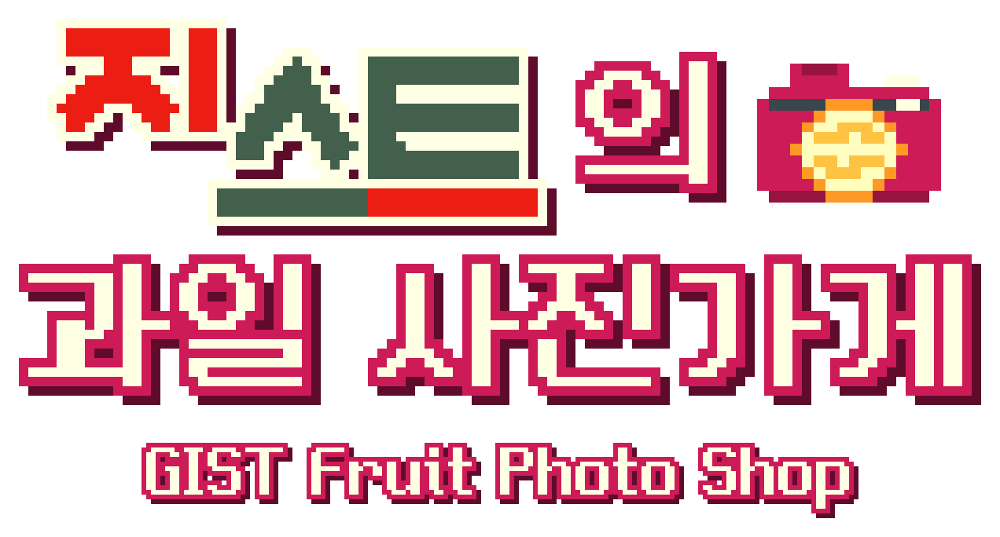
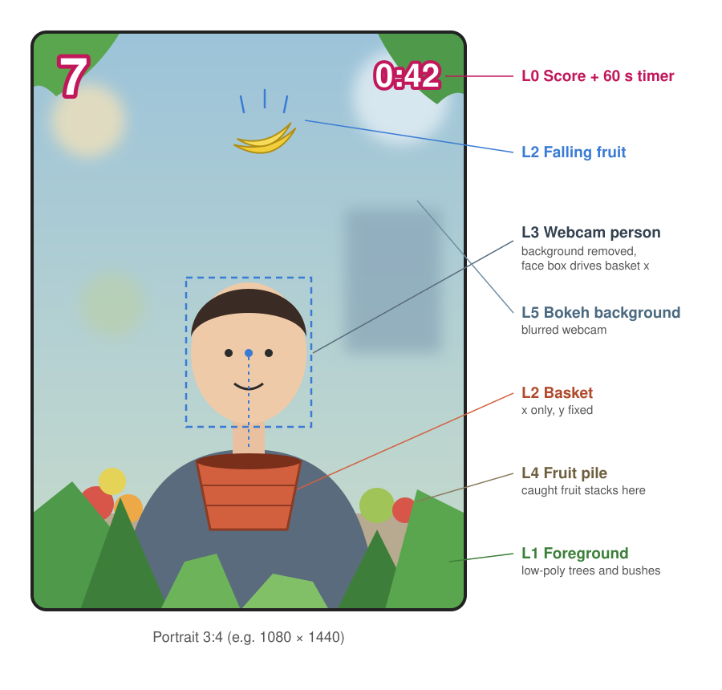
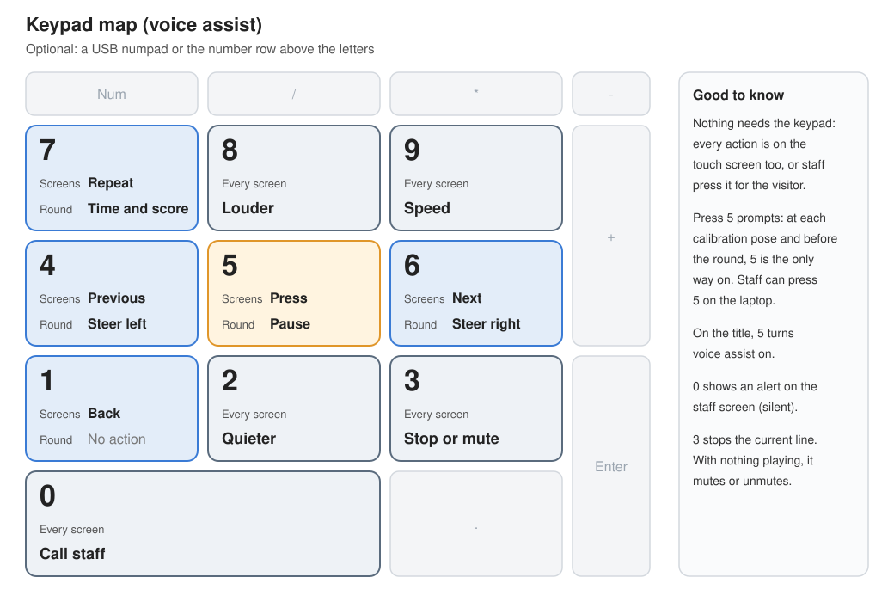
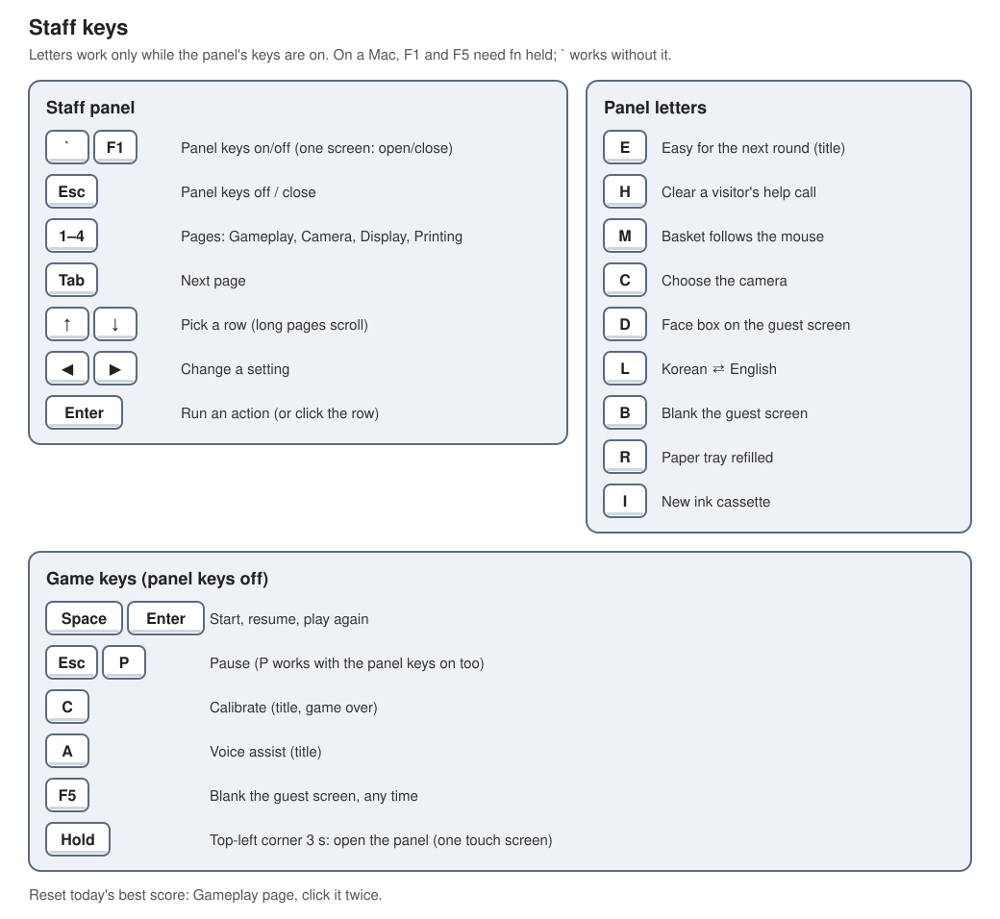

# GIST Fruit Photo Shop (지스트의 과일 사진가게)



**[한국어 README](README.md)** · **Design doc: [English (source)](Docs/DESIGN.md) · [한국어](Docs/DESIGN.ko.md)**

> **For gameplay specifics and the development process, see the [design doc](Docs/DESIGN.md).** This README covers only what you need to run the booth and set the project up.
>
> **Working with an LLM (an AI coding tool)?** After pulling this repository, have your agent **read [`Docs/DESIGN.md`](Docs/DESIGN.md) first, before anything else.** The design, the decision log and the progress all live there. The repository's `AGENTS.md` and `CLAUDE.md` say the same, so most tools follow it on their own. The English `DESIGN.md` is the source; the Korean translation (`DESIGN.ko.md`) follows it.

**An interactive photo booth designed first for accessibility.** Anyone who walks up can play it, whatever their range of movement, eyesight or reading. A visitor stands or sits in front of a camera, catches fruit for a minute by moving only their head, and takes home a four-cut photo with the fruit they caught, printed or on their phone.



## Contents

1. [Running the booth (for staff)](#running-the-booth-for-staff)
2. [How to play (to tell visitors)](#how-to-play-to-tell-visitors)
3. [First-time setup](#first-time-setup)
4. [Working on the project](#working-on-the-project)
5. [Progress](#progress), [Credits and licences](#credits-and-licences)

---

## Running the booth (for staff)

Written so the booth can be run from this section alone when the project lead isn't there.

### Equipment

| Equipment | Role | Connection |
|---|---|---|
| Booth laptop (MacBook) | Runs the game; the **staff screen** | Plugged in to power, ideally |
| Guest touch display | The **guest screen** (the game; tap buttons) | Connected to the laptop (extended display) |
| Camera | The visitor's face and picture | A webcam, or the DSLR (Canon EOS R6) → micro HDMI–HDMI cable → Elgato 4K X → laptop |
| Printer, Canon SELPHY CP1500 | Prints the four-cut photo | USB-C. **RP-108** paper (postcard, 4 × 6 in, 18 sheets at a time); one ink cassette prints 36 |
| Headphones | For voice-assist visitors (the beeps that say where the fruit is) | The laptop's headphone socket or Bluetooth |
| USB numpad (optional) | Controls for voice-assist visitors | USB. Without one, the number row on the laptop keyboard does the same |
| Internet | Getting the photo on a phone | The laptop needs internet (venue Wi-Fi, or a phone's hotspot). Visitors open the link on their own mobile data, so they don't join any Wi-Fi. Needs `cloudflared` on the laptop ([First-time setup](#first-time-setup) step 4) |

**Display arrangement (macOS):** keep the laptop as the **main display** (in System Settings ▸ Displays ▸ Arrange, the white menu bar on the laptop) and the touch display as an extended display, not mirrored. The staff screen then appears on the laptop and the guest screen on the touch display. To use the touch display as the main display instead, set staff panel ▸ Display ▸ "Main display shows" to "Guest screen" and restart the app. With only one display, the guest screen fills it and the staff panel opens over it (see "Staff keys").

### Starting up

**A. Running the app (once it's built)**

1. With everything connected, open the `FruitGame` app. The staff screen opens on the main display (the laptop) and the guest screen full screen on the touch display.
2. The first time, macOS asks about **camera** access and **incoming network connections** (for phone downloads): **allow** both.
3. To quit, press **⌘Q** (Windows: Alt+F4).

> The kiosk app is still being made (design doc M6 3.5). Until it's ready, use method B.

**B. Running from the Unity Editor**

1. Open the project in Unity Hub (see [First-time setup](#first-time-setup)) and open `Assets/FruitGame/Scenes/Game.unity` from the Project window.
2. Set up **two Game views**: one on **Display 1** (the guest screen) and one on **Display 2** (the staff screen). Open another Game view from Window ▸ General ▸ Game, and pick each one's number in the Display menu along its top.
3. Drag the Display 1 view's tab out into its own window, move it onto the touch display and make it large. Leave the Display 2 view on the laptop.
4. Press **▶ Play** at the top centre. With a Display 2 view open, the staff screen appears there by itself.
5. To stop, press ▶ again.

### Before opening

The app starts in **standby**: the guest screen says the booth isn't open yet ("잠시 쉬고 있어요"). Do the checks below on the staff screen, then press **Standby: open the booth** at the bottom of the staff panel; after a short loading screen the title appears. Press it again (**Standby**) for breaks: the camera and the heavy processing rest while it's up.

- [ ] After opening, the guest screen shows the block-built title and the **Play** button.
- [ ] Standing in front of the camera puts a face box on the staff screen's mirror, and the background behind the person is cleanly removed. If it's the wrong camera, choose one with **C** in the panel.
- [ ] The printer is on, with paper and ink, and the `Printer:` line in the staff panel's status card shows no problem.
- [ ] The headphones play sound (press **Voice assist** on the title to check, then press it again to turn it off).
- [ ] Staff panel ▸ Printing page ▸ **Phone link** says `Internet · up` (about 10 s after starting). Scan a test photo's QR code with a phone on mobile data, Wi-Fi off.
- [ ] If wanted, reset today's best score (staff panel ▸ Gameplay page ▸ "Today's best score", pressed twice).

### One visit, and what staff do

1. **Title:** the visitor presses **Play**. After 30 s with nobody there, a sample round plays itself; it stops the moment someone steps up or touches the screen.
2. **How to move:** suggest **Slide your head** to most people, and **Turn your head** to anyone who finds moving their body hard.
3. **Difficulty:** Easy / Normal / Hard. Suggest Easy for first-timers, children and older visitors.
4. **Calibration:** look straight, left and right, holding each briefly. Only as far as is comfortable: that range becomes the basket's ends. If a prompt such as "a little closer" shows, help them adjust the distance.
5. **The 60 s round:** the basket follows their head. If their face leaves the picture the game pauses, and it carries on when they're back. Three photos are taken automatically during the round.
6. **Results:** the score and the fruit caught. **Photo** takes the final posed shot.
7. **Photo:** on the preview, **Print** (it comes out of the printer in about 40 s) or **Get it on your phone** (a QR code). Staff hand over the print. **Done** goes back to the title.

If a visitor walks away mid-visit, "Still there?" appears after 20 s and the title returns 20 s after that. A pause longer than 60 s ends the round. Touching the screen extends the wait.

### Voice-assist visitors (blind and low-vision)

- Pressing **Voice assist** on the title, or **5** on the keypad, turns it on. Put the headphones on them.
- Voice assist skips the difficulty step, plays a gentler round and speaks every screen. It's controlled with the touch buttons on the left (Again, Stop, Louder, Softer, Speed) and the keypad below.
- When "Press 5" is asked, the visitor presses **5** once they've understood, and only then does it move on. Without a keypad, staff press **5** on the laptop keyboard for them.
- **High contrast** turns the screen black with yellow outlines, for low-vision visitors.
- Both turn off by themselves when the visit ends (back on the title).



### Help calls (keypad 0)

When a visitor presses **0**, they hear "직원을 불렀어요" (staff are on the way) and a **red bar appears across the top of the staff screen**. It makes no sound, because the only audio goes to the visitor's headphones. Go and help, then clear the bar by **clicking it**, or with **H** with the panel keys on.

### Printer

- Sheets aren't counted. When the printer reports paper or ink low or out (or a jam, or the cover open), the staff screen shows a warning: then refill the paper or change the ink cassette.
- If the printer has a problem, the guest screen says the printer is taking a break: offer **Get it on your phone** instead.
- Printed or saved photos stay in the laptop's `Pictures/FruitGame` folder and are deleted automatically 14 days later, when the game starts. Photos are never uploaded or stored anywhere else. Only a phone download passes through Cloudflare, and its link is gone after 15 minutes.

### Staff keys

Turn the staff panel's keys on with **`** (the key left of 1) or **F1** (on a Mac, F1 needs **fn** held). With two screens the panel is always on the laptop and this key **turns its letter keys on and off**. With one screen it opens the panel over the right of the guest screen. With only a touch screen, **hold the top-left corner of the guest screen for 3 s** to open it. Letters work only while the panel's keys are on, so they never clash with the game's keys.



| Key | What it does |
|---|---|
| **`** or **F1** | Panel keys on/off (one screen: open/close the panel) |
| **Esc** | Panel keys off / close the panel |
| **1–5**, **Tab** | Panel pages: Gameplay, Camera, Display, Printing, Beauty |
| **↑ ↓**, **◀ ▶**, **Enter** | Pick a row, change a setting, run an action (clicking works too; scroll long pages with the mouse wheel) |
| **E** | Easy for the next round (title) |
| **H** | Clear a help call |
| **M** | Basket follows the mouse instead of the face (for checks) |
| **C** | Choose the camera (with a live preview; the choice is remembered) |
| **D** | Face box on the guest screen (one screen) |
| **L** | Korean ⇄ English |
| **B**, **F5** | Blank the guest screen (to try playing by sound alone). F5 works whether the panel keys are on or not |
| *(click twice)* | Reset today's best score (Gameplay page) |

**Game keys** (panel keys off): **Space/Enter** start or resume, **Esc/P** pause, **C** calibrate, **A** voice assist (title).

The panel's settings (starting mode, assist, sensitivity, calibration, round length, camera mirroring, background removal model, look and ray tracing, orientation, language, screens, copies, printer) are saved on the laptop and kept for next time; the reset button at the bottom of the panel puts them back.

### Troubleshooting

| Symptom | Fix |
|---|---|
| No camera picture / the wrong camera | Check the panel's Camera page: if **Camera** says Off, press it to turn it back on. Otherwise turn the panel keys on and choose the camera with **C**. On macOS, allow the app (or Unity) in System Settings ▸ Privacy & Security ▸ Camera. |
| It can't find the face and keeps pausing | Check there's enough light on the face and they're not too far or too close. Ask them to take off a hat or mask covering the face. |
| The basket is too twitchy or too sluggish | Start again from the **title** so they calibrate afresh. If it persists, adjust the sensitivity on the panel's Gameplay page. |
| The background behind the person isn't removed | Try another background removal model on the panel's Camera page. |
| Nothing prints | Check the printer's power, the USB-C cable, paper and ink. Choose the printer on the panel's Printing page. Meanwhile, offer the phone download. |
| The QR link won't open on a phone | Look at staff panel ▸ Printing ▸ **Phone link**. If it's red, the laptop has no internet or `cloudflared` is missing: connect the laptop to the internet (a phone's hotspot works); the link comes back by itself within a minute. Meanwhile links use the local Wi-Fi, so phones must be on the laptop's Wi-Fi. If **Phone link** says `Local Wi-Fi`, that was chosen on purpose: phones join the laptop's Wi-Fi. |
| The panel's letter keys don't respond | Press **`** (or fn+F1) first to turn the panel keys on; its header changes to "keys on". In the Editor, click a Game view once first. |
| The guest and staff screens are swapped | Make the laptop the main display (Displays ▸ Arrange), or change staff panel ▸ Display ▸ "Main display shows", then restart the app. |
| The guest screen is black | Press **F5** once (the blank-screen test is on). |
| No sound | Check the headphones and the macOS sound output. In voice assist, press **Louder** or **8** on the keypad. |
| The game stutters in the Realistic look | Turn **Ray tracing** off on the panel's Display page (or switch the look to Classic). |
| The camera has to stay off (privacy, a broken camera) | Panel ▸ Camera page ▸ **Camera**: Off. A plain soft colour shows behind the scene and the basket follows the mouse or arrow keys. It's on again after a restart. |
| The screen is stuck or behaving oddly | Pause (Esc) ▸ **Main menu**. Failing that, quit and restart the app (or Play); settings are kept. |

### Closing

1. Put the booth in **Standby** (staff panel, bottom left), then quit the app (**⌘Q**; in the Editor, press ▶ again).
2. Turn the printer off and take out any paper left.
3. Photos stay only on the laptop and are deleted after 14 days. To delete them now, empty the `Pictures/FruitGame` folder.

---

## How to play (to tell visitors)

### A game anyone can play

| For | How |
|---|---|
| **Small or one-sided movement** | Steer with head position alone, or by turning the head for anyone who finds moving their body hard. Calibration measures each person's comfortable range and maps it to the whole width, so a few centimetres is enough. |
| **Wheelchair users, or playing seated** | No standing or reaching; the camera only needs the head and shoulders. |
| **Blind and low-vision visitors** | With voice assist, beeps in the headphones say where the fruit is, and a Korean narrator guides them from start to photo. There's a high-contrast screen too. |
| **Anyone who wants it slower** | Easy is slower, with no bombs. |
| **Every player** | Fruit drift gently toward the basket, missing never ends the game, and the game pauses when the face leaves the picture. |
| **Companions and staff** | Every screen works by touch or mouse, so someone else can press the buttons. |

### Rules

- Catch the falling fruit in the basket for 60 s. Each fruit is 1 point, a **golden fruit** 3, and from **5 in a row** points double. Catching a **bomb** loses 5 points (Normal and Hard).
- The fruit caught pile up behind the visitor and appear in the photo.
- Difficulty rises only through speed and rhythm; the basket and the movement needed stay the same.

| | Easy | Normal | Hard | Voice assist |
|---|---|---|---|---|
| Fruit speed | Speeds up slowly | Speeds up evenly through the round | Speeds up the most | Steady |
| Gaps between fruit | One at a time | Several at once near the end | Closer than Normal | One at a time |
| Bombs | None | 4 | 7 | None |

### Voice assist's sounds

- **Beeps:** which side of the basket the fruit is on, heard in the matching ear. They speed up as the basket gets under the fruit and become one long tone right under it.
- **Clear sounds:** a bright chime for a catch, a low note for a miss, a sparkle for a golden fruit.
- **Narrator:** the time left and score (at 45, 30 and 15 s), the final score, and pose guidance for the photo ("a little to the right!"). Speech speed goes from 1× to 2×.

### The four-cut photo

Three shots taken automatically during the round plus the final pose become a four-cut photo with the title, score and logos. A gentle beauty filter touches only the visitor. Print it as a postcard, or get it on a phone by QR code over mobile data; phone links expire after 15 minutes.

The screen fits both landscape (16:9) and portrait (9:16) displays.

---

## First-time setup

Step by step, for anyone using GitHub for the first time. Works on macOS or Windows.

> ⚠️ **The game does not function without the private assets.** Some files can't go in the repository because of their licences (the background-removal models and the fruit, tree and prop 3D models). **If you're on the team, they will be provided to you as the "FruitGame Private Share" folder, and you must run its installer in step 3 below after cloning the repository and before opening the project in Unity, to start working on the project.**

### 1. Get the repository (GitHub Desktop)

1. Install and open [GitHub Desktop](https://desktop.github.com). You can skip signing in.
2. Choose **File ▸ Clone repository** ▸ the **URL** tab.
3. Paste `https://github.com/hyunsoo-ju/gist-fruit-photo-shop` as the URL, choose where to keep it under Local path, and click **Clone**.
4. The `gist-fruit-photo-shop` folder you get (the one holding `Assets`, `Packages` and `ProjectSettings`) is the **project folder**.

> If you use a terminal, `git clone https://github.com/hyunsoo-ju/gist-fruit-photo-shop.git` works too. GitHub's "Download ZIP" isn't recommended: it can't take updates later.

**Don't open it in Unity yet.** The assets go in first.

### 2. Install Unity

1. Install and open [Unity Hub](https://unity.com/download). Sign in with a (free) Unity account, and choose the **Personal** (free) licence when asked.
2. The project uses **Unity 6000.6.7f1**. In Unity Hub ▸ **Installs ▸ Install Editor**, click "Install" next to it. If it isn't listed, open the **Archive** tab ▸ "download archive", find **6000.6.7f1** and click "Install".
   (Pasting `unityhub://6000.6.7f1/b22767f04f04` into a web browser's address bar makes Unity Hub install this exact version.)
3. The module list during the install can be left as it is (add macOS/Windows Build Support to build the app).

### 3. Install the private assets (before opening Unity)

1. Open the **"FruitGame Private Share"** folder you were given (or the folder you get by unzipping the zip of that name).
2. **macOS:** double-click `Install (macOS).command`. If macOS says it's from an unidentified developer, **right-click it ▸ Open ▸ Open**.
   **Windows:** double-click `Install (Windows).bat`. If "Windows protected your PC" appears, click **More info ▸ Run anyway**.
3. In the folder picker, choose the **project folder** from step 1.
4. When it says every file is in place, you're done.

The folder's `README (English).md` has the details and troubleshooting. If you opened the project in Unity first by mistake, quit Unity and run the installer: it repairs it.

### 4. Open the project

1. In Unity Hub ▸ **Projects ▸ Add ▸ Add project from disk**, choose the project folder.
2. Click the project in the list (check the version says 6000.6.7f1). The first opening takes a few minutes.
3. In the **Project** window at the bottom, double-click `Assets/FruitGame/Scenes/Game.unity`.
4. Press **▶ Play** at the top centre. Allow camera access if macOS asks.

**Check it worked:** fruit, trees and the crates at the sides are all made of blocks, and standing in front of the camera removes the background behind you. If fruit look like grey balls, do step 3 again.

**For phone links:** the booth laptop also needs Cloudflare's `cloudflared`, which gives each photo an internet link so phones can open it without joining the venue Wi-Fi. On a Mac, in Terminal: `brew install cloudflared` (Homebrew: [brew.sh](https://brew.sh)). On Windows: `winget install --id Cloudflare.cloudflared`. No Cloudflare account is needed. Photos pass through Cloudflare on their way to the phone. Without it, phone links fall back to the local Wi-Fi.

**For the performance meter (optional):** the staff screen's meter shows the CPU and GPU temperatures and GPU load through macmon, which reads them without administrator rights. On a Mac, in Terminal: `brew install macmon`. Without it the meter still works, without temperatures.

### Getting updates

In GitHub Desktop, click **Fetch origin ▸ Pull origin** (or run `git pull`). If you're told the assets changed, run the installer from the new copy of "FruitGame Private Share".

---

## Working on the project

- **Read the [design doc](Docs/DESIGN.md) first.** How every feature behaves, the tuning values, why each choice was made and the work left are all there. LLM agents start there too (see `AGENTS.md`, `CLAUDE.md`). When the design changes, edit the English `Docs/DESIGN.md` first, then bring the Korean translation in line.
- In code, folders and menus the project is called **FruitGame**. There's one game scene, `Assets/FruitGame/Scenes/Game.unity`; in a built app `Boot.unity` (a "getting ready" screen) runs first.
- On-screen text is in `Assets/FruitGame/Resources/Strings.txt` (Korean and English); the narrator's lines are in `Assets/FruitGame/Resources/NarrationLines.txt`.
- The narration is rendered with Google Cloud TTS by `Tools/render_narration.py`. Set your own API key in the environment variable `GOOGLE_TTS_API_KEY` first, and never put the key in the repository.
  ```bash
  python3 Tools/render_narration.py --engine google --speeds 1,1.25,1.5,1.75,2
  ```
- After UI changes, run **FruitGame ▸ Fonts ▸ Check All Text** during Play to check every character is in the pixel font.
- When the private assets (step 3) change, the project lead rebuilds the share and sends it to the team.

## Progress

Gameplay, face control, the photo booth, the pixel and voxel style, Korean localisation, portrait and landscape screens, difficulty and voice assist are done. Polish for the event's equipment (M6) and connecting that equipment (M17) are under way. Left to do: the DSLR camera, the kiosk app build, and checking and tuning on the venue's equipment. See [design doc §19](Docs/DESIGN.md) for details.

## Credits and licences

- Face tracking and background removal run on the device with Unity Inference Engine, using MediaPipe BlazeFace, Face Mesh and Selfie Segmentation (Apache-2.0) and Robust Video Matting (**GPL-3.0**). See `Assets/FruitGame/ML/CREDITS.txt`.
- The beauty filter is based on GPUPixel (Apache-2.0). See `Assets/FruitGame/Art/Beauty/NOTICE.txt`.
- Font: Neo둥근모 Pro (Dalgona, based on Kim Jung-tae's Dunggeunmo, SIL OFL 1.1).
- 3D assets: Low Poly Food, PolyOne Free Fruits, Low Poly Trees (not redistributable), Kenney Nature Kit (CC0). Sound effects: Kenney (CC0); camera shutter "Camera" (themightyglider, OpenGameArt, CC0).
- Narration voice: made with Google Cloud Text-to-Speech.
