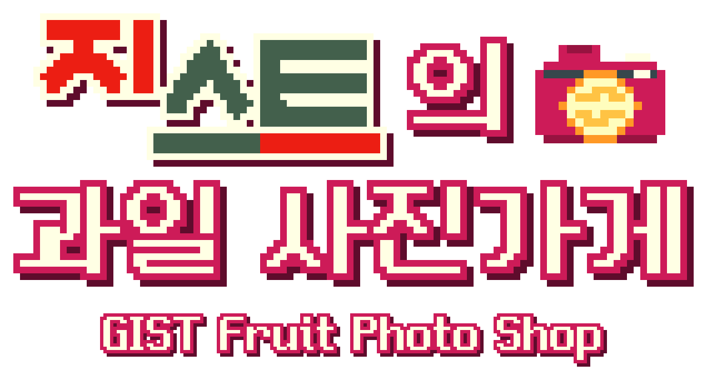
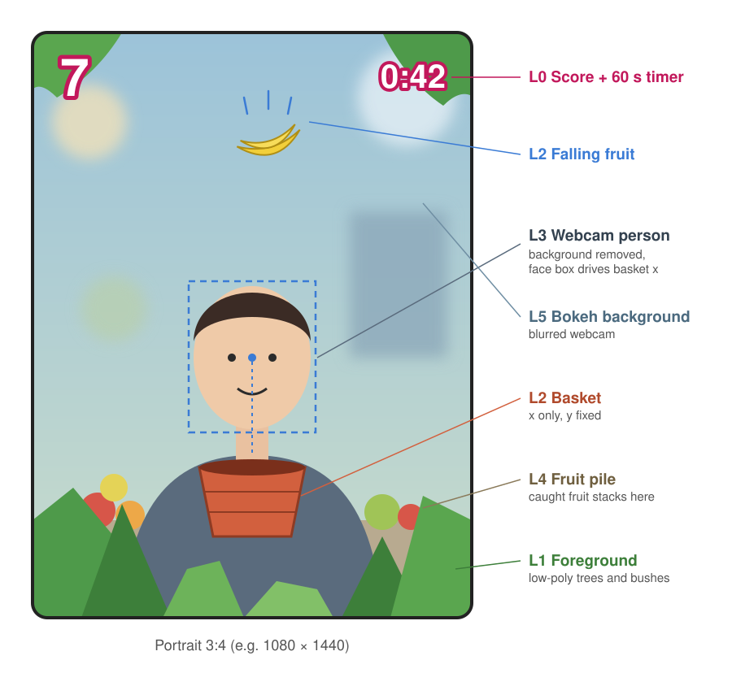
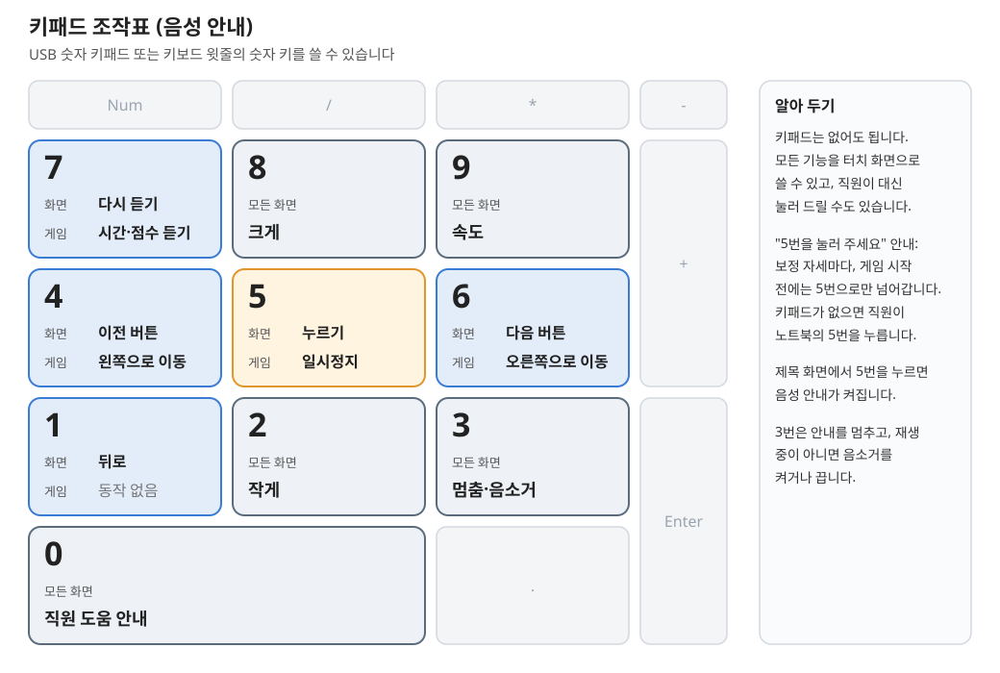
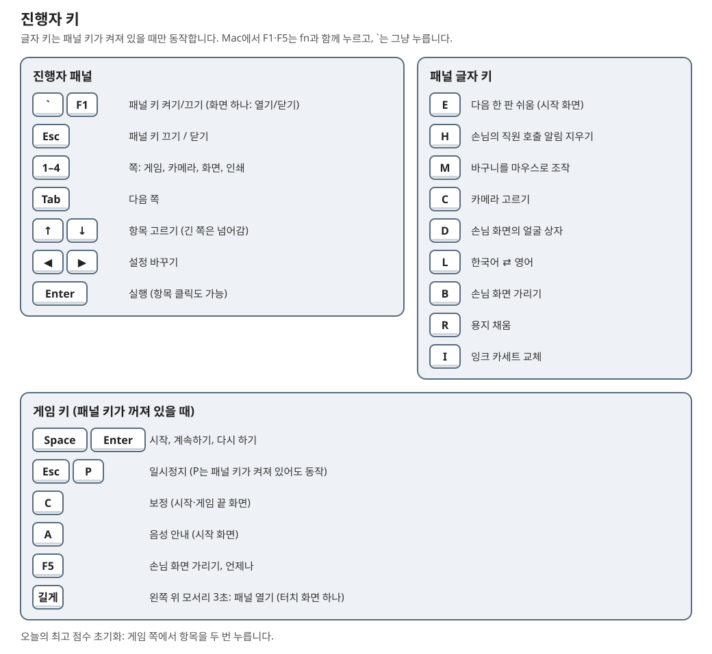

# 지스트의 과일 사진가게 (GIST Fruit Photo Shop)



**[English README](README.en.md)** · **설계 문서: [한국어](Docs/DESIGN.ko.md) · [English (원문)](Docs/DESIGN.md)**

> **게임의 세부 동작과 개발 과정은 [설계 문서](Docs/DESIGN.ko.md)를 보십시오.** 이 README는 부스를 운영하고 프로젝트를 설치하는 데 필요한 내용만 다룹니다.
>
> **LLM(AI 코딩 도구)과 함께 작업하는 경우:** 이 저장소를 받은 뒤 에이전트가 **가장 먼저 [`Docs/DESIGN.md`](Docs/DESIGN.md)를 읽도록** 하십시오. 설계, 결정 기록, 진행 상황이 모두 그 문서에 있으며, 저장소의 `AGENTS.md`와 `CLAUDE.md`에도 같은 지시가 있어 대부분의 도구가 자동으로 따릅니다. 영어 원문(`DESIGN.md`)이 기준이고, 한국어 번역(`DESIGN.ko.md`)은 원문을 따라 갱신합니다.

**접근성을 중심으로 만든 인터랙티브 포토부스입니다.** 움직일 수 있는 범위나 시력, 읽기 능력과 관계없이 부스 앞에 온 누구나 할 수 있도록 설계했습니다. 카메라 앞에 서거나 앉아서 머리만 움직여 1분 동안 과일을 받고, 받은 과일과 함께 찍은 네컷 사진을 인쇄하거나 휴대폰으로 받아 갑니다.



## 목차

1. [부스 운영 안내 (진행자용)](#부스-운영-안내-진행자용)
2. [게임 방법 (손님 안내용)](#게임-방법-손님-안내용)
3. [처음 설치하기](#처음-설치하기)
4. [프로젝트 작업하기](#프로젝트-작업하기)
5. [진행 상황](#진행-상황), [출처 및 라이선스](#출처-및-라이선스)

---

## 부스 운영 안내 (진행자용)

담당자가 자리에 없어도 이 부분만 읽고 부스를 운영할 수 있도록 썼습니다.

### 장비

| 장비 | 역할 | 연결 |
|---|---|---|
| 부스 노트북 (MacBook) | 게임 실행, **진행자 화면** | 전원 연결 권장 |
| 손님용 터치 디스플레이 | **손님 화면** (게임, 터치로 버튼 누르기) | 노트북에 연결(확장 디스플레이) |
| 카메라 | 손님의 얼굴과 모습 | 웹캠, 또는 DSLR(Canon EOS R6) → micro HDMI–HDMI 케이블 → Elgato 4K X → 노트북 |
| 프린터 Canon SELPHY CP1500 | 네컷 사진 인쇄 | USB-C. 용지 **RP-108**(엽서, 4 × 6 in, 한 번에 18장), 잉크 카세트 1개로 36장 |
| 헤드폰 | 음성 안내 손님용 (방향을 알려 주는 삐 소리) | 노트북 이어폰 단자 또는 블루투스 |
| USB 숫자 키패드 (선택) | 음성 안내 손님용 조작 | USB. 없으면 노트북 키보드 윗줄 숫자로 대신합니다 |
| 인터넷 | 휴대폰으로 사진 받기 | 노트북이 인터넷에 연결되어 있어야 합니다(행사장 Wi-Fi 또는 휴대폰 핫스팟). 손님은 자기 모바일 데이터로 링크를 여니 Wi-Fi에 연결할 필요가 없습니다. 노트북에 `cloudflared`가 필요합니다([처음 설치하기](#처음-설치하기) 4단계) |

**화면 배치 (macOS):** 노트북을 **주 디스플레이**로 두고(시스템 설정 ▸ 디스플레이 ▸ 정렬에서 흰 메뉴 막대가 노트북 쪽), 터치 디스플레이는 미러링하지 않는 확장 디스플레이로 둡니다. 그러면 진행자 화면은 노트북, 손님 화면은 터치 디스플레이에 뜹니다. 반대로 터치 디스플레이를 주 디스플레이로 쓰려면 진행자 패널 ▸ 화면 ▸ 「주 디스플레이에 띄울 화면」을 「손님 화면」으로 바꾸고 앱을 다시 켭니다. 디스플레이가 하나뿐이면 손님 화면만 나오고, 진행자 패널은 그 위에 겹쳐 엽니다(아래 「진행자 키」).

### 켜기

**A. 앱으로 실행 (빌드한 경우)**

앱 빌드: Unity에서 **FruitGame ▸ Build ▸ macOS**를 누르면 프로젝트 폴더의 `Builds/macOS/GIST Fruit Photo Shop.app`이 만들어지고 Finder에 보입니다(몇 분 걸림, git에는 올라가지 않음). 부스 노트북으로는 `.app`만 옮기면 되며, 옆의 `…_BackUpThisFolder_ButDontShipItWithYourGame` 폴더는 필요 없습니다.

1. 장비를 모두 연결한 뒤 `GIST Fruit Photo Shop` 앱을 실행합니다. 주 디스플레이(노트북)에 진행자 화면이, 터치 디스플레이에 손님 화면이 전체 화면으로 뜹니다.
2. 처음 실행할 때 macOS가 **카메라** 접근과 **들어오는 네트워크 연결**(휴대폰 사진 받기용)을 물으면 모두 **허용**합니다.
3. 끌 때는 **⌘Q**(Windows는 Alt+F4)를 누릅니다.

> 키오스크용 앱은 아직 만드는 중입니다(설계 문서 M6 3.5). 앱이 준비되기 전에는 B 방법으로 운영합니다.

**B. Unity 에디터로 실행**

1. Unity Hub에서 프로젝트를 열고(아래 [처음 설치하기](#처음-설치하기)), Project 창에서 `Assets/FruitGame/Scenes/Game.unity`를 엽니다.
2. **Game 창을 두 개** 준비합니다. 하나는 **Display 1**(손님 화면), 다른 하나는 **Display 2**(진행자 화면)로 설정합니다. 새 Game 창은 메뉴 Window ▸ General ▸ Game으로 엽니다. 각 Game 창 위쪽의 Display 메뉴에서 번호를 고릅니다.
3. Display 1 창의 탭을 끌어 따로 창으로 만든 뒤 터치 디스플레이로 옮겨 크게 키웁니다. Display 2 창은 노트북 화면에 둡니다.
4. 위쪽 가운데의 **▶ Play**를 누릅니다. Display 2 창이 열려 있으면 진행자 화면이 자동으로 그쪽에 뜹니다.
5. 끌 때는 ▶를 다시 눌러 Play를 멈춥니다.

### 시작 전 점검

앱은 **대기 화면**으로 시작합니다. 손님 화면에는 부스가 아직 열리지 않았다는 안내(「잠시 쉬고 있어요」)가 나옵니다. 아래 점검을 진행자 화면에서 마친 뒤 진행자 패널 맨 아래의 **대기 중: 부스 열기**를 누르면, 짧은 로딩 화면 뒤에 시작 화면이 나옵니다. 쉬는 시간에는 다시 누릅니다(**대기 화면**). 대기 중에는 카메라와 무거운 처리가 쉽니다.

- [ ] 부스를 연 뒤 손님 화면에 블록으로 된 타이틀과 **시작** 버튼이 보입니다.
- [ ] 카메라 앞에 서면 진행자 화면의 거울 화면에 얼굴 상자가 생기고, 사람 뒤 배경이 깔끔하게 지워집니다. 카메라가 틀리면 패널의 **C**로 고릅니다.
- [ ] 프린터 전원이 켜져 있고 용지와 잉크가 있습니다. 진행자 패널 상태 칸의 `Printer:` 줄에 문제가 없습니다.
- [ ] 헤드폰에서 소리가 납니다(시작 화면의 **음성 안내**를 눌러 확인 후 다시 눌러 끕니다).
- [ ] 진행자 패널 ▸ 인쇄 쪽 ▸ **Phone link**가 `Internet · up`입니다(켠 뒤 약 10초). Wi-Fi를 끈 휴대폰으로 시험 사진의 QR 코드를 찍어 열어 봅니다.
- [ ] 필요하면 오늘의 최고 점수를 초기화합니다(진행자 패널 ▸ 게임 쪽 ▸ 「Today's best score」를 두 번 누름).

### 손님 한 분의 흐름과 진행자가 할 일

1. **시작 화면:** 손님이 **시작**을 누릅니다. 30초 동안 아무도 없으면 게임이 혼자 진행되는 예시 화면이 나오고, 사람이 오거나 화면을 누르면 바로 돌아옵니다.
2. **움직이는 방법 고르기:** 대부분은 **머리를 옆으로**를 권합니다. 몸을 움직이기 어려운 분께는 **고개를 돌려서**를 권합니다.
3. **난이도:** 쉬움 / 보통 / 어려움. 처음 하는 분, 어린이, 어르신께는 쉬움을 권합니다.
4. **보정:** 정면, 왼쪽, 오른쪽을 보며 잠깐씩 멈춥니다. 편한 만큼만 움직이면 되고, 그 범위가 바구니의 양 끝이 됩니다. 「조금 더 가까이」 같은 안내가 나오면 거리를 맞춰 줍니다.
5. **게임 60초:** 바구니가 머리를 따라 움직입니다. 얼굴이 화면에서 벗어나면 자동으로 멈췄다가 돌아오면 다시 시작합니다. 게임 중 사진이 자동으로 세 번 찍힙니다.
6. **결과 화면:** 점수와 받은 과일. **사진 찍기**를 누르면 마지막 포즈 사진을 찍습니다.
7. **사진:** 미리보기에서 **인쇄**(약 40초 뒤 프린터에서 나옴) 또는 **휴대폰으로 받기**(QR 코드)를 고릅니다. 인쇄물은 진행자가 건네 드립니다. **완료**를 누르면 시작 화면으로 돌아갑니다.

손님이 중간에 떠나면 20초 뒤 「아직 계세요?」 안내가 나오고, 다시 20초 뒤 시작 화면으로 돌아갑니다. 일시정지가 60초를 넘으면 게임이 끝납니다. 화면을 누르면 기다리는 시간이 늘어납니다.

### 음성 안내 손님 (시각장애인·저시력인)

- 시작 화면의 **음성 안내**를 누르거나 키패드의 **5**를 누르면 켜집니다. 헤드폰을 씌워 드립니다.
- 음성 안내를 켜면 난이도 단계 없이 더 쉬운 판으로 진행하고, 모든 화면을 말로 안내합니다. 왼쪽의 터치 버튼(다시·멈춤·크게·작게·속도)과 아래 키패드로 조작합니다.
- 「5번을 눌러 주세요」가 나오면 손님이 이해한 뒤 **5**를 눌러야 넘어갑니다. 키패드가 없으면 진행자가 노트북 키보드의 **5**를 대신 누릅니다.
- **고대비** 버튼은 저시력 손님을 위해 화면을 검은 바탕에 노란 테두리로 바꿉니다.
- 방문이 끝나면(시작 화면으로 돌아오면) 음성 안내와 고대비는 자동으로 꺼집니다.



### 직원 호출 (키패드 0)

손님이 **0**을 누르면 「직원을 불렀어요」라고 안내하고, **진행자 화면 위쪽에 빨간 알림 막대**가 뜹니다(소리는 나지 않습니다. 소리는 손님 헤드폰으로만 나가기 때문입니다). 손님께 가서 도와드린 뒤, 알림 막대를 **클릭**하거나 패널 키를 켜고 **H**를 눌러 지웁니다.

### 프린터

- 남은 장수는 세지 않습니다. 프린터가 용지나 잉크가 부족하거나 떨어졌다고 알리면(걸림, 덮개 열림도) 진행자 화면에 경고가 뜹니다. 그때 용지를 채우거나 잉크 카세트를 바꿉니다.
- 프린터에 문제가 있으면 손님 화면에 「프린터가 잠시 쉬고 있어요」가 나옵니다. 이때는 **휴대폰으로 받기**를 안내합니다.
- 인쇄하거나 저장한 사진은 노트북의 `사진(Pictures)/FruitGame` 폴더에 남고, 14일이 지나면 게임을 켤 때 자동으로 지워집니다. 사진은 어디에도 저장되어 올라가지 않습니다. 휴대폰으로 받을 때만 Cloudflare를 거쳐 전달되고, 링크는 15분 뒤 사라집니다.

### 진행자 키

진행자 패널은 **`** 키(숫자 1 왼쪽) 또는 **F1**로 켭니다(Mac에서 F1은 **fn**과 함께 눌러야 합니다). 화면이 둘이면 패널은 노트북 화면에 항상 있고, 이 키로 **글자 키를 켜고 끕니다**. 화면이 하나면 손님 화면 오른쪽에 패널이 열립니다. 터치 화면만 있을 때는 손님 화면의 **왼쪽 위 모서리를 3초** 누르면 열립니다. 글자 키는 패널 키가 켜져 있을 때만 동작하므로 게임 키와 겹치지 않습니다.



| 키 | 기능 |
|---|---|
| **`** 또는 **F1** | 패널 키 켜기/끄기 (화면 하나: 패널 열기/닫기) |
| **Esc** | 패널 키 끄기 / 패널 닫기 |
| **1–5**, **Tab** | 패널 쪽 바꾸기: 게임, 카메라, 화면, 인쇄, 뷰티 |
| **↑ ↓**, **◀ ▶**, **Enter** | 항목 고르기, 설정 바꾸기, 실행 (마우스로 눌러도 됩니다. 긴 쪽은 마우스 휠로 넘깁니다) |
| **E** | 다음 한 판을 쉬움으로 (시작 화면) |
| **H** | 직원 호출 알림 지우기 |
| **M** | 바구니를 얼굴 대신 마우스로 조작 (점검용) |
| **C** | 카메라 고르기 (미리보기 포함, 고른 카메라는 기억됩니다) |
| **D** | 손님 화면에 얼굴 상자 보이기 (화면 하나일 때) |
| **L** | 한국어 ⇄ 영어 |
| **B**, **F5** | 손님 화면 가리기 (음성만으로 해 보는 시험용). F5는 패널 키와 관계없이 동작합니다 |
| *(두 번 클릭)* | 오늘의 최고 점수 초기화 (게임 쪽) |

**게임 키**(패널 키가 꺼져 있을 때): **Space/Enter** 시작·계속하기, **Esc/P** 일시정지, **C** 보정, **A** 음성 안내(시작 화면).

패널의 설정(시작 모드, 보조 세기, 감도, 보정 조건, 한 판 길이, 카메라 반전, 배경 분리 모델, 조명과 레이 트레이싱, 화면 방향, 언어, 화면 수, 인쇄 매수, 프린터)은 노트북에 저장되어 다음에도 유지되며, 패널 아래의 초기화 버튼으로 되돌릴 수 있습니다.

### 문제 해결

| 증상 | 해결 |
|---|---|
| 카메라 화면이 안 나옴 / 다른 카메라가 나옴 | 패널 ▸ 카메라 쪽에서 **카메라**가 꺼짐이면 눌러 다시 켭니다. 아니면 패널 키를 켜고 **C**로 카메라를 고릅니다. macOS에서는 시스템 설정 ▸ 개인정보 보호 및 보안 ▸ 카메라에서 앱(또는 Unity)을 허용합니다. |
| 얼굴을 못 찾아 자꾸 멈춤 | 얼굴에 빛이 충분한지, 너무 멀거나 가깝지 않은지 확인합니다. 모자나 마스크가 얼굴을 가리면 벗어 달라고 부탁합니다. |
| 바구니가 너무 민감하거나 둔함 | **시작 화면**에서 다시 시작해 보정을 새로 합니다. 계속되면 패널 ▸ 게임 쪽의 감도를 조절합니다. |
| 사람 뒤 배경이 지워지지 않음 | 패널 ▸ 카메라 쪽의 배경 분리 모델을 바꿔 봅니다. |
| 인쇄가 안 됨 | 프린터 전원, USB-C 연결, 용지·잉크를 확인합니다. 패널 ▸ 인쇄 쪽에서 프린터를 고릅니다. 그동안은 휴대폰으로 받기를 안내합니다. |
| 휴대폰에서 QR 링크가 안 열림 | 진행자 패널 ▸ 인쇄 쪽 ▸ **Phone link**를 봅니다. 빨간색이면 노트북에 인터넷이 없거나 `cloudflared`가 없습니다. 노트북을 인터넷에 연결하면(휴대폰 핫스팟도 됩니다) 1분 안에 저절로 돌아옵니다. 그동안 링크는 로컬 Wi-Fi를 쓰므로 휴대폰이 노트북과 같은 Wi-Fi에 있어야 합니다. `Local Wi-Fi`로 되어 있으면 일부러 고른 것이니 휴대폰을 노트북의 Wi-Fi에 연결합니다. |
| 패널 글자 키가 안 먹음 | 먼저 **`**(또는 fn+F1)를 눌러 패널 키를 켭니다(머리글이 「keys on」으로 바뀝니다). 에디터에서는 Game 창을 한 번 클릭한 뒤 누릅니다. |
| 손님 화면과 진행자 화면이 바뀌어 나옴 | 주 디스플레이를 노트북으로 하거나(디스플레이 ▸ 정렬), 진행자 패널 ▸ 화면 ▸ 「주 디스플레이에 띄울 화면」을 바꾼 뒤 앱을 다시 켭니다. |
| 손님 화면이 까맣게 가려짐 | **F5**를 한 번 누릅니다(화면 가리기 시험 기능이 켜진 상태). |
| 소리가 안 남 | 헤드폰 연결과 macOS 소리 출력 장치를 확인합니다. 음성 안내 중이면 **크게** 버튼이나 키패드 **8**을 누릅니다. |
| 사실적 모습에서 게임이 끊김 | 패널 ▸ 화면 쪽에서 **레이 트레이싱**을 끕니다(또는 조명을 기본으로 바꿉니다). |
| 카메라를 꺼 두어야 함(사생활, 카메라 고장) | 패널 ▸ 카메라 쪽 ▸ **카메라**를 꺼짐으로 합니다. 장면 뒤에 부드러운 단색이 나오고 바구니는 마우스나 방향키로 움직입니다. 앱을 다시 켜면 카메라도 다시 켜집니다. |
| 화면이 멈추거나 이상함 | 일시정지(Esc) ▸ **처음으로**. 그래도 안 되면 앱(또는 Play)을 껐다 켭니다. 설정은 그대로 남습니다. |

### 끝낼 때

1. 부스를 **대기 화면**으로 둔 뒤(진행자 패널 왼쪽 아래) 앱을 끕니다(**⌘Q**, 에디터는 ▶ 다시 누르기).
2. 프린터를 끄고 남은 용지를 꺼내 둡니다.
3. 사진은 노트북에만 남고 14일 뒤 자동으로 지워집니다. 바로 지우려면 `사진/FruitGame` 폴더를 비웁니다.

---

## 게임 방법 (손님 안내용)

### 누구나 할 수 있는 게임

| 이런 분도 | 이렇게 할 수 있습니다 |
|---|---|
| **움직임이 작거나 한쪽으로만 편한 분** | 머리 위치만으로 조작하고, 몸을 움직이기 어려우면 고개를 돌려서도 조작합니다. 보정이 각자 편한 범위를 재서 바구니가 화면 끝까지 가게 맞추므로, 몇 센티미터만 움직여도 충분합니다. |
| **휠체어를 타거나 앉아서 하는 분** | 서거나 손을 뻗을 필요가 없고, 카메라가 머리와 어깨만 보면 됩니다. |
| **시각장애인과 저시력인** | 음성 안내를 켜면 과일 위치를 헤드폰의 삐 소리로 알려 주고, 한국어 내레이터가 처음부터 사진까지 안내합니다. 고대비 화면도 있습니다. |
| **천천히 하고 싶은 분** | 쉬움은 느리고 폭탄이 없는 판입니다. |
| **모든 플레이어** | 과일이 바구니 쪽으로 살짝 끌려오고, 놓쳐도 탈락하지 않으며, 얼굴이 화면에서 벗어나면 자동으로 멈춥니다. |
| **동행인과 진행자** | 모든 화면을 터치나 마우스로 다룰 수 있어 대신 눌러 줄 수 있습니다. |

### 규칙

- 60초 동안 떨어지는 과일을 바구니로 받습니다. 과일 1개에 1점, **황금 과일**은 3점, **5개 연속**으로 받으면 점수가 2배가 됩니다. **폭탄**을 받으면 5점이 깎입니다(보통·어려움).
- 받은 과일은 손님 뒤에 쌓여 사진에도 함께 나옵니다.
- 난이도는 속도와 박자로만 올라가며, 바구니 크기와 필요한 움직임은 같습니다.

| | 쉬움 | 보통 | 어려움 | 음성 안내 |
|---|---|---|---|---|
| 과일 속도 | 천천히 빨라짐 | 한 판 동안 고르게 빨라짐 | 가장 빠르게 빨라짐 | 일정함 |
| 떨어지는 간격 | 하나씩 | 막바지에는 여러 개가 함께 | 보통보다 더 촘촘함 | 하나씩 |
| 폭탄 | 없음 | 4개 | 7개 | 없음 |

### 음성 안내의 소리

- **삐 소리:** 과일이 바구니의 어느 쪽에 있는지 양쪽 귀로 들립니다. 바구니가 과일 밑으로 다가갈수록 빨라지다가, 바로 밑에서는 길게 이어집니다.
- **알기 쉬운 소리:** 받으면 밝은 차임, 놓치면 낮은 음, 황금 과일은 반짝이는 소리.
- **내레이터:** 남은 시간과 점수(45·30·15초), 최종 점수, 사진 포즈("조금 오른쪽으로요!")를 알려 줍니다. 말 속도는 1배부터 2배까지 고릅니다.

### 네컷 사진

게임 중 자동으로 찍힌 세 장과 마지막 포즈 사진이 타이틀, 점수, 로고와 함께 네컷 사진이 됩니다. 사진에는 손님만 은은하게 다듬는 뷰티 필터가 적용됩니다. 엽서 크기로 인쇄하거나, QR 코드로 모바일 데이터를 통해 휴대폰에 받습니다. 휴대폰 링크는 15분 뒤 만료됩니다.

화면은 가로(16:9)와 세로(9:16) 디스플레이 모두에 맞춰집니다.

---

## 처음 설치하기

GitHub를 처음 쓰는 분도 따라 할 수 있도록 순서대로 적었습니다. macOS 또는 Windows에서 할 수 있습니다.

> ⚠️ **이 게임은 비공개 에셋 없이는 동작하지 않습니다.** 라이선스 때문에 저장소에 넣을 수 없는 파일(배경 분리 모델, 과일·나무·소품 3D 모델)이 있습니다. **팀원이라면 「FruitGame Private Share」 폴더를 따로 받게 되며, 저장소를 받은(clone) 뒤 Unity로 열기 전에 반드시 아래 3단계의 설치 도구를 실행해야** 프로젝트 작업을 시작할 수 있습니다.

### 1. 저장소 받기 (GitHub Desktop)

1. [GitHub Desktop](https://desktop.github.com)을 설치하고 실행합니다. 로그인은 건너뛰어도 됩니다.
2. 메뉴 **File ▸ Clone repository** ▸ **URL** 탭을 고릅니다.
3. URL에 `https://github.com/hyunsoo-ju/gist-fruit-photo-shop`을 붙여 넣고, Local path에서 저장할 곳을 고른 뒤 **Clone**을 누릅니다.
4. 받은 `gist-fruit-photo-shop` 폴더(`Assets`, `Packages`, `ProjectSettings`가 들어 있는 폴더)가 **프로젝트 폴더**입니다.

> 터미널을 쓸 줄 알면 `git clone https://github.com/hyunsoo-ju/gist-fruit-photo-shop.git`로 받아도 됩니다. GitHub 웹사이트의 「Download ZIP」은 나중에 업데이트를 받을 수 없으므로 권하지 않습니다.

**아직 Unity로 열지 마십시오.** 에셋을 먼저 넣어야 합니다.

### 2. Unity 설치

1. [Unity Hub](https://unity.com/download)를 설치하고 실행합니다. Unity 계정(무료)으로 로그인하고, 라이선스를 물으면 **Personal**(무료)을 고릅니다.
2. 이 프로젝트는 **Unity 6000.6.7f1**을 씁니다. Unity Hub ▸ **Installs ▸ Install Editor**에서 이 버전이 보이면 「Install」을 누릅니다. 목록에 없으면 **Archive** 탭 ▸ 「download archive」에서 **6000.6.7f1**을 찾아 「Install」을 누릅니다.
   (웹 브라우저 주소창에 `unityhub://6000.6.7f1/b22767f04f04`를 붙여 넣으면 Unity Hub가 이 버전을 바로 설치합니다.)
3. 설치 중 모듈을 고르는 화면은 그대로 두어도 됩니다(앱을 빌드하려면 macOS/Windows Build Support를 추가합니다).

### 3. 비공개 에셋 설치 (Unity로 열기 전에)

1. 팀에서 받은 **「FruitGame Private Share」** 폴더(또는 같은 이름의 zip을 푼 폴더)를 엽니다.
2. **macOS:** `Install (macOS).command`를 더블클릭합니다. 「확인되지 않은 개발자」라며 열리지 않으면 **마우스 오른쪽 버튼 ▸ 열기 ▸ 열기**를 누릅니다.
   **Windows:** `Install (Windows).bat`를 더블클릭합니다. 「Windows의 PC 보호」가 뜨면 **추가 정보 ▸ 실행**을 누릅니다.
3. 폴더를 고르는 창에서 1단계의 **프로젝트 폴더**를 고릅니다.
4. 「모든 파일이 제자리에 들어갔습니다」가 나오면 끝입니다.

자세한 내용과 문제 해결은 그 폴더의 `README (Korean).md`에 있습니다. 실수로 Unity로 먼저 열었다면 Unity를 닫고 설치 도구를 실행하면 고쳐집니다.

### 4. 프로젝트 열기

1. Unity Hub ▸ **Projects ▸ Add ▸ Add project from disk**에서 프로젝트 폴더를 고릅니다.
2. 목록에 생긴 프로젝트를 누릅니다(버전이 6000.6.7f1인지 확인합니다). 처음 열 때는 몇 분 걸립니다.
3. 아래쪽 **Project** 창에서 `Assets/FruitGame/Scenes/Game.unity`를 더블클릭해 엽니다.
4. 위쪽 가운데의 **▶ Play**를 누릅니다. macOS가 카메라 접근을 물으면 허용합니다.

**잘 되었는지 확인:** 과일, 나무, 양옆의 나무 상자가 모두 블록 모양이고, 카메라 앞에 서면 사람 뒤 배경이 지워집니다. 과일이 회색 공으로 보이면 3단계를 다시 하십시오.

**휴대폰 링크용:** 부스 노트북에는 Cloudflare의 `cloudflared`도 필요합니다. 사진마다 인터넷 링크를 만들어, 휴대폰이 행사장 Wi-Fi에 연결하지 않고도 열 수 있게 합니다. Mac에서는 터미널에서 `brew install cloudflared`(Homebrew: [brew.sh](https://brew.sh)), Windows에서는 `winget install --id Cloudflare.cloudflared`를 실행합니다. Cloudflare 계정은 필요 없습니다. 사진은 휴대폰으로 가는 길에 Cloudflare를 거칩니다. 없으면 휴대폰 링크는 로컬 Wi-Fi로 돌아갑니다.

**성능 미터용(선택):** 진행자 화면의 성능 미터는 macmon으로 CPU·GPU 온도와 GPU 사용률을 보여 줍니다. macmon은 관리자 권한 없이 이를 읽습니다. Mac에서는 터미널에서 `brew install macmon`을 실행합니다. 없어도 미터는 동작하며 온도만 빠집니다.

### 업데이트 받기

GitHub Desktop에서 **Fetch origin ▸ Pull origin**을 누릅니다(또는 `git pull`). 에셋이 바뀌었다는 연락을 받으면, 새로 받은 「FruitGame Private Share」의 설치 도구를 다시 실행합니다.

---

## 프로젝트 작업하기

- **먼저 [설계 문서](Docs/DESIGN.md)를 읽으십시오.** 모든 기능의 동작, 조정값, 결정 이유, 남은 작업이 거기 있습니다. LLM 에이전트도 같은 문서에서 시작해야 하며(`AGENTS.md`, `CLAUDE.md` 참고), 설계가 바뀌면 영어 원문 `Docs/DESIGN.md`를 먼저 고친 뒤 한국어 번역을 맞춥니다.
- 코드, 폴더, 메뉴에서는 프로젝트를 **FruitGame**이라고 부릅니다. 장면은 `Assets/FruitGame/Scenes/Game.unity` 하나이고, 앱으로 빌드할 때는 `Boot.unity`(준비 화면)가 먼저 실행됩니다.
- 화면 문구는 `Assets/FruitGame/Resources/Strings.txt`(한국어, 영어), 내레이션 대사는 `Assets/FruitGame/Resources/NarrationLines.txt`에서 고칩니다.
- 내레이션 음성은 `Tools/render_narration.py`로 Google Cloud TTS에서 만듭니다. 각자 API 키를 환경 변수 `GOOGLE_TTS_API_KEY`로 설정한 뒤 실행하며, 키를 저장소에 넣지 마십시오.
  ```bash
  python3 Tools/render_narration.py --engine google --speeds 1,1.25,1.5,1.75,2
  ```
- UI를 고친 뒤에는 Play 중에 **FruitGame ▸ Fonts ▸ Check All Text**로 모든 글자가 픽셀 글꼴에 있는지 확인합니다.
- 비공개 에셋(위 3단계)을 바꾸면 담당자가 공유 폴더를 다시 만들어 팀에 전달합니다.

## 진행 상황

게임 플레이, 얼굴 조작, 포토부스, 픽셀·복셀 스타일, 한국어화, 세로·가로 화면, 난이도, 음성 안내가 완성되었고, 행사 장비에 맞춘 마무리(M6)와 장비 연결(M17)을 진행하고 있습니다. 남은 작업: DSLR 카메라 연결, 키오스크용 앱 빌드, 현장 장비 점검과 최종 조정. 자세한 내용은 [설계 문서 §19](Docs/DESIGN.ko.md)를 보십시오.

## 출처 및 라이선스

- 얼굴 추적과 배경 분리는 Unity Inference Engine으로 기기 안에서만 실행됩니다. MediaPipe BlazeFace·Face Mesh·Selfie Segmentation(Apache-2.0)과 Robust Video Matting(**GPL-3.0**)을 사용합니다. `Assets/FruitGame/ML/CREDITS.txt`를 참고하십시오.
- 뷰티 필터는 GPUPixel(Apache-2.0)을 바탕으로 만들었습니다. `Assets/FruitGame/Art/Beauty/NOTICE.txt`를 참고하십시오.
- 글꼴: Neo둥근모 Pro(Dalgona, 김중태의 둥근모꼴 기반, SIL OFL 1.1).
- 3D 에셋: Low Poly Food, PolyOne Free Fruits, Low Poly Trees(재배포 불가), Kenney Nature Kit(CC0). 효과음: Kenney(CC0), 카메라 셔터 "Camera"(themightyglider, OpenGameArt, CC0).
- 내레이션 음성: Google Cloud Text-to-Speech로 만들었습니다.
