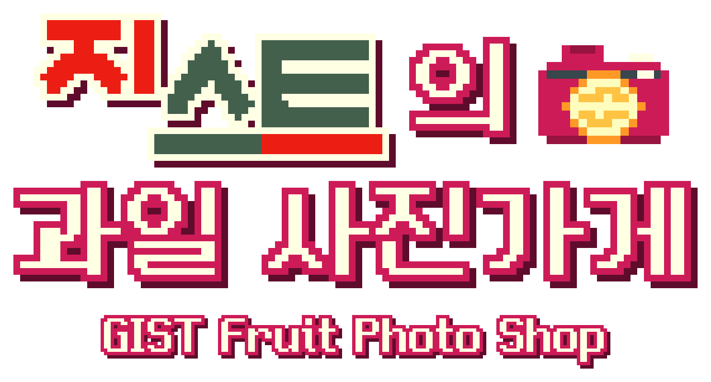
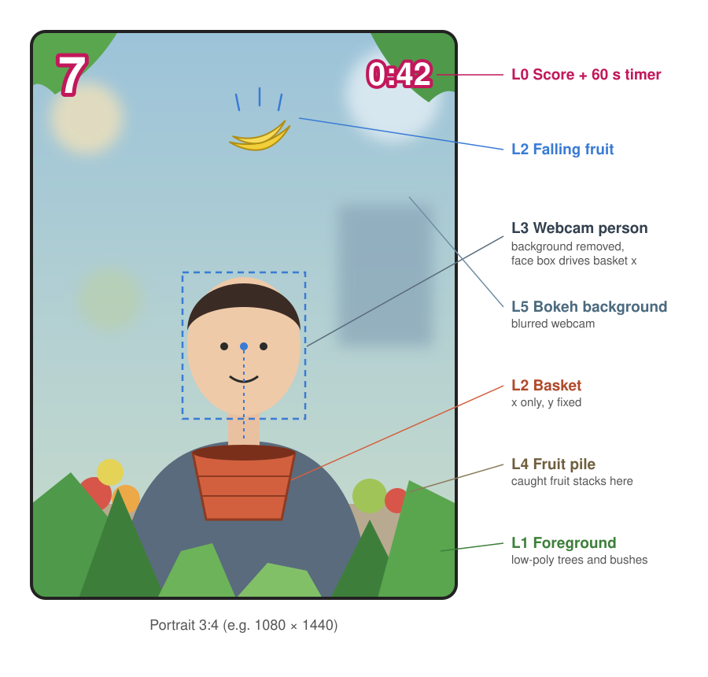

# 지스트의 과일 사진가게 (FruitGame)

**접근성을 중심으로 만든 인터랙티브 포토부스 애플리케이션입니다.**

웹캠 앞에 서서 고개만 움직여 짧은 과일 받기 게임을 하고, 직접 받은 과일과 함께 찍은 액자 사진을 가져갈 수 있습니다.

> **리디자인 진행 중:** 현재 로우폴리 스타일을 **픽셀/복셀 스타일**로 바꾸는 작업을 진행하고 있습니다. 아래 [로드맵](#로드맵)을 참고하십시오.

## 진행 방식

1. **보정** — 편하게 움직일 수 있는 만큼 고개를 좌우로 돌립니다. 움직임이 작아도 플레이 영역 전체를 사용할 수 있습니다.
2. **게임** — 바구니가 얼굴을 따라 움직입니다. 60초 동안 과일이 하나씩 떨어지며, 받은 과일은 플레이어 뒤에 차곡차곡 쌓입니다. 게임 중에 3·2·1 신호와 함께 사진이 세 번 자동으로 찍힙니다.
3. **촬영** — 쌓인 과일 앞에서 포즈를 취해 마지막 사진을 찍습니다. 자연스러운 뷰티 필터가 적용되고, 게임 중의 세 장과 함께 타이틀·점수·로고가 들어간 네컷 사진으로 완성됩니다.
4. **가져가기** — 사진을 인쇄하거나 QR 코드를 스캔해 휴대폰으로 내려받을 수 있습니다.

## 접근성

- **고개 움직임만으로 충분합니다:** 플레이어마다 보정을 거치므로, 고개를 움직일 수 있는 범위가 작아도 플레이 영역 전체를 오갈 수 있습니다.
- **마우스만으로 조작합니다:** 모든 화면을 마우스 하나로 다룰 수 있어 부스에 키보드가 필요하지 않습니다.
- **실수에 관대합니다:** 얼굴이 화면에서 벗어나면 자동으로 일시정지되고, 과일이 바구니 쪽으로 살짝 끌려오며, 목숨제가 아닌 시간제이므로 중간에 탈락하지 않습니다.

## 로드맵

게임 플레이, 얼굴 조작, 포토부스 기능은 완성되었으며(M1–M5, M7), 이제 시각 스타일을 새로 만듭니다. 자세한 내용은 [`Docs/DESIGN.md` §15](Docs/DESIGN.md)에 있습니다.

| 단계 | 내용 |
|---|---|
| **M8** 스타일 테스트 ✅ | 비교 결과 복셀 모델과 ½ 해상도 픽셀 렌더의 혼합으로 정했습니다. |
| **M9** 픽셀 글꼴 ✅ | 한글과 영문 모두 **Neo둥근모 Pro**로 통일했습니다. |
| **M10** 복셀 모델 ✅ | 기존 과일·바구니·나무·덤불을 복셀로 변환하는 도구를 만들어 적용했습니다. |
| **M11** 픽셀 렌더 ✅ | 게임 화면을 픽셀 아트처럼 렌더링하고, 플레이어 윤곽선과 디더링 원근 효과를 더했습니다. |
| **M12** 타이틀과 로고 ✅ | 시작 화면에 3D 복셀 타이틀 「지스트의 과일 사진가게」와 아이콘을 만들었습니다. |
| **M13** 3D UI ✅ | 키캡처럼 눌리는 버튼, 복셀 점수·타이머를 만들었습니다. |
| **M14** 사진 액자 ✅ | 네컷 사진(게임 중 세 장 + 마지막 사진)과 휴대폰 다운로드 페이지를 새 스타일로 바꿨습니다. |
| **M15** 한국어화 ✅ | 게임 안의 모든 문구를 한국어로 옮겼습니다(F3로 영어 전환). |
| **M6** 마무리 | 효과음, 설정 화면, macOS·Windows 빌드 등 마무리 작업을 합니다. |

## 실행 방법

- Unity **6000.6.7f1**(URP), macOS 또는 Windows.
- `Assets/FruitGame/Scenes/Game.unity`를 열고 Play를 누릅니다.
- 얼굴 조작에는 웹캠이 필요합니다. 특정 카메라를 사용하려면 `Assets/FruitGame/Config/GameConfig.asset`의 `preferredCameraName`을 설정합니다. 테스트 시 **F2**로 마우스/키보드 조작으로 전환할 수 있으며, **F1**을 누르면 추적 디버그 화면이 표시되고, **F3**을 누르면 한국어와 영어가 전환됩니다. 문구는 `Assets/FruitGame/Resources/Strings.txt`에서 수정할 수 있습니다.
- QR 다운로드를 사용하려면 휴대폰이 부스 컴퓨터와 같은 네트워크에 연결되어 있어야 합니다.

## 준비 (저장소에서 받은 경우)

재배포가 허용되지 않는 파일은 저장소에 포함되어 있지 않습니다. 해당 파일의 `.meta`는 저장소에 있으므로, **Unity로 프로젝트를 처음 열기 전에** 아래 파일을 같은 위치에 넣으면 모든 참조가 그대로 유지됩니다. (`.meta`만 있고 파일이 없는 상태로 먼저 열면 Unity가 `.meta`를 지우므로 참조가 끊어집니다.)

| 파일 | 위치 | 받는 곳 |
|---|---|---|
| `rvm_resnet50_fp32.onnx` | `Assets/FruitGame/ML/` | Robust Video Matting 저장소(github.com/PeterL1n/RobustVideoMatting)의 릴리스. **GPL-3.0** |
| `002_Pine_Tree.fbx`, `003_Oak_Tree.fbx`, `005_Cypress_Tree.fbx` | `Assets/FruitGame/Art/Models/Trees/` | Game Dev Skill Up의 *Low Poly Trees Asset Pack (Lite Version)*. 재배포 금지 |
| `Apple_01.fbx` … `Pineapple_02.fbx`(9종 × 2), `FruitAtlas.png`, `FruitAtlas_Far.png` | `Assets/FruitGame/Art/Models/Fruits/` | *Low Poly Food* 팩(`Fruits/*/<이름>_01·02.fbx`, 아틀라스는 팩의 `Texture.png`) |
| `SM_Fruits_*.fbx` 8개, `PolyOneAtlas.png`, `PolyOneAtlas_Far.png` | `Assets/FruitGame/Art/Models/FruitsPolyOne/` | Unity Asset Store의 *PolyOne Free Fruits*(아틀라스는 `Texture_BaseColor_v02.png`를 2048로 줄인 것) |
| `OrchardIllustration.png` (선택) | `Assets/FruitGame/Art/Backdrops/` | 출처 확인 필요(기본값에서는 사용하지 않음) |

프로젝트를 연 뒤 **FruitGame ▸ Voxels ▸ Bake Fruit**와 **Bake Scene**을 실행하면, 위 모델로 만든 복셀 메시(역시 저장소에서 제외됨)가 다시 생성됩니다.

## 문서

- [`Docs/DESIGN.md`](Docs/DESIGN.md): 상세 설계·구현 문서(영문)입니다. 게임 메커니즘, 조정값, 웹캠 처리 과정, 포토부스, 시각 스타일, 마일스톤과 로드맵, 결정 기록을 다룹니다.
- `Docs/images/`: 설계 문서에 사용된 다이어그램입니다.

## 출처 및 라이선스

- 얼굴 추적과 배경 분리는 Unity Inference Engine으로 기기 내에서 실행됩니다. MediaPipe BlazeFace·Face Mesh·Selfie Segmentation(Apache-2.0)과 Robust Video Matting(**GPL-3.0**)을 사용합니다. 자세한 내용은 `Assets/FruitGame/ML/CREDITS.txt`를 참고하십시오.
- 뷰티 필터는 GPUPixel(Apache-2.0)을 바탕으로 제작했습니다. `Assets/FruitGame/Art/Beauty/NOTICE.txt`를 참고하십시오.
- 글꼴: Neo둥근모 Pro(Dalgona, 김중태의 둥근모꼴 기반, SIL OFL 1.1).
- 3D 에셋: Low Poly Food, PolyOne Free Fruits, Low Poly Trees(재배포 불가), Kenney Nature Kit(CC0). 효과음: Kenney(CC0), 카메라 셔터 "Camera"(themightyglider, OpenGameArt, CC0).
